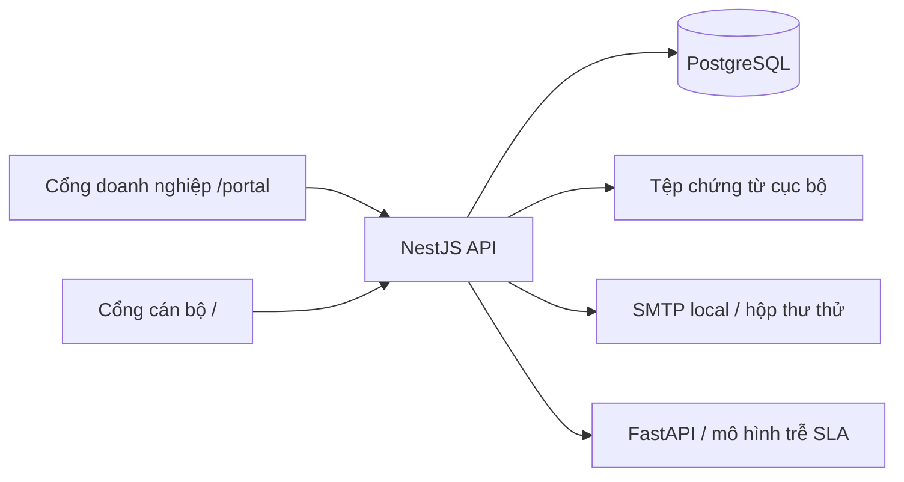

# SME KỸ THUẬT — cấu trúc, vận hành và nguồn kiểm chứng

Cập nhật khi hợp nhất tài liệu ngày 02/11/2026. Đọc nghiệp vụ, quyết định PO và **toàn bộ 7 đợt review** tại [SME_MASTER.md](SME_MASTER.md). File này là tài liệu tra cứu kỹ thuật; không tạo thêm plan/review/acceptance Markdown riêng cho từng đợt. Schema/source định nghĩa contract; bằng chứng runtime và quyết định PO có phạm vi riêng, không thay thế nhau.

<a id="cau-truc"></a>
## 1. Cấu trúc hệ thống



| Thành phần | Công nghệ / điểm vào | Trách nhiệm |
|---|---|---|
| Frontend | React, TypeScript, Vite; [App.tsx](../frontend/src/App.tsx) | Workspace cán bộ; `/portal` có phiên doanh nghiệp riêng |
| Backend | NestJS, Prisma 6.19; [main.ts](../backend/src/main.ts), [AppModule](../backend/src/app.module.ts) | Auth, phân quyền, validation, transaction, API, thông báo và tích hợp |
| Database | PostgreSQL; [schema.prisma](../backend/prisma/schema.prisma) | Nguồn dữ liệu bền vững; không thay bằng mock để che lỗi |
| ML service | FastAPI/scikit-learn; [main.py](../ml-service/app/main.py), [predictor](../ml-service/app/predictor.py) | Dự báo nguy cơ trễ SLA, không quyết định tín dụng |
| Tệp | [storage.ts](../backend/src/common/storage.ts), uploads của backend | Nội dung chứng từ; metadata/hash/version trong DB |
| Cấu hình | README, `start-use.ps1`, compose, các file env cục bộ | Chạy đúng target; không in/commit secret hoặc dump |

### Module và nguồn tra cứu

| Nhóm | Nguồn chính |
|---|---|
| Cán bộ / doanh nghiệp | [auth](../backend/src/modules/auth), [Portal auth](../backend/src/modules/portal/portal.auth.ts), [AuthContext](../frontend/src/context/AuthContext.tsx), [Portal client](../frontend/src/portal/client.ts) |
| Hồ sơ / Company | [loan-applications](../backend/src/modules/loan-applications), [companies](../backend/src/modules/companies) |
| Portal / checklist / các lần gửi | [PortalService](../backend/src/modules/portal/portal.service.ts), [approved policy](../backend/src/modules/portal/portal.approved-policy.ts), [intake workflow](../backend/src/modules/portal/portal.intake-workflow.ts) |
| Chứng từ / bổ sung | [documents](../backend/src/modules/documents), [supplements](../backend/src/modules/supplements) |
| Tờ trình | [appraisal](../backend/src/modules/appraisal), [AppraisalPanel](../frontend/src/components/AppraisalPanel.tsx) |
| Workflow / SLA | [workflow](../backend/src/modules/workflow/workflow.service.ts), [SLA](../backend/src/modules/workflow/sla) |
| Phân công / điều phối / COI / tải | [assignments](../backend/src/modules/assignments), [AssignmentsView](../frontend/src/components/AssignmentsView.tsx), [panel](../frontend/src/components/AssignmentChangeRequestPanel.tsx) |
| Thông báo | [notifications](../backend/src/modules/notifications), [NotificationBell](../frontend/src/components/NotificationBell.tsx), [target](../frontend/src/components/notificationTarget.ts) |
| Quản trị / giám sát / dự báo | [users](../backend/src/modules/users), [dashboard](../backend/src/modules/dashboard), [prediction](../backend/src/modules/prediction); cấu hình SLA tra module workflow |

<a id="du-lieu"></a>
## 2. Dữ liệu và contract cần giữ

Schema khi gộp có **25 model**, không dùng từ điển 11/14 bảng ở snapshot cũ làm hiện trạng. Tên bảng, field, enum, FK và default phải lấy từ [schema Prisma](../backend/prisma/schema.prisma); không chép một bản schema thứ hai vào tài liệu để rồi bị lệch.

| Nhóm | Model |
|---|---|
| Cán bộ / quyền | User, Role, UserRole |
| Doanh nghiệp / khoản vay | Company, LoanApplication |
| Tờ trình | AppraisalReport, AppraisalReportVersion, AppraisalReportEvent |
| Workflow / SLA | WorkflowStage, ApplicationStageHistory, ApplicationStagePause, SlaPolicyActivation |
| Chứng từ nội bộ | Document |
| Portal | PortalAccount, PortalRequest, PortalSubmission, PortalIntakeOperation, PortalIntakeIssue, PortalDocument |
| Phân công / điều phối / thông báo | PortalAssignment, ApplicationAssignment, AssignmentChangeRequest, InternalNotification |
| Bổ sung / dự báo | SupplementRequest, DelayPrediction |

Quan hệ chính: Company → Loan; PortalAccount → PortalRequest → submissions/documents; accept nối Portal với một Loan; Loan → lịch sử/chứng từ/bổ sung/tờ trình/dự báo. Đề nghị điều phối có đúng một cha Portal hoặc Loan; partial unique bảo đảm một PENDING theo cha. Hai loại phê duyệt (điều phối và tín dụng) có dữ liệu/API riêng.

### Khóa, phiên bản và quyền

- Đường ghi khóa và đọc lại cha trong transaction; không tin bản guard/UI đã đọc trước đó. Giữ thứ tự khóa, không gọi HTTP nội bộ để lồng giao dịch phân công.
- Phân công trực tiếp và approve điều phối dùng chung [assignment.transactions](../backend/src/modules/assignments/assignment.transactions.ts). Version phát hiện stale/ABA; UUID/hash chống lặp và dùng sai nội dung/người/phạm vi.
- [assignment-coordination](../backend/src/modules/assignments/assignment-coordination.ts) xử lý COI, obsolete và khóa actor/taxCode cho Company. Các guard chạy cả ở transaction riêng của Appraisal, Workflow, PortalSupplements và intake.
- `assignmentVersion` khác revision nội dung Portal; version tờ trình/snapshot/Company không được thay ngầm do điều chuyển. Retry trả biên nhận lịch sử và context hiện tại, không gọi lại ML.
- Thông báo điều phối ưu tiên mở biên nhận; quyền vào hồ sơ được xét lại, đặc biệt Portal đã ACCEPTED phải theo owner Loan hiện tại. Response công khai không chứa thông tin điều phối/COI.
- Tệp dùng hash/version/manifest; không sửa snapshot cũ để lấp thiếu dữ liệu, không annualize/fake0, không overwrite Company khi liên kết.

API điều phối: `GET /assignment-change-requests/capabilities`, list/detail, `POST` create, `POST /:id/approve|reject|cancel`. Các API nội bộ nằm dưới `/api`. Contract chi tiết lấy controller/service/DTO hiện tại; trạng thái và phạm vi đã nghiệm thu tra [review 2](SME_MASTER.md#review-2).

## 3. Chạy bản localhost đã được chuẩn bị

**Dữ liệu demo cho máy mới (06/11/2026):** sau khi `npm run prisma:push` và `npm run prisma:seed` (seed bật PA1, đặt định mức Tiếp nhận 112 giờ và Thẩm định 40 giờ), chạy `npm run build` rồi `npm run seed:demo` trong `backend` để có 7 tài khoản mô phỏng (1 Admin, 1 Quản lý, 3 CBTD, 2 Thẩm quyền; danh sách ở [README](../README.md#tai-khoan-noi-bo)) và 194 hồ sơ quá khứ kèm lịch sử SLA và dự báo (cần ml-service đang chạy). Mật khẩu lấy từ biến `DEMO_PASSWORD`; không đặt thì sinh ngẫu nhiên và in một lần. Script từ chối chạy khi `NODE_ENV=production`. Chạy lặp an toàn; **trước mỗi buổi demo chạy lại với `-- --reset`** vì đồng hồ SLA của hồ sơ mở vẫn chạy sau khi dựng. Dọn bộ tài khoản cũ: `npm run accounts:tidy`. Chi tiết và cách gỡ: đầu tệp [seed-demo.cjs](../backend/scripts/seed-demo.cjs). Đây là dữ liệu mô phỏng, không phải dữ liệu thật.

```powershell
.\start-use.ps1
```

| Dịch vụ | Địa chỉ thường dùng |
|---|---|
| Trang chủ công khai | http://localhost:5173/ |
| Cán bộ (đăng nhập nội bộ) | http://localhost:5173/noi-bo |
| Doanh nghiệp | http://localhost:5173/portal |
| API / health | http://localhost:3000/api/health |
| ML / health | http://localhost:8000/health |
| Hộp thư local | http://localhost:8025/; SMTP loopback 1025 |
| PostgreSQL local | localhost:5432; cấu hình thật trong env cục bộ, không đưa credential vào tài liệu |

`start-use` khởi động dịch vụ còn thiếu, không tự migration/push/seed và không thay process đang chạy. Python dùng `-X utf8` để tránh UnicodeEncodeError khi chạy ẩn. Script giả định DB/dependency/build đã được chuẩn bị; máy mới không được coi là đã setup chỉ vì có script.

Docker API có thể dùng 3001 theo compose; không nhầm với local API 3000 hoặc các cổng test. Health ready chỉ chứng minh dịch vụ sẵn sàng tại thời điểm gọi, không thay kiểm thử nghiệp vụ.

Chỉ đọc [mẫu env](../.env.example) để biết biến; dùng env cục bộ đúng môi trường, giữ JWT secret ổn định qua restart. Không chép account test cũ hoặc mật khẩu vào hai tài liệu chính. Cán bộ dùng tài khoản được cấp; DN dùng xác minh/forgot/reset. Mail local không tự gửi đến hộp thư internet.

Không dùng startup khác một cách máy móc: `start-local.ps1`/`run-local-dev.ps1` có thể push/seed. Phải đọc side effect và quyền dữ liệu trước khi chạy.

## 4. Migration và phát hành

| SQL cộng thêm | Phạm vi |
|---|---|
| [portal-intake-cycle.sql](../backend/prisma/portal-intake-cycle.sql) | Các lần gửi/review/return/issue của Portal |
| [portal-supplements.sql](../backend/prisma/portal-supplements.sql) | Bổ sung có cấu trúc sau tiếp nhận |
| [sme-branch-rollout.sql](../backend/prisma/sme-branch-rollout.sql) | Chính sách chi nhánh/tờ trình/rollout đã ghi nhận |
| [portal-account-recovery.sql](../backend/prisma/portal-account-recovery.sql) | Phục hồi Portal và authVersion |
| [round2-assignment-safety.sql](../backend/prisma/round2-assignment-safety.sql) | Version và idempotency phân công |
| [round2-assignment-coordination.sql](../backend/prisma/round2-assignment-coordination.sql) | Đề nghị điều phối, liên kết history/notices, FK/index/CHECK |
| [document-codes.sql](../backend/prisma/document-codes.sql) | Hai PostgreSQL sequence sinh `DN-1`/`SME-1`; giữ mã cũ, tiếp nối số ngắn đã có, chạy lại không reset |
| [renumber-document-codes.sql](../backend/prisma/renumber-document-codes.sql) | Chuyển mã cũ sang định dạng ngắn theo quyền riêng của PO; chỉ đổi hai cột mã, giữ mã ngắn đã cấp và trả bảng đối chiếu |

Danh sách là nguồn tra cứu, không phải lệnh áp tất cả SQL lên bất kỳ DB nào. Trước áp dụng cần xác định target, đối chiếu schema hiện có, backup và khôi phục thử, kiểm SQL lặp/schema diff/dữ liệu cũ, regenerate client/build tương ứng rồi smoke có cleanup. Không reset/seed DB dùng chung hoặc drop cột để quay về UI cũ.

Ngày 01–02/11 đã có bằng chứng áp dụng localhost, không suy ra mọi DB đã cập nhật. [Release đợt 1](../evidence/reviews/round-1/release.json), [release đợt 2](../evidence/reviews/round-2/release.json), [smoke đợt 2](../evidence/reviews/round-2/live-smoke.json). Dump/env/upload backup thật là dữ liệu cục bộ được quản lý riêng, không sao chép vào tài liệu/evidence chia sẻ.

**Mã hồ sơ rút gọn (05/11/2026):** áp `document-codes.sql` trước khi khởi động backend mới. PortalService.create cấp `DN` khi tạo bản nháp; PortalService.accept và LoanApplicationsService.create dùng chung bộ đếm `SME`. UUID, unique constraint và các mã đã lưu giữ nguyên; không cần Prisma generate hoặc đổi schema. SQL chỉ thêm hai sequence và khởi tạo bằng số ngắn lớn nhất + 1 khi sequence chưa tồn tại; không reset sequence đã có. PostgreSQL `nextval` bảo đảm cấp số đồng thời, có thể bỏ số khi rollback và không được reset để lấp số khuyết. Khi restore cần giữ cả sequence; nếu thiếu sequence, backend báo lỗi thay vì tự sinh mã khác.

Kiểm tra độc lập: `npm.cmd --prefix backend run test:document-codes`; kiểm tra service–Prisma–PostgreSQL tạm: `npm.cmd --prefix backend run check:document-codes` (Docker, image `postgres:16-alpine` đã có, không pull, tự dọn container/volume thử). Script này không dùng DATABASE_URL của hệ thống đang vận hành. Trạng thái áp dụng local và bằng chứng nằm tại mục mã hồ sơ rút gọn trong [Master](SME_MASTER.md#nhom-1).

**Chuyển mã cũ theo yêu cầu PO bổ sung 05/11/2026:** `renumber-document-codes.sql` là thao tác dữ liệu riêng, không chạy tự động khi startup hay cùng SQL tạo sequence. Yêu cầu backup/restore thử và giữ bảng mã cũ → mới riêng. SQL khóa hai bảng, dùng sequence hiện hành cho các mã chưa đúng dạng ngắn theo thứ tự created_at/id, kiểm mọi dữ liệu ngoài hai trường mã trong transaction; lỗi/xung đột sẽ rollback. Mã ngắn đã cấp và nội dung lịch sử/snapshot không được viết lại. Chạy lại không đổi mã hoặc tiêu thụ số; không reset sequence để lấp chỗ khuyết. Kiểm tra tạm riêng bằng `node backend/scripts/check-document-codes.cjs --isolated --renumber` từ root; kết quả local tại mục chuyển mã cũ trong Master.

## 5. Kiểm thử và ý nghĩa bằng chứng

```powershell
npm.cmd --prefix backend run build
npm.cmd --prefix backend test
npm.cmd --prefix frontend run build
npm.cmd --prefix frontend run test:intake
```

Đọc package scripts hiện tại trước dùng; không mặc định có `lint`, `pytest` hoặc suite khác. Build không thay kiểm thử quyền, transaction, dữ liệu bền vững hoặc UI.

Runner HTTP/DB/browser gồm `backend/scripts/check-sme-rollout.cjs`, `check-round2-assignments.cjs`, `check-assignment-safety.cjs` và `frontend/scripts/check-sme-rollout-browser.mjs --round2 --package-a`. Chúng **tạo/xóa dữ liệu thử**, chỉ chạy khi đã xác định đúng target/quyền và cổng trống. Harness sở hữu schema `portal_v2_it_*` và uploads riêng, có teardown; không dùng với production hoặc thay bằng seed/reset public.

Với UI: xem screenshot desktop/mobile và DOM, thực thi hành vi, đối chiếu DB khi cần. Fault injection ở transport/dependency là kiểm thử lỗi, không được dùng làm mock thay cho lưu dữ liệu hoặc sinh xác suất giả.

Số test tại mỗi mốc thuộc bộ ca/lần chạy đó, không cộng thành % hệ thống. Lượt gộp tài liệu này chỉ kiểm backup, link, cấu hình công cụ và tính nhất quán; không chạy lại các test nghiệp vụ/DB để tạo bằng chứng mới. Kết quả cũ được giữ tại [manifest bằng chứng](../evidence/reviews/manifest.json) và trích đúng phạm vi trong Master.

## 6. SLA: quyết định và activation khác nhau

PA1 đã được PO lựa chọn: giờ VN, thứ Hai–thứ Sáu 08–12h và 13–17h, lịch nghỉ được xác nhận; chỉ công đoạn mở mới theo activation mới, lịch sử cũ giữ policy/calendar snapshot. Pause theo thời gian chờ DN; DN chính thức gửi đủ phản hồi thì chuyển trách nhiệm về ngân hàng, không tính chỉ việc tải một tệp lẻ là gửi đủ.

Code có calculator/interval/policy và kiểm thử PA1. Tài liệu hợp nhất không tự xác nhận DB bất kỳ đã có lịch ngày nghỉ, thời điểm hiệu lực hoặc activation. Dự báo cho hồ sơ có dữ liệu giờ làm việc PA1 có nhánh không tương thích; không giả xác suất hoặc đổi model để che khác nghĩa feature.

<a id="ml"></a>
## 7. ML: phạm vi và giới hạn báo cáo

> **Cập nhật 06/11/2026:** mô hình triển khai hiện là **v4.0** (hai mô hình theo công đoạn, nhận biết SLA theo giờ làm việc, hợp đồng `/predict` mới, trạng thái `UNAVAILABLE` thay `INCOMPATIBLE_PA1`). Mô tả, kết quả và giới hạn: [SME_MASTER mục 5](SME_MASTER.md#trang-thai-mo-hinh). Cách tái lập: `ml-service/experiments/v3` (`simulate_v4.py` → `train_v4.py`, chạy trong container `smesystem-ml-service`, xem README ở đó). Đoạn dưới đây mô tả mô hình v1 lịch sử (`delay_model.joblib` vẫn còn trong repo để rollback), không còn là mô hình đang chạy.

Mô hình lịch sử `v1.0-rf` là Random Forest, dữ liệu **synthetic**. Báo cáo lưu ngày 24/10 nêu 3.000 mẫu, tập kiểm thử 600, accuracy 0,9700, precision 0,8267, recall 0,9254, F1 0,8732 và ROC-AUC 0,9927. Đây là số liệu lịch sử trên dữ liệu tổng hợp, không phải đánh giá vừa chạy khi gộp tài liệu và không chứng minh hiệu quả ngân hàng thật. Báo cáo đầy đủ/công thức sinh nhãn/cross-validation/threshold được giữ nguyên trong ZIP lịch sử.

Nguồn tái lập: [scripts ML](../ml-service/scripts), [schema API](../ml-service/app/schemas.py), [metadata model](../ml-service/app/model/model_metadata.json), [dịch vụ gọi/lưu dự báo](../backend/src/modules/prediction/prediction.service.ts). Không chạy training hoặc ghi đè model trong công việc tài liệu.

10 feature được ghi nhận: số tiền, thời hạn, tuổi doanh nghiệp, doanh thu năm, debt/equity, số bổ sung, workload cán bộ, thời gian tiếp nhận, loại vay và ngành. Số workload hiển thị Loan+Portal không tự thay feature extraction. Top reasons có heuristic, không mặc nhiên là SHAP/nhân quả. Không dùng nguy cơ trễ SLA làm duyệt/từ chối tín dụng hoặc suy ra nợ xấu.

Kết quả workflow/bàn giao và kết quả ML tách riêng. Có UPDATED/FAILED/INCOMPATIBLE_PA1/NOT_REPEATED; lỗi ML không đảo ngược giao dịch nghiệp vụ đã commit. Smoke localhost 02/11 đã ghi nhận cập nhật dự báo thật sau khi sửa cấu hình mã hóa khởi động, không đánh giá lại độ chính xác mô hình.

<a id="huong-dan-ai"></a>
## 8. Hướng dẫn AI và quyền thao tác

Policy hiện hành **sme-loan-ai-v1.2** nằm tại [AGENTS root](../AGENTS.md), [core](../.agents/AGENTS.md), [preflight](../.agents/workflow/preflight.md), [impact analysis](../.agents/workflow/impact-analysis.md) và [setup host](../.agents/AI-SETUP.md). Không thay chính sách bằng snapshot lịch sử trong ZIP hoặc JSON `original-rules`.

- SME-AI-011: đúng phạm vi PO; phương án thay thế/mở rộng nghiệp vụ cần PO duyệt trước, không hỏi lại quyền đã có.
- SME-AI-012: phân tích ngang, rồi truy vết sâu cha → con → cháu cả callers/callees/consumer; kiểm chứng xuyên suốt phần được duyệt. CodeGraph hỗ trợ cấu trúc, source/HTTP/DI/ORM nối các biên động.
- Chỉ giải thích/review thì không tự sửa; đã giao triển khai thì thực hiện và đưa kết quả cụ thể. Không tự đổi role/ngưỡng/SLA/ý nghĩa ML, không che backend bằng mock, không commit/push hoặc tạo subagent ngoài quyền được cấp.
- Với 7 nhóm, plan/review/approval/acceptance chỉ cập nhật trong Master. Vị trí file mặc định của thư viện skill không tạo thêm Markdown trong `docs`; không thay vendor SKILL.md.
- Hướng dẫn cấu hình không chứng minh host tự nạp đúng. Codex/Antigravity cần smoke ở phiên mới; giữ riêng mô phỏng và thực thi thật. Không tự tuyên bố nghiệm thu host chỉ từ validator tĩnh.

Tám báo cáo AI cũ được gộp ở mức hướng dẫn còn dùng; toàn bộ bằng chứng setup giữ byte-for-byte trong ZIP. Các JSON `docs/ai/acceptance-scenarios.json`, `skills-inventory.json`, `original-rules.json`, `validator-fixture-results.json`, `codegraph-verification.json` là fixture/snapshot cần giữ, không phải tài liệu vận hành mới hoặc lệnh tự thực thi.

<a id="quy-trinh-codegraph"></a>
## 9. Quy trình CodeGraph bắt buộc

Với công việc phụ thuộc source, AI tự chạy bằng terminal của host tại root:

```powershell
npm.cmd run graph:check
# Nếu cũ/thiếu:
npm.cmd run graph:build
npm.cmd run codegraph -- context transitionStage --file backend/src/modules/workflow/workflow.service.ts --no-source --json
npm.cmd run codegraph -- deps backend/src/modules/workflow/workflow.service.ts --json
npm.cmd run codegraph -- fn-impact predictForApplication --file backend/src/modules/prediction/prediction.service.ts --json
```

Đọc source/contracts tại các điểm liên quan, kiểm callers/consumers và transaction; sau sửa source/config phải làm mới/check graph trước bàn giao. Với tác vụ chỉ đọc tài liệu không phụ thuộc cấu trúc source, không cần build graph máy móc.

CodeGraph cục bộ ghim **3.17.0** theo package/lock. Adapter kiểm freshness/hash và wrapper giới hạn subcommand cấu trúc, tắt update-check/global config; không bypass wrapper bằng binary để né check. Thiếu dependency dùng `npm ci` theo lockfile trong quyền đã có, không tự npx/global-install hoặc bật server/watch/embedding.

Allowlist: `backend/src`, `frontend/src`, `ml-service/app`, `ml-service/scripts`, `backend/scripts`, `scripts`. Không index `.env`, dump/vault, model/dataset, uploads, vendor hoặc nội dung bí mật. Cache `.codegraph/` chứa cấu trúc source, giữ cục bộ, không commit/chia sẻ. Số node/file là snapshot của lần build, không phải độ hoàn thiện hay bảo đảm hồi quy.

Nguồn cơ chế thực tế: [adapter](../scripts/check-codegraph.mjs), [wrapper](../scripts/run-codegraph.mjs), [.codegraphrc](../.codegraphrc.json), [manifest route](../.agents/skills.json). Thay allowlist/phiên bản phải review wrapper/config/lock và kiểm thử phù hợp, không sửa dấu/hash để tạo kết quả xanh.

<a id="kiem-chung-ai"></a>
## 10. Kiểm chứng cấu hình AI và tài liệu

```powershell
node scripts/check-ai-rules.mjs
npm.cmd run graph:check
```

Validator tĩnh kiểm required files, các liên kết, core 12 policy, routing/trigger, 56 vendor skill hashes và fixture scenario. Nó không chạy app/DB/host AI, không thay UAT và không tự cấp quyền thao tác.

Baseline trước gộp: **380 PASS / 6 FAIL**. Lỗi sẵn có gồm thiếu `GEMINI.md` (nonempty/bootstrap/hard-rules và hai liên kết) cùng link tài liệu use case đã không tồn tại. Đã thay required doc paths bằng hai tài liệu mới và sửa các liên kết; giữ kiểm tra GEMINI, core policy, kỹ năng và scenario.

Sau gộp 02/11: **415 PASS / 3 FAIL** trên checkout. Ba lỗi còn lại đều do file `GEMINI.md` đã thiếu từ trước: nonempty, tham chiếu policy và wiring SME-AI-011/012. Không tạo host entry ngoài phạm vi hoặc bỏ kiểm tra để báo đạt. Kiểm tra 56 vendor skill hashes vẫn đạt.

`node scripts/check-ai-rules.test.mjs` đạt **18/18** ca. Fixture tạm dùng GEMINI giả lập hợp lệ để kiểm thử chính validator và các trường hợp cấu hình sai; không tạo GEMINI ở checkout và không chứng minh host Gemini đã được cấu hình. Kiểm tra syntax hai script đạt; CodeGraph đã làm mới, 174 file / 3.493 node / 6.951 edge. Kiểm tra riêng 180 link/anchor tại 14 Markdown hiện hành đạt, sáu JSON và 15 tệp bằng chứng giữ nguyên SHA-256. Đây là nghiệm thu hợp nhất tài liệu, không phải nghiệm thu lại ứng dụng.

<a id="sao-luu-tai-lieu"></a>
## 11. Sao lưu, nguồn gốc và khôi phục tài liệu

[ZIP trước hợp nhất](../archive/docs-before-consolidation-2026-11-02.zip) chứa nguyên trạng 26 Markdown + 6 JSON trong `docs`, 13 file entrypoint/tham chiếu và `manifest.json` SHA-256. Đã kiểm khớp byte từng file trước khi xóa bản rời. ZIP là lịch sử cục bộ, không phải bản hướng dẫn hiện hành; không đưa vào phát hành công khai khi chưa rà dữ liệu.

Có thể giải nén để **đọc/đối chiếu riêng**, không tự ghi đè hai tài liệu hiện tại:

```powershell
Expand-Archive -LiteralPath archive/docs-before-consolidation-2026-11-02.zip -DestinationPath .codex_tmp/docs-restore
```

Manifest trong ZIP giữ đường dẫn và hash cũ; tên entry có thể dùng dấu phân cách Windows. Không dùng nguyên trạng hướng dẫn cũ để seed/migrate hoặc bật policy. Việc khôi phục thay thế tài liệu/nguồn phải có đúng phạm vi được giao.

15 bằng chứng đã chuyển byte-for-byte sang `evidence/reviews`, có [manifest riêng](../evidence/reviews/manifest.json). Không chuyển dump, env, token hoặc mật khẩu vào thư mục bằng chứng. Các ảnh/bằng chứng cũ đã mất không được ghi thành vừa xác minh hoặc tự dựng lại.
