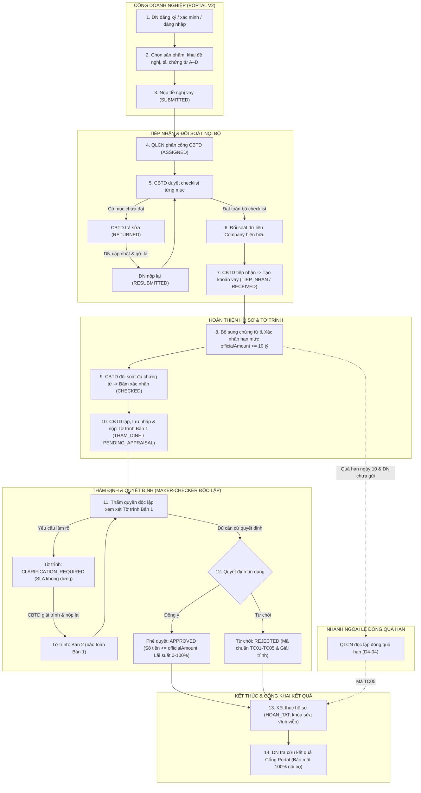
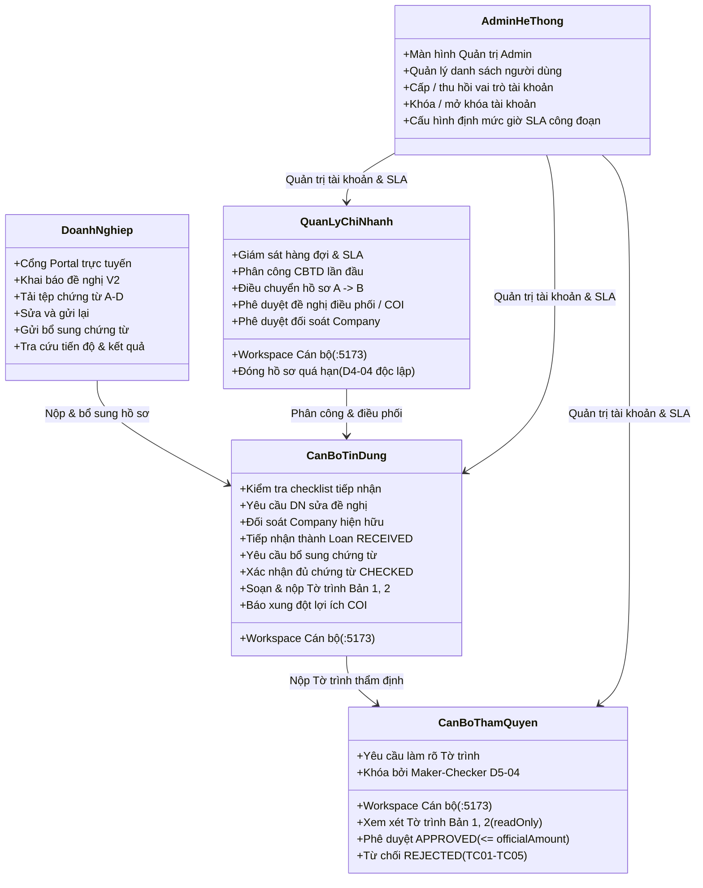

# SME MASTER — Tài liệu Nghiệp vụ và Vận hành Hệ thống SME Loan Workflow

Cập nhật ngày 02/11/2026. Đây là **tài liệu nghiệp vụ duy nhất và toàn diện của hệ thống SME Loan Workflow**, phục vụ Product Owner (PO) và người tiếp nhận dự án nắm bắt đầy đủ luồng quy trình thực tế, trách nhiệm của 5 actor, chi tiết 7 nhóm chức năng, trạng thái triển khai kiểm chứng, và các hạng mục bàn giao tiếp theo.

Cấu trúc code, cơ sở dữ liệu, quy trình CodeGraph và hướng dẫn vận hành kỹ thuật được lưu trữ tại [SME_KY_THUAT.md](SME_KY_THUAT.md). Quyết định trực tiếp của PO trong hội thoại có hiệu lực cao nhất.

---

### Mục lục liên kết nhanh
- [1. Luồng quy trình chính từ Doanh nghiệp đến Quyết định cuối](#luong-quy-trinh-chinh)
- [2. Trách nhiệm của đúng 5 Actor trong hệ thống](#trach-nhiem-5-actor)
- [3. Chi tiết 7 Nhóm chức năng hệ thống](#bay-nhom-chuc-nang)
  - [Nhóm 1 — Tài khoản và đề nghị Portal](#nhom-1)
  - [Nhóm 2 — Hàng đợi, phân công và điều phối](#nhom-2)
  - [Nhóm 3 — Kiểm tra và tiếp nhận](#nhom-3)
  - [Nhóm 4 — Chứng từ và bổ sung](#nhom-4)
  - [Nhóm 5 — Tờ trình và làm rõ](#nhom-5)
  - [Nhóm 6 — Quyết định và kết thúc](#nhom-6)
  - [Nhóm 7 — Quản trị và phân quyền](#nhom-7)
- [4. Chuẩn hóa trạng thái và Lịch sử các đợt review](#chuan-hoa-trang-thai)
  - [Bảng tổng hợp trạng thái chuẩn hóa 7 nhóm chức năng](#bang-tong-hop-7-nhom)
  - [Lịch sử các đợt review và thay thế các quyết định hoãn](#lich-su-review)
  - [Kết quả kiểm chứng thực nghiệm E2E trên hệ thống local đang chạy](#kiem-chung-local-e2e)
- [5. Trạng thái mô hình Machine Learning](#trang-thai-mo-hinh)
- [6. Kế hoạch bàn giao cho người tiếp nhận dự án](#ban-giao-nguoi-tiep-nhan)
  - [A. Điều chỉnh mô hình ML áp dụng vào hệ thống SME](#ke-hoach-dieu-chinh-mo-hinh)
  - [B. Kế hoạch gỡ chức năng "Quản lý vấn đề hồ sơ"](#ke-hoach-go-quan-ly-van-de)
- [7. Quyết định PO và các ranh giới bất biến phải giữ](#quyet-dinh-po-va-ranh-gioi)

---

## 1. Luồng quy trình chính từ Doanh nghiệp đến Quyết định cuối

Hệ thống SME Loan Workflow quản lý trọn vẹn vòng đời khoản cấp tín dụng cho doanh nghiệp vừa và nhỏ (SME) tại một chi nhánh ngân hàng, bắt đầu từ Cổng Doanh nghiệp trực tuyến (Portal V2) đến quy trình thẩm định nội bộ đa tầng và ra quyết định cuối cùng.

### Sơ đồ luồng nghiệp vụ tổng thể (14 bước liên hoàn)

### Bảng diễn giải chi tiết 14 bước quy trình

| Bước | Hành động nghiệp vụ | Actor thực hiện | Trạng thái hệ thống | Kết quả & Bằng chứng nghiệp vụ |
|---|---|---|---|---|
| **1** | Đăng ký tài khoản, nhận OTP xác minh email loopback, đăng nhập cổng trực tuyến. | Doanh nghiệp | `PORTAL_ACTIVE` | Tài khoản Portal được kích hoạt; phiên làm việc gắn token riêng biệt. |
| **2** | Chọn sản phẩm vốn lưu động (sản xuất / thương mại / dịch vụ), khai báo doanh thu năm hoàn thành, tải tài liệu 4 nhóm A–D. | Doanh nghiệp | `DRAFT` | Bản nháp được lưu trữ cô lập theo phiên; liên kết chứng từ với cơ sở doanh thu. |
| **3** | Rà soát cam kết đại diện pháp luật và nộp chính thức đề nghị vay. | Doanh nghiệp | `SUBMITTED` | Tạo bản ghi đề xuất lần 1 (`submission sequence: 1`), chụp snapshot hồ sơ, khóa sửa đổi trực tiếp. |
| **4** | Quản lý chi nhánh theo dõi hàng đợi tiếp nhận, phân công CBTD phụ trách hồ sơ. | Quản lý (QLCN) | `ASSIGNED` | Khóa phiên bản `expectedRevision`, kiểm tra cán bộ hoạt động (`isActive: true`), gửi thông báo chuông cho CBTD. |
| **5** | CBTD kiểm tra đối soát từng mục trong checklist chứng từ và dữ liệu kê khai. | CBTD | `ASSIGNED` | Đánh giá từng mục: `ACCEPTED` (Chấp nhận) hoặc `NEEDS_CORRECTION` (Cần chỉnh sửa). |
| **6** | Nếu có sai sót, CBTD tổng hợp danh sách cần sửa và bấm "Trả đề nghị để chỉnh sửa". | CBTD | `RETURNED` | Đề nghị mở khóa cho DN chỉnh sửa; API cán bộ tiếp tục phục vụ bản đã nộp, không rò rỉ dữ liệu nháp đang sửa. |
| **7** | DN nhận thông báo, tải tệp thay thế hoặc cập nhật số liệu và nộp lại đề nghị. | Doanh nghiệp | `RESUBMITTED` | Tạo lần nộp mới (`sequence: 2`); kế thừa toàn bộ các mục nhóm khác đã được duyệt đạt trước đó. |
| **8** | CBTD kiểm tra đạt toàn bộ checklist, thực hiện đối soát Company nếu MST đã tồn tại. | CBTD & QLCN | `RESUBMITTED` | Nếu MST đã có: đối soát căn cứ; QLCN xác nhận đối soát thì cập nhật Company (chụp snapshot cho các hồ sơ vay cũ). |
| **9** | CBTD xác nhận đạt điều kiện và bấm "Tiếp nhận đề nghị". | CBTD | `TIEP_NHAN / RECEIVED` | Tạo đúng 1 bản ghi khoản vay nội bộ `LoanApplication`; đề nghị Portal chuyển `ACCEPTED`, khóa vĩnh viễn việc nộp lại. |
| **10** | Rà soát danh mục chứng từ, phát hành yêu cầu bổ sung nếu cần, xác định hạn mức chính thức (`officialAmount ≤ 10 tỷ`). | CBTD & DN | `SUPPLEMENT_REQUIRED` hoặc `RECEIVED` | Khi có yêu cầu bổ sung: SLA PA1 tạm dừng (`pausedAt`). DN gửi đủ tệp: SLA tiếp tục chạy. Hạn mức chi nhánh tối đa đúng 10 tỷ VNĐ. |
| **11** | Sau khi đủ chứng từ, CBTD trực tiếp bấm "Xác nhận hồ sơ đầy đủ" trên giao diện. | CBTD | `TIEP_NHAN / CHECKED` | Chuyển trạng thái `CHECKED`, thỏa mãn điều kiện bắt buộc để chuyển sang bước lập tờ trình thẩm định. |
| **12** | CBTD nhập 8 trường đánh giá tín dụng trong `AppraisalPanel`, bấm "Lưu nháp" rồi bấm "Trình tờ trình". | CBTD | `THAM_DINH / PENDING_APPRAISAL` | Tạo bản ghi bất biến Tờ trình Bản 1 (`AppraisalReportVersion sequence: 1`), tính mã băm căn cứ `evidenceHash`, tự động chuyển công đoạn Thẩm định. |
| **13** | Thẩm quyền độc lập xem xét; nếu cần giải trình thêm thì bấm "Yêu cầu làm rõ tờ trình". | Thẩm quyền & CBTD | `CLARIFICATION_REQUIRED` | Tờ trình mở quyền sửa cho CBTD; SLA công đoạn KHÔNG tạm dừng. CBTD giải trình và nộp lại -> Tạo Tờ trình Bản 2. |
| **14** | Thẩm quyền độc lập kiểm tra bản mới nhất, đối soát `evidenceHash`, thực hiện Phê duyệt hoặc Từ chối. | Cán bộ Thẩm quyền | `HOAN_TAT / APPROVED` hoặc `REJECTED` | Kiểm tra Maker-Checker 3 tầng; cập nhật `completedAt`, đóng `stageHistory`, vô hiệu hóa điều phối chờ; DN tra cứu kết quả an toàn trên Portal. |

### Bốn nguyên tắc nghiệp vụ cốt lõi bắt buộc nắm rõ

1. **Đủ dữ liệu gửi không đồng nghĩa ngân hàng đã kiểm tra đạt:**
   Doanh nghiệp tải lên đủ tài liệu theo danh mục và nộp thành công chỉ là điều kiện cần để hệ thống chuyển trạng thái sang `SUBMITTED`. Ngân hàng bắt buộc phải phân công CBTD rà soát từng mục, kiểm tra tính hợp pháp, hợp lệ và logic tài chính. Chỉ khi CBTD duyệt đạt 100% checklist thì đề nghị mới đủ điều kiện để tiếp nhận.
2. **Tiếp nhận không tự chuyển `CHECKED`:**
   Khi CBTD bấm "Tiếp nhận", hệ thống tạo khoản vay `LoanApplication` ở công đoạn `TIEP_NHAN` với trạng thái ban đầu là `RECEIVED`. Trạng thái này tuyệt đối **không tự động chuyển sang `CHECKED`**. CBTD phụ trách phải trực tiếp đối soát lại toàn bộ hồ sơ trong môi trường nội bộ, cập nhật hạn mức chính thức và chủ động bấm nút "Xác nhận hồ sơ đầy đủ" (`checkDocuments`) thì hồ sơ mới đạt trạng thái `CHECKED`.
3. **Đóng quá hạn là nhánh ngoại lệ đặc biệt:**
   Đóng quá hạn bổ sung chứng từ (`CLOSED_TIMEOUT`) là nghiệp vụ ngoại lệ dành riêng cho Quản lý chi nhánh (`QUAN_LY`) theo quy định DEC-02 / TK-08. Thao tác chỉ được phép khi: hồ sơ đang ở trạng thái `SUPPLEMENT_REQUIRED`, đã quá hạn 10 ngày lịch (giờ Việt Nam UTC+7, mốc cuối tuần dời sang thứ Hai), doanh nghiệp chưa gửi đủ chứng từ, và QLCN phải độc lập hoàn toàn theo quy tắc D4-04 (`assignedTo !== user.id && intakeOfficerId !== user.id`). Đây không phải quy trình tự động của hệ thống hay của CBTD/Thẩm quyền.
4. **Machine Learning chỉ cảnh báo nguy cơ trễ SLA, không quyết định tín dụng:**
   Mô hình ML tích hợp trong hệ thống chỉ có một nhiệm vụ duy nhất: phân tích các thuộc tính vận hành để dự báo xác suất và nguyên nhân hồ sơ có thể bị **trễ hạn xử lý công đoạn (SLA delay risk)** nhằm hỗ trợ cán bộ chủ động điều phối. Mô hình tuyệt đối **không chấm điểm tín dụng, không đánh giá khả năng trả nợ và không thay thế quyết định phê duyệt/từ chối của con người**.

---

## 2. Trách nhiệm của đúng 5 Actor trong hệ thống

Hệ thống phân định rành mạch quyền hạn, trách nhiệm và giới hạn thao tác của đúng 5 nhóm đối tượng người dùng.

### 1. Doanh nghiệp (Cổng Portal Doanh nghiệp)
* **Kênh truy cập:** Cổng Portal trực tuyến tại địa chỉ `http://localhost:5173/portal`.
* **Chức năng thực hiện:** Đăng ký tài khoản doanh nghiệp; nhận mã OTP xác thực email; đăng nhập và phục hồi mật khẩu; chọn gói sản phẩm vốn lưu động V2 (sản xuất / thương mại / dịch vụ); nhập liệu phương án vốn, thông tin tài chính và tải lên chứng từ 4 nhóm (A, B, C, D); ký cam kết đại diện và nộp đề nghị vay; tiếp nhận thông báo trả sửa, cập nhật tệp/dữ liệu và nộp lại; tải lên chứng từ bổ sung theo yêu cầu; tra cứu tiến độ xử lý và xem kết quả công khai.
* **Quan hệ công việc:** Nhận yêu cầu chỉnh sửa/bổ sung từ CBTD; gửi hồ sơ đã hoàn thiện cho CBTD và Quản lý chi nhánh; nhận kết quả phê duyệt hoặc từ chối từ ngân hàng.
* **Thời điểm được sửa / chỉ xem / bị chặn:**
  * *Được sửa:* Khi hồ sơ đang ở trạng thái `DRAFT` hoặc khi bị ngân hàng trả về yêu cầu sửa đổi (`RETURNED`).
  * *Chỉ xem:* Khi hồ sơ đã nộp thành công (`SUBMITTED`), đang phân công (`ASSIGNED`), đã tiếp nhận thành khoản vay (`ACCEPTED`), hoặc đã kết thúc (`HOAN_TAT`).
  * *Bị chặn:* Bị chặn chỉnh sửa trực tiếp khi hồ sơ đang trong quá trình ngân hàng xem xét hoặc đã kết thúc quy trình.
* **Giới hạn quyền quan trọng:** Tài khoản Portal hoàn toàn tách biệt với tài khoản cán bộ ngân hàng; chỉ xem được dữ liệu thuộc quyền sở hữu của chính tài khoản mình; tuyệt đối không xem được danh tính cán bộ nội bộ, ghi chú nội bộ, kết quả dự báo ML, hay các trao đổi điều phối nhân sự của ngân hàng.

### 2. Cán bộ tín dụng (CBTD)
* **Kênh truy cập:** Không gian làm việc Cán bộ Ngân hàng tại địa chỉ `http://localhost:5173/` với vai trò hoạt động `activeRole === 'CBTD'`.
* **Chức năng thực hiện:** Tiếp nhận đề nghị vay Portal được phân công; kiểm tra từng mục checklist chứng từ; yêu cầu doanh nghiệp chỉnh sửa/bổ sung trước tiếp nhận; thực hiện đối soát dữ liệu doanh nghiệp hiện hữu; tiếp nhận chính thức đề nghị thành hồ sơ vay `LoanApplication` (`RECEIVED`); phát hành và giải quyết yêu cầu bổ sung chứng từ sau tiếp nhận; xác nhận hạn mức chính thức (`officialAmount ≤ 10 tỷ`); đối soát và bấm "Xác nhận hồ sơ đầy đủ" (`CHECKED`); khởi tạo, soạn thảo, lưu nháp và nộp Tờ trình thẩm định tín dụng (Bản 1, Bản 2); gửi đề nghị điều phối hồ sơ hoặc báo cáo xung đột lợi ích (COI).
* **Quan hệ công việc:** Nhận phân công xử lý từ Quản lý chi nhánh; làm việc trực tiếp với Doanh nghiệp để hoàn thiện chứng từ; bàn giao hồ sơ đã hoàn tất Tờ trình cho Cán bộ Thẩm quyền; nhận yêu cầu làm rõ Tờ trình từ Cán bộ Thẩm quyền.
* **Thời điểm được sửa / chỉ xem / bị chặn:**
  * *Được sửa:* Khi được phân công phụ trách hồ sơ (`assignedTo === user.id`) tại công đoạn `TIEP_NHAN` và khi Tờ trình thẩm định đang ở trạng thái `DRAFT` hoặc `CLARIFICATION_REQUIRED`.
  * *Chỉ xem:* Khi hồ sơ chuyển sang công đoạn `THAM_DINH` hoặc `CAP_TREN` (chờ Thẩm quyền xử lý).
  * *Bị chặn:* Bị chặn mọi thao tác ghi khi hồ sơ đang có đề nghị COI chờ giải quyết (`writeBlocked: true`), hoặc khi hồ sơ đã kết thúc (`HOAN_TAT`).
* **Giới hạn quyền quan trọng:** Không có quyền phê duyệt hoặc từ chối khoản vay; không có quyền tự ý đóng hồ sơ quá hạn; không tự ý chuyển giao hồ sơ cho người khác; tuyệt đối không được phê duyệt hoặc yêu cầu làm rõ đối với hồ sơ do chính mình tiếp nhận hoặc soạn thảo (ràng buộc Maker-Checker D5-04).

### 3. Cán bộ Thẩm quyền (THAM_QUYEN)
* **Kênh truy cập:** Không gian làm việc Cán bộ Ngân hàng tại địa chỉ `http://localhost:5173/` với vai trò hoạt động `activeRole === 'THAM_QUYEN'`.
* **Chức năng thực hiện:** Xem xét, thẩm tra hồ sơ vay và Tờ trình thẩm định tại công đoạn `THAM_DINH` và `CAP_TREN`; phát hành yêu cầu làm rõ Tờ trình gửi CBTD (`CLARIFICATION_REQUIRED`); thực hiện Phê duyệt khoản vay (`APPROVED`) kèm số tiền phê duyệt (`approvedAmount ≤ officialAmount`) và lãi suất; thực hiện Từ chối khoản vay (`REJECTED`) theo danh mục lý do chuẩn (TC01–TC05) kèm ghi chú giải trình chi tiết.
* **Quan hệ công việc:** Tiếp nhận hồ sơ đã trình Tờ trình từ CBTD; phát hành yêu cầu làm rõ cho CBTD; đưa ra quyết định tín dụng cuối cùng để kết thúc hồ sơ.
* **Thời điểm được sửa / chỉ xem / bị chặn:**
  * *Được thao tác:* Thực hiện yêu cầu làm rõ hoặc phê duyệt/từ chối khi Tờ trình ở trạng thái `SUBMITTED`, không còn yêu cầu bổ sung PENDING, và bản thân là cán bộ độc lập.
  * *Chỉ xem:* Toàn bộ các ô nhập liệu phân tích thẩm định của CBTD hiển thị ở chế độ chỉ đọc (`readOnly`), không sửa thay phần phân tích của CBTD.
  * *Bị chặn:* Nút bấm Phê duyệt, Từ chối và Yêu cầu làm rõ bị vô hiệu hóa (disabled) kèm cảnh báo giải thích rõ ràng (theo D5-04) nếu bản thân là cán bộ đang thụ lý (`assignedTo`), cán bộ tiếp nhận ban đầu (`intakeOfficerId`), hoặc cán bộ từng tham gia soạn thảo/trình tờ trình (`appraisalReportEvent`).
* **Giới hạn quyền quan trọng:** **Phân biệt rành mạch với Quản lý chi nhánh:** Cán bộ Thẩm quyền CHỈ thực hiện thẩm định và ra quyết định tín dụng, KHÔNG làm nhiệm vụ điều phối nhân sự, phân công hàng đợi hay xử lý tài khoản; bị ràng buộc bởi nguyên tắc Maker-Checker 3 tầng độc lập theo định danh `user.id`.

### 4. Quản lý chi nhánh (QUAN_LY)
* **Kênh truy cập:** Không gian làm việc Cán bộ Ngân hàng tại địa chỉ `http://localhost:5173/` với vai trò hoạt động `activeRole === 'QUAN_LY'`.
* **Chức năng thực hiện:** Theo dõi hàng đợi tiếp nhận Portal và toàn bộ danh mục hồ sơ vay của chi nhánh; giám sát tải công việc của cán bộ và các cảnh báo nguy cơ trễ hạn SLA; phân công CBTD xử lý đề nghị Portal; điều chuyển hồ sơ vay giữa các cán bộ; xem xét và quyết định phê duyệt/từ chối các đề nghị điều phối và xung đột lợi ích (COI); phê duyệt hoặc từ chối kết quả đối soát dữ liệu doanh nghiệp hiện hữu (Company Reconciliation); thực hiện đóng thủ công hồ sơ bổ sung quá hạn (`closeOverdueSupplement` sang `CLOSED_TIMEOUT`).
* **Quan hệ công việc:** Tiếp nhận đề nghị mới từ Cổng Portal để giao việc cho CBTD; tiếp nhận đề nghị điều phối/COI từ CBTD; bàn giao công việc cho CBTD mới; phối hợp giải quyết vướng mắc thủ tục.
* **Thời điểm được sửa / chỉ xem / bị chặn:**
  * *Được thao tác:* Phân công cán bộ, điều chuyển công việc, xử lý đối soát Company, và đóng hồ sơ quá hạn khi đủ điều kiện.
  * *Chỉ xem:* Xem thông tin chi tiết hồ sơ, tài liệu và tiến độ của toàn chi nhánh.
  * *Bị chặn:* Bị chặn tự phân công hồ sơ cho chính mình; bị chặn tự phê duyệt đề nghị điều phối hoặc đối soát Company do mình lập; **bị chặn đóng hồ sơ quá hạn (theo D4-04)** nếu chính là cán bộ đang phụ trách (`assignedTo === user.id`) hoặc là người tiếp nhận ban đầu (`intakeOfficerId === user.id`).
* **Giới hạn quyền quan trọng:** **Phân biệt rành mạch với Thẩm quyền:** QLCN điều phối nhân sự và vận hành chi nhánh, TUYỆT ĐỐI KHÔNG tự ý phê duyệt cấp tín dụng cho khoản vay; thao tác điều phối hay duyệt đối soát Company không phải là quyết định cấp tín dụng.

### 5. Quản trị hệ thống (ADMIN)
* **Kênh truy cập:** Màn hình Quản trị hệ thống tại địa chỉ `http://localhost:5173/` với vai trò hoạt động `activeRole === 'ADMIN'`.
* **Chức năng thực hiện:** Quản lý danh sách tài khoản người dùng nội bộ; cấp phát và thu hồi vai trò nghiệp vụ (`CBTD`, `THAM_QUYEN`, `QUAN_LY`, `ADMIN`); kích hoạt hoặc vô hiệu hóa tài khoản cán bộ (`isActive`); cấu hình định mức thời gian xử lý chuẩn của các công đoạn quy trình (`standardSlaHours`).
* **Quan hệ công việc:** Tiếp nhận yêu cầu quản trị từ lãnh đạo chi nhánh; thiết lập cấu hình tham số vận hành cho toàn bộ cán bộ ngân hàng.
* **Thời điểm được sửa / chỉ xem / bị chặn:**
  * *Được thao tác:* Cập nhật thông tin cán bộ, phân quyền vai trò và hiệu chỉnh giờ chuẩn SLA công đoạn.
  * *Bị chặn:* Bị chặn tự khóa tài khoản của chính mình (`actorId === id`); bị chặn tự tước vai trò `ADMIN` của chính mình; bị chặn khóa tài khoản hoặc tước vai trò `CBTD` nếu cán bộ đó vẫn còn hồ sơ vay chưa hoàn tất (`openLoans > 0`) hoặc còn đề nghị Portal đang phụ trách (`pendingPortal > 0`).
* **Giới hạn quyền quan trọng:** Tuyệt đối không dùng quyền Admin để can thiệp vào quy trình cấp tín dụng (không tiếp nhận, không lập tờ trình, không phê duyệt/từ chối khoản vay); cập nhật định mức SLA của Admin chỉ áp dụng cho lượt vào công đoạn mới, không làm thay đổi hay hồi tố dữ liệu lịch sử các công đoạn đã qua.

---

## 3. Chi tiết 7 Nhóm chức năng hệ thống

Tất cả 7 nhóm chức năng được chuẩn hóa theo cùng một cấu trúc thống nhất:
a. Mục tiêu và phạm vi.
b. Actor áp dụng.
c. Điều kiện đầu vào.
d. Luồng chính theo từng bước.
e. Luồng ngoại lệ: Tình huống → Actor xử lý → Cách xử lý → Kết quả/Đường đi tiếp.
f. Đầu ra và liên hệ với nhóm khác.
g. Trạng thái triển khai và bằng chứng kiểm chứng thực tế.

---

### Nhóm 1 — Tài khoản và đề nghị Portal

* **a. Mục tiêu và phạm vi:** Cung cấp kênh số hóa cho doanh nghiệp đăng ký tài khoản, xác thực danh tính qua email, đăng nhập bảo mật, phục hồi mật khẩu; khai báo nhu cầu vốn lưu động theo chuẩn Portal V2 (sản xuất / thương mại / dịch vụ), tải lên chứng từ số hóa 4 nhóm bắt buộc và nộp hồ sơ vay trực tuyến.
* **b. Actor áp dụng:** Doanh nghiệp (người đại diện hợp pháp hoặc người được ủy quyền).
* **c. Điều kiện đầu vào:** Khách hàng doanh nghiệp có địa chỉ email hợp lệ, mã số thuế (MST) và các tệp tài liệu số hóa (PDF, PNG, JPG).
* **d. Luồng chính theo từng bước:**
  1. *Đăng ký & Kích hoạt:* DN nhập MST, tên công ty, email và mật khẩu -> Hệ thống gửi OTP xác minh -> DN nhập mã xác minh hoàn tất kích hoạt tài khoản.
  2. *Đăng nhập:* DN đăng nhập vào Cổng Portal, khởi tạo đề nghị vay vốn lưu động mới (chuẩn V2).
  3. *Khai báo phương án:* Chọn lĩnh vực ngành nghề (sản xuất / thương mại / dịch vụ); nhập số tiền đề nghị, mục đích vốn, thời hạn vay và phương thức chứng minh hoạt động kinh doanh.
  4. *Tải lên chứng từ:* Tải lên đầy đủ 4 nhóm tài liệu: Nhóm A (Pháp lý), Nhóm B (Báo cáo tài chính), Nhóm C (Phương án kinh doanh / Hợp đồng đầu ra), Nhóm D (Phương án vốn vay).
  5. *Liên kết doanh thu:* Nhập doanh thu năm tài chính hoàn thành và liên kết trực tiếp với tài liệu Báo cáo tài chính tương ứng.
  6. *Ký cam kết & Nộp:* Đọc điều khoản cam kết pháp lý, tích chọn xác nhận đại diện hợp pháp và bấm "Nộp đề nghị vay". Hệ thống tạo bản ghi `PortalSubmission sequence: 1`, chuyển trạng thái sang `SUBMITTED`.
* **e. Luồng ngoại lệ:**
  * *Tình huống 1: Hộp thư doanh nghiệp không nhận được OTP xác thực hoặc lỗi SMTP.*
    -> *Actor xử lý:* Doanh nghiệp.
    -> *Cách xử lý:* Bấm nút "Gửi lại mã xác minh" sau khoảng thời gian chờ (cooldown 60s); hệ thống sử dụng cơ chế ghi nhận nội bộ an toàn (loopback dev mailbox).
    -> *Kết quả:* Nhận mã mới và hoàn tất kích hoạt tài khoản.
  * *Tình huống 2: Doanh nghiệp quên mật khẩu đăng nhập.*
    -> *Actor xử lý:* Doanh nghiệp.
    -> *Cách xử lý:* Sử dụng chức năng Quên mật khẩu; hệ thống phát hành token một lần có thời hạn (reset token băm SHA-256); người dùng đặt mật khẩu mới.
    -> *Kết quả:* Mật khẩu được cập nhật, toàn bộ phiên đăng nhập cũ bị thu hồi; DN đăng nhập lại bằng mật khẩu mới.
  * *Tình huống 3: Mở đồng thời 2 tab trình duyệt hoặc phản hồi cũ trả về muộn (Late Response).*
    -> *Actor xử lý:* Hệ thống Frontend.
    -> *Cách xử lý:* Mỗi tab cô lập bộ nhớ nháp riêng theo khóa phiên (`sessionId`) và kiểm tra `epoch`; phản hồi muộn từ tab cũ bị hủy bỏ an toàn.
    -> *Kết quả:* Ngăn chặn tuyệt đối việc nháp của tài khoản này ghi đè lên tài khoản khác.
  * *Tình huống 4: Thiếu chứng từ bắt buộc hoặc số tiền đề nghị không hợp lệ.*
    -> *Actor xử lý:* Doanh nghiệp & Hệ thống Wizard.
    -> *Cách xử lý:* Wizard client-side kiểm tra tính sẵn sàng (`readiness`), báo lỗi trực quan tại ô nhập liệu và vô hiệu hóa nút nộp.
    -> *Kết quả:* DN bổ sung đầy đủ thông tin mới có thể hoàn tất nộp đề nghị.
* **f. Đầu ra và liên hệ với nhóm khác:** Đề nghị vay ở trạng thái `SUBMITTED`, lưu trữ bất biến snapshot hồ sơ và danh mục tệp. Bàn giao sang **Nhóm 2 (Hàng đợi, phân công và điều phối)** để Quản lý chi nhánh phân công cán bộ xử lý.
* **g. Trạng thái triển khai và bằng chứng kiểm chứng:**
  * *Trạng thái:* **ĐÃ TRIỂN KHAI CODE & ĐÃ KIỂM CHỨNG TOÀN DIỆN**.
  * *Bằng chứng:* 75 Chrome CDP browser checks, 90 portal regression tests, ảnh chụp kiểm chứng đa tab `r1-cross-tab-protected.png`; 100% pass trên hệ thống local đang chạy ([PASS 8, 9, 10]).

---

### Nhóm 2 — Hàng đợi, phân công và điều phối

* **a. Mục tiêu và phạm vi:** Quản lý hàng đợi các đề nghị vay mới nộp; phân công CBTD phụ trách lần đầu; điều chuyển hồ sơ vay giữa các cán bộ; xử lý quy trình xin điều phối công việc và báo cáo xung đột lợi ích (COI); bảo vệ lịch sử bàn giao và tính toàn vẹn của việc giao nhận việc.
* **b. Actor áp dụng:** Quản lý chi nhánh (QUAN_LY), Cán bộ tín dụng (CBTD).
* **c. Điều kiện đầu vào:** Đề nghị vay ở trạng thái `SUBMITTED`, hoặc hồ sơ vay đang mở; danh sách cán bộ tín dụng của chi nhánh đang hoạt động (`isActive === true`).
* **d. Luồng chính theo từng bước:**
  1. *Theo dõi hàng đợi:* QLCN truy cập danh sách tiếp nhận Portal, theo dõi các đề nghị mới và tải công việc hiện tại của từng CBTD.
  2. *Phân công lần đầu:* QLCN chọn một CBTD khả dụng, nhập `expectedRevision` và ghi chú phân công -> Gửi yêu cầu phân công (`POST /portal-intakes/:id/assign`).
  3. *Xác lập quyền phụ trách:* Đề nghị Portal chuyển trạng thái sang `ASSIGNED`, gán `assignedTo = cbtd.id`, ghi nhận lịch sử phân công `PortalAssignment`.
  4. *Thông báo giao việc:* Hệ thống tự động tạo thông báo chuông (`InternalNotification`) gửi đến tài khoản của CBTD được giao việc.
  5. *Bàn giao công việc khi điều chuyển:* Khi cần điều chuyển khoản vay đang mở, QLCN thực hiện lệnh tái phân công (`reassign`), hệ thống cập nhật `loan.assignedTo`, lưu lịch sử `ApplicationAssignment` và gửi thông báo bàn giao cho cả cán bộ cũ và cán bộ mới.
* **e. Luồng ngoại lệ:**
  * *Tình huống 1: Màn hình phân công bị cũ (Stale Version) hoặc hai Quản lý cùng phân công đồng thời.*
    -> *Actor xử lý:* Quản lý chi nhánh & Hệ thống.
    -> *Cách xử lý:* Backend kiểm tra phiên bản `expectedRevision` và `expectedAssignmentVersion` dưới khóa bi quan `lockOfficer`. Giao dịch sau bị phát hiện stale và từ chối với HTTP 409 Conflict.
    -> *Kết quả:* Quản lý được yêu cầu tải lại trang để thấy dữ liệu phân công mới nhất.
  * *Tình huống 2: CBTD quá tải hoặc không thể tiếp tục phụ trách.*
    -> *Actor xử lý:* CBTD & QLCN.
    -> *Cách xử lý:* CBTD tạo đề nghị điều phối (`AssignmentChangeRequest`) nêu rõ lý do; QLCN xem xét chấp thuận (chọn CBTD mới) hoặc từ chối có lý do.
    -> *Kết quả:* Nếu chấp thuận, hồ sơ được chuyển sang CBTD mới trong cùng một transaction; CBTD cũ mất quyền ghi.
  * *Tình huống 3: Cán bộ phát hiện Xung đột lợi ích (COI).*
    -> *Actor xử lý:* CBTD & QLCN.
    -> *Cách xử lý:* CBTD gửi đề nghị báo COI; hệ thống lập tức khóa quyền ghi nghiệp vụ của cán bộ (`writeBlocked: true`) và chặn chốt quyết định tín dụng (`decisionBlocked: true`). QLCN bắt buộc phải vào điều chuyển hồ sơ sang cán bộ khác hoặc đưa ra kết luận có căn cứ rằng không có xung đột.
    -> *Kết quả:* Bảo vệ tối đa tính khách quan của việc thẩm định tín dụng; ngăn chặn cán bộ tự rút đề nghị COI để lách luật.
  * *Tình huống 4: Cán bộ được phân công bị khóa tài khoản hoặc tước quyền đột xuất.*
    -> *Actor xử lý:* Quản lý chi nhánh.
    -> *Cách xử lý:* QLCN thực hiện quyền điều chuyển trực tiếp mà không cần chờ đề nghị từ cán bộ bị khóa.
    -> *Kết quả:* Hồ sơ được bàn giao ngay cho cán bộ mới, không bị tắc nghẽn quy trình.
  * *Tình huống 5: Gửi lặp request do chập chờn mạng (Network Retry).*
    -> *Actor xử lý:* Hệ thống API.
    -> *Cách xử lý:* Idempotency kiểm tra `clientRequestId` và mã băm payload hash; nếu trùng lặp trả về kết quả an toàn trước đó.
    -> *Kết quả:* Không sinh bản ghi phân công trùng lặp hay bắn nhiều thông báo chuông.
* **f. Đầu ra và liên hệ với nhóm khác:** Đề nghị Portal có cán bộ phụ trách (`ASSIGNED`) hoặc khoản vay có `assignedTo` mới. Chuyển sang **Nhóm 3 (Kiểm tra và tiếp nhận)** để CBTD tiến hành kiểm tra hồ sơ.
* **g. Trạng thái triển khai và bằng chứng kiểm chứng:**
  * *Trạng thái:* **ĐÃ TRIỂN KHAI CODE & ĐÃ KIỂM CHỨNG TOÀN DIỆN**.
  * *Bằng chứng:* 155 checks kiểm soát điều phối API/DB, 62 checks an toàn phân công, bộ ảnh giao diện `round2-01` đến `round2-09`; 100% pass trên hệ thống local đang chạy ([PASS 11]).

---

### Nhóm 3 — Kiểm tra và tiếp nhận

* **a. Mục tiêu và phạm vi:** Quy định trình tự CBTD kiểm tra đối soát từng mục trong hồ sơ nộp; quy trình trả sửa và nộp lại giữa ngân hàng và doanh nghiệp; cơ chế đối soát dữ liệu doanh nghiệp hiện hữu (Company Reconciliation); và thao tác tiếp nhận chính thức đề nghị vay thành khoản vay nội bộ `LoanApplication`.
* **b. Actor áp dụng:** Cán bộ tín dụng (CBTD), Doanh nghiệp, Quản lý chi nhánh (QLCN).
* **c. Điều kiện đầu vào:** Đề nghị vay ở trạng thái `ASSIGNED`, CBTD phụ trách đăng nhập hệ thống.
* **d. Luồng chính theo từng bước:**
  1. *Kiểm tra checklist:* CBTD mở bảng kiểm tra tiếp nhận (`IntakeCyclePanel`), rà soát từng mục tài liệu và thông tin khai báo.
  2. *Đánh giá từng mục:* CBTD đánh dấu `ACCEPTED` cho các mục đạt yêu cầu; nếu có mục chưa đạt, đánh dấu `NEEDS_CORRECTION` và nhập nội dung hướng dẫn chi tiết.
  3. *Trả đề nghị để sửa đổi:* CBTD bấm "Trả đề nghị để chỉnh sửa" (`POST /portal-intakes/:id/return-correction`). Đề nghị chuyển trạng thái sang `RETURNED`.
  4. *Doanh nghiệp hoàn thiện:* Doanh nghiệp nhận thông báo, mở Cổng Portal cập nhật tài liệu hoặc số liệu và bấm "Nộp lại đề nghị". Đề nghị chuyển trạng thái sang `RESUBMITTED` (`submission sequence: 2`).
  5. *Kiểm tra lại:* CBTD rà soát lại; hệ thống tự động kế thừa kết quả duyệt của các mục không bị thay đổi.
  6. *Đối soát Company:* CBTD đối chiếu thông tin doanh nghiệp với dữ liệu Company đã có trong hệ thống (nếu MST đã tồn tại).
  7. *Tiếp nhận chính thức:* Sau khi toàn bộ checklist đạt và đối soát Company hoàn tất, CBTD bấm "Tiếp nhận đề nghị" (`POST /portal-intakes/:id/accept`).
  8. *Khởi tạo khoản vay:* Hệ thống tạo bản ghi khoản vay `LoanApplication` ở công đoạn `TIEP_NHAN`, trạng thái ban đầu `RECEIVED`; đề nghị Portal chuyển sang `ACCEPTED` và khóa vĩnh viễn.
* **e. Luồng ngoại lệ:**
  * *Tình huống 1: Doanh nghiệp chủ động xin sửa đổi thông tin sau khi đã nộp.*
    -> *Actor xử lý:* Doanh nghiệp & CBTD.
    -> *Cách xử lý:* DN gửi yêu cầu xin chỉnh sửa (`request-correction`); hệ thống ghi nhận `correctionRequest` ở trạng thái chờ xử lý (`PENDING`) và gửi thông báo cho CBTD. Yêu cầu này lập tức **chặn quyền tiếp nhận** (`canAccept = false`). CBTD xem xét: nếu đồng ý thì chuyển sang trả sửa dữ liệu; nếu không đồng ý thì từ chối có lý do công khai gửi DN.
    -> *Kết quả:* Đảm bảo không tiếp nhận khi doanh nghiệp đang có yêu cầu xin điều chỉnh thông tin dở dang.
  * *Tình huống 2: Thông tin DN khai báo khác biệt trọng yếu với dữ liệu Company hiện hữu.*
    -> *Actor xử lý:* CBTD & QLCN.
    -> *Cách xử lý:* Hệ thống chặn tiếp nhận tự động. CBTD gửi yêu cầu đối soát Company (`company-reconciliation`) kèm căn cứ chứng minh; QLCN xem xét và ra quyết định: chấp thuận (cập nhật thông tin Company mới, đồng thời lưu snapshot profile Company cho các khoản vay cũ) hoặc từ chối yêu cầu.
    -> *Kết quả:* Dữ liệu khách hàng được đối soát minh bạch qua quyền của Quản lý, không cho phép CBTD tự ý ghi đè dữ liệu Company dùng chung.
  * *Tình huống 3: Doanh nghiệp đang trong quá trình chỉnh sửa (trạng thái `RETURNED`) nhưng cán bộ tải danh sách hồ sơ.*
    -> *Actor xử lý:* Hệ thống API (`PortalService.internalPublished`).
    -> *Cách xử lý:* API danh sách và chi tiết dành cho cán bộ ngân hàng chỉ trả về dữ liệu và tệp của lần nộp chính thức gần nhất; không trả về các dữ liệu nháp hay tệp mới đang tải dở của DN.
    -> *Kết quả:* Bảo mật tuyệt đối ranh giới dữ liệu làm việc của khách hàng cho đến khi khách hàng chính thức nộp lại.
* **f. Đầu ra và liên hệ với nhóm khác:** Khoản vay nội bộ `LoanApplication` được tạo lập thành công (Stage: `TIEP_NHAN`, Status: `RECEIVED`), chụp snapshot thông tin doanh nghiệp, lưu vết `intakeOfficerId`, khởi tạo lịch sử công đoạn đầu tiên và tính SLA Tiếp nhận. Bàn giao sang **Nhóm 4 (Chứng từ và bổ sung)**.
* **g. Trạng thái triển khai và bằng chứng kiểm chứng:**
  * *Trạng thái:* **ĐÃ TRIỂN KHAI CODE & ĐÃ KIỂM CHỨNG TOÀN DIỆN**.
  * *Bằng chứng:* 129 checks riêng đợt 3 (API/PostgreSQL), kiểm chứng chu trình trả sửa Cổng DN, đối soát Company, ảnh chụp `round3-01` đến `round3-06`; 100% pass trên hệ thống local đang chạy ([PASS 12, 13, 14]).

---

### Nhóm 4 — Chứng từ và bổ sung

* **a. Mục tiêu và phạm vi:** Quản lý hạn mức tín dụng chính thức của khoản vay (ràng buộc tối đa 10 tỷ đồng theo chính sách chi nhánh); quy trình phát hành và xử lý yêu cầu bổ sung chứng từ sau tiếp nhận; cơ chế quản lý tệp phiên bản bổ sung (semantics `heads`); kiểm soát tạm dừng và chạy lại SLA PA1; thao tác trực tiếp của CBTD xác nhận đủ chứng từ (`CHECKED`); và nghiệp vụ ngoại lệ đóng hồ sơ quá hạn bổ sung (D4-04).
* **b. Actor áp dụng:** Cán bộ tín dụng (CBTD), Doanh nghiệp, Quản lý chi nhánh (QLCN).
* **c. Điều kiện đầu vào:** Khoản vay nội bộ đang mở tại công đoạn `TIEP_NHAN` hoặc `THAM_DINH`.
* **d. Luồng chính theo từng bước:**
  1. *Xác định hạn mức chính thức:* CBTD thẩm tra nhu cầu và cập nhật hạn mức chính thức `officialAmount` (ràng buộc `≤ 10.000.000.000 VNĐ`).
  2. *Phát hành yêu cầu bổ sung:* Nếu cần thêm hồ sơ chứng minh, CBTD lập yêu cầu bổ sung (`POST /supplements/:applicationId`). Hồ sơ chuyển sang `SUPPLEMENT_REQUIRED`.
  3. *Tạm dừng SLA PA1:* Hệ thống tự động tạo khoảng dừng mở `applicationStagePause` (`WAIT_ENTERPRISE`), tạm dừng đồng hồ tính giờ làm việc ngân hàng của công đoạn.
  4. *Doanh nghiệp gửi bổ sung:* Doanh nghiệp nhận thông báo, mở Cổng Portal tải lên các chứng từ bổ sung theo yêu cầu.
  5. *Giải quyết yêu cầu bổ sung:* CBTD kiểm tra tài liệu DN nộp, bấm "Giải quyết bổ sung". Hệ thống đóng khoảng dừng SLA PA1, tính thời gian tạm dừng và tiếp tục chạy đồng hồ SLA.
  6. *Rà soát chứng từ:* Tab "Danh mục chứng từ" hiển thị hợp nhất tài liệu nộp ban đầu và các tệp bổ sung hiện hành đã được duyệt (gắn huy hiệu `BỔ SUNG`, chỉ hiển thị tệp `heads` mới nhất).
  7. *Xác nhận hồ sơ đầy đủ:* Tại công đoạn Tiếp nhận, CBTD phụ trách trực tiếp bấm nút "Xác nhận hồ sơ đầy đủ" (`checkDocuments(true)`). Khoản vay chuyển trạng thái sang `CHECKED`.
* **e. Luồng ngoại lệ:**
  * *Tình huống 1: Nhập hạn mức vượt quá 10 tỷ đồng trên hồ sơ mới.*
    -> *Actor xử lý:* CBTD & Hệ thống.
    -> *Cách xử lý:* Giao diện hiển thị cảnh báo đỏ `Vượt hạn mức chi nhánh (tối đa 10 tỷ)` và vô hiệu hóa nút Lưu; backend chặn với HTTP 400 Bad Request. Tuyệt đối không hiển thị nút "Trình cấp trên" (chỉ hồ sơ cũ không có `businessPolicyVersion` mới giữ luồng Cấp trên cũ để tương thích ngược).
    -> *Kết quả:* Đảm bảo tuân thủ nghiêm ngặt trần hạn mức chi nhánh được PO phê duyệt.
  * *Tình huống 2: Quá hạn bổ sung chứng từ (ngày 5 nhắc hạn, ngày 10 đánh dấu quá hạn).*
    -> *Actor xử lý:* Quản lý chi nhánh (QLCN).
    -> *Cách xử lý:* Khi hồ sơ ở `SUPPLEMENT_REQUIRED`, quá hạn thực tế theo ngày lịch UTC+7 và DN chưa gửi đủ tài liệu, QLCN độc lập thực hiện quyền đóng thủ công (`closeOverdueSupplement`). Hồ sơ chuyển sang `HOAN_TAT / CLOSED_TIMEOUT`, ghi nhận mã từ chối `TC05`.
    -> *Kết quả:* Kết thúc hồ sơ quá hạn an toàn, bảo vệ chỉ số SLA của chi nhánh.
  * *Tình huống 3: QLCN vi phạm nguyên tắc Maker-Checker khi đóng hồ sơ quá hạn (Quy tắc D4-04).*
    -> *Actor xử lý:* Hệ thống Backend & Frontend.
    -> *Cách xử lý:* Backend kiểm tra trong transaction `FOR UPDATE`: nếu `loan.assignedTo === user.id || loan.intakeOfficerId === user.id`, ném ngay `ForbiddenException` (HTTP 403: *"Bạn đang phụ trách hoặc là người tiếp nhận ban đầu của hồ sơ này nên không được tự đóng hồ sơ."*). Trên UI, nút "Đóng hồ sơ do quá hạn" bị vô hiệu hóa (disabled) và hiển thị banner alert giải thích rõ lý do.
    -> *Kết quả:* Ngăn chặn tuyệt đối việc người phụ trách hoặc tiếp nhận tự ý đóng hồ sơ của chính mình để xóa dấu vết hay trốn tránh trách nhiệm.
  * *Tình huống 4: Doanh nghiệp đã gửi đủ chứng từ nhưng hồ sơ bị quá hạn ngày lịch.*
    -> *Actor xử lý:* Hệ thống Backend.
    -> *Cách xử lý:* API `closeOverdueSupplement` kiểm tra trạng thái chờ; nếu `waitingOn !== 'ENTERPRISE'` (tức DN đã nộp đủ, ngân hàng đang kiểm tra), API từ chối lệnh đóng với HTTP 400.
    -> *Kết quả:* Ngân hàng bắt buộc phải kiểm tra chứng từ của DN, không được đóng hồ sơ khi khách hàng đã phản hồi đúng hạn.
  * *Tình huống 5: Tệp bổ sung được thay thế nhiều lần (Chuỗi A → B → C).*
    -> *Actor xử lý:* Hệ thống Frontend & Backend (`heads` semantics).
    -> *Cách xử lý:* Thuật toán `heads` xác định tệp C thay thế B, B thay thế A. Chỉ tệp C duy nhất xuất hiện trong danh mục chứng từ chính thức; A và B được chuyển vào lịch sử phiên bản của mục bổ sung.
    -> *Kết quả:* Không nhân đôi bản ghi bảng `Document`, DB không bị rác và checksum tài liệu được bảo toàn.
* **f. Đầu ra và liên hệ với nhóm khác:** Khoản vay đạt trạng thái `CHECKED`, `isDocumentComplete: true`, hạn mức chính thức được chốt, sẵn sàng bàn giao sang **Nhóm 5 (Tờ trình và làm rõ)** để lập Tờ trình thẩm định tín dụng.
* **g. Trạng thái triển khai và bằng chứng kiểm chứng:**
  * *Trạng thái:* **ĐÃ TRIỂN KHAI CODE & ĐÃ KIỂM CHỨNG TOÀN DIỆN**.
  * *Bằng chứng:* 11/11 tests trong `backend/test/close-overdue.test.cjs` (bao gồm ca kiểm thử D4-04), 123 checks SLA PA1 trong `pa1-acceptance.json`, 6/6 tests vòng đời component trong `check-loan-detail-modal-ui.mjs`; 100% pass trên hệ thống local đang chạy ([PASS 15, 16, 17, 30, 31, 32]).

---

### Nhóm 5 — Tờ trình và làm rõ

* **a. Mục tiêu và phạm vi:** Quy trình CBTD lập, lưu nháp và nộp Tờ trình thẩm định tín dụng gồm 8 trường đánh giá trọng yếu; cơ chế quản lý phiên bản Tờ trình bất biến (`appraisalReportVersion`); bảo vệ tính toàn vẹn của căn cứ hồ sơ bằng mã băm `evidenceHash`; vòng làm rõ nội bộ giữa Thẩm quyền và CBTD; và hiển thị minh bạch trạng thái khóa quyền Maker-Checker trên giao diện (D5-04).
* **b. Actor áp dụng:** Cán bộ tín dụng (CBTD), Cán bộ Thẩm quyền (THAM_QUYEN).
* **c. Điều kiện đầu vào:** Hồ sơ vay ở trạng thái `CHECKED`, hạn mức chính thức hợp lệ, không còn yêu cầu bổ sung chứng từ PENDING.
* **d. Luồng chính theo từng bước:**
  1. *Mở Tờ trình:* CBTD mở bảng Tờ trình tín dụng (`AppraisalPanel`). Nếu là hồ sơ mới chưa có tờ trình, hệ thống hiển thị trạng thái "Đang lập" (HTTP 204 No Content).
  2. *Soạn thảo 8 nội dung:* CBTD nhập đầy đủ 8 trường thẩm định: Đánh giá pháp lý; Đánh giá hoạt động kinh doanh; Phân tích tài chính; Dòng tiền và nguồn trả nợ; Tài sản bảo đảm; Rủi ro và biện pháp kiểm soát; Kết luận đề xuất; Điều kiện đề xuất.
  3. *Lưu nháp:* CBTD bấm "Lưu nháp tờ trình" (`DRAFT_SAVED`). Hệ thống cập nhật trường `draft` và tăng phiên bản sửa đổi `revision`.
  4. *Trình tờ trình Bản 1:* CBTD bấm "Trình tờ trình" (`SUBMITTED`). Hệ thống chụp toàn bộ căn cứ hồ sơ (công ty, số tiền, mục đích, danh mục tệp) và tính toán mã băm an toàn `evidenceHash`; tạo bản ghi bất biến Tờ trình Bản 1 (`AppraisalReportVersion sequence: 1`); tự động chuyển hồ sơ sang công đoạn `THAM_DINH`, trạng thái `PENDING_APPRAISAL`; gửi thông báo chuông cho Thẩm quyền.
  5. *Thẩm quyền yêu cầu làm rõ:* Thẩm quyền độc lập mở hồ sơ, xem xét Bản 1; nếu phát hiện điểm chưa rõ, nhập nội dung giải trình và bấm "Yêu cầu làm rõ tờ trình" (`POST /appraisals/:id/clarify`). Tờ trình chuyển trạng thái `CLARIFICATION_REQUIRED`. Đồng hồ SLA công đoạn tiếp tục chạy bình thường (làm rõ nội bộ không dừng SLA).
  6. *CBTD giải trình & Trình Bản 2:* CBTD nhận thông báo, chỉnh sửa nội dung giải trình trong form, bấm "Lưu nháp" rồi bấm "Trình tờ trình". Hệ thống tạo bản ghi bất biến Tờ trình Bản 2 (`sequence: 2`), bảo toàn nguyên vẹn Bản 1 trong lịch sử.
* **e. Luồng ngoại lệ:**
  * *Tình huống 1: Mở hồ sơ mới chưa từng có bản ghi Tờ trình nào trong cơ sở dữ liệu.*
    -> *Actor xử lý:* Hệ thống Backend & Frontend (Quy tắc D5-01).
    -> *Cách xử lý:* Backend `AppraisalController.view` trả về HTTP `204 No Content` (không INSERT bản ghi rỗng vào DB). Frontend `client.ts` trả về `undefined`, `AppraisalPanel` chuẩn hóa về `null`, đặt trạng thái "Đang lập" và cho phép CBTD nhập liệu bình thường.
    -> *Kết quả:* Triệt tiêu hoàn toàn lỗi crash parser JSON (`Unexpected end of JSON input`), không hiển thị alert lỗi giả trên màn hình.
  * *Tình huống 2: CBTD vừa sửa nội dung nhưng bấm nút Trình tờ trình ngay mà chưa bấm Lưu nháp.*
    -> *Actor xử lý:* Hệ thống Frontend (Quy tắc D5-02).
    -> *Cách xử lý:* Nút "Trình tờ trình" tự động bị vô hiệu hóa (`disabled`); giao diện hiển thị dòng chữ hướng dẫn trực quan: `* Vui lòng bấm Lưu nháp tờ trình trước khi Trình tờ trình để hệ thống chốt bản nháp vào hồ sơ.`. Khi nội dung đã lưu khớp với bản nháp, hiển thị nhãn xanh cho phép bấm Trình.
    -> *Kết quả:* Cán bộ nắm rõ chu trình hai bước; ngăn chặn việc nộp bản nháp cũ ngoài ý muốn.
  * *Tình huống 3: Cán bộ không độc lập mở hồ sơ với vai trò Thẩm quyền (Quy tắc D5-04).*
    -> *Actor xử lý:* Hệ thống Backend & Frontend.
    -> *Cách xử lý:* Backend API `findOne` và `GET /appraisals/:id` tính toán và trả về đối tượng `makerCheckerRestrictions` (`isIndependent: false`, `decisionBlocked: true`, `canClarify: false` kèm lý do chi tiết). Frontend `AppraisalPanel` và `LoanDetailModal` tự động vô hiệu hóa nút "Yêu cầu làm rõ tờ trình", ô nhập văn bản và các nút phê duyệt/từ chối; đồng thời hiển thị thông báo alert giải thích rõ vi phạm Maker-Checker.
    -> *Kết quả:* Cán bộ vẫn xem được đầy đủ hồ sơ nhưng không thể thực hiện các thao tác quyết định; loại bỏ việc bị nhận lỗi 403 bất ngờ sau khi bấm nút.
  * *Tình huống 4: Căn cứ hồ sơ bị thay đổi ngầm sau khi đã trình Tờ trình (Lệch `evidenceHash`).*
    -> *Actor xử lý:* Hệ thống Backend (`assertReportDecision`).
    -> *Cách xử lý:* Khi Thẩm quyền xem xét hoặc ra quyết định, hệ thống tính toán lại mã băm của căn cứ hiện tại và đối soát với `evidenceHash` đã lưu trong phiên bản tờ trình. Nếu phát hiện sai lệch, từ chối ngay với HTTP 409 Conflict: *"Căn cứ đã thay đổi sau khi trình tờ trình."*.
    -> *Kết quả:* Chống gian lận và bảo vệ tính toàn vẹn của hồ sơ tín dụng.
  * *Tình huống 5: Gửi lặp request hoặc xung đột phiên bản sửa đổi (`revision`).*
    -> *Actor xử lý:* Hệ thống Backend.
    -> *Cách xử lý:* Kiểm tra `expectedRevision` dưới transaction `FOR UPDATE`. Lệnh sửa đổi đồng thời bị từ chối với HTTP 409 Conflict. Lệnh gửi lặp cùng `clientRequestId` và cùng payload trả về kết quả an toàn không nhân đôi bản ghi sự kiện.
    -> *Kết quả:* Đảm bảo tính nhất quán và nguyên tử của chu trình Tờ trình.
* **f. Đầu ra và liên hệ với nhóm khác:** Tờ trình tín dụng ở trạng thái `SUBMITTED`, có phiên bản bất biến mới nhất (`reportVersionId`), căn cứ `evidenceHash` toàn vẹn, sẵn sàng bàn giao sang **Nhóm 6 (Quyết định và kết thúc)** để Cán bộ Thẩm quyền ra quyết định cuối cùng.
* **g. Trạng thái triển khai và bằng chứng kiểm chứng:**
  * *Trạng thái:* **ĐÃ TRIỂN KHAI CODE & ĐÃ KIỂM CHỨNG TOÀN DIỆN**.
  * *Bằng chứng:* 9/9 tests trong `backend/test/appraisal.test.cjs` (bao gồm test D5-04 và D5-05), 3/3 tests UI trong `check-appraisal-panel-ui.mjs`, ảnh chụp Chrome CDP `01-cbtd-draft.png`, `02-approver-clarification.png`; 100% pass trên hệ thống local đang chạy ([PASS 18, 19, 20, 21, 22, 23]).

---

### Nhóm 6 — Quyết định và kết thúc

* **a. Mục tiêu và phạm vi:** Quy định thẩm quyền độc lập phê duyệt cấp tín dụng hoặc từ chối khoản vay; chuẩn hóa danh mục lý do từ chối (TC01–TC05); khóa toàn diện hồ sơ khi kết thúc (Terminal State); bảo mật thông tin nội bộ trên Cổng Doanh nghiệp; và bảo đảm độc lập luồng đóng quá hạn của Quản lý chi nhánh.
* **b. Actor áp dụng:** Cán bộ Thẩm quyền (THAM_QUYEN), Doanh nghiệp, Quản lý chi nhánh (QUAN_LY).
* **c. Điều kiện đầu vào:** Hồ sơ ở công đoạn `THAM_DINH` hoặc `CAP_TREN`, Tờ trình tín dụng ở trạng thái `SUBMITTED`, không còn yêu cầu làm rõ hay bổ sung PENDING, Cán bộ Thẩm quyền độc lập 3 tầng theo định danh `user.id`.
* **d. Luồng chính theo từng bước:**
  1. *Xem xét Tờ trình:* Thẩm quyền mở modal chi tiết hồ sơ, kiểm tra bản Tờ trình `SUBMITTED` có `reportVersionId` tương ứng.
  2. *Trường hợp Phê duyệt (APPROVED):*
     - Thẩm quyền mở form phê duyệt, nhập số tiền phê duyệt (`approvedAmount`) và lãi suất (`approvedInterestRate`).
     - Bấm "Xác nhận Phê duyệt" (`POST /workflow/:id/transition`).
     - Hệ thống kiểm tra: `0 < approvedAmount ≤ officialAmount`, `0 ≤ interestRate ≤ 100`, kiểm tra Maker-Checker 3 tầng, đối soát `evidenceHash`.
     - Cập nhật hồ sơ: `currentStage = 'HOAN_TAT'`, `currentStatus = 'APPROVED'`, `completedAt = now`.
     - Đóng dòng lịch sử công đoạn (`exitedAt = now`, tính SLA closing), cập nhật Tờ trình sang `DECIDED`, chuyển toàn bộ đề nghị điều phối phân công PENDING sang `OBSOLETE`.
  3. *Trường hợp Từ chối (REJECTED):*
     - Thẩm quyền mở form từ chối, chọn 1 trong 5 lý do chuẩn từ danh mục (TC01–TC05) và nhập ghi chú giải trình chi tiết.
     - Bấm "Xác nhận Từ chối".
     - Hệ thống kiểm tra: mã thuộc danh mục chuẩn, có ghi chú giải trình, kiểm tra Maker-Checker.
     - Cập nhật hồ sơ sang `HOAN_TAT / REJECTED`, đóng `stageHistory`, vô hiệu hóa điều phối chờ, chuyển Tờ trình sang `DECIDED`.
  4. *Khóa vĩnh viễn hồ sơ:* Sau khi vào `HOAN_TAT`, mọi API ghi nghiệp vụ trên khoản vay đều bị chặn vĩnh viễn (`assertLoanWrite` trả HTTP 403).
  5. *Doanh nghiệp tra cứu kết quả:* DN đăng nhập Cổng Portal tra cứu trạng thái:
     - Nếu Phê duyệt: Hiển thị 4 bước hoàn tất, trạng thái "Đã được phê duyệt".
     - Nếu Từ chối: Hiển thị bước 1–3 hoàn tất, bước 4 dừng lại; chỉ hiển thị nhãn lý do chuẩn (ví dụ: `TC02 - Năng lực tài chính không đảm bảo`), bảo mật tuyệt đối 100% không để lộ ghi chú nội bộ, dự báo ML hay danh tính cán bộ.
* **e. Luồng ngoại lệ:**
  * *Tình huống 1: Gửi mã lý do từ chối sai quy cách hoặc tấn công Prototype Keys (Quy tắc D6-01).*
    -> *Actor xử lý:* Hệ thống Backend & Frontend.
    -> *Cách xử lý:* Backend sử dụng hàm kiểm tra thuộc tính riêng `Object.prototype.hasOwnProperty.call(PUBLIC_REJECTION_REASONS, code)`. Các mã tùy ý (`TC99`, `TC00`) hoặc prototype keys (`constructor`, `toString`, `__proto__`, `valueOf`) bị từ chối ngay với HTTP 400 Bad Request. Hồ sơ giữ nguyên trạng thái `SUBMITTED`, không bị thay đổi. Cổng Portal có cơ chế fallback hiển thị thông điệp trung tính nếu dữ liệu lịch sử chứa mã lạ.
    -> *Kết quả:* Bảo vệ an toàn dữ liệu và tuân thủ tuyệt đối danh mục từ chối tín dụng của ngân hàng.
  * *Tình huống 2: Nhập số tiền phê duyệt vượt hạn mức hoặc lãi suất ngoài khoảng 0–100% (Quy tắc D6-02).*
    -> *Actor xử lý:* Thẩm quyền & Hệ thống.
    -> *Cách xử lý:* Form phê duyệt client-side kiểm tra giá trị: nếu `approvedAmount > officialAmount` hoặc `approvedAmount ≤ 0`, hoặc lãi suất ngoài khoảng 0–100%, nút "Xác nhận Phê duyệt" bị khóa (`disabled`) và hiển thị dòng chữ cảnh báo đỏ trực quan. Backend kiểm tra độc lập và ném HTTP 400 nếu nhận dữ liệu sai.
    -> *Kết quả:* Ngăn chặn sai sót số liệu phê duyệt tín dụng.
  * *Tình huống 3: Hai Thẩm quyền cùng bấm duyệt đồng thời hoặc gửi lặp request (Quy tắc D6-03 & D6-05).*
    -> *Actor xử lý:* Hệ thống Backend.
    -> *Cách xử lý:* Transaction thực thi khóa bi quan `SELECT id FROM loan_applications WHERE id = ... FOR UPDATE`. Giao dịch đầu tiên hoàn tất đóng hồ sơ sang `HOAN_TAT`. Giao dịch thứ hai phát hiện `loan.completedAt || loan.currentStage === 'HOAN_TAT'`, lập tức từ chối với thông báo rõ ràng: *"Hồ sơ đã kết thúc, không thể chuyển trạng thái."*.
    -> *Kết quả:* Đảm bảo tính nguyên tử: chỉ có đúng 1 quyết định được ghi nhận, không sinh rác DB.
  * *Tình huống 4: Vi phạm Maker-Checker 3 tầng độc lập.*
    -> *Actor xử lý:* Hệ thống Backend.
    -> *Cách xử lý:* `assertIndependent` kiểm tra định danh `user.id`: nếu cán bộ là `assignedTo`, `intakeOfficerId`, hoặc từng có sự kiện soạn/trình Tờ trình trong `appraisal_report_events`, ném ngay `ForbiddenException` (HTTP 403).
    -> *Kết quả:* Chặn đứng nguy cơ tự phê duyệt khoản vay do chính mình tiếp nhận hoặc thẩm định.
  * *Tình huống 5: Luồng đóng quá hạn bổ sung (TC05).*
    -> *Actor xử lý:* Quản lý chi nhánh (QLCN).
    -> *Cách xử lý:* QLCN độc lập thực hiện qua API riêng `closeOverdueSupplement`, ghi nhận mã `TC05` và trạng thái `CLOSED_TIMEOUT`. Luồng này tách biệt hoàn toàn với thẩm quyền thẩm định của Cán bộ Thẩm quyền.
    -> *Kết quả:* Bảo toàn ranh giới giữa điều phối chi nhánh và quyết định tín dụng.
* **f. Đầu ra và liên hệ với nhóm khác:** Khoản vay kết thúc vòng đời (`completedAt` có giá trị, `currentStage = 'HOAN_TAT'`), kết quả được công khai bảo mật cho khách hàng trên Cổng Portal, toàn bộ dữ liệu chuyển sang chế độ lưu trữ bất biến phục vụ kiểm toán và thanh tra.
* **g. Trạng thái triển khai và bằng chứng kiểm chứng:**
  * *Trạng thái:* **ĐÃ TRIỂN KHAI CODE & ĐÃ KIỂM CHỨNG TOÀN DIỆN**.
  * *Bằng chứng:* 15/15 tests trong `backend/test/workflow-decision.test.cjs` (bao gồm prototype keys, mã sai, fallback Portal), ảnh chụp Chrome CDP `03-approved-versioned-report.png`, test suite `test:tracking` 4/4; 100% pass trên hệ thống local đang chạy ([PASS 24, 25, 26, 27, 28, 29, 32]).

---

### Nhóm 7 — Quản trị và phân quyền

* **a. Mục tiêu và phạm vi:** Quản lý danh sách tài khoản người dùng nội bộ, phân quyền vai trò, kích hoạt/khóa tài khoản gắn liền với kiểm soát an toàn bàn giao công việc; chuẩn hóa cơ chế chọn vai trò làm việc R6 (Role Switcher trên giao diện); đồng bộ phiên làm việc giữa các tab trình duyệt; xử lý tự động phục hồi phiên khi bị thu hồi vai trò; cô lập phiên qua epoch và miễn nhiễm lỗi hạ tầng mạng; và quản trị định mức thời gian xử lý chuẩn SLA công đoạn không hồi tố lịch sử.
* **b. Actor áp dụng:** Quản trị hệ thống (ADMIN), Cán bộ ngân hàng đa vai trò.
* **c. Điều kiện đầu vào:** Admin đăng nhập để thực hiện quản trị; cán bộ đăng nhập có 1 hoặc nhiều vai trò được cấp phát.
* **d. Luồng chính theo từng bước:**
  1. *Chuyển đổi vai trò làm việc (R6 UI):* Cán bộ có nhiều vai trò mở popup tài khoản trên Navbar -> Danh sách radio hiển thị các vai trò được cấp (`ROLE_NAMES`) kèm chỉ báo vai trò đang chọn -> Click chọn vai trò mới -> Hộp thoại cảnh báo việc hủy bỏ nội dung chưa lưu trên màn hình -> Xác nhận chuyển -> State `activeRole` cập nhật, Workspace unmount và remount sạch sẽ.
  2. *Đồng bộ đa tab:* Khi Tab 1 chuyển vai trò, sự kiện `storage` đối với `sme_active_role` kích hoạt trên Tab 2; Tab 2 tự động chuyển đổi sang vai trò mới tương ứng mà không cần tải lại trang.
  3. *Quản lý tài khoản cán bộ:* Admin truy cập `AdminView`, tạo tài khoản mới hoặc cập nhật thông tin/vai trò/trạng thái hoạt động (`isActive`) của cán bộ dưới transaction có khóa cán bộ chung.
  4. *Quản trị định mức SLA:* Admin hiệu chỉnh định mức giờ xử lý chuẩn `standardSlaHours` của các công đoạn quy trình (`workflow_stages`).
* **e. Luồng ngoại lệ:**
  * *Tình huống 1: Admin vô hiệu hóa hoặc thu hồi vai trò của một cán bộ đang đăng nhập ở thiết bị khác (Quy tắc D7-02).*
    -> *Actor xử lý:* Hệ thống Backend & Frontend.
    -> *Cách xử lý:* Thao tác tiếp theo của cán bộ gửi kèm vai trò cũ bị backend từ chối với HTTP 403 kèm mã lỗi riêng biệt: `errorCode: 'ACTIVE_ROLE_INVALID'`. Frontend API `client.ts` bắt mã lỗi này và phát sự kiện `sme-role-invalidated`. `AuthContext` tự động gọi `/auth/me` nạp profile mới từ DB: nếu tài khoản bị khóa hoặc 0 vai trò -> thực hiện `logout()` an toàn; nếu còn vai trò khác -> tự động chọn vai trò hợp lệ đầu tiên và hiển thị thanh thông báo `session-recovery-banner` trong Workspace.
    -> *Kết quả:* Không làm gián đoạn phiên của người dùng, không để người dùng kẹt ở lỗi 403; không tự động gửi lại (auto-replay) các thao tác ghi dữ liệu.
  * *Tình huống 2: Đổi vai trò khi modal chi tiết hoặc form nhập liệu đang mở (Quy tắc D7-03).*
    -> *Actor xử lý:* Hệ thống Frontend.
    -> *Cách xử lý:* `App.tsx` sử dụng cơ chế `<Workspace key={`${user.id}:${activeRole}`} />`. Khi vai trò đổi, React unmount toàn bộ cây component con, tự động đóng mọi modal và hủy bỏ các form nhập liệu dở dang.
    -> *Kết quả:* Dọn sạch triệt để state của vai trò cũ, ngăn chặn việc mang dữ liệu dở dang sang vai trò mới.
  * *Tình huống 3: Admin tự khóa tài khoản hoặc tước quyền Admin của chính mình.*
    -> *Actor xử lý:* Hệ thống Backend (`UsersService.update`).
    -> *Cách xử lý:* Backend kiểm tra `actorId === id`; nếu phát hiện Admin tự khóa hoặc tự tước vai trò Admin của mình, từ chối ngay với HTTP 400 Bad Request: *"Không thể tự khóa tài khoản của chính mình."*.
    -> *Kết quả:* Bảo vệ hệ thống luôn có ít nhất một tài khoản quản trị hoạt động.
  * *Tình huống 4: Khóa tài khoản hoặc tước vai trò CBTD khi cán bộ còn công việc chưa bàn giao.*
    -> *Actor xử lý:* Hệ thống Backend.
    -> *Cách xử lý:* Backend kiểm tra: nếu cán bộ còn hồ sơ vay chưa kết thúc (`openLoans > 0`) hoặc còn đề nghị Portal đang phụ trách (`pendingPortal > 0`), từ chối lệnh khóa với HTTP 400 Bad Request, thông báo rõ số lượng hồ sơ cần bàn giao.
    -> *Kết quả:* Bắt buộc Quản lý phải thực hiện điều chuyển công việc trước khi vô hiệu hóa nhân sự.
  * *Tình huống 5: Phản hồi muộn từ phiên cũ hoặc lỗi mạng tạm thời (Catch Block Protection & Epoch).*
    -> *Actor xử lý:* Hệ thống Frontend (`AuthContext.tsx`).
    -> *Cách xử lý:* Mỗi lần đăng xuất, đăng nhập khác hoặc đổi vai trò đều tăng số epoch (`sessionEpoch.current++`). Mọi phản hồi bất đồng bộ muộn từ `restoreSession` hoặc `/auth/me` đều đối soát epoch và token trước khi ghi state; lỗi mạng (status 0), timeout (408) hay lỗi server 5xx không bao giờ xóa token hay kết luận tài khoản bị khóa. Khi `restoreSession` nhận 401, `loading` lập tức chuyển về `false` và đưa về màn hình `LoginPage`.
    -> *Kết quả:* Loại bỏ dứt điểm tình trạng kẹt màn hình "Đang kiểm tra phiên đăng nhập…" và miễn nhiễm trước các sự cố mạng tạm thời.
  * *Tình huống 6: Hiệu chỉnh định mức giờ SLA công đoạn.*
    -> *Actor xử lý:* Hệ thống Backend.
    -> *Cách xử lý:* `AdminController.updateStage` cập nhật bảng `workflow_stages`. Lịch sử các công đoạn đã vào lưu snapshot cố định `slaStandardHours` và chính sách PA1 tại thời điểm mở công đoạn.
    -> *Kết quả:* Cấu hình mới chỉ áp dụng cho các lượt vào công đoạn tiếp theo; tuyệt đối không hồi tố hay làm sai lệch báo cáo KPI lịch sử.
* **f. Đầu ra và liên hệ với nhóm khác:** Phiên làm việc, vai trò và quyền hạn được đồng bộ nhất quán trên toàn hệ thống; nguyên tắc Maker-Checker được duy trì bất biến theo định danh `user.id`; dữ liệu phân quyền bảo vệ an toàn cho cả 6 nhóm chức năng còn lại.
* **g. Trạng thái triển khai và bằng chứng kiểm chứng:**
  * *Trạng thái:* **ĐÃ TRIỂN KHAI CODE & ĐÃ KIỂM CHỨNG TOÀN DIỆN**.
  * *Bằng chứng:* 7/7 tests trì hoãn trong `check-delayed-session-recovery.mjs`, 5/5 tests trong `test:role-governance`, 4/4 tests backend `role-governance.test.cjs`, ảnh chụp Chrome CDP `r6-01a`, `r6-01b`, `r6-02`, `r6-03`; 100% pass trên hệ thống local đang chạy ([PASS 33, 34]).

---

## 4. Chuẩn hóa trạng thái và Lịch sử các đợt review

### Bảng tổng hợp trạng thái chuẩn hóa 7 nhóm chức năng

Toàn bộ 7 nhóm chức năng đã được rà soát, đồng bộ và hoàn thành triển khai mã nguồn, kiểm chứng kỹ thuật đa tầng và thực nghiệm E2E thành công trên hệ thống local đang chạy:

| Nhóm chức năng | Đã triển khai Code | Đã kiểm chứng API / DB | Đã kiểm chứng Trình duyệt (UI) | Đã được PO Nghiệm thu | Bằng chứng thực tế ghi nhận |
|---|:---:|:---:|:---:|:---:|---|
| **Nhóm 1 — Tài khoản & Đề nghị Portal** | **ĐẠT** | **ĐẠT** (90 tests) | **ĐẠT** (75 CDP checks) | **ĐẠT (Local)** | Wizard Portal V2, Upload 4 nhóm A–D, Mobile 375px, ảnh `r1-cross-tab-protected.png` |
| **Nhóm 2 — Hàng đợi & Điều phối** | **ĐẠT** | **ĐẠT** (155 checks) | **ĐẠT** (40 checks) | **ĐẠT (Local)** | Phân công an toàn, điều chuyển A→B, khóa COI, ảnh `round2-01` đến `round2-09` |
| **Nhóm 3 — Kiểm tra & Tiếp nhận** | **ĐẠT** | **ĐẠT** (129 checks) | **ĐẠT** (21 checks) | **ĐẠT (Local)** | Trả sửa–gửi lại, đối soát Company, tiếp nhận tạo `LoanApplication` (`RECEIVED`), ảnh `round3-01`–`06` |
| **Nhóm 4 — Chứng từ & Bổ sung** | **ĐẠT** | **ĐẠT** (134 checks) | **ĐẠT** (6 suites) | **ĐẠT (Local)** | Hạn mức 10 tỷ, bổ sung heads, tạm dừng/chạy SLA PA1, đóng quá hạn D4-04 độc lập |
| **Nhóm 5 — Tờ trình & Làm rõ** | **ĐẠT** | **ĐẠT** (9 tests) | **ĐẠT** (3 suites) | **ĐẠT (Local)** | Tờ trình Bản 1–2, HTTP 204/null, căn cứ `evidenceHash`, UI khóa Maker-Checker D5-04 |
| **Nhóm 6 — Quyết định & Kết thúc** | **ĐẠT** | **ĐẠT** (15 tests) | **ĐẠT** (4 suites) | **ĐẠT (Local)** | Phê duyệt/từ chối TC01–TC05, an toàn prototype keys, Terminal State, bảo mật Portal |
| **Nhóm 7 — Quản trị & Phân quyền** | **ĐẠT** | **ĐẠT** (4 tests) | **ĐẠT** (16 suites) | **ĐẠT (Local)** | Role Switcher R6, đồng bộ 2 tab, phục hồi phiên an toàn, SLA không hồi tố, ảnh `r6-01`–`03` |

> [!IMPORTANT]
> **Ranh giới nghiệm thu:** Trạng thái "ĐẠT (Local)" xác nhận toàn bộ chức năng đã được triển khai, kiểm thử tự động và thực nghiệm thành công trên hệ thống đang chạy tại máy local (`localhost:3000`, `localhost:5173`, `localhost:8000`, `localhost:8025`). Hệ thống **CHƯA phát hành ra internet hoặc máy chủ từ xa**; không quy đổi số lượng bài kiểm thử thành tỷ lệ phần trăm hoàn thiện toàn diện.

---

### Lịch sử các đợt review và thay thế các quyết định hoãn

1. **Đợt 1 (Portal V2 & Tài khoản):** Review và triển khai ngày 01/11/2026. Giải quyết cô lập phiên đa tab (R1), chuẩn hóa recovery và revision (R2), ràng buộc sản phẩm vốn lưu động V2 (R3), khép kín xác minh email loopback (R4), cơ chế reset mật khẩu một lần (R5). Chuyển mục chọn vai trò cán bộ (R6) sang Đợt 7.
2. **Đợt 2 (Phân công & Điều phối):** Review và triển khai ngày 02/11/2026 (Gói A và Gói B). Giải quyết xung đột phiên bản và gửi lặp idempotency (D2-01), khóa đồng thời tài khoản (D2-02), thông báo chuông bàn giao (D2-03), chuẩn hóa lý do điều chuyển (D2-04), đồng nhất số liệu tải công việc (D2-05), lịch sử điều phối và tách bạch owner (D2-06), cô lập lỗi ML (D2-07), và quy trình xử lý xung đột lợi ích COI (D2-08).
3. **Đợt 3 (Tiếp nhận & Đối soát):** Review và triển khai ngày 02/11/2026. Chuẩn hóa `internalPublished` không làm lộ dữ liệu nháp đang sửa của DN (D3-01); thiết lập quy trình đối soát dữ liệu Company hiện hữu do QLCN phê duyệt và chụp snapshot bảo vệ hồ sơ cũ (D3-02); quy trình xử lý yêu cầu xin sửa đổi thông tin của DN chặn tiếp nhận an toàn (D3-03).
4. **Đợt 4 (Chứng từ & Hạn mức):** Review và triển khai ngày 02/11/2026. Ràng buộc trần hạn mức chi nhánh đúng 10 tỷ VNĐ (D4-01); tách bạch Tiếp nhận và Thẩm định, hướng dẫn CBTD xác nhận đủ chứng từ thủ công không tự động chuyển `CHECKED` (D4-02); quản lý tệp bổ sung theo semantics `heads` không nhân đôi dữ liệu DB (D4-03).
   * *Thay thế quyết định hoãn D4-04:* Quyết định tạm hoãn D4-04 trước đây đã chính thức được **THAY THẾ bằng phê duyệt bổ sung của PO ngày 02/11/2026**. Đã triển khai kiểm tra Maker-Checker trong transaction `FOR UPDATE` tại `workflow.service.ts` (chặn QLCN phụ trách hoặc tiếp nhận ban đầu tự đóng hồ sơ quá hạn) và tích hợp vô hiệu hóa nút bấm kèm giải thích lý do trên `LoanDetailModal.tsx`.
5. **Đợt 5 (Tờ trình & Phiên bản):** Review và triển khai ngày 02/11/2026. Xử lý mở hồ sơ mới trả về HTTP 204 No Content và chuẩn hóa `null` trên UI (D5-01); chu trình hai bước Lưu nháp → Trình kèm chỉ dẫn trực quan (D5-02); dọn dẹp mã nguồn thừa (D5-03); kiểm chứng 6 tiêu chí an toàn phiên bản và mã băm căn cứ `evidenceHash` (D5-05).
   * *Thay thế quyết định hoãn D5-04:* Quyết định tạm hoãn D5-04 trước đây đã chính thức được **THAY THẾ bằng phê duyệt bổ sung của PO ngày 02/11/2026**. Đã triển khai hợp đồng `makerCheckerRestrictions` trên API `findOne` và `makerChecker` trên `GET /appraisals/:id`; UI `LoanDetailModal` và `AppraisalPanel` vô hiệu hóa nút Phê duyệt, Từ chối, Yêu cầu làm rõ và hiển thị thông báo alert giải thích lý do cụ thể khi cán bộ không độc lập.
6. **Đợt 6 (Quyết định tín dụng & Kết thúc):** Review và triển khai ngày 02/11/2026. Ràng buộc danh mục từ chối chuẩn TC01–TC05 và bổ sung kiểm tra thuộc tính riêng chống tấn công prototype keys (D6-01); đồng nhất hạn mức và lãi suất phê duyệt trên form UI và backend (D6-02); bảo đảm tính nguyên tử và khóa vĩnh viễn khi kết thúc Terminal State (D6-03, D6-05); bảo mật 100% thông tin nội bộ trên Cổng Doanh nghiệp (D6-04); duy trì độc lập luồng đóng quá hạn TC05.
7. **Đợt 7 (Quản trị & Phân quyền R6):** Review và triển khai ngày 02/11/2026. Bổ sung bộ điều khiển Role Switcher trên Navbar và đồng bộ 2 tab qua storage event (D7-01); cơ chế phát hiện mã lỗi riêng `ACTIVE_ROLE_INVALID` và tự động phục hồi phiên an toàn (D7-02); cách ly state khi đổi vai trò qua unmount Workspace (D7-03); bảo vệ Maker-Checker đa vai trò bất biến theo `user.id` (D7-04); quản trị giờ SLA công đoạn không hồi tố lịch sử (D7-05); hoàn thiện sửa bổ sung D7-02/D7-03 đồng nhất contract `/auth/me`, sửa dứt điểm kẹt loading khi 401, bảo vệ phiên qua Epoch và miễn nhiễm lỗi mạng tạm thời.

---

### Kết quả kiểm chứng thực nghiệm E2E trên hệ thống local đang chạy

Kịch bản kiểm chứng tự động `backend/scripts/verify-local-running-system.cjs` đã được thực thi trực tiếp trên hệ thống local đang hoạt động đầy đủ các dịch vụ (`localhost:3000`, `localhost:5173`, `localhost:8000`, `localhost:8025`), ghi nhận **38/38 checks PASS** (báo cáo tại `evidence/reviews/integration/local-system-verification.json`):

1. **Trạng thái dịch vụ & Dữ liệu baseline ([PASS 1–7]):**
   - Backend API (`:3000/api`), Frontend Staff & Portal (`:5173`), ML Service (`:8000`), Dev Mailbox (`:8025`) đều phản hồi HTTP 200 OK.
   - Cơ sở dữ liệu baseline được bảo toàn nguyên vẹn: 4 users, 4 companies, 4 loans, 1 portal account.
   - Đăng nhập thành công 4 vai trò cán bộ nội bộ (`ADMIN`, `QUAN_LY`, `CBTD`, `THAM_QUYEN`) và tài khoản Doanh nghiệp Portal.
2. **Luồng hồ sơ chính Master xuyên suốt 13 mốc kiểm thử ([PASS 8–25]):**
   - DN tạo yêu cầu V2, tải 4 nhóm chứng từ A–D, nộp đề nghị (`SUBMITTED`).
   - QLCN phân công CBTD phụ trách (`ASSIGNED`).
   - CBTD kiểm tra checklist, yêu cầu sửa đổi BCTC (`RETURNED`).
   - DN cập nhật tệp BCTC và nộp lại (`RESUBMITTED`), bảo toàn các mục đã duyệt đạt.
   - CBTD đối soát đạt và tiếp nhận -> Khởi tạo khoản vay `LoanApplication` (`TIEP_NHAN / RECEIVED`).
   - CBTD phát hành yêu cầu bổ sung chứng từ (`SUPPLEMENT_REQUIRED`); giải quyết bổ sung thành công -> quay lại xử lý bình thường.
   - CBTD xác nhận hạn mức chính thức 150 triệu VNĐ, kiểm tra đủ chứng từ (`CHECKED`).
   - CBTD lập và nộp Tờ trình thẩm định Bản 1 -> Tự động chuyển sang `THAM_DINH / PENDING_APPRAISAL`.
   - **Kiểm chứng D5-04:** API `findOne` và `GET /appraisals/:id` trả về `makerCheckerRestrictions`: CBTD thụ lý/lập tờ trình bị khóa quyết định và yêu cầu làm rõ, UI hiển thị lý do giải thích minh bạch; Thẩm quyền độc lập có quyền ra quyết định bình thường.
   - Thẩm quyền độc lập phát hành yêu cầu làm rõ nội dung (`CLARIFICATION_REQUIRED`).
   - CBTD giải trình và nộp Tờ trình Bản 2 -> Tạo phiên bản bất biến Version 2, bảo toàn Version 1 trong lịch sử.
   - Thẩm quyền độc lập phê duyệt khoản vay 140 triệu VNĐ, lãi suất 8.5%/năm (`HOAN_TAT / APPROVED`).
   - Doanh nghiệp tra cứu kết quả trên Portal: Hiển thị trạng thái "ĐÃ DUYỆT" minh bạch; thông tin rủi ro/ML/ghi chú nội bộ được che chắn tuyệt đối.
3. **Các luồng ngoại lệ, bảo mật và kiểm chứng D4-04 ([PASS 26–36]):**
   - Chặn từ chối với mã lý do không hợp lệ `TC99` (HTTP 400 Bad Request); từ chối thành công với mã chuẩn `TC02` (Hồ sơ không đáp ứng điều kiện tài chính); DN xem lý do chuẩn trên Portal.
   - Chặn CBTD tự ý đóng hồ sơ quá hạn (HTTP 403 Forbidden - Segregation of Duties).
   - **Kiểm chứng D4-04:** Chặn QLCN đang phụ trách hồ sơ (`assignedTo === user.id`) hoặc là người tiếp nhận ban đầu (`intakeOfficerId === user.id`) đóng hồ sơ quá hạn (HTTP 403 Forbidden - Maker-Checker); QLCN độc lập đóng hồ sơ quá hạn thành công (`CLOSED_TIMEOUT`). UI vô hiệu hóa nút "Đóng hồ sơ do quá hạn" và hiển thị lý do giải thích.
   - Chặn vượt quyền khi header `X-Active-Role` không thuộc quyền được cấp (HTTP 403 `ACTIVE_ROLE_INVALID`); xác thực vai trò hợp lệ qua `/auth/me` thành công.
   - Chặn tải chứng từ trái phép (HTTP 401/403); tải chứng từ hợp lệ bảo toàn 100% tính toàn vẹn nhị phân.
4. **Dọn dẹp & Bảo toàn dữ liệu sau thực nghiệm ([PASS 37–38]):**
   - Tự động dọn dẹp sạch sẽ toàn bộ các bản ghi thử nghiệm gắn nhãn `[LOCAL-TEST]`.
   - Đối chiếu số lượng bản ghi baseline sau kiểm chứng: 4 users, 4 companies, 4 loan applications, 1 portal account — hoàn toàn khớp với ban đầu.

---

## 5. Trạng thái mô hình Machine Learning

> [!NOTE]
> **Ghi nhận chính thức theo bằng chứng kỹ thuật hiện hành:**
> “Đợt hoàn thiện chức năng giữ nguyên mô hình ML, không huấn luyện lại mô hình. ML tiếp tục dự báo nguy cơ trễ SLA, không quyết định tín dụng. Điều chỉnh mô hình là công việc bàn giao tiếp theo.”

* **Kiểm chứng kỹ thuật:**
  * Dịch vụ ML Service tại thư mục `ml-service/` (FastAPI) hoạt động bình thường trên cổng `:8000`, cung cấp endpoint dự báo `POST /predict`.
  * Không phát sinh bất kỳ tệp artifact `.joblib` mới nào; không có lệnh huấn luyện lại mô hình hay ghi đè dataset trong đợt hoàn thiện chức năng.
  * Hợp đồng tích hợp backend (`PredictionService`) giữ nguyên vai trò dự báo xác suất và top lý do nguy cơ trễ hạn xử lý công đoạn; sự cố kết nối ML không làm gián đoạn hay rollback các giao dịch chuyển bước nghiệp vụ của ngân hàng.

---

## 6. Kế hoạch bàn giao cho người tiếp nhận dự án

### Tổng kết phạm vi đã hoàn thành và phần còn lại
* **Đã hoàn thành:** Toàn bộ các chức năng thuộc 7 nhóm chức năng đã được triển khai đầy đủ trên mã nguồn (`backend/` và `frontend/`), đã diễn tập migration an toàn trên DB PostgreSQL local, đã kiểm chứng E2E với 38/38 checks pass trên hệ sinh thái đang chạy, và đã cập nhật tài liệu đầy đủ.
* **Phần còn lại chưa thực hiện trong đợt này:** Chưa phát hành hệ thống ra internet hoặc môi trường máy chủ từ xa; chưa tích hợp dịch vụ chứng thư số/chữ ký số CA thực tế; chưa thay đổi mô hình ML.

Hai đầu việc quan trọng tiếp theo được giao cho người tiếp nhận dự án (CHƯA thực hiện trong lượt cập nhật tài liệu này):

---

### A. Điều chỉnh mô hình để áp dụng vào hệ thống SME

1. **Mục tiêu:** Khảo sát, tinh chỉnh và nâng cấp mô hình Machine Learning để phản ánh chính xác các thuộc tính vận hành thực tế của quy trình SME Loan Workflow, phục vụ cảnh báo sớm nguy cơ vi phạm SLA.
2. **Nội dung công việc cần làm:**
   - Khảo sát mã nguồn dịch vụ `ml-service/`, các tệp dữ liệu huấn luyện hiện có (`data/`) và pipeline trích xuất đặc trưng (feature engineering).
   - Đề xuất phương án điều chỉnh mô hình (thuật toán, siêu tham số, bộ trọng số đặc trưng) phù hợp với quy trình 4 công đoạn thực tế (`TIEP_NHAN`, `THAM_DINH`, `CAP_TREN`, `HOAN_TAT`) và chính sách giờ làm việc ngân hàng PA1.
   - Xây dựng bộ tiêu chí đánh giá mô hình khách quan (ROC-AUC, Precision, Recall, F1-Score trên nhãn cảnh báo nguy cơ trễ SLA).
   - Tích hợp và kiểm chứng mô hình mới trên môi trường local trước khi đề xuất áp dụng.
3. **Các ràng buộc bất biến bắt buộc tuân thủ:**
   - **Tuyệt đối không thay đổi chức năng và quy trình SME:** Mọi điều chỉnh mô hình không được phép làm thay đổi luồng nghiệp vụ, phân quyền 5 actor hay logic xử lý của 7 nhóm chức năng đã được duyệt và nghiệm thu (ngoại trừ việc gỡ module chỉ định tại Mục B).
   - **Giữ nguyên ý nghĩa nghiệp vụ của ML:** Mô hình CHỈ dự báo nguy cơ trễ hạn SLA của công đoạn. Tuyệt đối **không biến mô hình thành công cụ tự động ra quyết định cấp tín dụng, chấm điểm rủi ro tài chính hay thay thế con người**.
   - **Giữ nguyên hợp đồng tích hợp:** Duy trì giao thức REST API giữa Backend NestJS và ML Service (`/predict`), giữ nguyên định dạng dữ liệu đầu vào/đầu ra và các chính sách SLA PA1.
   - **Phân biệt dữ liệu:** Phân định rạch ròi giữa dữ liệu giả lập/tổng hợp (synthetic data) dùng cho kiểm thử và dữ liệu hoạt động thực tế; không dùng dữ liệu nhạy cảm của khách hàng ngoài phạm vi cho phép.
   - **Khả năng chịu lỗi (Fault-Tolerance):** Dịch vụ ML gặp lỗi hoặc phản hồi chậm tuyệt đối không được làm sai lệch, gián đoạn hay rollback các giao dịch nghiệp vụ cốt lõi của ngân hàng (tiếp nhận, chuyển bước, phê duyệt).
   - **Bàn giao hoàn chỉnh:** Khi hoàn thành, phải bàn giao rõ ràng phiên bản mô hình, lệnh/hướng dẫn chạy, báo cáo kết quả đánh giá thực nghiệm, giới hạn của mô hình và quy trình rollback về phiên bản trước.

---

### B. Kế hoạch gỡ chức năng “Quản lý vấn đề hồ sơ”

> [!WARNING]
> **Ngoại lệ duy nhất đối với yêu cầu giữ nguyên chức năng:** Đây là hạng mục công việc tiếp theo được yêu cầu chuẩn bị, **CHƯA gỡ khỏi ứng dụng trong lượt cập nhật tài liệu này**.

1. **Xác định chính xác vị trí mã nguồn và module cần gỡ (dựa trên CodeGraph & Source Audit):**
   - *Giao diện người dùng (Frontend):*
     * Khối `<h4>Vướng mắc cần xử lý</h4>` trong component `frontend/src/portal/IntakeCyclePanel.tsx` (dòng 69–73).
     * Các ô nhập liệu dành cho Quản lý chi nhánh: "Vấn đề nội bộ" (`description`), "Phương án và người chịu trách nhiệm" (`proposal`), "Thông báo cho doanh nghiệp" (`publicMessage`), và nút bấm "Ghi nhận vướng mắc chặn tiếp nhận" (`action('issues', ...)`).
     * Bảng hiển thị danh sách vướng mắc nội bộ và nút "Ghi nhận đã xử lý" của Quản lý.
   - *Backend API & Logic nghiệp vụ:*
     * Endpoint `POST /portal-intakes/:id/issues` trong `backend/src/modules/portal/portal.controller.ts`.
     * Phương thức `recordIssue` và `resolveIssue` trong `backend/src/modules/portal/portal.service.ts`.
     * Thuộc tính `issues` trong đối tượng trả về của `PortalIntakeWorkflow.intakeCycleView`.
   - *Cơ sở dữ liệu (Database):*
     * Bảng `portal_intake_issues` trong `backend/prisma/schema.prisma` đối với các bản ghi loại `kind === 'INTERNAL'`.
   - *Điểm phụ thuộc chặn luồng (Blocking Dependency):*
     * Kiểm tra `assertReviewsComplete` trong `backend/src/modules/portal/portal.intake-cycle.ts`: hiện đang có điều kiện chặn tiếp nhận nếu tồn tại vướng mắc mở (`view.issues.some(i => i.status === 'OPEN')`).
2. **Phân biệt rành mạch — Tuyệt đối không nhầm lẫn với các phân hệ khác:**
   - **KHÔNG PHẢI** Đề nghị điều phối phân công hoặc Xung đột lợi ích COI (`assignment_change_requests` / Nhóm 2).
   - **KHÔNG PHẢI** Quy trình trả hồ sơ yêu cầu Doanh nghiệp chỉnh sửa (`return-correction` / `RETURNED` / Nhóm 3).
   - **KHÔNG PHẢI** Quy trình đối soát dữ liệu doanh nghiệp hiện hữu (`company-reconciliation` / Nhóm 3).
   - **KHÔNG PHẢI** Yêu cầu bổ sung chứng từ sau tiếp nhận (`supplement_requests` / Nhóm 4).
   - **KHÔNG PHẢI** Yêu cầu làm rõ Tờ trình thẩm định (`CLARIFICATION_REQUIRED` / Nhóm 5).
   - **KHÔNG PHẢI** Nhật ký kiểm toán hoặc lịch sử công đoạn (`application_stage_histories`).
3. **Quy trình triển khai bắt buộc khi thực hiện gỡ bỏ:**
   - **Phân tích ảnh hưởng ngang → sâu:** Bắt buộc chạy CodeGraph (`npm run codegraph -- deps` và `fn-impact`) trên các file bị ảnh hưởng (`IntakeCyclePanel.tsx`, `portal.service.ts`, `portal.intake-cycle.ts`) trước khi sửa mã nguồn.
   - **Xử lý điểm nghẽn phụ thuộc luồng tiếp nhận:** Vì `assertReviewsComplete` hiện đang kiểm tra vướng mắc mở để chặn tiếp nhận, khi gỡ bỏ giao diện/API này, phải có phương án điều chỉnh điều kiện kiểm tra trong `portal.intake-cycle.ts` để luồng tiếp nhận hoạt động thông suốt mà không phụ thuộc vào `PortalIntakeIssue`. Trình phương án cho PO phê duyệt trước khi sửa code.
   - **Bảo toàn dữ liệu lịch sử:** Tuyệt đối **không tự ý xóa dữ liệu lịch sử hoặc chạy lệnh DROP TABLE** đối với bảng `portal_intake_issues` trên cơ sở dữ liệu đang vận hành; chỉ gỡ bỏ điểm gọi trên giao diện và API tiếp nhận mới.
   - **Kiểm thử hồi quy toàn diện:** Chạy toàn bộ test suite `portal-intake-cycle.test.cjs`, `check-sme-rollout-browser.mjs` và kịch bản `verify-local-running-system.cjs` để bảo đảm việc gỡ bỏ không làm ảnh hưởng đến các luồng tiếp nhận, đối soát Company hay phân công cán bộ.
   - **Không sửa chức năng khác:** Tuyệt đối không sửa đổi các chức năng khác dưới danh nghĩa gỡ bỏ module vướng mắc hồ sơ hoặc điều chỉnh mô hình.

---

## 7. Quyết định PO và các ranh giới bất biến phải giữ

Toàn bộ quá trình phát triển và vận hành hệ thống SME Loan Workflow phải tuân thủ nghiêm ngặt các quyết định có hiệu lực của PO:

| Mã quyết định | Nội dung quyết định còn hiệu lực | Ranh giới bất biến bắt buộc phải giữ |
|---|---|---|
| **DEC-01** | Vận hành trong phạm vi một chi nhánh; phân quyền theo vai trò (`RoleCode`) và quan hệ sở hữu đối tượng hồ sơ. | Không mở rộng sang nhiều chi nhánh hoặc tạo thêm các cấp phê duyệt mới ngoài phạm vi đã duyệt. |
| **DEC-02 / TK-07 / TK-08** | Quy tắc nhắc hạn bổ sung ngày 5, đánh dấu quá hạn ngày 10; tính theo ngày lịch giờ Việt Nam (UTC+7), mốc rơi vào cuối tuần dời sang thứ Hai kế tiếp; Quản lý chi nhánh đóng thủ công khi đủ điều kiện. | Không tự động đóng hồ sơ bằng cron job; không tùy tiện gia hạn hạn chót; QLCN đóng quá hạn phải tuân thủ nghiêm Maker-Checker D4-04. |
| **DEC-03** | Toàn bộ email thông báo trong môi trường thử nghiệm/local gửi qua hộp thư nội bộ (Dev Mailbox port 1025/8025). | Tuyệt đối không gửi email ra môi trường internet công cộng; không đưa thông tin bí mật/credential vào mã nguồn và tài liệu. |
| **DEC-04** | Dữ liệu kiểm thử là dữ liệu tổng hợp giả lập; Machine Learning chỉ cảnh báo nguy cơ trễ SLA công đoạn. | Không dùng ML để chấm điểm tín dụng hoặc tự động phê duyệt/từ chối; không tự ý huấn luyện lại mô hình ngoài phạm vi giao việc. |
| **V0-A – V4-A** | Chuẩn hóa Cổng Portal V2: khai báo năm tài chính hoàn thành, liên kết nguồn doanh thu năm, cam kết đại diện pháp luật, checklist điều kiện, không tự ý ghi đè Company dùng chung. | Không đồng nhất việc DN nộp đủ tệp với việc ngân hàng kiểm tra đạt; khác biệt Company phải qua đối soát riêng. |
| **S1 – S4 (SLA PA1)** | Chính sách tính giờ làm việc ngân hàng PA1: 08:00–12:00 và 13:00–17:00 từ Thứ Hai đến Thứ Sáu (giờ VN); tạm dừng khi chờ doanh nghiệp bổ sung; tiếp tục chạy khi nộp đủ; snapshot lịch sử công đoạn cố định lúc mở. | Làm rõ nội bộ giữa Thẩm quyền và CBTD KHÔNG tạm dừng SLA; cập nhật định mức SLA của Admin KHÔNG hồi tố lịch sử công đoạn đã qua. |
| **Hạn mức 10 tỷ** | Hạn mức cấp tín dụng chi nhánh tối đa đúng 10 tỷ VNĐ (bao gồm đúng 10 tỷ). | Hồ sơ mới vượt 10 tỷ bị chặn ngay tại UI và API; không tự động chuyển luồng Cấp trên; giữ luồng Cấp trên cũ chỉ để tương thích ngược cho hồ sơ cũ. |
| **D4-04 & D5-04** | Thắt chặt Maker-Checker khi đóng quá hạn (D4-04) và hiển thị minh bạch lý do khóa quyền Maker-Checker trên giao diện Tờ trình & Quyết định (D5-04). | Duy trì kiểm tra độc lập 3 tầng theo định danh bất biến `user.id`; giao diện vô hiệu hóa nút bấm và hiển thị lý do giải thích minh bạch, không đoán quyền và không để người dùng nhận lỗi 403 bất ngờ. |
