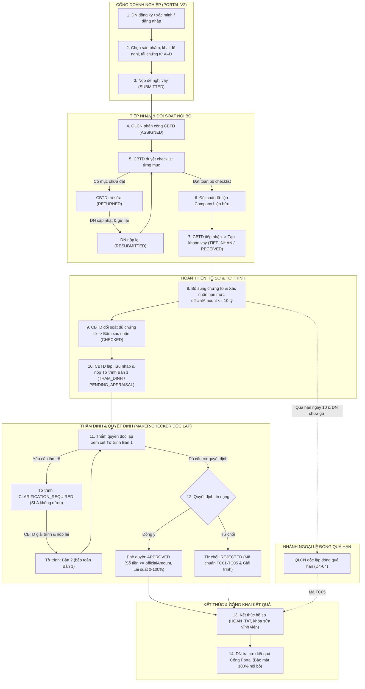
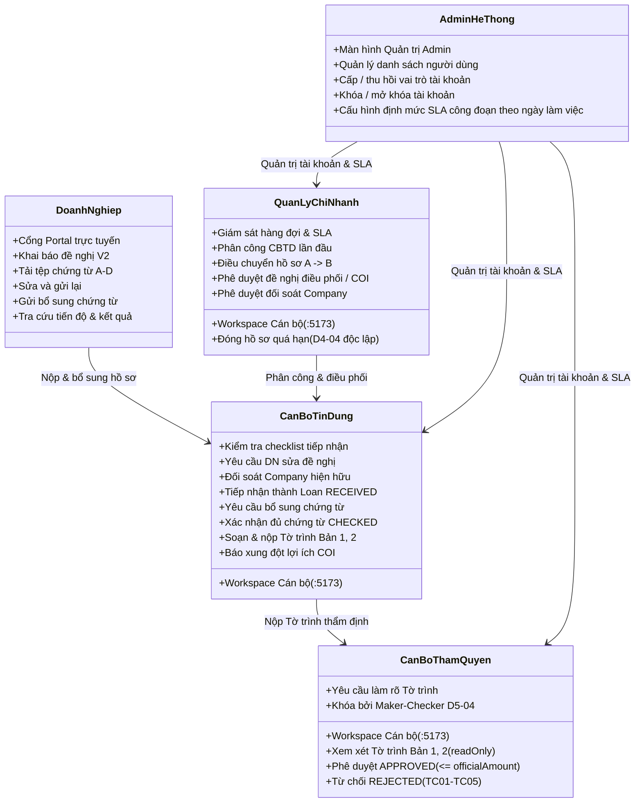

# SME MASTER — Tài liệu Nghiệp vụ và Vận hành Hệ thống SME Loan Workflow

Cập nhật ngày 02/11/2026. Đây là **tài liệu nghiệp vụ duy nhất và toàn diện của hệ thống SME Loan Workflow**, phục vụ Product Owner (PO) và người tiếp nhận dự án nắm bắt đầy đủ luồng quy trình thực tế, trách nhiệm của 5 actor, chi tiết 7 nhóm chức năng, trạng thái triển khai kiểm chứng, và các hạng mục bàn giao tiếp theo.

Cấu trúc code, cơ sở dữ liệu, quy trình CodeGraph và hướng dẫn vận hành kỹ thuật được lưu trữ tại [SME_KY_THUAT.md](SME_KY_THUAT.md). Quyết định trực tiếp của PO trong hội thoại có hiệu lực cao nhất.

---

### Mục lục liên kết nhanh
- [1. Luồng quy trình chính từ Doanh nghiệp đến Quyết định cuối](#luong-quy-trinh-chinh)
- [2. Trách nhiệm của đúng 5 Actor trong hệ thống](#trach-nhiem-5-actor)
- [3. Chi tiết 7 Nhóm chức năng hệ thống](#bay-nhom-chuc-nang)
  - [Nhóm 1 — Tài khoản và đề nghị Portal](#nhom-1)
  - [Nhóm 2 — Hàng đợi, phân công và điều phối](#nhom-2)
  - [Nhóm 3 — Kiểm tra và tiếp nhận](#nhom-3)
  - [Nhóm 4 — Chứng từ và bổ sung](#nhom-4)
  - [Nhóm 5 — Tờ trình và làm rõ](#nhom-5)
  - [Nhóm 6 — Quyết định và kết thúc](#nhom-6)
  - [Nhóm 7 — Quản trị và phân quyền](#nhom-7)
- [4. Chuẩn hóa trạng thái và Lịch sử các đợt review](#chuan-hoa-trang-thai)
  - [Bảng tổng hợp trạng thái chuẩn hóa 7 nhóm chức năng](#bang-tong-hop-7-nhom)
  - [Lịch sử các đợt review và thay thế các quyết định hoãn](#lich-su-review)
  - [Kết quả kiểm chứng thực nghiệm E2E trên hệ thống local đang chạy](#kiem-chung-local-e2e)
- [5. Trạng thái mô hình Machine Learning](#trang-thai-mo-hinh)
- [6. Kế hoạch bàn giao cho người tiếp nhận dự án](#ban-giao-nguoi-tiep-nhan)
  - [A. Điều chỉnh mô hình ML áp dụng vào hệ thống SME](#ke-hoach-dieu-chinh-mo-hinh)
  - [B. Kế hoạch gỡ chức năng "Quản lý vấn đề hồ sơ"](#ke-hoach-go-quan-ly-van-de)
- [7. Quyết định PO và các ranh giới bất biến phải giữ](#quyet-dinh-po-va-ranh-gioi)

---

## 1. Luồng quy trình chính từ Doanh nghiệp đến Quyết định cuối

Hệ thống SME Loan Workflow quản lý trọn vẹn vòng đời khoản cấp tín dụng cho doanh nghiệp vừa và nhỏ (SME) tại một chi nhánh ngân hàng, bắt đầu từ Cổng Doanh nghiệp trực tuyến (Portal V2) đến quy trình thẩm định nội bộ đa tầng và ra quyết định cuối cùng.

### Sơ đồ luồng nghiệp vụ tổng thể (14 bước liên hoàn)

### Bảng diễn giải chi tiết 14 bước quy trình

| Bước | Hành động nghiệp vụ | Actor thực hiện | Trạng thái hệ thống | Kết quả & Bằng chứng nghiệp vụ |
|---|---|---|---|---|
| **1** | Đăng ký tài khoản, nhận OTP xác minh email loopback, đăng nhập cổng trực tuyến. | Doanh nghiệp | `PORTAL_ACTIVE` | Tài khoản Portal được kích hoạt; phiên làm việc gắn token riêng biệt. |
| **2** | Chọn sản phẩm vốn lưu động (sản xuất / thương mại / dịch vụ), khai báo doanh thu năm hoàn thành, tải tài liệu 4 nhóm A–D. | Doanh nghiệp | `DRAFT` | Bản nháp được lưu trữ cô lập theo phiên; liên kết chứng từ với cơ sở doanh thu. |
| **3** | Rà soát cam kết đại diện pháp luật và nộp chính thức đề nghị vay. | Doanh nghiệp | `SUBMITTED` | Tạo bản ghi đề xuất lần 1 (`submission sequence: 1`), chụp snapshot hồ sơ, khóa sửa đổi trực tiếp. |
| **4** | Quản lý chi nhánh theo dõi hàng đợi tiếp nhận, phân công CBTD phụ trách hồ sơ. | Quản lý (QLCN) | `ASSIGNED` | Khóa phiên bản `expectedRevision`, kiểm tra cán bộ hoạt động (`isActive: true`), gửi thông báo chuông cho CBTD. |
| **5** | CBTD kiểm tra đối soát từng mục trong checklist chứng từ và dữ liệu kê khai. | CBTD | `ASSIGNED` | Đánh giá từng mục: `ACCEPTED` (Chấp nhận) hoặc `NEEDS_CORRECTION` (Cần chỉnh sửa). |
| **6** | Nếu có sai sót, CBTD tổng hợp danh sách cần sửa và bấm "Trả đề nghị để chỉnh sửa". | CBTD | `RETURNED` | Đề nghị mở khóa cho DN chỉnh sửa; API cán bộ tiếp tục phục vụ bản đã nộp, không rò rỉ dữ liệu nháp đang sửa. |
| **7** | DN nhận thông báo, tải tệp thay thế hoặc cập nhật số liệu và nộp lại đề nghị. | Doanh nghiệp | `RESUBMITTED` | Tạo lần nộp mới (`sequence: 2`); kế thừa toàn bộ các mục nhóm khác đã được duyệt đạt trước đó. |
| **8** | CBTD kiểm tra đạt toàn bộ checklist, thực hiện đối soát Company nếu MST đã tồn tại. | CBTD & QLCN | `RESUBMITTED` | Nếu MST đã có: đối soát căn cứ; QLCN xác nhận đối soát thì cập nhật Company (chụp snapshot cho các hồ sơ vay cũ). |
| **9** | CBTD xác nhận đạt điều kiện và bấm "Tiếp nhận đề nghị". | CBTD | `TIEP_NHAN / RECEIVED` | Tạo đúng 1 bản ghi khoản vay nội bộ `LoanApplication`; đề nghị Portal chuyển `ACCEPTED`, khóa vĩnh viễn việc nộp lại. |
| **10** | Rà soát danh mục chứng từ, phát hành yêu cầu bổ sung nếu cần, xác định hạn mức chính thức (`officialAmount ≤ 10 tỷ`). | CBTD & DN | `SUPPLEMENT_REQUIRED` hoặc `RECEIVED` | Khi có yêu cầu bổ sung: SLA PA1 tạm dừng (`pausedAt`). DN gửi đủ tệp: SLA tiếp tục chạy. Hạn mức chi nhánh tối đa đúng 10 tỷ VNĐ. |
| **11** | Sau khi đủ chứng từ, CBTD trực tiếp bấm "Xác nhận hồ sơ đầy đủ" trên giao diện. | CBTD | `TIEP_NHAN / CHECKED` | Chuyển trạng thái `CHECKED`, thỏa mãn điều kiện bắt buộc để chuyển sang bước lập tờ trình thẩm định. |
| **12** | CBTD nhập 8 trường đánh giá tín dụng trong `AppraisalPanel`, bấm "Lưu nháp" rồi bấm "Trình tờ trình". | CBTD | `THAM_DINH / PENDING_APPRAISAL` | Tạo bản ghi bất biến Tờ trình Bản 1 (`AppraisalReportVersion sequence: 1`), tính mã băm căn cứ `evidenceHash`, tự động chuyển công đoạn Thẩm định. |
| **13** | Thẩm quyền độc lập xem xét; nếu cần giải trình thêm thì bấm "Yêu cầu làm rõ tờ trình". | Thẩm quyền & CBTD | `CLARIFICATION_REQUIRED` | Tờ trình mở quyền sửa cho CBTD; SLA công đoạn KHÔNG tạm dừng. CBTD giải trình và nộp lại -> Tạo Tờ trình Bản 2. |
| **14** | Thẩm quyền độc lập kiểm tra bản mới nhất, đối soát `evidenceHash`, thực hiện Phê duyệt hoặc Từ chối. | Cán bộ Thẩm quyền | `HOAN_TAT / APPROVED` hoặc `REJECTED` | Kiểm tra Maker-Checker 3 tầng; cập nhật `completedAt`, đóng `stageHistory`, vô hiệu hóa điều phối chờ; DN tra cứu kết quả an toàn trên Portal. |

### Bốn nguyên tắc nghiệp vụ cốt lõi bắt buộc nắm rõ

1. **Đủ dữ liệu gửi không đồng nghĩa ngân hàng đã kiểm tra đạt:**
   Doanh nghiệp tải lên đủ tài liệu theo danh mục và nộp thành công chỉ là điều kiện cần để hệ thống chuyển trạng thái sang `SUBMITTED`. Ngân hàng bắt buộc phải phân công CBTD rà soát từng mục, kiểm tra tính hợp pháp, hợp lệ và logic tài chính. Chỉ khi CBTD duyệt đạt 100% checklist thì đề nghị mới đủ điều kiện để tiếp nhận.
2. **Tiếp nhận không tự chuyển `CHECKED`:**
   Khi CBTD bấm "Tiếp nhận", hệ thống tạo khoản vay `LoanApplication` ở công đoạn `TIEP_NHAN` với trạng thái ban đầu là `RECEIVED`. Trạng thái này tuyệt đối **không tự động chuyển sang `CHECKED`**. CBTD phụ trách phải trực tiếp đối soát lại toàn bộ hồ sơ trong môi trường nội bộ, cập nhật hạn mức chính thức và chủ động bấm nút "Xác nhận hồ sơ đầy đủ" (`checkDocuments`) thì hồ sơ mới đạt trạng thái `CHECKED`.
3. **Đóng quá hạn là nhánh ngoại lệ đặc biệt:**
   Đóng quá hạn bổ sung chứng từ (`CLOSED_TIMEOUT`) là nghiệp vụ ngoại lệ dành riêng cho Quản lý chi nhánh (`QUAN_LY`) theo quy định DEC-02 / TK-08. Thao tác chỉ được phép khi: hồ sơ đang ở trạng thái `SUPPLEMENT_REQUIRED`, đã quá hạn 10 ngày lịch (giờ Việt Nam UTC+7, mốc cuối tuần dời sang thứ Hai), doanh nghiệp chưa gửi đủ chứng từ, và QLCN phải độc lập hoàn toàn theo quy tắc D4-04 (`assignedTo !== user.id && intakeOfficerId !== user.id`). Đây không phải quy trình tự động của hệ thống hay của CBTD/Thẩm quyền.
4. **Machine Learning chỉ cảnh báo nguy cơ trễ SLA, không quyết định tín dụng:**
   Mô hình ML tích hợp trong hệ thống chỉ có một nhiệm vụ duy nhất: phân tích các thuộc tính vận hành để dự báo xác suất và nguyên nhân hồ sơ có thể bị **trễ hạn xử lý công đoạn (SLA delay risk)** nhằm hỗ trợ cán bộ chủ động điều phối. Mô hình tuyệt đối **không chấm điểm tín dụng, không đánh giá khả năng trả nợ và không thay thế quyết định phê duyệt/từ chối của con người**.

---

## 2. Trách nhiệm của đúng 5 Actor trong hệ thống

Hệ thống phân định rành mạch quyền hạn, trách nhiệm và giới hạn thao tác của đúng 5 nhóm đối tượng người dùng.

### 1. Doanh nghiệp (Cổng Portal Doanh nghiệp)
* **Kênh truy cập:** Cổng Portal trực tuyến tại địa chỉ `http://localhost:5173/portal`.
* **Chức năng thực hiện:** Đăng ký tài khoản doanh nghiệp; nhận mã OTP xác thực email; đăng nhập và phục hồi mật khẩu; chọn gói sản phẩm vốn lưu động V2 (sản xuất / thương mại / dịch vụ); nhập liệu phương án vốn, thông tin tài chính và tải lên chứng từ 4 nhóm (A, B, C, D); ký cam kết đại diện và nộp đề nghị vay; tiếp nhận thông báo trả sửa, cập nhật tệp/dữ liệu và nộp lại; tải lên chứng từ bổ sung theo yêu cầu; tra cứu tiến độ xử lý và xem kết quả công khai.
* **Quan hệ công việc:** Nhận yêu cầu chỉnh sửa/bổ sung từ CBTD; gửi hồ sơ đã hoàn thiện cho CBTD và Quản lý chi nhánh; nhận kết quả phê duyệt hoặc từ chối từ ngân hàng.
* **Thời điểm được sửa / chỉ xem / bị chặn:**
  * *Được sửa:* Khi hồ sơ đang ở trạng thái `DRAFT` hoặc khi bị ngân hàng trả về yêu cầu sửa đổi (`RETURNED`).
  * *Chỉ xem:* Khi hồ sơ đã nộp thành công (`SUBMITTED`), đang phân công (`ASSIGNED`), đã tiếp nhận thành khoản vay (`ACCEPTED`), hoặc đã kết thúc (`HOAN_TAT`).
  * *Bị chặn:* Bị chặn chỉnh sửa trực tiếp khi hồ sơ đang trong quá trình ngân hàng xem xét hoặc đã kết thúc quy trình.
* **Giới hạn quyền quan trọng:** Tài khoản Portal hoàn toàn tách biệt với tài khoản cán bộ ngân hàng; chỉ xem được dữ liệu thuộc quyền sở hữu của chính tài khoản mình; tuyệt đối không xem được danh tính cán bộ nội bộ, ghi chú nội bộ, kết quả dự báo ML, hay các trao đổi điều phối nhân sự của ngân hàng.

### 2. Cán bộ tín dụng (CBTD)
* **Kênh truy cập:** Không gian làm việc Cán bộ Ngân hàng tại địa chỉ `http://localhost:5173/` với vai trò hoạt động `activeRole === 'CBTD'`.
* **Chức năng thực hiện:** Tiếp nhận đề nghị vay Portal được phân công; kiểm tra từng mục checklist chứng từ; yêu cầu doanh nghiệp chỉnh sửa/bổ sung trước tiếp nhận; thực hiện đối soát dữ liệu doanh nghiệp hiện hữu; tiếp nhận chính thức đề nghị thành hồ sơ vay `LoanApplication` (`RECEIVED`); phát hành và giải quyết yêu cầu bổ sung chứng từ sau tiếp nhận; xác nhận hạn mức chính thức (`officialAmount ≤ 10 tỷ`); đối soát và bấm "Xác nhận hồ sơ đầy đủ" (`CHECKED`); khởi tạo, soạn thảo, lưu nháp và nộp Tờ trình thẩm định tín dụng (Bản 1, Bản 2); gửi đề nghị điều phối hồ sơ hoặc báo cáo xung đột lợi ích (COI).
* **Quan hệ công việc:** Nhận phân công xử lý từ Quản lý chi nhánh; làm việc trực tiếp với Doanh nghiệp để hoàn thiện chứng từ; bàn giao hồ sơ đã hoàn tất Tờ trình cho Cán bộ Thẩm quyền; nhận yêu cầu làm rõ Tờ trình từ Cán bộ Thẩm quyền.
* **Thời điểm được sửa / chỉ xem / bị chặn:**
  * *Được sửa:* Khi được phân công phụ trách hồ sơ (`assignedTo === user.id`) tại công đoạn `TIEP_NHAN` và khi Tờ trình thẩm định đang ở trạng thái `DRAFT` hoặc `CLARIFICATION_REQUIRED`.
  * *Chỉ xem:* Khi hồ sơ chuyển sang công đoạn `THAM_DINH` (chờ Thẩm quyền xử lý).
  * *Bị chặn:* Bị chặn mọi thao tác ghi khi hồ sơ đang có đề nghị COI chờ giải quyết (`writeBlocked: true`), hoặc khi hồ sơ đã kết thúc (`HOAN_TAT`).
* **Giới hạn quyền quan trọng:** Không có quyền phê duyệt hoặc từ chối khoản vay; không có quyền tự ý đóng hồ sơ quá hạn; không tự ý chuyển giao hồ sơ cho người khác; tuyệt đối không được phê duyệt hoặc yêu cầu làm rõ đối với hồ sơ do chính mình tiếp nhận hoặc soạn thảo (ràng buộc Maker-Checker D5-04).

### 3. Cán bộ Thẩm quyền (THAM_QUYEN)
* **Kênh truy cập:** Không gian làm việc Cán bộ Ngân hàng tại địa chỉ `http://localhost:5173/` với vai trò hoạt động `activeRole === 'THAM_QUYEN'`.
* **Chức năng thực hiện:** Xem xét, thẩm tra hồ sơ vay và Tờ trình thẩm định tại công đoạn `THAM_DINH`; phát hành yêu cầu làm rõ Tờ trình gửi CBTD (`CLARIFICATION_REQUIRED`); thực hiện Phê duyệt khoản vay (`APPROVED`) kèm số tiền phê duyệt (`approvedAmount ≤ officialAmount`) và lãi suất; thực hiện Từ chối khoản vay (`REJECTED`) theo danh mục lý do chuẩn (TC01–TC05) kèm ghi chú giải trình chi tiết.
* **Quan hệ công việc:** Tiếp nhận hồ sơ đã trình Tờ trình từ CBTD; phát hành yêu cầu làm rõ cho CBTD; đưa ra quyết định tín dụng cuối cùng để kết thúc hồ sơ.
* **Thời điểm được sửa / chỉ xem / bị chặn:**
  * *Được thao tác:* Thực hiện yêu cầu làm rõ hoặc phê duyệt/từ chối khi Tờ trình ở trạng thái `SUBMITTED`, không còn yêu cầu bổ sung PENDING, và bản thân là cán bộ độc lập.
  * *Chỉ xem:* Toàn bộ các ô nhập liệu phân tích thẩm định của CBTD hiển thị ở chế độ chỉ đọc (`readOnly`), không sửa thay phần phân tích của CBTD.
  * *Bị chặn:* Nút bấm Phê duyệt, Từ chối và Yêu cầu làm rõ bị vô hiệu hóa (disabled) kèm cảnh báo giải thích rõ ràng (theo D5-04) nếu bản thân là cán bộ đang thụ lý (`assignedTo`), cán bộ tiếp nhận ban đầu (`intakeOfficerId`), hoặc cán bộ từng tham gia soạn thảo/trình tờ trình (`appraisalReportEvent`).
* **Giới hạn quyền quan trọng:** **Phân biệt rành mạch với Quản lý chi nhánh:** Cán bộ Thẩm quyền CHỈ thực hiện thẩm định và ra quyết định tín dụng, KHÔNG làm nhiệm vụ điều phối nhân sự, phân công hàng đợi hay xử lý tài khoản; bị ràng buộc bởi nguyên tắc Maker-Checker 3 tầng độc lập theo định danh `user.id`.

### 4. Quản lý chi nhánh (QUAN_LY)
* **Kênh truy cập:** Không gian làm việc Cán bộ Ngân hàng tại địa chỉ `http://localhost:5173/` với vai trò hoạt động `activeRole === 'QUAN_LY'`.
* **Chức năng thực hiện:** Theo dõi hàng đợi tiếp nhận Portal và toàn bộ danh mục hồ sơ vay của chi nhánh; giám sát tải công việc của cán bộ và các cảnh báo nguy cơ trễ hạn SLA; phân công CBTD xử lý đề nghị Portal; điều chuyển hồ sơ vay giữa các cán bộ; xem xét và quyết định phê duyệt/từ chối các đề nghị điều phối và xung đột lợi ích (COI); phê duyệt hoặc từ chối kết quả đối soát dữ liệu doanh nghiệp hiện hữu (Company Reconciliation); thực hiện đóng thủ công hồ sơ bổ sung quá hạn (`closeOverdueSupplement` sang `CLOSED_TIMEOUT`).
* **Quan hệ công việc:** Tiếp nhận đề nghị mới từ Cổng Portal để giao việc cho CBTD; tiếp nhận đề nghị điều phối/COI từ CBTD; bàn giao công việc cho CBTD mới; phối hợp giải quyết vướng mắc thủ tục.
* **Thời điểm được sửa / chỉ xem / bị chặn:**
  * *Được thao tác:* Phân công cán bộ, điều chuyển công việc, xử lý đối soát Company, và đóng hồ sơ quá hạn khi đủ điều kiện.
  * *Chỉ xem:* Xem thông tin chi tiết hồ sơ, tài liệu và tiến độ của toàn chi nhánh.
  * *Bị chặn:* Bị chặn tự phân công hồ sơ cho chính mình; bị chặn tự phê duyệt đề nghị điều phối hoặc đối soát Company do mình lập; **bị chặn đóng hồ sơ quá hạn (theo D4-04)** nếu chính là cán bộ đang phụ trách (`assignedTo === user.id`) hoặc là người tiếp nhận ban đầu (`intakeOfficerId === user.id`).
* **Giới hạn quyền quan trọng:** **Phân biệt rành mạch với Thẩm quyền:** QLCN điều phối nhân sự và vận hành chi nhánh, TUYỆT ĐỐI KHÔNG tự ý phê duyệt cấp tín dụng cho khoản vay; thao tác điều phối hay duyệt đối soát Company không phải là quyết định cấp tín dụng.

### 5. Quản trị hệ thống (ADMIN)
* **Kênh truy cập:** Màn hình Quản trị hệ thống tại địa chỉ `http://localhost:5173/` với vai trò hoạt động `activeRole === 'ADMIN'`.
* **Chức năng thực hiện:** Quản lý danh sách tài khoản người dùng nội bộ; cấp phát và thu hồi vai trò nghiệp vụ (`CBTD`, `THAM_QUYEN`, `QUAN_LY`, `ADMIN`); kích hoạt hoặc vô hiệu hóa tài khoản cán bộ (`isActive`); cấu hình định mức thời gian xử lý chuẩn của các công đoạn quy trình (`standardSlaHours`).
* **Quan hệ công việc:** Tiếp nhận yêu cầu quản trị từ lãnh đạo chi nhánh; thiết lập cấu hình tham số vận hành cho toàn bộ cán bộ ngân hàng.
* **Thời điểm được sửa / chỉ xem / bị chặn:**
  * *Được thao tác:* Cập nhật thông tin cán bộ, phân quyền vai trò và hiệu chỉnh định mức SLA công đoạn theo ngày làm việc (không sửa được Hoàn tất).
  * *Bị chặn:* Bị chặn tự khóa tài khoản của chính mình (`actorId === id`); bị chặn tự tước vai trò `ADMIN` của chính mình; bị chặn khóa tài khoản hoặc tước vai trò `CBTD` nếu cán bộ đó vẫn còn hồ sơ vay chưa hoàn tất (`openLoans > 0`) hoặc còn đề nghị Portal đang phụ trách (`pendingPortal > 0`).
* **Giới hạn quyền quan trọng:** Tuyệt đối không dùng quyền Admin để can thiệp vào quy trình cấp tín dụng (không tiếp nhận, không lập tờ trình, không phê duyệt/từ chối khoản vay); cập nhật định mức SLA của Admin chỉ áp dụng cho lượt vào công đoạn mới, không làm thay đổi hay hồi tố dữ liệu lịch sử các công đoạn đã qua.

---

## 3. Chi tiết 7 Nhóm chức năng hệ thống

Tất cả 7 nhóm chức năng được chuẩn hóa theo cùng một cấu trúc thống nhất:
a. Mục tiêu và phạm vi.
b. Actor áp dụng.
c. Điều kiện đầu vào.
d. Luồng chính theo từng bước.
e. Luồng ngoại lệ: Tình huống → Actor xử lý → Cách xử lý → Kết quả/Đường đi tiếp.
f. Đầu ra và liên hệ với nhóm khác.
g. Trạng thái triển khai và bằng chứng kiểm chứng thực tế.

---

### Nhóm 1 — Tài khoản và đề nghị Portal

* **a. Mục tiêu và phạm vi:** Cung cấp kênh số hóa cho doanh nghiệp đăng ký tài khoản, xác thực danh tính qua email, đăng nhập bảo mật, phục hồi mật khẩu; khai báo nhu cầu vốn lưu động theo chuẩn Portal V2 (sản xuất / thương mại / dịch vụ), tải lên chứng từ số hóa 4 nhóm bắt buộc và nộp hồ sơ vay trực tuyến.
* **b. Actor áp dụng:** Doanh nghiệp (người đại diện hợp pháp hoặc người được ủy quyền).
* **c. Điều kiện đầu vào:** Khách hàng doanh nghiệp có địa chỉ email hợp lệ, mã số thuế (MST) và các tệp tài liệu số hóa (PDF, PNG, JPG).
* **d. Luồng chính theo từng bước:**
  1. *Đăng ký & Kích hoạt:* DN nhập MST, tên công ty, email và mật khẩu -> Hệ thống gửi OTP xác minh -> DN nhập mã xác minh hoàn tất kích hoạt tài khoản.
  2. *Đăng nhập:* DN đăng nhập vào Cổng Portal, khởi tạo đề nghị vay vốn lưu động mới (chuẩn V2).
  3. *Khai báo phương án:* Chọn lĩnh vực ngành nghề (sản xuất / thương mại / dịch vụ); nhập số tiền đề nghị, mục đích vốn, thời hạn vay và phương thức chứng minh hoạt động kinh doanh.
  4. *Tải lên chứng từ:* Tải lên đầy đủ 4 nhóm tài liệu: Nhóm A (Pháp lý), Nhóm B (Báo cáo tài chính), Nhóm C (Phương án kinh doanh / Hợp đồng đầu ra), Nhóm D (Phương án vốn vay).
  5. *Liên kết doanh thu:* Nhập doanh thu năm tài chính hoàn thành và liên kết trực tiếp với tài liệu Báo cáo tài chính tương ứng.
  6. *Ký cam kết & Nộp:* Đọc điều khoản cam kết pháp lý, tích chọn xác nhận đại diện hợp pháp và bấm "Nộp đề nghị vay". Hệ thống tạo bản ghi `PortalSubmission sequence: 1`, chuyển trạng thái sang `SUBMITTED`.
* **e. Luồng ngoại lệ:**
  * *Tình huống 1: Hộp thư doanh nghiệp không nhận được OTP xác thực hoặc lỗi SMTP.*
    -> *Actor xử lý:* Doanh nghiệp.
    -> *Cách xử lý:* Bấm nút "Gửi lại mã xác minh" sau khoảng thời gian chờ (cooldown 60s); hệ thống sử dụng cơ chế ghi nhận nội bộ an toàn (loopback dev mailbox).
    -> *Kết quả:* Nhận mã mới và hoàn tất kích hoạt tài khoản.
  * *Tình huống 2: Doanh nghiệp quên mật khẩu đăng nhập.*
    -> *Actor xử lý:* Doanh nghiệp.
    -> *Cách xử lý:* Sử dụng chức năng Quên mật khẩu; hệ thống phát hành token một lần có thời hạn (reset token băm SHA-256); người dùng đặt mật khẩu mới.
    -> *Kết quả:* Mật khẩu được cập nhật, toàn bộ phiên đăng nhập cũ bị thu hồi; DN đăng nhập lại bằng mật khẩu mới.
  * *Tình huống 3: Mở đồng thời 2 tab trình duyệt hoặc phản hồi cũ trả về muộn (Late Response).*
    -> *Actor xử lý:* Hệ thống Frontend.
    -> *Cách xử lý:* Mỗi tab cô lập bộ nhớ nháp riêng theo khóa phiên (`sessionId`) và kiểm tra `epoch`; phản hồi muộn từ tab cũ bị hủy bỏ an toàn.
    -> *Kết quả:* Ngăn chặn tuyệt đối việc nháp của tài khoản này ghi đè lên tài khoản khác.
  * *Tình huống 4: Thiếu chứng từ bắt buộc hoặc số tiền đề nghị không hợp lệ.*
    -> *Actor xử lý:* Doanh nghiệp & Hệ thống Wizard.
    -> *Cách xử lý:* Wizard client-side kiểm tra tính sẵn sàng (`readiness`), báo lỗi trực quan tại ô nhập liệu và vô hiệu hóa nút nộp.
    -> *Kết quả:* DN bổ sung đầy đủ thông tin mới có thể hoàn tất nộp đề nghị.
* **f. Đầu ra và liên hệ với nhóm khác:** Đề nghị vay ở trạng thái `SUBMITTED`, lưu trữ bất biến snapshot hồ sơ và danh mục tệp. Bàn giao sang **Nhóm 2 (Hàng đợi, phân công và điều phối)** để Quản lý chi nhánh phân công cán bộ xử lý.
* **g. Trạng thái triển khai và bằng chứng kiểm chứng:**
  * *Trạng thái:* **ĐÃ TRIỂN KHAI CODE & ĐÃ KIỂM CHỨNG TOÀN DIỆN**.
  * *Bằng chứng:* 75 Chrome CDP browser checks, 90 portal regression tests, ảnh chụp kiểm chứng đa tab `r1-cross-tab-protected.png`; 100% pass trên hệ thống local đang chạy ([PASS 8, 9, 10]).

---

#### Review UX Portal theo vai trò PO và Senior Frontend — 05/11/2026

**Phạm vi:** PO yêu cầu review và đề xuất, chưa sửa giao diện, code, dữ liệu hoặc quy tắc bắt buộc. Khảo sát 7 view Portal, tập trung wizard gửi đề nghị và bước 5; dùng ảnh PO gửi, ảnh xác thực đã chụp trong phiên và source/CodeGraph hiện hành. Chưa thực hiện lại thao tác gửi trên hồ sơ PO cung cấp.

**Hiện trạng theo source:** nút Gửi chỉ được render ở bước 5 nhưng việc đi qua đủ 5 bước không phải điều kiện gửi phía server. `navigate` lưu nháp theo validation cấu trúc, không kiểm đủ trường/tài liệu bắt buộc của từng bước; dấu ✓ dựa vào vị trí bước hiện tại (`step > index + 1`), không phải trạng thái đủ dữ liệu. Bước 5 ghép checklist, issues, formErrors và gợi ý nên có thể lặp lỗi; `formErrors` từ evaluatePolicy chứa tên trường kỹ thuật và được render trực tiếp. Trạng thái `dirty` cũng khóa gửi nên tick cam kết có thể làm người dùng phải lưu nháp rồi đợi đánh giá lại. Source hiện giữ đầy đủ ràng buộc cấu hình, quyền sửa, revision, file đang tải và readiness; không được bỏ các ràng buộc này để làm UI đơn giản hơn.

**Đề xuất PO, CHƯA DUYỆT:** chặn nút Tiếp tục theo trường bắt buộc áp dụng tại bước hiện tại, vẫn cho lưu nháp/quay lại/xem yêu cầu tài liệu; không chặn bằng dữ liệu chỉ có ở bước sau, trường tùy chọn, mục LATER hoặc kiểm tra nghiệp vụ của CBTD. Bước 5 kiểm toàn bộ theo policy/revision mới nhất. Dấu hoàn thiện dựa trên readiness thay vì vị trí; thay đổi ngành/phạm vi/đại diện/dư nợ/bảo đảm/tài liệu phải đánh giá lại các phần phụ thuộc. Không tự nâng cảnh báo cân đối vốn hoặc tài liệu cung cấp sau thành điều kiện chặn mới.

**Đề xuất Senior Frontend, CHƯA DUYỆT:** bước 5 gồm một thông báo tổng quan, bốn khối tóm tắt theo bước 1–4 với trạng thái và nút sửa, danh sách thiếu được khử trùng lặp và ánh xạ tới trường/bước, một vùng cam kết và gửi. Desktop dùng nội dung chính + thanh tóm tắt bên phải; mobile một cột với hành động cuối màn hình không che nội dung. 5 view xác thực chỉ cần chỉnh nội dung/trạng thái và khả năng sử dụng; danh sách đề nghị cần ưu tiên việc cần làm tiếp; wizard/tài liệu/bước 5 là ưu tiên cao. Giữ palette/logo đã duyệt.

**Ảnh hưởng:** nhóm 1 trực tiếp; nhóm 2–3 tiêu thụ bản nộp/checklist, nhóm 4 giữ luồng bổ sung sau tiếp nhận; không thay maker-checker, luồng quyết định, Company, SLA hoặc ML. Truy vết PortalApp → PortalWizard → validateV2/canSendCycle/DocumentManager → checklist/approved assessment → evaluateIntakeReadiness/evaluatePolicy → publish; server vẫn là điểm kiểm tra quyết định. Gói hồi quy khi được giao sửa phải gồm thiếu trường, điều kiện thay đổi, tệp nguồn/năm/phiên bản, cam kết, lỗi lưu/409, hai tab, nộp lại và khử trùng lỗi; không chỉ kiểm màu/bố cục.

Chi tiết phương án, đánh giá 7 view, wireframe, tiêu chí nghiệm thu và ranh giới tại [mục 13 của file review giao diện duy nhất](../output/Review_Giao_Dien_5_Actor_SME.md). Đây là phương án trình PO, không phải cập nhật trạng thái đã triển khai/nghiệm thu của 7 nhóm.

#### Triển khai gói giao diện Portal — 05/11/2026

**PO đã giao:** gói giao diện theo review UX. Phạm vi gồm bố cục bước 5, tóm tắt lỗi tiếng Việt theo bước, trình bày checklist, trạng thái/hướng dẫn hành động, tinh chỉnh nội dung các view xác thực/danh sách. Chưa giao gói kiểm/chặn từng bước hoặc thay cách lưu/gửi.

**Kế hoạch:** (1) kiểm tra trước khi sửa cho mô hình hiển thị lỗi: ánh xạ, khử trùng, giữ lỗi chưa biết và trạng thái chưa kiểm tra; (2) tách phần review trình bày khỏi PortalWizard, dùng các callback và disabled guard hiện có; (3) CSS desktop/mobile, checklist và nội dung xác thực/danh sách; (4) hồi quy logic hiện có, TypeScript/bundle, kiểm tra trình duyệt với dữ liệu thử chỉ đọc hoặc fixture giao diện được ghi rõ; cập nhật bằng chứng tại đây và file review duy nhất.

**Ảnh hưởng ngang → sâu:** PortalApp → PortalWizard → component review/formatter mới → DTO assessment/readiness chỉ đọc. Nơi hiển thị bước 4–5 dùng cùng mô hình checklist; PortalAuth/danh sách chỉ đổi nội dung. Giữ nguyên persist/navigate/submitTestRequest, validateV2, canSendCycle, client API và toàn backend; không đổi điều kiện bắt buộc, Company, snapshot, SLA/ML hoặc DB. Số bước vẫn 5; bỏ dấu ✓ theo vị trí, giữ số bước và bước đang xem, không triển khai thuật toán hoàn thiện mới trong gói giao diện.

**Tiêu chí:** không lộ tên trường kỹ thuật trong thông báo review; mỗi thiếu sót đã biết gắn đúng bước, không nhân đôi; lỗi chưa biết/checklist lỗi/stale không biến thành trạng thái đủ gửi; đủ thông tin và điều kiện cũ mới dùng được nút Gửi. Cam kết và guard gửi giữ nguyên; bản đã gửi vẫn chỉ đọc. Desktop/mobile không tràn hoặc che nút/nội dung, xem/sửa được từng phần.

**Kết quả gói giao diện: ĐÃ TRIỂN KHAI SOURCE, ĐÃ KIỂM CHỨNG PHẠM VI DƯỚI ĐÂY, CHỜ PO REVIEW.** Bước 5 dùng 4 thẻ thông tin có thể mở/thu gọn và khung gửi riêng; lỗi gắn bước, tiếng Việt và khử trùng. Checklist bước 4–5 tách cần cung cấp/đã cung cấp chờ kiểm tra/cung cấp sau/không áp dụng; phần hướng dẫn dài được thu gọn. Có lý do khi chưa gửi được, một cam kết và hai nút Lưu nháp/Gửi dùng lại callback/guard cũ. Các bước chỉ hiển thị số, không đánh dấu hoàn thiện theo vị trí. DN-01–05 chỉnh câu hướng dẫn và khoảng cách mobile; DN-06 thêm việc tiếp theo theo trạng thái. Không triển khai chặn Next, thuật toán hoàn thiện bước, tự lưu khi Gửi hay tính năng xác thực mới.

| Nhánh ảnh hưởng | Thay đổi và bằng chứng | Giới hạn |
|---|---|---|
| PortalApp → PortalWizard → PortalReview/review.ts → assessment/readiness | Adapter trình bày chỉ đọc; 11 test ánh xạ/khử trùng/unknown/lỗi và trạng thái/guard/render. SHA256 AST của `canSendApproved`, `received`, `persist`, `mutate`, `navigate`, `useRemote`, `submitTestRequest`: 7/7 giữ nguyên so với trước gói. | Không thay readiness/validation/policy hoặc submit payload. Chưa xác minh lại giao dịch gửi thật. |
| Wizard → DocumentManager và nguồn doanh thu | Chỉ thêm điểm focus; dùng lại checklist và callback tải tệp. 33 test Portal, 9 test supplement, 8 test intake và 4 test tracking đạt. | Không upload/xóa/ghi DB trong đợt giao diện; không thay snapshot/Company/SLA/ML. |
| PortalReview + CSS responsive | 69/69 browser checks, 18 ảnh, không lỗi runtime; desktop 1440 và mobile 375 không tràn ngang; thiếu/đủ/chưa lưu/stale/lỗi/chỉ đọc/chưa mở/tệp chờ/legacy. Đã xem ảnh trực tiếp. | Bước 5 dùng component thật với fixture tổng hợp gắn nhãn, callback cục bộ; không phải bằng chứng tích hợp API–DB hoặc UAT hồ sơ PO. |
| PortalAuth/Danh sách | 5 màn xác thực mở trên app local bằng thao tác chỉ đọc ở hai kích thước; bản reset dùng token minh họa, không submit. Danh sách chỉ thay câu hướng dẫn theo source, TypeScript/bundle đạt. | Chưa kiểm chứng lại danh sách đã đăng nhập và gửi/nhận email/reset token thật. Không tuyên bố đã nghiệm thu toàn bộ 7 view. |

**Kiểm tra kỹ thuật:** TypeScript (`node node_modules/typescript/bin/tsc -p tsconfig.app.json`) và Vite bundle (`node node_modules/vite/bin/vite.js build --configLoader runner --outDir ../evidence/reviews/portal-ui-20261105/build`) đạt tại `frontend`; đây là lệnh kiểm chứng riêng, không phải xác nhận lệnh build mặc định. CodeGraph build/check đạt: 186 files, 3.786 nodes, 7.567 edges; đã truy vấn context/deps/impact. 65 test trong phạm vi đạt. Không commit/push/phát hành, không thao tác dữ liệu nghiệp vụ.

**Bàn giao:** [mục 14 file review duy nhất](../output/Review_Giao_Dien_5_Actor_SME.md#14-ket-qua-goi-giao-dien-portal), [browser results](../evidence/reviews/portal-ui-20261105/browser-results.json), [đối chiếu workflow](../evidence/reviews/portal-ui-20261105/workflow-results.json), [ảnh desktop](../evidence/reviews/portal-ui-20261105/review-incomplete-1440.png), [ảnh mobile](../evidence/reviews/portal-ui-20261105/review-incomplete-375.png). Gói kiểm/chặn từng bước và cải tiến lưu/gửi trong review UX vẫn là đề xuất riêng, chưa triển khai.

#### Mã đề nghị và hồ sơ vay rút gọn — 05/11/2026

**PO đã duyệt triển khai:** đề nghị Doanh nghiệp `DN-1`, `DN-2`…; hồ sơ vay `SME-1`, `SME-2`…; không ngày tháng/số 0 đệm/chuỗi ngẫu nhiên. Giữ UUID, mã cũ và liên kết lịch sử. Hai bộ đếm độc lập, dùng chung bộ đếm SME cho tiếp nhận Portal và tạo tại quầy.

**Kế hoạch và ảnh hưởng ngang → sâu:** (1) test trước cho định dạng, bộ đếm lớn, fail-closed và idempotency; (2) thêm allocator PostgreSQL sequence dùng trong transaction hiện hữu, thay đúng ba nơi sinh mã: PortalService.create/accept và LoanApplicationsService.create; (3) SQL cộng thêm tạo hai sequence, tiếp nối số ngắn đã tồn tại và không reset khi chạy lại; (4) kiểm tra PostgreSQL tạm riêng cho đồng thời/rollback/restart, hồi quy tạo/gửi/tiếp nhận, build/CodeGraph. API/controller/DTO/schema UUID/quyền/checklist/Company/snapshot/SLA/ML giữ nguyên. Frontend và thông báo dùng nguyên chuỗi mã API, đã tìm nơi tiêu thụ và không cần đổi UI.

**Nghiệm thu:** mã mới đúng `DN-[số nguyên dương]`/`SME-[số nguyên dương]`, không đệm; không trùng khi nhiều tiến trình tạo đồng thời; retry cùng clientRequestId không cấp mã mới; mã cũ không sửa. Sequence không tái sử dụng số sau rollback/xóa; có thể có số bị bỏ qua khi giao dịch không thành công, không cam kết dãy liền không khuyết. Áp dụng DB hiện hành/restart local chỉ sau khi có phạm vi môi trường rõ; không seed/reset/đánh lại mã cũ.

**Source và kiểm chứng đã đạt:** [allocator](../backend/src/common/document-codes.ts), [SQL cộng thêm](../backend/prisma/document-codes.sql), ba call site nêu trên. 3 test allocator đã thất bại trước khi triển khai, sau sửa đạt; 91 test source/hồi quy tạo/retry/quyền/policy/snapshot/intake đạt ([TAP](../evidence/reviews/document-codes-20261105/regression.tap)). TypeScript backend build ra thư mục bằng chứng đạt. CodeGraph build/context/deps/fn-impact đã kiểm tra allocator đến đủ ba controller và consumer frontend; UUID và contract mã chuỗi không đổi.

**PostgreSQL thật, môi trường riêng:** 25/25 kiểm tra đạt ([JSON](../evidence/reviews/document-codes-20261105/postgres-results.json)): tạo nháp `DN-1`, tại quầy `SME-1`, nhận từ Portal `SME-2`, retry cùng mã; 24 request đồng thời/24 cấp mã SME qua hai client không trùng; rollback/xóa không tái sử dụng; restart DB giữ bộ đếm; migration tiếp nối short code đã có, chạy lại không reset và không sửa mã cũ. Chạy bằng image `postgres:16-alpine` có sẵn, container/volume riêng đã xóa. Harness đã sửa việc Docker cấp lại cổng ngẫu nhiên sau restart; lần kiểm chứng cuối đạt toàn bộ. Đây là test service–Prisma–PostgreSQL thật trên dữ liệu tổng hợp, chưa phải UI/API live của DB SME local.

**Hiệu lực local: ĐÃ ÁP DỤNG theo xác nhận PO trong phiên 05/11/2026**, với yêu cầu giữ các tính năng liên quan. Đã backup DB `sme_loan` trên `sme-loan-workflow-db-1:5432`, restore toàn bộ sang container riêng và so sánh dữ liệu; thử SQL trên bản restore rồi mới áp local. Fingerprint toàn bộ 25 bảng/92 bản ghi trước và sau migration giống nhau; SQL không đổi mã/UUID/liên kết/trạng thái hay dữ liệu cũ ([bằng chứng áp dụng](../evidence/reviews/document-codes-20261105/local-activation.json)). Backup chứa dữ liệu thật giữ riêng tại `evidence/private-backups/`, đã git-ignore; container/volume khôi phục thử được dọn.

Backend đã `npm.cmd --prefix backend run build` thành công và khởi động bản mới ở cổng 3000. Xác minh `/api/health` với timeout 8s: backend/database/prediction đều `ready` ([runtime + hash module](../evidence/reviews/document-codes-20261105/backend-activation.json)); lượt poll 2s ban đầu hết thời gian chờ, không phải lỗi DB sau khi kiểm chứng lại. Build mặc định được chạy bằng quyền host vì sandbox không ghi được dist cũ; không đổi ACL hoặc cấu hình hệ thống. Hai sequence local đang ở số 1/chưa cấp, không tạo hồ sơ thử hoặc tiêu thụ số trên DB local.

Hồi quy thêm 27 test tra cứu/theo dõi/thông báo/Company/phân công đạt ([TAP](../evidence/reviews/document-codes-20261105/consumer-regression.tap)); đã giữ đúng thứ tự kiểm tra công đoạn/SLA trước khi cấp mã ở quầy để lỗi cấu hình vẫn trả như cũ. Gói chỉ thay cơ chế sinh mã mới, không thay quyền/API/workflow/checklist/SLA/ML. Kiểm chứng tạo và tiếp nhận thật ở mức service–Prisma–PostgreSQL nằm trên DB tạm; chưa thực hiện UAT UI/API có ghi hồ sơ trên DB SME local. Không đánh lại mã cũ, không commit/push hay phát hành ngoài local.

**Chốt gói:** kiểm tra lại trên bản build dùng cho runtime: **118/118 test** đạt ([TAP cuối](../evidence/reviews/document-codes-20261105/runtime-regression.tap)); **25/25 kiểm tra PostgreSQL tạm** đạt trên source cuối. Dùng đúng env kết nối của backend để kiểm tra chỉ đọc: đúng DB/schema đã áp SQL, có quyền USAGE hai sequence và INSERT hai bảng, không tiêu thụ số ([JSON](../evidence/reviews/document-codes-20261105/runtime-db-check.json)). CodeGraph mới/hợp lệ; build mặc định đạt. Gói mã rút gọn đã hoàn thành và có hiệu lực cho hồ sơ tạo mới trên local; chờ PO sử dụng/review.

#### Chuyển mã hồ sơ cũ sang mã ngắn — 05/11/2026

**PO yêu cầu mới, thay thế quyết định giữ mã cũ ở gói trước:** đổi mã cũ trên cả Portal và hồ sơ vay để đồng nhất định dạng. Phạm vi local đã dùng trong phiên: `sme_loan` tại `sme-loan-workflow-db-1:5432`. Kiểm kê hiện tại có 13/15 đề nghị cần đổi và 3/3 hồ sơ vay cần đổi; hai mã ngắn DN đã có giữ nguyên. Cấp số tiếp theo từ sequence hiện hành cho các hồ sơ cũ theo `createdAt`, rồi `id`; không đánh lại mã ngắn đã được cấp.

**Kế hoạch/ảnh hưởng:** truy vết mã hiển thị/tìm kiếm ở PortalApp/LoanList/tracking/điều phối tới hai cột unique `portal_requests.reference` và `loan_applications.application_code`; quan hệ vẫn qua UUID. Test PostgreSQL trước cho chuyển mã/thứ tự/giữ mã ngắn/cấp số tiếp/idempotency/rollback; SQL có transaction, khóa hai bảng và kiểm fingerprint mọi cột khác. Backup mới, khôi phục thử riêng, chạy SQL trên bản restore trước khi áp local; lưu bảng mã cũ → mới trong thư mục backup riêng. Không sửa snapshot, nội dung lịch sử, tài liệu, trạng thái, Company, SLA/ML; các tham chiếu mã trong nội dung lịch sử được giữ làm dấu vết tại thời điểm ghi, có bảng đối chiếu khi cần tra cứu.

**Tiêu chí:** mọi mã chính đều đúng dạng ngắn và unique; mã ngắn hiện hữu giữ nguyên; mọi cột/bảng khác và UUID/liên kết giữ nguyên; sequence không reset/tái sử dụng; chạy lại không đổi mã. Hoàn thành kiểm tra trên PostgreSQL tạm và bản restore trước khi ghi local.

**ĐÃ ÁP DỤNG LOCAL:** chuyển **13 đề nghị cũ sang DN-3…DN-15** và **3 hồ sơ vay cũ sang SME-1…SME-3**; giữ hai mã DN-1/DN-2 hiện có. 15/15 đề nghị và 3/3 hồ sơ vay đã đúng định dạng ngắn. UUID, mọi liên kết, timestamps, dữ liệu kê khai và toàn bộ cột/bảng khác giữ nguyên theo fingerprint **25 bảng/94 bản ghi**, chỉ loại trừ đúng hai trường mã được phép đổi. Sequence hiện ở DN=15/SME=3, không reset; mã kế tiếp là DN-16/SME-4 nếu chưa có giao dịch mới.

**Bằng chứng:** [SQL chuyển mã](../backend/prisma/renumber-document-codes.sql), [kết quả local](../evidence/reviews/document-codes-20261105/renumber-local-activation.json), [36 kiểm tra PostgreSQL riêng](../evidence/reviews/document-codes-20261105/renumber-postgres-results.json). Test được chạy trước SQL: thất bại vì chưa có chuyển mã; sau triển khai đạt 36/36, gồm thứ tự chuyển, giữ mã ngắn, FK/lịch sử, số kế tiếp, chạy lại không cấp số và rollback cả hai nhóm khi xung đột. Bản dump mới đã khôi phục thử đầy đủ và chạy chuyển mã thành công trên bản restore trước khi ghi local. Dump và bảng mã cũ → mới/preview được giữ riêng trong `evidence/private-backups/renumber-document-codes-*/`, không đưa vào Git/báo cáo chia sẻ; các container/volume kiểm tra đã dọn.

Gói này cập nhật dữ liệu, không đổi source backend đang chạy hoặc giao diện. Source PortalApp/LoanList/tracking/điều phối đọc mã hiện tại từ hai trường trên qua UUID; người dùng tải lại danh sách để nhận mã mới. Không tái tạo hồ sơ, không đổi trạng thái/SLA/ML hoặc viết lại nội dung lịch sử/snapshot bất biến. CodeGraph đã cập nhật và hợp lệ; chưa thực hiện thêm thao tác nghiệp vụ có ghi hồ sơ hay xác nhận UAT UI trong đợt chuyển mã.

### Nhóm 2 — Hàng đợi, phân công và điều phối

* **a. Mục tiêu và phạm vi:** Quản lý hàng đợi các đề nghị vay mới nộp; phân công CBTD phụ trách lần đầu; điều chuyển hồ sơ vay giữa các cán bộ; xử lý quy trình xin điều phối công việc và báo cáo xung đột lợi ích (COI); bảo vệ lịch sử bàn giao và tính toàn vẹn của việc giao nhận việc.
* **b. Actor áp dụng:** Quản lý chi nhánh (QUAN_LY), Cán bộ tín dụng (CBTD).
* **c. Điều kiện đầu vào:** Đề nghị vay ở trạng thái `SUBMITTED`, hoặc hồ sơ vay đang mở; danh sách cán bộ tín dụng của chi nhánh đang hoạt động (`isActive === true`).
* **d. Luồng chính theo từng bước:**
  1. *Theo dõi hàng đợi:* QLCN truy cập danh sách tiếp nhận Portal, theo dõi các đề nghị mới và tải công việc hiện tại của từng CBTD.
  2. *Phân công lần đầu:* QLCN chọn một CBTD khả dụng, nhập `expectedRevision` và ghi chú phân công -> Gửi yêu cầu phân công (`POST /portal-intakes/:id/assign`).
  3. *Xác lập quyền phụ trách:* Đề nghị Portal chuyển trạng thái sang `ASSIGNED`, gán `assignedTo = cbtd.id`, ghi nhận lịch sử phân công `PortalAssignment`.
  4. *Thông báo giao việc:* Hệ thống tự động tạo thông báo chuông (`InternalNotification`) gửi đến tài khoản của CBTD được giao việc.
  5. *Bàn giao công việc khi điều chuyển:* Khi cần điều chuyển khoản vay đang mở, QLCN thực hiện lệnh tái phân công (`reassign`), hệ thống cập nhật `loan.assignedTo`, lưu lịch sử `ApplicationAssignment` và gửi thông báo bàn giao cho cả cán bộ cũ và cán bộ mới.
* **e. Luồng ngoại lệ:**
  * *Tình huống 1: Màn hình phân công bị cũ (Stale Version) hoặc hai Quản lý cùng phân công đồng thời.*
    -> *Actor xử lý:* Quản lý chi nhánh & Hệ thống.
    -> *Cách xử lý:* Backend kiểm tra phiên bản `expectedRevision` và `expectedAssignmentVersion` dưới khóa bi quan `lockOfficer`. Giao dịch sau bị phát hiện stale và từ chối với HTTP 409 Conflict.
    -> *Kết quả:* Quản lý được yêu cầu tải lại trang để thấy dữ liệu phân công mới nhất.
  * *Tình huống 2: CBTD quá tải hoặc không thể tiếp tục phụ trách.*
    -> *Actor xử lý:* CBTD & QLCN.
    -> *Cách xử lý:* CBTD tạo đề nghị điều phối (`AssignmentChangeRequest`) nêu rõ lý do; QLCN xem xét chấp thuận (chọn CBTD mới) hoặc từ chối có lý do.
    -> *Kết quả:* Nếu chấp thuận, hồ sơ được chuyển sang CBTD mới trong cùng một transaction; CBTD cũ mất quyền ghi.
  * *Tình huống 3: Cán bộ phát hiện Xung đột lợi ích (COI).*
    -> *Actor xử lý:* CBTD & QLCN.
    -> *Cách xử lý:* CBTD gửi đề nghị báo COI; hệ thống lập tức khóa quyền ghi nghiệp vụ của cán bộ (`writeBlocked: true`) và chặn chốt quyết định tín dụng (`decisionBlocked: true`). QLCN bắt buộc phải vào điều chuyển hồ sơ sang cán bộ khác hoặc đưa ra kết luận có căn cứ rằng không có xung đột.
    -> *Kết quả:* Bảo vệ tối đa tính khách quan của việc thẩm định tín dụng; ngăn chặn cán bộ tự rút đề nghị COI để lách luật.
  * *Tình huống 4: Cán bộ được phân công bị khóa tài khoản hoặc tước quyền đột xuất.*
    -> *Actor xử lý:* Quản lý chi nhánh.
    -> *Cách xử lý:* QLCN thực hiện quyền điều chuyển trực tiếp mà không cần chờ đề nghị từ cán bộ bị khóa.
    -> *Kết quả:* Hồ sơ được bàn giao ngay cho cán bộ mới, không bị tắc nghẽn quy trình.
  * *Tình huống 5: Gửi lặp request do chập chờn mạng (Network Retry).*
    -> *Actor xử lý:* Hệ thống API.
    -> *Cách xử lý:* Idempotency kiểm tra `clientRequestId` và mã băm payload hash; nếu trùng lặp trả về kết quả an toàn trước đó.
    -> *Kết quả:* Không sinh bản ghi phân công trùng lặp hay bắn nhiều thông báo chuông.
* **f. Đầu ra và liên hệ với nhóm khác:** Đề nghị Portal có cán bộ phụ trách (`ASSIGNED`) hoặc khoản vay có `assignedTo` mới. Chuyển sang **Nhóm 3 (Kiểm tra và tiếp nhận)** để CBTD tiến hành kiểm tra hồ sơ.
* **g. Trạng thái triển khai và bằng chứng kiểm chứng:**
  * *Trạng thái:* **ĐÃ TRIỂN KHAI CODE & ĐÃ KIỂM CHỨNG TOÀN DIỆN**.
  * *Bằng chứng:* 155 checks kiểm soát điều phối API/DB, 62 checks an toàn phân công, bộ ảnh giao diện `round2-01` đến `round2-09`; 100% pass trên hệ thống local đang chạy ([PASS 11]).

---

### Nhóm 3 — Kiểm tra và tiếp nhận

* **a. Mục tiêu và phạm vi:** Quy định trình tự CBTD kiểm tra đối soát từng mục trong hồ sơ nộp; quy trình trả sửa và nộp lại giữa ngân hàng và doanh nghiệp; cơ chế đối soát dữ liệu doanh nghiệp hiện hữu (Company Reconciliation); và thao tác tiếp nhận chính thức đề nghị vay thành khoản vay nội bộ `LoanApplication`.
* **b. Actor áp dụng:** Cán bộ tín dụng (CBTD), Doanh nghiệp, Quản lý chi nhánh (QLCN).
* **c. Điều kiện đầu vào:** Đề nghị vay ở trạng thái `ASSIGNED`, CBTD phụ trách đăng nhập hệ thống.
* **d. Luồng chính theo từng bước:**
  1. *Kiểm tra checklist:* CBTD mở bảng kiểm tra tiếp nhận (`IntakeCyclePanel`), rà soát từng mục tài liệu và thông tin khai báo.
  2. *Đánh giá từng mục:* CBTD đánh dấu `ACCEPTED` cho các mục đạt yêu cầu; nếu có mục chưa đạt, đánh dấu `NEEDS_CORRECTION` và nhập nội dung hướng dẫn chi tiết.
  3. *Trả đề nghị để sửa đổi:* CBTD bấm "Trả đề nghị để chỉnh sửa" (`POST /portal-intakes/:id/return-correction`). Đề nghị chuyển trạng thái sang `RETURNED`.
  4. *Doanh nghiệp hoàn thiện:* Doanh nghiệp nhận thông báo, mở Cổng Portal cập nhật tài liệu hoặc số liệu và bấm "Nộp lại đề nghị". Đề nghị chuyển trạng thái sang `RESUBMITTED` (`submission sequence: 2`).
  5. *Kiểm tra lại:* CBTD rà soát lại; hệ thống tự động kế thừa kết quả duyệt của các mục không bị thay đổi.
  6. *Đối soát Company:* CBTD đối chiếu thông tin doanh nghiệp với dữ liệu Company đã có trong hệ thống (nếu MST đã tồn tại).
  7. *Tiếp nhận chính thức:* Sau khi toàn bộ checklist đạt và đối soát Company hoàn tất, CBTD bấm "Tiếp nhận đề nghị" (`POST /portal-intakes/:id/accept`).
  8. *Khởi tạo khoản vay:* Hệ thống tạo bản ghi khoản vay `LoanApplication` ở công đoạn `TIEP_NHAN`, trạng thái ban đầu `RECEIVED`; đề nghị Portal chuyển sang `ACCEPTED` và khóa vĩnh viễn.
* **e. Luồng ngoại lệ:**
  * *Tình huống 1: Doanh nghiệp chủ động xin sửa đổi thông tin sau khi đã nộp.*
    -> *Actor xử lý:* Doanh nghiệp & CBTD.
    -> *Cách xử lý:* DN gửi yêu cầu xin chỉnh sửa (`request-correction`); hệ thống ghi nhận `correctionRequest` ở trạng thái chờ xử lý (`PENDING`) và gửi thông báo cho CBTD. Yêu cầu này lập tức **chặn quyền tiếp nhận** (`canAccept = false`). CBTD xem xét: nếu đồng ý thì chuyển sang trả sửa dữ liệu; nếu không đồng ý thì từ chối có lý do công khai gửi DN.
    -> *Kết quả:* Đảm bảo không tiếp nhận khi doanh nghiệp đang có yêu cầu xin điều chỉnh thông tin dở dang.
  * *Tình huống 2: Thông tin DN khai báo khác biệt trọng yếu với dữ liệu Company hiện hữu.*
    -> *Actor xử lý:* CBTD & QLCN.
    -> *Cách xử lý:* Hệ thống chặn tiếp nhận tự động. CBTD gửi yêu cầu đối soát Company (`company-reconciliation`) kèm căn cứ chứng minh; QLCN xem xét và ra quyết định: chấp thuận (cập nhật thông tin Company mới, đồng thời lưu snapshot profile Company cho các khoản vay cũ) hoặc từ chối yêu cầu.
    -> *Kết quả:* Dữ liệu khách hàng được đối soát minh bạch qua quyền của Quản lý, không cho phép CBTD tự ý ghi đè dữ liệu Company dùng chung.
  * *Tình huống 3: Doanh nghiệp đang trong quá trình chỉnh sửa (trạng thái `RETURNED`) nhưng cán bộ tải danh sách hồ sơ.*
    -> *Actor xử lý:* Hệ thống API (`PortalService.internalPublished`).
    -> *Cách xử lý:* API danh sách và chi tiết dành cho cán bộ ngân hàng chỉ trả về dữ liệu và tệp của lần nộp chính thức gần nhất; không trả về các dữ liệu nháp hay tệp mới đang tải dở của DN.
    -> *Kết quả:* Bảo mật tuyệt đối ranh giới dữ liệu làm việc của khách hàng cho đến khi khách hàng chính thức nộp lại.
* **f. Đầu ra và liên hệ với nhóm khác:** Khoản vay nội bộ `LoanApplication` được tạo lập thành công (Stage: `TIEP_NHAN`, Status: `RECEIVED`), chụp snapshot thông tin doanh nghiệp, lưu vết `intakeOfficerId`, khởi tạo lịch sử công đoạn đầu tiên và tính SLA Tiếp nhận. Bàn giao sang **Nhóm 4 (Chứng từ và bổ sung)**.
* **g. Trạng thái triển khai và bằng chứng kiểm chứng:**
  * *Trạng thái:* **ĐÃ TRIỂN KHAI CODE & ĐÃ KIỂM CHỨNG TOÀN DIỆN**.
  * *Bằng chứng:* 129 checks riêng đợt 3 (API/PostgreSQL), kiểm chứng chu trình trả sửa Cổng DN, đối soát Company, ảnh chụp `round3-01` đến `round3-06`; 100% pass trên hệ thống local đang chạy ([PASS 12, 13, 14]).

---

### Nhóm 4 — Chứng từ và bổ sung

* **a. Mục tiêu và phạm vi:** Quản lý hạn mức tín dụng chính thức của khoản vay (ràng buộc tối đa 10 tỷ đồng theo chính sách chi nhánh); quy trình phát hành và xử lý yêu cầu bổ sung chứng từ sau tiếp nhận; cơ chế quản lý tệp phiên bản bổ sung (semantics `heads`); kiểm soát tạm dừng và chạy lại SLA PA1; thao tác trực tiếp của CBTD xác nhận đủ chứng từ (`CHECKED`); và nghiệp vụ ngoại lệ đóng hồ sơ quá hạn bổ sung (D4-04).
* **b. Actor áp dụng:** Cán bộ tín dụng (CBTD), Doanh nghiệp, Quản lý chi nhánh (QLCN).
* **c. Điều kiện đầu vào:** Khoản vay nội bộ đang mở tại công đoạn `TIEP_NHAN` hoặc `THAM_DINH`.
* **d. Luồng chính theo từng bước:**
  1. *Xác định hạn mức chính thức:* CBTD thẩm tra nhu cầu và cập nhật hạn mức chính thức `officialAmount` (ràng buộc `≤ 10.000.000.000 VNĐ`).
  2. *Phát hành yêu cầu bổ sung:* Nếu cần thêm hồ sơ chứng minh, CBTD lập yêu cầu bổ sung (`POST /supplements/:applicationId`). Hồ sơ chuyển sang `SUPPLEMENT_REQUIRED`.
  3. *Tạm dừng SLA PA1:* Hệ thống tự động tạo khoảng dừng mở `applicationStagePause` (`WAIT_ENTERPRISE`), tạm dừng đồng hồ tính giờ làm việc ngân hàng của công đoạn.
  4. *Doanh nghiệp gửi bổ sung:* Doanh nghiệp nhận thông báo, mở Cổng Portal tải lên các chứng từ bổ sung theo yêu cầu. Khi doanh nghiệp bấm gửi đủ, hệ thống đóng khoảng dừng SLA PA1 và đồng hồ chạy lại trong lúc ngân hàng kiểm tra. Hồ sơ tại quầy không có bước này: CBTD bấm "Đã nhận đủ từ doanh nghiệp" ngay khi nhận đủ giấy tờ.
  5. *Giải quyết yêu cầu bổ sung:* CBTD kiểm tra tài liệu DN nộp và hoàn tất yêu cầu. Nếu trả lại để doanh nghiệp sửa, SLA PA1 dừng lại cho đến khi doanh nghiệp gửi đủ.
  6. *Rà soát chứng từ:* Tab "Danh mục chứng từ" hiển thị hợp nhất tài liệu nộp ban đầu và các tệp bổ sung hiện hành đã được duyệt (gắn huy hiệu `BỔ SUNG`, chỉ hiển thị tệp `heads` mới nhất).
  7. *Xác nhận hồ sơ đầy đủ:* Tại công đoạn Tiếp nhận, CBTD phụ trách trực tiếp bấm nút "Xác nhận hồ sơ đầy đủ" (`checkDocuments(true)`). Khoản vay chuyển trạng thái sang `CHECKED`.
* **e. Luồng ngoại lệ:**
  * *Tình huống 1: Nhập hạn mức vượt quá 10 tỷ đồng trên hồ sơ mới.*
    -> *Actor xử lý:* CBTD & Hệ thống.
    -> *Cách xử lý:* Giao diện hiển thị cảnh báo đỏ `Vượt hạn mức chi nhánh (tối đa 10 tỷ)` và vô hiệu hóa nút Lưu; backend chặn với HTTP 400 Bad Request. Hệ thống không có công đoạn Cấp trên; hồ sơ vượt hạn mức không được phê duyệt.
    -> *Kết quả:* Đảm bảo tuân thủ nghiêm ngặt trần hạn mức chi nhánh được PO phê duyệt.
  * *Tình huống 2: Quá hạn bổ sung chứng từ (ngày 5 nhắc hạn, ngày 10 đánh dấu quá hạn).*
    -> *Actor xử lý:* Quản lý chi nhánh (QLCN).
    -> *Cách xử lý:* Khi hồ sơ ở `SUPPLEMENT_REQUIRED`, quá hạn thực tế theo ngày lịch UTC+7 và DN chưa gửi đủ tài liệu, QLCN độc lập thực hiện quyền đóng thủ công (`closeOverdueSupplement`). Hồ sơ chuyển sang `HOAN_TAT / CLOSED_TIMEOUT`, ghi nhận mã từ chối `TC05`.
    -> *Kết quả:* Kết thúc hồ sơ quá hạn an toàn, bảo vệ chỉ số SLA của chi nhánh.
  * *Tình huống 3: QLCN vi phạm nguyên tắc Maker-Checker khi đóng hồ sơ quá hạn (Quy tắc D4-04).*
    -> *Actor xử lý:* Hệ thống Backend & Frontend.
    -> *Cách xử lý:* Backend kiểm tra trong transaction `FOR UPDATE`: nếu `loan.assignedTo === user.id || loan.intakeOfficerId === user.id`, ném ngay `ForbiddenException` (HTTP 403: *"Bạn đang phụ trách hoặc là người tiếp nhận ban đầu của hồ sơ này nên không được tự đóng hồ sơ."*). Trên UI, nút "Đóng hồ sơ do quá hạn" bị vô hiệu hóa (disabled) và hiển thị banner alert giải thích rõ lý do.
    -> *Kết quả:* Ngăn chặn tuyệt đối việc người phụ trách hoặc tiếp nhận tự ý đóng hồ sơ của chính mình để xóa dấu vết hay trốn tránh trách nhiệm.
  * *Tình huống 4: Doanh nghiệp đã gửi đủ chứng từ nhưng hồ sơ bị quá hạn ngày lịch.*
    -> *Actor xử lý:* Hệ thống Backend.
    -> *Cách xử lý:* API `closeOverdueSupplement` kiểm tra trạng thái chờ; nếu `waitingOn !== 'ENTERPRISE'` (tức DN đã nộp đủ, ngân hàng đang kiểm tra), API từ chối lệnh đóng với HTTP 400.
    -> *Kết quả:* Ngân hàng bắt buộc phải kiểm tra chứng từ của DN, không được đóng hồ sơ khi khách hàng đã phản hồi đúng hạn.
  * *Tình huống 5: Tệp bổ sung được thay thế nhiều lần (Chuỗi A → B → C).*
    -> *Actor xử lý:* Hệ thống Frontend & Backend (`heads` semantics).
    -> *Cách xử lý:* Thuật toán `heads` xác định tệp C thay thế B, B thay thế A. Chỉ tệp C duy nhất xuất hiện trong danh mục chứng từ chính thức; A và B được chuyển vào lịch sử phiên bản của mục bổ sung.
    -> *Kết quả:* Không nhân đôi bản ghi bảng `Document`, DB không bị rác và checksum tài liệu được bảo toàn.
* **f. Đầu ra và liên hệ với nhóm khác:** Khoản vay đạt trạng thái `CHECKED`, `isDocumentComplete: true`, hạn mức chính thức được chốt, sẵn sàng bàn giao sang **Nhóm 5 (Tờ trình và làm rõ)** để lập Tờ trình thẩm định tín dụng.
* **g. Trạng thái triển khai và bằng chứng kiểm chứng:**
  * *Trạng thái:* **ĐÃ TRIỂN KHAI CODE & ĐÃ KIỂM CHỨNG TOÀN DIỆN**.
  * *Bằng chứng:* 11/11 tests trong `backend/test/close-overdue.test.cjs` (bao gồm ca kiểm thử D4-04), 123 checks SLA PA1 trong `pa1-acceptance.json`, 6/6 tests vòng đời component trong `check-loan-detail-modal-ui.mjs`; 100% pass trên hệ thống local đang chạy ([PASS 15, 16, 17, 30, 31, 32]).

---

### Nhóm 5 — Tờ trình và làm rõ

* **a. Mục tiêu và phạm vi:** Quy trình CBTD lập, lưu nháp và nộp Tờ trình thẩm định tín dụng gồm 8 trường đánh giá trọng yếu; cơ chế quản lý phiên bản Tờ trình bất biến (`appraisalReportVersion`); bảo vệ tính toàn vẹn của căn cứ hồ sơ bằng mã băm `evidenceHash`; vòng làm rõ nội bộ giữa Thẩm quyền và CBTD; và hiển thị minh bạch trạng thái khóa quyền Maker-Checker trên giao diện (D5-04).
* **b. Actor áp dụng:** Cán bộ tín dụng (CBTD), Cán bộ Thẩm quyền (THAM_QUYEN).
* **c. Điều kiện đầu vào:** Hồ sơ vay ở trạng thái `CHECKED`, hạn mức chính thức hợp lệ, không còn yêu cầu bổ sung chứng từ PENDING.
* **d. Luồng chính theo từng bước:**
  1. *Mở Tờ trình:* CBTD mở bảng Tờ trình tín dụng (`AppraisalPanel`). Nếu là hồ sơ mới chưa có tờ trình, hệ thống hiển thị trạng thái "Đang lập" (HTTP 204 No Content).
  2. *Soạn thảo 8 nội dung:* CBTD nhập đầy đủ 8 trường thẩm định: Đánh giá pháp lý; Đánh giá hoạt động kinh doanh; Phân tích tài chính; Dòng tiền và nguồn trả nợ; Tài sản bảo đảm; Rủi ro và biện pháp kiểm soát; Kết luận đề xuất; Điều kiện đề xuất.
  3. *Lưu nháp:* CBTD bấm "Lưu nháp tờ trình" (`DRAFT_SAVED`). Hệ thống cập nhật trường `draft` và tăng phiên bản sửa đổi `revision`.
  4. *Trình tờ trình Bản 1:* CBTD bấm "Trình tờ trình" (`SUBMITTED`). Hệ thống chụp toàn bộ căn cứ hồ sơ (công ty, số tiền, mục đích, danh mục tệp) và tính toán mã băm an toàn `evidenceHash`; tạo bản ghi bất biến Tờ trình Bản 1 (`AppraisalReportVersion sequence: 1`); tự động chuyển hồ sơ sang công đoạn `THAM_DINH`, trạng thái `PENDING_APPRAISAL`; gửi thông báo chuông cho Thẩm quyền.
  5. *Thẩm quyền yêu cầu làm rõ:* Thẩm quyền độc lập mở hồ sơ, xem xét Bản 1; nếu phát hiện điểm chưa rõ, nhập nội dung giải trình và bấm "Yêu cầu làm rõ tờ trình" (`POST /appraisals/:id/clarify`). Tờ trình chuyển trạng thái `CLARIFICATION_REQUIRED`. Đồng hồ SLA công đoạn tiếp tục chạy bình thường (làm rõ nội bộ không dừng SLA).
  6. *CBTD giải trình & Trình Bản 2:* CBTD nhận thông báo, chỉnh sửa nội dung giải trình trong form, bấm "Lưu nháp" rồi bấm "Trình tờ trình". Hệ thống tạo bản ghi bất biến Tờ trình Bản 2 (`sequence: 2`), bảo toàn nguyên vẹn Bản 1 trong lịch sử.
* **e. Luồng ngoại lệ:**
  * *Tình huống 1: Mở hồ sơ mới chưa từng có bản ghi Tờ trình nào trong cơ sở dữ liệu.*
    -> *Actor xử lý:* Hệ thống Backend & Frontend (Quy tắc D5-01).
    -> *Cách xử lý:* Backend `AppraisalController.view` trả về HTTP `204 No Content` (không INSERT bản ghi rỗng vào DB). Frontend `client.ts` trả về `undefined`, `AppraisalPanel` chuẩn hóa về `null`, đặt trạng thái "Đang lập" và cho phép CBTD nhập liệu bình thường.
    -> *Kết quả:* Triệt tiêu hoàn toàn lỗi crash parser JSON (`Unexpected end of JSON input`), không hiển thị alert lỗi giả trên màn hình.
  * *Tình huống 2: CBTD vừa sửa nội dung nhưng bấm nút Trình tờ trình ngay mà chưa bấm Lưu nháp.*
    -> *Actor xử lý:* Hệ thống Frontend (Quy tắc D5-02).
    -> *Cách xử lý:* Nút "Trình tờ trình" tự động bị vô hiệu hóa (`disabled`); giao diện hiển thị dòng chữ hướng dẫn trực quan: `* Vui lòng bấm Lưu nháp tờ trình trước khi Trình tờ trình để hệ thống chốt bản nháp vào hồ sơ.`. Khi nội dung đã lưu khớp với bản nháp, hiển thị nhãn xanh cho phép bấm Trình.
    -> *Kết quả:* Cán bộ nắm rõ chu trình hai bước; ngăn chặn việc nộp bản nháp cũ ngoài ý muốn.
  * *Tình huống 3: Cán bộ không độc lập mở hồ sơ với vai trò Thẩm quyền (Quy tắc D5-04).*
    -> *Actor xử lý:* Hệ thống Backend & Frontend.
    -> *Cách xử lý:* Backend API `findOne` và `GET /appraisals/:id` tính toán và trả về đối tượng `makerCheckerRestrictions` (`isIndependent: false`, `decisionBlocked: true`, `canClarify: false` kèm lý do chi tiết). Frontend `AppraisalPanel` và `LoanDetailModal` tự động vô hiệu hóa nút "Yêu cầu làm rõ tờ trình", ô nhập văn bản và các nút phê duyệt/từ chối; đồng thời hiển thị thông báo alert giải thích rõ vi phạm Maker-Checker.
    -> *Kết quả:* Cán bộ vẫn xem được đầy đủ hồ sơ nhưng không thể thực hiện các thao tác quyết định; loại bỏ việc bị nhận lỗi 403 bất ngờ sau khi bấm nút.
  * *Tình huống 4: Căn cứ hồ sơ bị thay đổi ngầm sau khi đã trình Tờ trình (Lệch `evidenceHash`).*
    -> *Actor xử lý:* Hệ thống Backend (`assertReportDecision`).
    -> *Cách xử lý:* Khi Thẩm quyền xem xét hoặc ra quyết định, hệ thống tính toán lại mã băm của căn cứ hiện tại và đối soát với `evidenceHash` đã lưu trong phiên bản tờ trình. Nếu phát hiện sai lệch, từ chối ngay với HTTP 409 Conflict: *"Căn cứ đã thay đổi sau khi trình tờ trình."*.
    -> *Kết quả:* Chống gian lận và bảo vệ tính toàn vẹn của hồ sơ tín dụng.
  * *Tình huống 5: Gửi lặp request hoặc xung đột phiên bản sửa đổi (`revision`).*
    -> *Actor xử lý:* Hệ thống Backend.
    -> *Cách xử lý:* Kiểm tra `expectedRevision` dưới transaction `FOR UPDATE`. Lệnh sửa đổi đồng thời bị từ chối với HTTP 409 Conflict. Lệnh gửi lặp cùng `clientRequestId` và cùng payload trả về kết quả an toàn không nhân đôi bản ghi sự kiện.
    -> *Kết quả:* Đảm bảo tính nhất quán và nguyên tử của chu trình Tờ trình.
* **f. Đầu ra và liên hệ với nhóm khác:** Tờ trình tín dụng ở trạng thái `SUBMITTED`, có phiên bản bất biến mới nhất (`reportVersionId`), căn cứ `evidenceHash` toàn vẹn, sẵn sàng bàn giao sang **Nhóm 6 (Quyết định và kết thúc)** để Cán bộ Thẩm quyền ra quyết định cuối cùng.
* **g. Trạng thái triển khai và bằng chứng kiểm chứng:**
  * *Trạng thái:* **ĐÃ TRIỂN KHAI CODE & ĐÃ KIỂM CHỨNG TOÀN DIỆN**.
  * *Bằng chứng:* 9/9 tests trong `backend/test/appraisal.test.cjs` (bao gồm test D5-04 và D5-05), 3/3 tests UI trong `check-appraisal-panel-ui.mjs`, ảnh chụp Chrome CDP `01-cbtd-draft.png`, `02-approver-clarification.png`; 100% pass trên hệ thống local đang chạy ([PASS 18, 19, 20, 21, 22, 23]).

---

### Nhóm 6 — Quyết định và kết thúc

* **a. Mục tiêu và phạm vi:** Quy định thẩm quyền độc lập phê duyệt cấp tín dụng hoặc từ chối khoản vay; chuẩn hóa danh mục lý do từ chối (TC01–TC05); khóa toàn diện hồ sơ khi kết thúc (Terminal State); bảo mật thông tin nội bộ trên Cổng Doanh nghiệp; và bảo đảm độc lập luồng đóng quá hạn của Quản lý chi nhánh.
* **b. Actor áp dụng:** Cán bộ Thẩm quyền (THAM_QUYEN), Doanh nghiệp, Quản lý chi nhánh (QUAN_LY).
* **c. Điều kiện đầu vào:** Hồ sơ ở công đoạn `THAM_DINH`, Tờ trình tín dụng ở trạng thái `SUBMITTED`, không còn yêu cầu làm rõ hay bổ sung PENDING, Cán bộ Thẩm quyền độc lập 3 tầng theo định danh `user.id`.
* **d. Luồng chính theo từng bước:**
  1. *Xem xét Tờ trình:* Thẩm quyền mở modal chi tiết hồ sơ, kiểm tra bản Tờ trình `SUBMITTED` có `reportVersionId` tương ứng.
  2. *Trường hợp Phê duyệt (APPROVED):*
     - Thẩm quyền mở form phê duyệt, nhập số tiền phê duyệt (`approvedAmount`) và lãi suất (`approvedInterestRate`).
     - Bấm "Xác nhận Phê duyệt" (`POST /workflow/:id/transition`).
     - Hệ thống kiểm tra: `0 < approvedAmount ≤ officialAmount`, `0 ≤ interestRate ≤ 100`, kiểm tra Maker-Checker 3 tầng, đối soát `evidenceHash`.
     - Cập nhật hồ sơ: `currentStage = 'HOAN_TAT'`, `currentStatus = 'APPROVED'`, `completedAt = now`.
     - Đóng dòng lịch sử công đoạn (`exitedAt = now`, tính SLA closing), cập nhật Tờ trình sang `DECIDED`, chuyển toàn bộ đề nghị điều phối phân công PENDING sang `OBSOLETE`.
  3. *Trường hợp Từ chối (REJECTED):*
     - Thẩm quyền mở form từ chối, chọn 1 trong 5 lý do chuẩn từ danh mục (TC01–TC05) và nhập ghi chú giải trình chi tiết.
     - Bấm "Xác nhận Từ chối".
     - Hệ thống kiểm tra: mã thuộc danh mục chuẩn, có ghi chú giải trình, kiểm tra Maker-Checker.
     - Cập nhật hồ sơ sang `HOAN_TAT / REJECTED`, đóng `stageHistory`, vô hiệu hóa điều phối chờ, chuyển Tờ trình sang `DECIDED`.
  4. *Khóa vĩnh viễn hồ sơ:* Sau khi vào `HOAN_TAT`, mọi API ghi nghiệp vụ trên khoản vay đều bị chặn vĩnh viễn (`assertLoanWrite` trả HTTP 403).
  5. *Doanh nghiệp tra cứu kết quả:* DN đăng nhập Cổng Portal tra cứu trạng thái:
     - Nếu Phê duyệt: Hiển thị 4 bước hoàn tất, trạng thái "Đã được phê duyệt".
     - Nếu Từ chối: Hiển thị bước 1–3 hoàn tất, bước 4 dừng lại; chỉ hiển thị nhãn lý do chuẩn (ví dụ: `TC02 - Năng lực tài chính không đảm bảo`), bảo mật tuyệt đối 100% không để lộ ghi chú nội bộ, dự báo ML hay danh tính cán bộ.
* **e. Luồng ngoại lệ:**
  * *Tình huống 1: Gửi mã lý do từ chối sai quy cách hoặc tấn công Prototype Keys (Quy tắc D6-01).*
    -> *Actor xử lý:* Hệ thống Backend & Frontend.
    -> *Cách xử lý:* Backend sử dụng hàm kiểm tra thuộc tính riêng `Object.prototype.hasOwnProperty.call(PUBLIC_REJECTION_REASONS, code)`. Các mã tùy ý (`TC99`, `TC00`) hoặc prototype keys (`constructor`, `toString`, `__proto__`, `valueOf`) bị từ chối ngay với HTTP 400 Bad Request. Hồ sơ giữ nguyên trạng thái `SUBMITTED`, không bị thay đổi. Cổng Portal có cơ chế fallback hiển thị thông điệp trung tính nếu dữ liệu lịch sử chứa mã lạ.
    -> *Kết quả:* Bảo vệ an toàn dữ liệu và tuân thủ tuyệt đối danh mục từ chối tín dụng của ngân hàng.
  * *Tình huống 2: Nhập số tiền phê duyệt vượt hạn mức hoặc lãi suất ngoài khoảng 0–100% (Quy tắc D6-02).*
    -> *Actor xử lý:* Thẩm quyền & Hệ thống.
    -> *Cách xử lý:* Form phê duyệt client-side kiểm tra giá trị: nếu `approvedAmount > officialAmount` hoặc `approvedAmount ≤ 0`, hoặc lãi suất ngoài khoảng 0–100%, nút "Xác nhận Phê duyệt" bị khóa (`disabled`) và hiển thị dòng chữ cảnh báo đỏ trực quan. Backend kiểm tra độc lập và ném HTTP 400 nếu nhận dữ liệu sai.
    -> *Kết quả:* Ngăn chặn sai sót số liệu phê duyệt tín dụng.
  * *Tình huống 3: Hai Thẩm quyền cùng bấm duyệt đồng thời hoặc gửi lặp request (Quy tắc D6-03 & D6-05).*
    -> *Actor xử lý:* Hệ thống Backend.
    -> *Cách xử lý:* Transaction thực thi khóa bi quan `SELECT id FROM loan_applications WHERE id = ... FOR UPDATE`. Giao dịch đầu tiên hoàn tất đóng hồ sơ sang `HOAN_TAT`. Giao dịch thứ hai phát hiện `loan.completedAt || loan.currentStage === 'HOAN_TAT'`, lập tức từ chối với thông báo rõ ràng: *"Hồ sơ đã kết thúc, không thể chuyển trạng thái."*.
    -> *Kết quả:* Đảm bảo tính nguyên tử: chỉ có đúng 1 quyết định được ghi nhận, không sinh rác DB.
  * *Tình huống 4: Vi phạm Maker-Checker 3 tầng độc lập.*
    -> *Actor xử lý:* Hệ thống Backend.
    -> *Cách xử lý:* `assertIndependent` kiểm tra định danh `user.id`: nếu cán bộ là `assignedTo`, `intakeOfficerId`, hoặc từng có sự kiện soạn/trình Tờ trình trong `appraisal_report_events`, ném ngay `ForbiddenException` (HTTP 403).
    -> *Kết quả:* Chặn đứng nguy cơ tự phê duyệt khoản vay do chính mình tiếp nhận hoặc thẩm định.
  * *Tình huống 5: Luồng đóng quá hạn bổ sung (TC05).*
    -> *Actor xử lý:* Quản lý chi nhánh (QLCN).
    -> *Cách xử lý:* QLCN độc lập thực hiện qua API riêng `closeOverdueSupplement`, ghi nhận mã `TC05` và trạng thái `CLOSED_TIMEOUT`. Luồng này tách biệt hoàn toàn với thẩm quyền thẩm định của Cán bộ Thẩm quyền.
    -> *Kết quả:* Bảo toàn ranh giới giữa điều phối chi nhánh và quyết định tín dụng.
* **f. Đầu ra và liên hệ với nhóm khác:** Khoản vay kết thúc vòng đời (`completedAt` có giá trị, `currentStage = 'HOAN_TAT'`), kết quả được công khai bảo mật cho khách hàng trên Cổng Portal, toàn bộ dữ liệu chuyển sang chế độ lưu trữ bất biến phục vụ kiểm toán và thanh tra.
* **g. Trạng thái triển khai và bằng chứng kiểm chứng:**
  * *Trạng thái:* **ĐÃ TRIỂN KHAI CODE & ĐÃ KIỂM CHỨNG TOÀN DIỆN**.
  * *Bằng chứng:* 15/15 tests trong `backend/test/workflow-decision.test.cjs` (bao gồm prototype keys, mã sai, fallback Portal), ảnh chụp Chrome CDP `03-approved-versioned-report.png`, test suite `test:tracking` 4/4; 100% pass trên hệ thống local đang chạy ([PASS 24, 25, 26, 27, 28, 29, 32]).

---

### Nhóm 7 — Quản trị và phân quyền

* **a. Mục tiêu và phạm vi:** Quản lý danh sách tài khoản người dùng nội bộ, phân quyền vai trò, kích hoạt/khóa tài khoản gắn liền với kiểm soát an toàn bàn giao công việc; chuẩn hóa cơ chế chọn vai trò làm việc R6 (Role Switcher trên giao diện); đồng bộ phiên làm việc giữa các tab trình duyệt; xử lý tự động phục hồi phiên khi bị thu hồi vai trò; cô lập phiên qua epoch và miễn nhiễm lỗi hạ tầng mạng; và quản trị định mức thời gian xử lý chuẩn SLA công đoạn không hồi tố lịch sử.
* **b. Actor áp dụng:** Quản trị hệ thống (ADMIN), Cán bộ ngân hàng đa vai trò.
* **c. Điều kiện đầu vào:** Admin đăng nhập để thực hiện quản trị; cán bộ đăng nhập có 1 hoặc nhiều vai trò được cấp phát.
* **d. Luồng chính theo từng bước:**
  1. *Chuyển đổi vai trò làm việc (R6 UI):* Cán bộ có nhiều vai trò mở popup tài khoản trên Navbar -> Danh sách radio hiển thị các vai trò được cấp (`ROLE_NAMES`) kèm chỉ báo vai trò đang chọn -> Click chọn vai trò mới -> Hộp thoại cảnh báo việc hủy bỏ nội dung chưa lưu trên màn hình -> Xác nhận chuyển -> State `activeRole` cập nhật, Workspace unmount và remount sạch sẽ.
  2. *Đồng bộ đa tab:* Khi Tab 1 chuyển vai trò, sự kiện `storage` đối với `sme_active_role` kích hoạt trên Tab 2; Tab 2 tự động chuyển đổi sang vai trò mới tương ứng mà không cần tải lại trang.
  3. *Quản lý tài khoản cán bộ:* Admin truy cập `AdminView`, tạo tài khoản mới hoặc cập nhật thông tin/vai trò/trạng thái hoạt động (`isActive`) của cán bộ dưới transaction có khóa cán bộ chung.
  4. *Quản trị định mức SLA:* Admin nhập định mức theo ngày làm việc, bước 0,5 ngày; hệ thống lưu `standardSlaHours` theo giờ (1 ngày = 8 giờ) cho công đoạn Tiếp nhận và Thẩm định (`workflow_stages`). Hoàn tất không tính SLA.
* **e. Luồng ngoại lệ:**
  * *Tình huống 1: Admin vô hiệu hóa hoặc thu hồi vai trò của một cán bộ đang đăng nhập ở thiết bị khác (Quy tắc D7-02).*
    -> *Actor xử lý:* Hệ thống Backend & Frontend.
    -> *Cách xử lý:* Thao tác tiếp theo của cán bộ gửi kèm vai trò cũ bị backend từ chối với HTTP 403 kèm mã lỗi riêng biệt: `errorCode: 'ACTIVE_ROLE_INVALID'`. Frontend API `client.ts` bắt mã lỗi này và phát sự kiện `sme-role-invalidated`. `AuthContext` tự động gọi `/auth/me` nạp profile mới từ DB: nếu tài khoản bị khóa hoặc 0 vai trò -> thực hiện `logout()` an toàn; nếu còn vai trò khác -> tự động chọn vai trò hợp lệ đầu tiên và hiển thị thanh thông báo `session-recovery-banner` trong Workspace.
    -> *Kết quả:* Không làm gián đoạn phiên của người dùng, không để người dùng kẹt ở lỗi 403; không tự động gửi lại (auto-replay) các thao tác ghi dữ liệu.
  * *Tình huống 2: Đổi vai trò khi modal chi tiết hoặc form nhập liệu đang mở (Quy tắc D7-03).*
    -> *Actor xử lý:* Hệ thống Frontend.
    -> *Cách xử lý:* `App.tsx` sử dụng cơ chế `<Workspace key={`${user.id}:${activeRole}`} />`. Khi vai trò đổi, React unmount toàn bộ cây component con, tự động đóng mọi modal và hủy bỏ các form nhập liệu dở dang.
    -> *Kết quả:* Dọn sạch triệt để state của vai trò cũ, ngăn chặn việc mang dữ liệu dở dang sang vai trò mới.
  * *Tình huống 3: Admin tự khóa tài khoản hoặc tước quyền Admin của chính mình.*
    -> *Actor xử lý:* Hệ thống Backend (`UsersService.update`).
    -> *Cách xử lý:* Backend kiểm tra `actorId === id`; nếu phát hiện Admin tự khóa hoặc tự tước vai trò Admin của mình, từ chối ngay với HTTP 400 Bad Request: *"Không thể tự khóa tài khoản của chính mình."*.
    -> *Kết quả:* Bảo vệ hệ thống luôn có ít nhất một tài khoản quản trị hoạt động.
  * *Tình huống 4: Khóa tài khoản hoặc tước vai trò CBTD khi cán bộ còn công việc chưa bàn giao.*
    -> *Actor xử lý:* Hệ thống Backend.
    -> *Cách xử lý:* Backend kiểm tra: nếu cán bộ còn hồ sơ vay chưa kết thúc (`openLoans > 0`) hoặc còn đề nghị Portal đang phụ trách (`pendingPortal > 0`), từ chối lệnh khóa với HTTP 400 Bad Request, thông báo rõ số lượng hồ sơ cần bàn giao.
    -> *Kết quả:* Bắt buộc Quản lý phải thực hiện điều chuyển công việc trước khi vô hiệu hóa nhân sự.
  * *Tình huống 5: Phản hồi muộn từ phiên cũ hoặc lỗi mạng tạm thời (Catch Block Protection & Epoch).*
    -> *Actor xử lý:* Hệ thống Frontend (`AuthContext.tsx`).
    -> *Cách xử lý:* Mỗi lần đăng xuất, đăng nhập khác hoặc đổi vai trò đều tăng số epoch (`sessionEpoch.current++`). Mọi phản hồi bất đồng bộ muộn từ `restoreSession` hoặc `/auth/me` đều đối soát epoch và token trước khi ghi state; lỗi mạng (status 0), timeout (408) hay lỗi server 5xx không bao giờ xóa token hay kết luận tài khoản bị khóa. Khi `restoreSession` nhận 401, `loading` lập tức chuyển về `false` và đưa về màn hình `LoginPage`.
    -> *Kết quả:* Loại bỏ dứt điểm tình trạng kẹt màn hình "Đang kiểm tra phiên đăng nhập…" và miễn nhiễm trước các sự cố mạng tạm thời.
  * *Tình huống 6: Hiệu chỉnh định mức giờ SLA công đoạn.*
    -> *Actor xử lý:* Hệ thống Backend.
    -> *Cách xử lý:* `AdminController.updateStage` cập nhật bảng `workflow_stages`. Lịch sử các công đoạn đã vào lưu snapshot cố định `slaStandardHours` và chính sách PA1 tại thời điểm mở công đoạn.
    -> *Kết quả:* Cấu hình mới chỉ áp dụng cho các lượt vào công đoạn tiếp theo; tuyệt đối không hồi tố hay làm sai lệch báo cáo KPI lịch sử.
* **f. Đầu ra và liên hệ với nhóm khác:** Phiên làm việc, vai trò và quyền hạn được đồng bộ nhất quán trên toàn hệ thống; nguyên tắc Maker-Checker được duy trì bất biến theo định danh `user.id`; dữ liệu phân quyền bảo vệ an toàn cho cả 6 nhóm chức năng còn lại.
* **g. Trạng thái triển khai và bằng chứng kiểm chứng:**
  * *Trạng thái:* **ĐÃ TRIỂN KHAI CODE & ĐÃ KIỂM CHỨNG TOÀN DIỆN**.
  * *Bằng chứng:* 7/7 tests trì hoãn trong `check-delayed-session-recovery.mjs`, 5/5 tests trong `test:role-governance`, 4/4 tests backend `role-governance.test.cjs`, ảnh chụp Chrome CDP `r6-01a`, `r6-01b`, `r6-02`, `r6-03`; 100% pass trên hệ thống local đang chạy ([PASS 33, 34]).

---

### Danh sách hồ sơ theo bố cục TMS và menu khóa — ngày 05/11/2026

**PO duyệt:** danh sách hồ sơ theo bố cục danh sách đơn hàng của TMS, màu trạng thái rõ, bỏ Kanban cho cả CBTD, Quản lý, Thẩm quyền; menu giữ đủ mục, mục ngoài quyền làm mờ có biểu tượng khóa, kể cả với Admin; Thẩm quyền đăng nhập vào "Thẩm định & phê duyệt"; màu chính đổi về `#5146e5`.

**Thực hiện:**

- **Menu:** `menuItems` trả đủ 9 mục với tình trạng mở, khóa, chưa triển khai; quyền `canOpenTab` và API không đổi. Khổ từ 900px trở xuống ẩn mục khóa để tiết kiệm chỗ.
- **API:** `GET /loan-applications` có `page` thì trả `{items,total,page,pageSize}`, xếp quá hạn, hạn gần nhất, tạm dừng, chưa có dữ liệu, đã kết thúc; thêm lọc mã, doanh nghiệp, loại vay, CBTD, ngày tạo, quá hạn. Không có `page` vẫn trả mảng cho nơi gọi cũ.
- **Giao diện:** `LoanTable`, `LoanFilters`, `loanListDisplay.ts`, `loan-table.css`; xóa `KanbanBoard`, `SlaStatusBadge`, `AppraisalQueueTable`. Popup của CBTD, Quản lý và trang riêng của Thẩm quyền giữ nguyên.
- **Màu:** `theme.css`, nút chính Portal, biểu tượng thương hiệu.

**Kiểm chứng:** viết test trước và thấy đỏ; backend 354/354 test; `test:loan-list`, `test:navigation` và các gói hồi quy frontend đạt; build đạt. Thử trên schema riêng đã xóa với 38 hồ sơ, đủ 7 trạng thái, tên dài: 4 vai trò, khổ 1440, 1280, 768, 375 không tràn ngang; lọc, xóa lọc, chuyển trang, mở rộng dòng, bấm mục khóa không chuyển trang; Quản lý, CBTD không còn Kanban.

**Chưa kiểm chứng:** lọc và phân trang với dữ liệu lớn hơn; chưa thêm index cho cột lọc mới vì không có quyền migrate trong đợt này; màn Portal sau đăng nhập khi đổi màu.

**Kết quả `ui-review`, chờ PO duyệt sửa:** nút xác nhận phê duyệt 2,54:1 và từ chối 3,76:1 dưới chuẩn tương phản; nhãn trạng thái ở trang thẩm định khác màu với bảng; emoji ở nhãn hạn bổ sung; nút mở rộng 32px trên điện thoại; bộ lọc chiếm nhiều chiều cao ở màn thấp.

**PO duyệt và đã sửa ngày 05/11/2026:**

- **Bỏ bộ lọc ngày tạo:** bỏ hai ô "Ngày tạo từ", "Ngày tạo đến" trên giao diện và trong `LoanFilterValues`. Dòng "Ngày tạo" ở phần mở rộng của bảng giữ nguyên. PO duyệt gỡ luôn ở API: `GET /loan-applications` không còn nhận `createdFrom`, `createdTo`; giá trị gửi kèm bị bỏ qua. Backend 355/355 test, build đạt. Backend chính chưa khởi động lại nên đang chạy bản cũ, có hiệu lực từ lần khởi động sau; giao diện đã không gửi nên không ảnh hưởng người dùng.
- **Tương phản nút:** `.btn-success` `#047857`, khi rê chuột `#065f46`; `.btn-danger` `#b91c1c`, khi rê chuột `#991b1b`. Chữ trắng đạt tối thiểu 4,5:1 ở cả hai trạng thái. Đây là class dùng chung nên các nút khác dùng hai class này (popup CBTD và Quản lý, đóng hồ sơ quá hạn, yêu cầu bổ sung) cũng đổi màu.

**Kiểm chứng:** viết test trước và thấy đỏ; `test:loan-list` 7/7, `test:appraisal` 19/19, `test:navigation` 10/10, `test:loan-detail` 14/14, `test:close-overdue` 3/3, `test:supplements` 9/9; build đạt. Trên hệ thống chính, chỉ xem, không gửi quyết định: CBTD không còn ô ngày, lọc theo mã vẫn đúng; Thẩm quyền mở `SME-4`, thấy cả hai nút màu mới khi đủ điều kiện, tải lại trang vẫn "Đang thẩm định". Chưa xem trên giao diện các nút dùng chung ở popup CBTD và Quản lý, đóng hồ sơ, yêu cầu bổ sung.

**Phông chữ và nền (PO duyệt ngày 05/11/2026):** đổi phông từ Roboto sang Inter, tải từ Google Fonts như trước. Nền trang `#f3f4f6`, viền `#dfe3eb`, chữ `#243041` và `#4b5c73`; tiêu đề trang 24px, ô nhập 14px, số trong bảng hồ sơ thẳng cột; bỏ khai báo phông cũ trong `styles.css`. File chuẩn giao diện đã cập nhật theo. Chưa làm: gom cỡ chữ và độ đậm, bỏ chữ in hoa, gom bo góc, màu xám đặt cứng, nền Portal vẫn giữ `#F8FAFC`.

**Kiểm chứng phông và nền:** 8 gói test frontend đạt, build đạt. Trên hệ thống chính, chỉ xem: Dashboard và Danh sách hồ sơ khổ 1280, Danh sách khổ 375, popup Quản lý, Đăng nhập Portal đều dùng Inter, không tràn ngang. Đo tương phản trên Dashboard và Danh sách hồ sơ không phát sinh chữ mới dưới 4,5:1 do nền mới; còn chữ menu khóa 3,63:1 và chữ xanh, cam ở Dashboard 3,77:1, 3,56:1, có từ trước. Bảng hồ sơ cao 517px so với 488px khi dùng Roboto. Chưa xem Portal sau đăng nhập, màn hình rộng hơn 1280px và khi không tải được Google Fonts.

**Gom kiểu chữ và bỏ biểu tượng khóa (PO duyệt ngày 05/11/2026):** phía ngân hàng chỉ còn cỡ chữ 12, 13, 14, 16, 18, 24, 28px; độ đậm 400, 500, 600; bo góc 4px, 8px, giữ hình tròn cho ảnh đại diện và chấm trạng thái. Bỏ chữ in hoa, kể cả chữ viết sẵn ở popup và nhãn "Điểm nghẽn cao". Dữ liệu trả về như "CAO", "QUÁ TẢI" giữ nguyên. Menu bỏ biểu tượng khóa, mục ngoài quyền vẫn mờ, không bấm được, có ghi chú khi rê chuột và cho trình đọc màn hình; quyền không đổi. Bảng hồ sơ: cột Doanh nghiệp tối thiểu 216px, đệm ngang ô 12px để Inter không cắt tên. `portal.css`, `review.css` không sửa; `theme.css` và `brand.css` dùng chung nên Portal chịu ảnh hưởng ở nút, ô nhập, biểu tượng thương hiệu và chữ đậm.

**Kiểm chứng:** 12 gói test frontend đạt, trong đó sửa kỳ vọng `BỔ SUNG` thành `Bổ sung` ở `test:loan-detail`; build đạt. Trên hệ thống chính, chỉ xem, không bấm xác nhận, đo trực tiếp: Danh sách hồ sơ và trang thẩm định `SME-4` khổ 1280 không còn giá trị ngoài thang, không chữ in hoa; Dashboard không còn biểu tượng khóa; bảng hồ sơ không cuộn ngang ở 1280, không tên nào bị cắt ở 1280, 768, 375; popup `SME-1` không tràn, không in hoa. Chưa xem lại ảnh ở khổ 768, 375 vì trình duyệt không chụp được khi cửa sổ ẩn; chưa xem Portal sau đăng nhập, form Tạo hồ sơ, Quản trị, Điều phối. Chữ menu mờ vẫn 3,63:1, chờ duyệt đổi `#64748b`.

**Kanban:** `check-sme-rollout` và các script tích hợp không dùng Kanban; CSS `.kanban-*` trong `theme.css` còn lại, chờ dọn riêng.

---

### Review vai trò Cán bộ Thẩm quyền — ngày 05/11/2026

**Phạm vi PO giao:** Thẩm định hồ sơ vay (xem xét tờ trình, yêu cầu làm rõ tờ trình) và Quyết định tín dụng (phê duyệt, từ chối). PO duyệt sửa 3 lỗi phát hiện khi thử; không đổi quyền vai trò.

| Công việc | Đầu vào | Kết quả | Kiểm chứng |
|---|---|---|---|
| Xem xét tờ trình | Hồ sơ ở Thẩm định, tờ trình đã trình | 8 mục chỉ đọc, các bản đã trình, chứng từ, hạn SLA | Trình duyệt |
| Yêu cầu làm rõ | Nội dung làm rõ | Tờ trình "CBTD cần làm rõ", CBTD có thông báo, ẩn nút quyết định, SLA vẫn chạy, CBTD trình lại thành bản mới | Trình duyệt và API |
| Phê duyệt | Số tiền trong hạn mức, lãi suất 0–100%, bản tờ trình mới nhất | Chuyển Hoàn tất, chốt SLA, hiện kết quả, báo CBTD | Trình duyệt và API |
| Từ chối | Mã TC01–TC05, giải trình, bản tờ trình mới nhất | Chuyển Hoàn tất, chốt SLA, hiện kết quả, báo CBTD | Trình duyệt và API |

**Đã sửa:**

- **Kết quả quyết định:** `DecisionResult.tsx` hiện số tiền, lãi suất hoặc mã và giải trình, người quyết định, thời điểm; `AppraisalPanel` ghi bản tờ trình đã quyết định.
- **Báo CBTD:** `WorkflowService.transitionStage` gửi thông báo trong cùng transaction khi phê duyệt hoặc từ chối.
- **Căn cứ thay đổi:** `AppraisalService.view` trả `evidenceChanged`; khi căn cứ đổi, giao diện ẩn nút quyết định và hướng dẫn yêu cầu CBTD làm rõ, trình lại. API vẫn chặn như cũ.
- **Bỏ quyền thêm tệp của Thẩm quyền (PO duyệt):** `POST /documents/:applicationId` chỉ còn vai trò CBTD; `DocumentsService.create` chỉ nhận ở công đoạn Tiếp nhận nên tài khoản đa vai trò cũng bị chặn; nút "Thêm tài liệu" chỉ hiện với CBTD phụ trách ở Tiếp nhận.
- **Bỏ quyền xóa tệp của Thẩm quyền (PO duyệt):** `DELETE /documents/:id` chỉ còn vai trò CBTD, `DocumentsService.delete` chỉ nhận ở công đoạn Tiếp nhận, nút xóa chỉ hiện với CBTD phụ trách ở Tiếp nhận. Hồ sơ cũ không có tờ trình cũng không còn bị xóa tệp ở Thẩm định.
- **Bỏ lãi suất điền sẵn (PO duyệt):** form phê duyệt để trống lãi suất, chưa nhập hoặc nhập ngoài 0–100% thì không xác nhận được.

**Kiểm chứng:** viết test trước và thấy đỏ; backend 343/343 test, `check:sla-pa1` 120 checks; frontend `test:appraisal` 20/20, `test:loan-detail` 14/14, `test:appraisal` 8/8 và các gói hồi quy đạt; build đạt. Thử trên schema riêng đã xóa sau khi xong: duyệt 4 tỷ, lãi suất 7,9%; từ chối TC03; làm rõ và trình lại; bổ sung xong thì ẩn nút, trình lại thì hiện nút; tài khoản đa vai trò bị khóa nút và có lý do; CBTD thấy kết quả và 3 thông báo; các thao tác ngoài quyền và sai đầu vào bị API từ chối.

**Rà soát lại trên bản cuối:** trên schema riêng đã xóa, Thẩm quyền xem tờ trình 8 mục chỉ đọc, không có nút thêm hoặc xóa tệp; phê duyệt phải nhập lãi suất mới xác nhận được; từ chối theo mã và giải trình; yêu cầu làm rõ, CBTD trình lại bản 2 rồi phê duyệt trên bản 2. CBTD ở Tiếp nhận vẫn có nút thêm và xóa tệp. Kết luận: đủ 4 tính năng PO liệt kê với hồ sơ tại quầy và hồ sơ cũ.

**Giao diện Thẩm quyền (PO duyệt ngày 05/11/2026):** bỏ Kanban ở màn "Thẩm định & phê duyệt", chỉ còn bảng sắp xếp theo hạn SLA gần nhất, cột Hạn SLA và Tờ trình, trạng thái đang tải, rỗng, lỗi có nút thử lại; khổ dưới 768 hiện dạng thẻ. Thay popup bằng trang riêng `/tham-dinh/<mã hồ sơ>`, bên trái là tờ trình để đọc và căn cứ, bên phải cố định khoản vay, nguy cơ trễ SLA và khối quyết định với form tại chỗ; lỗi hiện ngay trên trang. Mở từ danh sách, Dashboard, thông báo đều vào trang này; tải lại trang và nút Back dùng được. PO duyệt bỏ Kanban cả ở tab "Danh sách hồ sơ" của Thẩm quyền: cùng dạng bảng, hồ sơ đã kết thúc xếp sau, ghi "Không tính SLA", kết quả quyết định và nút "Xem". CBTD, Quản lý giữ Kanban và popup. API danh sách trả thêm `reportStatus`.

**Kiểm chứng giao diện:** thử trên schema riêng đã xóa ở khổ 1280, 768, 375: duyệt, từ chối, làm rõ, bổ sung rồi căn cứ đổi, quá hạn, người lập bị khóa, hồ sơ vượt hạn mức chỉ từ chối, không tìm thấy hồ sơ, hồ sơ còn ở Tiếp nhận không lộ dữ liệu. Bảng không tràn ngang ở cả ba khổ; form và nút xác nhận nằm trong màn hình sau khi chọn.

**Chưa kiểm chứng giao diện:** phần bổ sung và đề nghị gốc của hồ sơ Portal trên trang mới; trạng thái lỗi mạng mới kiểm bằng code. `LoanDetailModal` còn nhánh phê duyệt và từ chối không còn ai mở tới, chờ dọn riêng.

**Chưa kiểm chứng:** quyết định trên hồ sơ đi từ Portal trên giao diện và cách doanh nghiệp thấy kết quả (chỉ có test tự động); bước bấm chuyển vai trò, vì trình duyệt kiểm thử chặn hộp xác nhận nên phải đặt sẵn vai trò. `check:portal-mvp` dừng ở bước tạo nháp vì script dựng schema chưa áp `document-codes.sql`, không kiểm chứng được phần sau.

**PO chốt ngày 05/11/2026:** ở công đoạn Thẩm định không vai trò nào thêm được tệp. Hồ sơ Portal bổ sung qua Portal; hồ sơ tại quầy chỉ ghi nhận việc nhận đủ giấy tờ bằng nút xác nhận, không có tệp trong hệ thống.

**Tách hai mục menu của Thẩm quyền (PO duyệt ngày 05/11/2026):** trước đây "Danh sách hồ sơ" và "Thẩm định & phê duyệt" dùng cùng một màn, chỉ khác lọc công đoạn.

| | Thẩm định & phê duyệt | Danh sách hồ sơ (Thẩm quyền) |
|---|---|---|
| Mục đích | Hàng việc cần xử lý | Sổ tra cứu |
| Hồ sơ | Đang mở ở Thẩm định | Từ Thẩm định trở đi |
| Thứ tự | Quá hạn, hạn SLA gần nhất | Mới cập nhật trước |
| Cột | Hạn SLA, số tiền đề xuất, tờ trình, CBTD, nút Xem xét hoặc Xem | Trạng thái, kết quả, người quyết định và thời điểm, nút Xem |
| Bộ lọc | Mã hồ sơ, doanh nghiệp | Đầy đủ |

Quy tắc xếp tab, mỗi hồ sơ đúng một tab và số đếm theo bộ lọc đang áp dụng:

| Thứ tự xét | Điều kiện | Tab |
|---|---|---|
| 1 | Đang chờ bổ sung | Chờ doanh nghiệp |
| 2 | Đề nghị điều phối xung đột lợi ích còn mở | Chờ CBTD, ghi "Chờ Quản lý giải quyết xung đột lợi ích" |
| 3 | Thẩm quyền đang xem đã phụ trách, tiếp nhận hoặc lập tờ trình | Thẩm quyền khác xử lý, chỉ hiện khi có hồ sơ |
| 4 | Hồ sơ quy trình cũ | Chờ quyết định, ghi "Quy trình cũ, không có tờ trình" |
| 5 | Đang làm rõ, căn cứ đã đổi, chưa có tờ trình đã trình | Chờ CBTD |
| 6 | Tờ trình đã trình, căn cứ không đổi | Chờ quyết định |

**PO chốt khi triển khai:** hồ sơ quy trình cũ vào "Chờ quyết định" thay cho đề xuất ban đầu "Chờ CBTD", vì CBTD không lập được tờ trình cho loại này còn Thẩm quyền quyết định được ngay. Thêm tab "Thẩm quyền khác xử lý" cho tài khoản đa vai trò. Quản lý thấy cùng các tab, nút Xem, không xét điều kiện độc lập; Danh sách của Quản lý và CBTD giữ nguyên. Quyền, quy trình, SLA, ML không đổi.

**Thực hiện:** API `GET /loan-applications` thêm `queue` (`DECIDE`, `CBTD`, `ENTERPRISE`, `OTHER_REVIEWER`, chỉ Thẩm quyền và Quản lý, trả thêm `groupCounts`, `queueReason`) và `sort=updated`; dòng trả thêm `reportVersion` chỉ gồm số bản và thời điểm trình, không có nội dung. Code: `appraisal-queue.ts`, `AppraisalQueue.tsx`, `appraisalQueue.ts`; `LoanTable` nhận cột theo màn.

**Chế độ chỉ xem (PO duyệt ngày 05/11/2026):** mở hồ sơ từ Danh sách của Thẩm quyền thì địa chỉ có `?xem=tra-cuu`; trang ẩn khối quyết định, chạy lại dự báo, yêu cầu bổ sung và xác nhận đã nhận đủ, có nút "Mở tại Thẩm định & phê duyệt". Mở từ hàng việc, Dashboard, thông báo giữ đủ thao tác. Đây là phân luồng giao diện, không phải quyền: API không đổi. Kiểm chứng trên hệ thống chính, chỉ xem, hồ sơ `SME-4`: mở từ Danh sách không có nút thao tác, tải lại vẫn chỉ xem, quay lại về Danh sách; hồ sơ đã kết thúc vẫn hiện kết quả; mở từ hàng việc và qua nút chuyển đều có 3 thao tác. `test:appraisal` 29/29, build đạt. Chưa thử panel bổ sung của hồ sơ Portal ở chế độ này.

**Màu 3 nút thao tác (PO duyệt ngày 05/11/2026):** Phê duyệt `#047857`, Từ chối `#b91c1c`, Yêu cầu làm rõ `#92400e`; chưa chọn là viền và chữ màu trên nền trắng, rê chuột có nền nhạt, đang chọn là nền màu với chữ trắng. Chữ đạt tối thiểu 4,5:1 ở cả hai trạng thái. Kiểm chứng: `test:appraisal` 30/30, `test:loan-detail` 14/14, build đạt; trên `SME-4` của hệ thống chính, chỉ bấm chọn, không gửi: đo màu đúng ở cả 3 nút, nút cao 44px. Khung trình duyệt kiểm thử đang ẩn nên hiệu ứng chuyển màu bị dừng, phải tắt tạm hiệu ứng để đo; chưa xem trực tiếp hiệu ứng rê chuột và chuyển màu.

**Trình bày tờ trình cho Thẩm quyền (PO duyệt ngày 05/11/2026):** giữ tên "Tờ trình tín dụng", nội dung vẫn là 8 trường CBTD đã nhập, không migrate. `AppraisalReportCard` đưa "Đề xuất của CBTD", số tiền đề xuất, hạn mức chính thức, thời hạn, tỷ lệ đề xuất trên vốn điều lệ và "Điều kiện đề xuất" lên đầu; 6 mục còn lại đánh số, luôn mở, dòng tối đa 68 ký tự. Dòng đầu ghi phiên bản, người trình, thời điểm (API trả thêm `submittedByName`); có trạng thái căn cứ với phiên bản mới nhất đang chờ quyết định; mục đổi so với phiên bản trước có nhãn "Đã sửa so với phiên bản trước"; xem phiên bản cũ có cảnh báo quyết định áp dụng cho phiên bản mới nhất. Dưới khổ 1280 có nút nổi "Đến phần quyết định", tự ẩn khi khối quyết định đã trong màn hình. Không đổi quyền, quy trình, SLA, ML.

**Khác bản thiết kế:** yêu cầu làm rõ hiện ở đầu tờ trình thay vì tại mục liên quan, vì dữ liệu không gắn yêu cầu với mục nào.

**Đồng bộ nhãn (PO duyệt ngày 05/11/2026):** form lập tờ trình trong popup dùng chung danh sách nhãn với trang của Thẩm quyền (`REPORT_FORM_FIELDS`), giữ gợi ý "(ghi không áp dụng nếu có căn cứ)" và "(nếu có)"; "Bản đã trình" đổi thành "Phiên bản". Chỉ đổi chữ hiển thị, khóa dữ liệu không đổi nên tờ trình cũ vẫn đọc được. `test:appraisal` 37/37 và 6 gói hồi quy đạt, build đạt. Xem popup `SME-4` bằng vai trò Quản lý trên hệ thống chính, chỉ đọc: đủ 8 nhãn mới và "Phiên bản 1". Chưa mở form khi CBTD đang soạn; đã đổi nhãn trong `check-sme-rollout-browser.mjs` nhưng chưa chạy script này.

**Kiểm chứng:** viết test trước và thấy đỏ; backend 370/370 test; `test:appraisal` 35/35 và 13 gói hồi quy frontend đạt; build đạt. Trên schema riêng đã xóa, chạy đủ luồng thật yêu cầu làm rõ, CBTD sửa và trình lại: phiên bản 2 ghi đúng người trình và yêu cầu đã trả lời, nhãn "Đã sửa" chỉ ở hai mục có đổi, có đủ 3 thao tác; căn cứ đã đổi, chờ bổ sung, chưa có tờ trình, quy trình cũ hiện đúng. Khổ 1440 không tràn, không có nút nổi; khổ 375 không tràn, nút nổi cao 44px, bấm tới đúng khối quyết định rồi tự ẩn. Trên `SME-4` của hệ thống chính, chỉ đọc: hiện đúng người trình, số tiền, trạng thái căn cứ. Phát hiện và sửa khi thử: CSS `.btn` đè làm nút nổi hiện ở khổ rộng. Backend chính khởi động lại lúc 21:47 ngày 05/11/2026, không seed hay migrate.

**Chưa kiểm chứng:** hồ sơ Portal; khổ 768; khung yêu cầu làm rõ đang mở chỉ thử trên luồng làm rõ trước đó, chưa xem lại ở bố cục mới.

**Bỏ mục lục (PO duyệt ngày 05/11/2026):** dòng mục lục đầu phần phân tích không thêm thông tin vì tờ trình chỉ có 6 mục cố định và làm rối giao diện nên đã gỡ.

**Chờ PO quyết định về lãi suất:** hiện Thẩm quyền nhập tự do 0–100%, hệ thống không có biểu lãi suất. Phương án: biểu theo loại vay có sàn và trần do Admin cấu hình (đề xuất), mức cố định theo loại vay, hoặc giữ nguyên. Hai phương án đầu là tính năng mới, cần migrate và mức lãi suất do PO cung cấp.

**Kiểm chứng:** viết test trước và thấy đỏ; backend 369/369 test; frontend `test:appraisal` 28/28 và 13 gói hồi quy đạt; build đạt. Trên schema riêng đã xóa, 11 hồ sơ đủ các tình huống: 9 hồ sơ ở Thẩm định nằm đúng một tab, tổng số đếm khớp; hồ sơ Tiếp nhận không hiện; mở cả 9 hồ sơ thì chỉ 3 hồ sơ của tab "Chờ quyết định" có nút quyết định. Phê duyệt `SME-101` thì rời hàng việc, số đếm giảm, Danh sách hiện kết quả, người quyết định, thời điểm. Yêu cầu làm rõ `SME-102` thì chuyển sang "Chờ CBTD". Lọc theo mã, số đếm đổi theo và ẩn tab trống; xóa lọc trở lại. Quản lý có nút Xem, popup không có nút quyết định. Khổ 1280 không cuộn ngang; khổ 375 không tràn ngang, tab cao 44px, nút Xem 40px. Phát hiện và sửa lỗi bấm lại tab đang mở làm trống bảng, kiểm chứng trên trình duyệt. Trên hệ thống chính, chỉ đọc: Thẩm quyền thấy `SME-4`, `SME-2` ở "Chờ quyết định"; Danh sách có thêm `SME-1`.

**Đo tải:** hàng việc đọc lại tệp căn cứ của hồ sơ đủ điều kiện quyết định ở mỗi lần tải, theo lô 5 hồ sơ: 20 hồ sơ khoảng 0,2 giây, 100 hồ sơ khoảng 1 giây (mỗi hồ sơ 3 tệp 2MB); Danh sách khoảng 0,03 giây. Thời gian tăng theo dung lượng tệp.

**Vận hành:** backend chính được khởi động lại lúc khoảng 21:28 ngày 05/11/2026 để áp API mới, không chạy seed hay migrate.

**Chưa kiểm chứng:** hồ sơ từ Portal trong hàng việc; số lượng trên một trang (phân trang hàng việc mới có test tự động, chưa bấm trên giao diện); tài khoản đa vai trò thật (đã thử bằng Thẩm quyền đứng tên người tiếp nhận); lỗi mạng trên màn mới.

**Chờ PO quyết định:**

- Thẩm quyền còn yêu cầu bổ sung, xác nhận đã nhận đủ, chạy lại AI ngoài danh sách chức năng.
- Form phê duyệt chưa có ô điều kiện phê duyệt hoặc ghi chú; nếu nghiệp vụ cần thì là tính năng mới.
- Thông báo cho CBTD khi Quản lý đóng hồ sơ quá hạn bổ sung chưa có, ngoài phạm vi lần này.

**Chi tiết nhỏ chưa sửa:** nút "Điều phối cán bộ" ở Dashboard không có tác dụng với Thẩm quyền; Dashboard đếm cả hồ sơ ở Tiếp nhận; Thẩm quyền chọn được TC05; ô "Chỉ hồ sơ của tôi" có thể luôn rỗng với Thẩm quyền (theo code, chưa bấm thử).

---

### Kiểm thử vai trò Cán bộ tín dụng — ngày 05/11/2026

**Phạm vi:** PO giao thử ở góc người dùng, không sửa code. Thử trên schema riêng đã xóa, backend 3101, frontend 5199, khổ 1280, tài khoản CBTD; đề nghị và phản hồi của doanh nghiệp, thao tác của Quản lý, Thẩm quyền đi qua API thử để dựng tình huống. Hộp xác nhận của trình duyệt được giả lập chấp nhận.

| Chức năng | Kết quả | Kiểm chứng |
|---|---|---|
| Kiểm tra checklist | Đạt | 12 mục, đạt hoặc cần sửa theo từng mục; chưa đạt hết thì khóa tiếp nhận |
| Trả sửa đề nghị | Đạt | Trả theo mục và dữ liệu; doanh nghiệp gửi lại thành lần 2, có so sánh thay đổi; xử lý đề nghị xin sửa của doanh nghiệp |
| Đối soát công ty | Đạt | Hiện khác biệt, không tự ghi đè, gửi Quản lý xử lý, chặn tiếp nhận khi còn mở |
| Tiếp nhận đề nghị | Đạt | Doanh nghiệp mới và hiện có; tạo hồ sơ vay và bắt đầu SLA |
| Yêu cầu bổ sung | Đạt | Portal theo danh mục, tại quầy theo nội dung; SLA tạm dừng; chỉ một yêu cầu mở |
| Giải quyết bổ sung | Đạt | Chấp nhận, yêu cầu thay thế, trả danh sách sửa, hoàn tất; tại quầy "Đã nhận đủ" |
| Xác nhận đủ hồ sơ | Đạt | Bỏ được xác nhận; thêm chứng từ thì tự về chưa đủ |
| Lưu nháp, trình tờ trình | Đạt | Chặn khi chưa lưu, thiếu nội dung, chưa đủ hồ sơ, chưa có hạn mức; làm rõ rồi trình lại phiên bản 2 |
| Xác định hạn mức | Đạt | Chặn trên 10 tỷ và số 0; khóa sau khi trình |
| Tra cứu hồ sơ vay | Đạt | Lọc mã, tên, MST, công đoạn; chỉ hồ sơ của mình; hồ sơ đã kết thúc hiện kết quả |
| Phân quyền | Đạt | 26 thao tác ngoài quyền qua API đều bị từ chối; đường dẫn `/tham-dinh/...` chuyển về Danh sách |

**Lỗi phát hiện, đã sửa (PO duyệt ngày 05/11/2026):**

- `MST-01`: tạo hồ sơ tại quầy nhận mã số thuế `123`, `abc`. Nay mã số thuế phải có 10 hoặc 13 chữ số, cùng quy tắc Portal, kiểm tra ở form, `CreateLoanDto` và `CompaniesService.upsert`. Dữ liệu đã có không bị đụng tới.
- `DOC-01`: tải chứng từ tại quầy nhận tệp `virus.exe`. Nay `DocumentsService.upload` dùng cùng bộ kiểm tra tệp của Portal, gồm đuôi tệp và nội dung, trước khi lưu. Pháp lý, Hoạt động sản xuất kinh doanh, Phương án kinh doanh, Khác chỉ nhận PDF; Tài chính, Dư nợ nhận PDF, XLSX; Tài sản bảo đảm nhận PDF, JPG, PNG; tối đa 10 MB. Chứng từ đã lưu không bị đụng tới.

**Kiểm chứng bản sửa:** viết test trước và thấy đỏ; backend 375/375 test; 15 gói test frontend đạt; build đạt. Trên schema riêng đã xóa: giao diện chặn `123`, `abc`, số 11 chữ số; MST 10 chữ số có khoảng trắng hai đầu được cắt và tạo được; API chặn `abc` ở cả tạo hồ sơ và lưu doanh nghiệp, nhận 13 chữ số. Tệp `.exe`, `.txt`, PNG ở loại Pháp lý, tệp đổi đuôi thành `.pdf` và `.xlsx` hỏng đều bị từ chối, không thêm dòng; PDF thật và PNG ở Tài sản bảo đảm được nhận. Backend chính khởi động lại ngày 05/11/2026, không seed hay migrate; gửi MST `abc` vào API chính bị từ chối. Đã đổi `check-workflow.cjs` sang MST và PDF hợp lệ nhưng chưa chạy script này.

**PO chốt ngày 05/11/2026:**

- **Hạn mức:** hạn mức chính thức không được vượt số tiền đề xuất. Không quá 10 tỷ là phạm vi cứng của hệ thống, áp dụng mọi hồ sơ. Đã triển khai: `assertOfficialAmount` kiểm tra khi lưu hạn mức và khi trình tờ trình; trước đây hồ sơ quy trình cũ không bị chặn 10 tỷ khi lưu. Popup báo lỗi ngay và khóa nút lưu. Backend 380/380 test, 15 gói test frontend đạt, build đạt. Trên schema riêng đã xóa: API và giao diện từ chối trên 10 tỷ, vượt đề xuất, số 0; nhận bằng đề xuất, thấp hơn đề xuất, đúng 10 tỷ khi đề xuất 10 tỷ. Hồ sơ quy trình cũ và hạn mức sai đã lưu từ trước mới có test tự động. Backend chính khởi động lại, không seed hay migrate. `check-sme-rollout-browser.mjs` đang đặt hạn mức 10 tỷ, có thể phải đổi dữ liệu nếu hồ sơ của script đề xuất thấp hơn; chưa chạy.
- **Gửi lại đề nghị:** giữ quy tắc hiện tại. Trả sửa chỉ tài liệu thì mục đã đạt và không đổi được giữ; trả sửa có dữ liệu khai báo thì kiểm tra lại toàn bộ. Lần thử trên chỉ đi qua trường hợp có dữ liệu khai báo; trường hợp giữ kết quả có test tự động, chưa thử trên giao diện.

**Sửa giao diện CBTD (PO duyệt ngày 05/11/2026):**

- Popup hồ sơ và đề nghị Portal hiện tên nghiệp vụ thay cho mã: trạng thái, công đoạn, loại chứng từ, tên tệp bổ sung, mức nguy cơ; phần đối soát dùng "doanh nghiệp" thay cho "Company", có đủ tên trường và số tiền định dạng VNĐ. Bỏ emoji ở popup và nhãn hạn bổ sung; bỏ chữ Anh và tên mô hình ở khối dự báo, ý nghĩa vẫn là nguy cơ trễ SLA.
- Thông báo thành công của bổ sung Portal không còn biến mất. Nút gửi bổ sung tại quầy khóa khi để trống; nút tạo hồ sơ khóa khi trên 10 tỷ. Lỗi tệp đổi thành "Tệp không đúng định dạng cho loại tài liệu này hoặc vượt 10 MB.", áp dụng cả Portal.
- Danh sách hồ sơ tự cập nhật mỗi 60 giây khi trang đang hiển thị, khi quay lại cửa sổ, khi đóng popup và khi quay về tab hồ sơ. Áp dụng cho mọi vai trò dùng màn này; lần cập nhật nền không hiện trạng thái tải, lỗi mạng ở lần nền không xóa danh sách đang xem.

**Đính chính sau khi đọc code:** hai ghi nhận trước đó chưa đúng. Gửi bổ sung tại quầy để trống vốn có hộp cảnh báo; tạo hồ sơ trên 10 tỷ trên giao diện vốn có thông báo đúng, câu "Cổng này" chỉ xuất hiện khi gọi thẳng API và vẫn giữ nguyên.

**Kiểm chứng:** viết test trước và thấy đỏ; backend 380/380 test; 16 gói test frontend đạt; build đạt. Trên schema riêng đã xóa, khổ 1280: popup Portal và tại quầy không còn mã, emoji; đối soát `DN-3` hiện đúng tên và số tiền; tên tệp bổ sung "Đăng ký doanh nghiệp"; thông báo bổ sung còn sau khi tải lại hồ sơ; nút tạo hồ sơ khóa ở 11 tỷ, mở ở 10 tỷ; hồ sơ mới hiện sau sự kiện quay lại cửa sổ, không cần tải lại trang. Backend chính khởi động lại, không seed hay migrate; đã đổi chữ trong `round3-intake-checks.mjs` nhưng chưa chạy.

**Chưa kiểm chứng phần giao diện:** bản tính giờ 60 giây chỉ có test tự động; khổ điện thoại; màn Portal với câu lỗi tệp mới. Emoji ở Dashboard (`OverdueSupplementsPanel`, `DashboardView`) thuộc Quản lý và Thẩm quyền nên giữ nguyên.

**Chưa kiểm chứng:** đề nghị xin điều phối và xung đột lợi ích; khổ điện thoại; hồ sơ thật trên hệ thống chính; thử nhập sai MST và tệp sai phía Portal trên giao diện; tải lên qua chọn tệp bằng tay.

**Review trạng thái màn chi tiết hồ sơ (ngày 06/11/2026, chờ PO duyệt, chưa sửa code):** PO muốn CBTD chuyển từ popup sang view chi tiết như Thẩm quyền. Kết quả theo đọc code, chưa mở trên trình duyệt, chưa chạy test.

- **`AppraisalWorkspace` với Thẩm quyền:** có đủ 6 trạng thái nhưng còn thiếu một phần. Tải lại lỗi thì thay cả trang bằng màn lỗi và mất nội dung đang nhập; nút tải lại không báo đang tải; rời trang không cảnh báo; đầu trang thiếu hạn và số lần bổ sung; tab Tiến trình không hiện lỗi lịch SLA; hồ sơ đóng do quá hạn dùng màu cảnh báo; giải trình dài trong `DecisionResult` chưa ngắt chuỗi liền.
- **Với CBTD:** chưa dùng lại nguyên trạng được. Thiếu form tờ trình, hạn mức, thêm và xóa chứng từ, xác nhận đủ hồ sơ, đề nghị điều phối, lịch sử bàn giao, chuyển Thẩm định của quy trình cũ. Code đang gắn cứng Thẩm quyền ở quyền sửa, câu lỗi 403 và đường dẫn `/tham-dinh`. Nút chạy lại dự báo đang hiện cho mọi vai trò, popup chỉ cho Thẩm quyền và Quản lý nên phải ẩn với CBTD.
- **Lỗi hiện có ở popup:** `AppraisalPanel` nạp lại và xóa nội dung tờ trình chưa lưu khi có thêm chứng từ hoặc hồ sơ đổi `updatedAt`; tải chi tiết lỗi thì chỉ có `alert`, không hiện gì và không có nút thử lại; yêu cầu bổ sung đã hết hạn hiện "Đang chờ bổ sung".
- **PO chốt ngày 06/11/2026:** view chi tiết chỉ áp dụng cho CBTD; Quản lý vẫn dùng popup.

**Triển khai view chi tiết hồ sơ CBTD (PO duyệt ngày 06/11/2026, commit `6481598` trên nhánh `LeThiYenNhi`):**

- **Điều hướng:** CBTD bấm hồ sơ thì chuyển sang `/ho-so/<mã hồ sơ>` thay cho popup, gồm danh sách, thông báo, đề nghị Portal đã tiếp nhận, đề nghị điều phối. Tải lại trang vẫn ở đúng hồ sơ. Danh sách giữ nguyên bộ lọc khi quay lại. Quản lý và Thẩm quyền vào `/ho-so/...` thì về trang chính; CBTD vào `/tham-dinh/...` vẫn về Danh sách.
- **Bố cục:** đầu trang có trạng thái, hạn SLA; thanh công đoạn; bên trái là tờ trình, đề nghị gốc, chứng từ, bổ sung, tiến trình, đề nghị điều phối, lịch sử bàn giao; bên phải là "Việc cần làm" và "Khoản vay". Tờ trình đã trình hiện dạng chỉ đọc. Từ khổ dưới 1280px, "Việc cần làm" lên đầu.
- **Lỗi đã xử lý trong view mới:** nội dung tờ trình chưa lưu không mất khi hồ sơ nạp lại; tải lại lỗi thì giữ trang và có nút thử lại; thành công và lỗi báo ngay tại trang, không dùng `alert`; yêu cầu bổ sung hết hạn hiện đúng trạng thái; nút trình khóa kèm lý do cụ thể; rời trang khi tờ trình hoặc hạn mức chưa lưu có cảnh báo, kể cả nút quay lại của trình duyệt và đăng xuất.
- **Không đổi:** API, quyền, quy trình, ngưỡng tiền, SLA. CBTD không có nút chạy lại dự báo, như popup trước đây. `LoanDetailModal` giữ nguyên.
- **File:** mới `officerCase.ts`, `OfficerCaseWorkspace`, `OfficerReportEditor`, `OfficerTaskPanel`, `OfficerDocumentToolbar`, `CaseStageProgress`, `scripts/check-officer-case.mjs`; sửa `App`, `Navbar` (đăng xuất), `AppraisalEvidenceTabs` (tùy chọn mới, không truyền thì Thẩm quyền như cũ), `appraisalWorkspace.ts` (kiểu dữ liệu), `appraisal-workspace.css` (lớp `.oc-*`).

**Kiểm chứng:** viết test trước và thấy đỏ; `test:officer-case` 15/15; 16 gói frontend còn lại đạt; backend 380/380; build đạt. Thử trên schema riêng đã xóa, cổng 3101 và 5199, 12 hồ sơ thử, không đụng DB chính, không khởi động lại backend chính; hộp xác nhận được giả lập, bộ chọn tệp được gán bằng script.

| Nội dung | Kết quả |
|---|---|
| Mở từ danh sách, tải lại, quay lại, tiến và lùi trình duyệt | Đạt, bộ lọc còn nguyên |
| Đủ luồng: xác nhận đủ hồ sơ, hạn mức, thêm chứng từ, lưu nháp, trình | Đạt; thêm chứng từ thì mất xác nhận đủ hồ sơ |
| Hạn mức 11 tỷ, vượt đề xuất, số 0; tệp `.exe` | Bị chặn, hiện đúng câu lỗi |
| Nội dung chưa lưu khi xác nhận hồ sơ, lưu hạn mức, thêm chứng từ, tải lại lỗi | Còn nguyên |
| Rời trang khi chưa lưu: nút Danh sách, menu, nút lùi trình duyệt | Có cảnh báo; từ chối thì ở lại |
| Làm rõ rồi trình lại | Đạt, thành phiên bản 2 |
| Chờ bổ sung tại quầy, "Đã nhận đủ" | Đạt, SLA chạy lại |
| Quy trình cũ chuyển Thẩm định | Đạt |
| Báo xung đột lợi ích | Lần đầu thử trên giao diện: đạt, khóa form và nút ghi |
| Đã phê duyệt, đã từ chối, giải trình rất dài | Đạt; lỗi tràn ngang phát hiện khi thử đã sửa trong view CBTD |
| Hồ sơ của cán bộ khác | Theo mã báo không tìm thấy, theo địa chỉ báo không có quyền, không lộ dữ liệu |
| Khổ 1280, 768, 375 | Không tràn ngang; ở 375 nút và ô nhập cao tối thiểu 44px |
| Quản lý | Vẫn mở popup |
| Thẩm quyền | Vẫn mở trang thẩm định, đủ 3 thao tác quyết định |

**Chưa kiểm chứng:** chọn tệp bằng tay; yêu cầu bổ sung Portal có danh mục (mới thấy khung tạo yêu cầu); đề nghị điều phối lý do thường; Quản lý xử lý xung đột lợi ích rồi CBTD được mở lại; mở từ thông báo và từ đề nghị Portal vừa tiếp nhận; hồ sơ thật trên hệ thống chính; vị trí thông báo khi cuộn ở khổ dưới 650px sau lần chỉnh cuối (mới đọc code). `round2-coordination-checks.mjs`, `check-sme-rollout-browser.mjs` có thao tác CBTD, chưa chạy và có thể phải đổi vì không còn popup.

**Sau đợt thử:** lệnh kiểm tra kiểu đã sinh nhầm 71 tệp `.js`, `.d.ts` trong `frontend`, đã xóa. Phần thử trên giao diện ở trên chạy với các tệp này; không có tệp `.ts`, `.tsx` nào sửa sau khi chúng sinh ra nên logic giống mã nguồn. Sau khi xóa: build và `test:officer-case`, `test:appraisal`, `test:loan-detail`, `test:navigation` đạt; chưa thử lại trên giao diện. Ngày 06/11/2026 backend 3000 và frontend 5173 bị tắt, chưa rõ nguyên nhân; đã bật lại lúc 13:22, không seed hay migrate, API trả 401 khi chưa đăng nhập, chưa thử đăng nhập bằng tài khoản thật.

**Backlog, chưa sửa:**

- Rời trang chưa cảnh báo với nội dung đang gõ ở form bổ sung và đề nghị điều phối; phiên hết hạn cũng không giữ được nội dung chưa lưu.
- Popup của Quản lý còn hai lỗi: tải chi tiết lỗi thì không hiện gì và không mở lại được; yêu cầu hết hạn hiện "Đang chờ bổ sung".
- Trang của Thẩm quyền còn: tải lại lỗi mất cả trang; tệp bổ sung hiện mã thay vì tên; giải trình rất dài trong `DecisionResult` có thể tràn ngang.
- Khổ điện thoại, menu chiếm khoảng 590px đầu trang trước khi tới nội dung, thuộc phần dùng chung.
- `LoanDetailModal` còn nhánh CBTD và Thẩm quyền không còn được dùng tới.

---

### Cấu hình SLA theo ngày làm việc — triển khai ngày 05/11/2026

**Quyết định PO (chốt và duyệt triển khai ngày 05/11/2026):** dùng PA1, lưu theo giờ, nhập và hiển thị theo ngày làm việc, 1 ngày = 8 giờ.

| | Tiếp nhận | Thẩm định | Hoàn tất |
|---|---|---|---|
| Định mức | 14 ngày làm việc (112 giờ) | 5 ngày làm việc (40 giờ) | Không tính SLA, ẩn ở Admin, API từ chối sửa |
| Bắt đầu tính | CBTD chấp nhận đề nghị Portal hoặc tạo hồ sơ tại quầy | Tờ trình được trình, hồ sơ chuyển sang Thẩm định | Không áp dụng |
| Kết thúc tính | Chuyển sang Thẩm định | Phê duyệt hoặc từ chối | Không áp dụng |

- **Lịch:** thứ Hai–thứ Sáu, 08:00–12:00 và 13:00–17:00 giờ Việt Nam; kỳ 01/01–31/12/2026, phiên bản `VN-20260101-20261231-v1`. Ngày nghỉ: 01/01; 16–20/02; 27/04; 30/04; 01/05; 01–02/09; 24/11. Ngày 23/11 là ngày làm việc; không theo hoán đổi và làm bù thứ Bảy của công chức. Một số ngày lấy từ báo chí và trang tổng hợp, chưa đối chiếu văn bản gốc.
- **Hạn:** thời điểm vào công đoạn cộng định mức theo giờ làm việc, cộng thêm thời gian đã dừng. Hạn rơi đúng cuối ca thì giữ 12:00 hoặc 17:00. Khi đang chờ doanh nghiệp, hiển thị "Tạm dừng · còn X" thay cho ngày hạn. Ví dụ: vào 16/11 08:00 với 14 ngày thì hạn 04/12 17:00; vào 25/11 10:00 với 5 ngày thì hạn 02/12 10:00.
- **Quy tắc tạm dừng (một quy tắc cho cả hai kênh):** SLA dừng từ lúc phát hành yêu cầu bổ sung đến lúc ngân hàng ghi nhận đã nhận đủ từ doanh nghiệp. Portal: hệ thống tự ghi khi doanh nghiệp bấm gửi đủ. Quầy: CBTD bấm "Đã nhận đủ từ doanh nghiệp" ngay khi nhận đủ giấy tờ. Ngân hàng trả lại để sửa thì dừng lại. Làm rõ tờ trình không dừng. Hạn chế đã chấp nhận: ở kênh quầy, CBTD bấm muộn thì đồng hồ dừng lâu hơn thực tế.
- **Nhân sự nghỉ:** CBTD nghỉ thì Quản lý điều chuyển. Thẩm quyền nghỉ thì Thẩm quyền độc lập khác xử lý, không cần điều chuyển. SLA không dừng và giữ nguyên giờ đã dùng trong cả hai trường hợp.
- **Nhãn:** "Quá hạn" ở Kanban và danh sách, ẩn khi đang chờ doanh nghiệp, hiện lại khi đồng hồ chạy tiếp; quá hạn không chặn xử lý. "Quá hạn bổ sung" là nhãn riêng về hạn của doanh nghiệp. Hồ sơ không có lịch sử công đoạn hiển thị "Chưa có dữ liệu SLA".
- **Yêu cầu bổ sung:** chỉ một yêu cầu mở mỗi lần.
- **ML:** không thay đổi; hồ sơ mới theo PA1 hiện "Chưa có dự báo tương thích PA1".

**Thực hiện:** `working-time.ts` thêm lịch 2026 và `workingDeadline`; `sla-policy.ts` đăng ký lịch và thêm `stageSlaSummary`; `admin.controller.ts` nhận định mức theo bội số 4 giờ, từ chối sửa Hoàn tất; `loan-applications.service.ts` trả `slaSummary` trong danh sách và chi tiết, không truy vấn lặp từng hồ sơ; `seed.js` đặt 112/40 giờ, bật PA1 cùng đợt và không tạo yêu cầu bổ sung trùng; frontend gồm `slaDisplay.ts`, `SlaStatusBadge.tsx`, `AdminView`, `KanbanBoard`, `LoanList`, `LoanDetailModal`, `DashboardView`. `check-sla-pa1.cjs` áp thêm `document-codes.sql` cho schema riêng vì `nextDocumentCode` cần sequence này.

**Dữ liệu `public` (một transaction, sau khi backend mới đã chạy):** `TIEP_NHAN` = 112 giờ, `THAM_DINH` = 40 giờ; thêm một bản ghi kích hoạt PA1 với lịch 2026 lúc 05/11/2026 17:22 giờ Việt Nam; xóa 11 yêu cầu bổ sung trùng của hồ sơ `SME-3` (đã xác nhận trùng nội dung, người tạo, hạn), giữ yêu cầu cũ nhất ngày 05/10. Sao lưu trước khi ghi: `.codex_tmp/backups/public-before-sla-pa1-20261105.dump` (không đưa vào git).

**Kiểm chứng:**

- Backend 327/327 test, trong đó `sla-working-days.test.cjs` 22 test: hai ví dụ hạn, đóng đúng hạn và vượt 1 phút, dừng và ẩn nhãn, trễ rồi dừng, yêu cầu bổ sung thứ hai, kênh quầy chạy lại khi CBTD ghi nhận, điều chuyển không đụng đồng hồ, làm rõ không dừng, sửa Hoàn tất bị từ chối, bội số 4 giờ, ngoài kỳ lịch, danh sách một truy vấn.
- `check:sla-pa1` 119 checks trên schema riêng (lịch mô phỏng).
- Frontend: `test:admin-sla` 3/3, `test:sla-display` 7/7, `test:loan-detail` 7/7, `test:navigation` 9/9, `test:deadlines` 3/3, `test:close-overdue` 3/3, `test:supplements` 9/9, `test:portal` 33/33, `test:appraisal` 3/3, `test:role-governance` 5/5, `test:tracking` 4/4, `test:intake` 8/8; build đạt.
- API backend mới: `PUT /admin/workflow-stages/HOAN_TAT` trả 400; `PUT .../THAM_DINH` với 6 giờ trả 400 và không ghi.
- Trình duyệt: Admin thấy 14 và 5 ngày làm việc, không có Hoàn tất, bấm Lưu giá trị không đổi trả 200 và DB vẫn 112 giờ; Quản lý thấy cột Kanban, Dashboard ghi theo ngày, Hoàn tất ghi "Không tính SLA", hồ sơ `SME-2` và `SME-3` ghi "Chưa có dữ liệu SLA"; không có lỗi console.

**Chưa kiểm chứng:** chưa thấy nhãn "Quá hạn" màu đỏ và dòng hạn trên giao diện bằng dữ liệu thật, vì DB chưa có hồ sơ nào có công đoạn PA1 đang mở (hai hàm hiển thị đã có test đơn vị). Demo cần hồ sơ thật vào Thẩm định trước 23/11; việc tạo hồ sơ chờ PO cho phép riêng. Chưa kiểm chứng CBTD mới tiếp tục tờ trình đang dở sau điều chuyển. Bảy script tích hợp chưa chạy lại theo quyết định PO.

**Hạn chế đã biết:**

- Từ 01/01/2027 không mở được công đoạn mới; công đoạn còn mở qua 31/12/2026 không chuyển bước được, kể cả khi thêm lịch sau vì công đoạn giữ phiên bản lịch từ lúc mở. Cần phương án lịch 2027 trước cuối năm nếu chạy tiếp.
- `seed.js` tìm hồ sơ mẫu theo mã cũ, trong khi `public` đã đánh lại mã thành `SME-1`, `SME-2`, `SME-3`; chạy lại seed trên `public` có thể tạo thêm hồ sơ mẫu.

**Backlog:** hạn bổ sung trùng ngày lễ; đo thời gian đề nghị chờ tiếp nhận; cảnh báo sớm 80%; báo cáo số lần bổ sung để phát hiện lạm dụng tạm dừng.

---

### Bổ sung review giao diện ngày 05/11/2026 — gỡ Cấp trên khỏi cấu hình Admin

**Phạm vi PO giao:** xóa mục Cấp trên trong giao diện Admin và kiểm tra giao diện 5 actor theo luồng chính/7 nhóm đã chốt. Chỉ sửa mục cấu hình Admin; các phát hiện giao diện khác được ghi review, không tự sửa nghiệp vụ ngoài phạm vi.

**Phương án thực hiện:** lọc công đoạn `CAP_TREN` khỏi danh sách cấu hình SLA ở frontend, kể cả khi API đang trả về dữ liệu danh mục cũ. Giữ nguyên API lịch sử, enum, bản ghi công đoạn và snapshot SLA. Không seed/migrate hoặc thay đổi dữ liệu nghiệp vụ.

| Phần | Truy vết / ảnh hưởng | Thực hiện và kiểm chứng |
|---|---|---|
| Nhóm 7 — cấu hình Admin | Workspace → AdminView(settings) → GET /admin/workflow-stages → WorkflowStage; frontend đang render cả CAP_TREN | Viết kiểm tra render với danh mục có công đoạn cũ; lọc CAP_TREN; kiểm tra các dòng hiện hành còn nguyên và tạo/cấp quyền không bị ảnh hưởng. |
| Nhóm 1–6 và quyền 5 actor | Portal, menu theo vai trò, LoanList/Kanban, tiếp nhận, chứng từ, tờ trình, quyết định, điều phối | Đối chiếu source và review trình duyệt chỉ đọc khi có tài khoản thử sẵn có; tách rõ kiểm chứng mới và bằng chứng nghiệm thu Local trước đây. |
| Dữ liệu cũ / SLA / ML | CAP_TREN còn phục vụ hồ sơ cũ; định mức và lịch sử được dùng ở nhiều nhóm | Không xóa dữ liệu hoặc thay đổi cách tính; phát hiện ngoài mục cấu hình Admin được ghi lại để PO chốt. |

**Tiêu chí bàn giao:** view Cấu hình SLA không còn mục Cấp trên; các công đoạn khác vẫn hiển thị; kiểm tra hồi quy liên quan và build frontend đạt; ghi kết quả từng actor/nhóm, giới hạn UI/API/DB và bằng chứng vào mục này cùng bản review giao diện đã được PO yêu cầu trong `output`.

**Kết quả ngày 05/11/2026:** đã hoàn thành gỡ mục Cấp trên khỏi view Cấu hình SLA của Admin. `AdminView.load` lọc theo mã `CAP_TREN`; API/dữ liệu cũ giữ nguyên để phục vụ hồ sơ lịch sử. Chrome trên hệ thống local xác nhận view chỉ còn 3 dòng Tiếp nhận, Thẩm định, Hoàn tất ở desktop 1440px và mobile 375px; DOM mobile không tràn ngang. Không bấm Lưu hoặc thay đổi giá trị SLA trong lượt kiểm tra này.

**Mở rộng ngày 05/11/2026 (PO duyệt "Gỡ, giữ dữ liệu cũ"):** gỡ Cấp trên khỏi cột Kanban, bộ lọc công đoạn và trạng thái, bảng nút thắt Dashboard, nút trình Cấp trên và nhãn "Cần Cấp trên" ở chi tiết hồ sơ; bước Cấp trên chỉ hiện với hồ sơ cũ đã vào công đoạn này. `PUT /admin/workflow-stages/CAP_TREN` trả 400. Giữ enum, bản ghi công đoạn, lịch sử và nhánh chuyển hồ sơ cũ ở API.

- **Kiểm chứng:** backend 301/301 test; `check-loan-detail-modal-ui` 7/7, `check-admin-sla-ui` 2/2, `check-navigation` 9/9, `check-sla-display` 4/4; build frontend đạt; trình duyệt với vai trò Quản lý xác nhận Kanban còn 3 cột, bộ lọc không còn Cấp trên, hồ sơ `SME-20260920-0003` mở được từ bảng; backend tạm chạy bản mới ở cổng 3001 trả 400 khi sửa `CAP_TREN`.
- **Sự cố khi kiểm thử:** backend đang chạy ở cổng 3000 là bản cũ nên lệnh thử đã đổi `stage_name` của `CAP_TREN` thành `x`. Đã khôi phục về `Trình cấp trên phê duyệt (> 10 tỷ)` theo `seed.js`; không có bản sao DB để đối chiếu giá trị trước đó. `standard_sla_hours` vẫn là 48.
- **Còn lại:** cần khởi động lại backend ở cổng 3000 để lớp chặn có hiệu lực. Hồ sơ cũ ở Cấp trên vẫn hiện mã/nhãn của chính nó ở bảng, chi tiết và cảnh báo sớm; hồ sơ cũ trên 10 tỷ đang ở Thẩm định không còn nút trình (DB local hiện không có hồ sơ như vậy). Seed vẫn giữ công đoạn và hồ sơ mẫu Cấp trên vì `check-workflow` và nhánh hồ sơ cũ cần; chờ PO quyết. Định mức, lịch và PA1 chưa thay đổi.

**Xóa sạch Cấp trên ngày 05/11/2026 (PO duyệt "Xóa sạch Cấp trên", thay hai mục trên):** quy trình còn 3 công đoạn Tiếp nhận → Thẩm định → Hoàn tất. Đã bỏ `CAP_TREN` và `WAITING_HEAD_OFFICE` khỏi schema, API, frontend, seed, Portal và kiểm thử; hồ sơ vượt 10 tỷ không được phê duyệt, kể cả hồ sơ cũ (chỉ từ chối được).

- **Dữ liệu `public`:** xóa hồ sơ mẫu `SME-20260920-0003` (không có dữ liệu con; công ty liên quan giữ nguyên) và bản ghi công đoạn, `HOAN_TAT` có `order_index` = 3, enum được tạo lại bằng `backend/prisma/remove-cap-tren.sql`. Sao lưu trước khi chạy: `.codex_tmp/backups/public-before-remove-cap-tren-20261105.dump` (không đưa vào git).
- **Kiểm chứng:** backend 303/303 test; `check:sla-pa1` 119 checks trên schema riêng; frontend 28/28 test ở 6 script; build frontend đạt; API `PUT /admin/workflow-stages/CAP_TREN` trả 400 và `GET` chỉ còn 3 công đoạn; trình duyệt vai trò Quản lý xác nhận Dashboard, Kanban, bảng và chi tiết không còn chữ Cấp trên/Hội đồng. Mã nguồn `backend/src`, `frontend/src`, `ml-service/app`, `schema.prisma`, `seed.js` không còn `CAP_TREN`/`WAITING_HEAD_OFFICE`/`HEAD_OFFICE`.
- **Chưa chạy:** `check-workflow`, `check-sme-rollout`, `check-round2`, `check-round3`, `check-portal-v2-intake`, `check-portal-intake-cycle`, `check-branch-migration` đã cập nhật nhưng chưa chạy lại; chưa xem giao diện bằng vai trò CBTD, Thẩm quyền, Admin.
- **Còn lại:** schema kiểm thử cũ `portal_v2_it_505abdfdfb5a4eb59f3b122d3b0e8bd0` còn enum cũ, không đụng tới. `.agents/AGENTS.md` còn cụm "ngưỡng cấp trên" trong quy tắc chung, chờ PO quyết vì là file chính sách. Các mục review và bằng chứng lịch sử giữ nguyên để truy vết. Định mức, lịch và PA1 chưa thay đổi.

**Kiểm chứng phần sửa:** kiểm tra render tái hiện lỗi trước sửa (1 fail/1 pass), sau sửa đạt 2/2; gói hồi quy frontend liên quan đạt 43/43, Portal đạt 33/33, bổ sung đạt 9/9 (tổng 85 kiểm tra có phạm vi). TypeScript `tsc -p tsconfig.app.json` và Vite bundle đạt. Lệnh build mặc định bị EPERM khi ghi tsbuildinfo/cache; đã dùng config loader `runner` và thư mục build riêng trong bằng chứng, không đổi quyền máy. CodeGraph đã làm mới và `graph:check` đạt.

**Kết luận rà soát:** chưa thể xác nhận toàn bộ giao diện hiện tại khớp hoàn toàn quy trình mới, dù các mục nghiệm thu Local trước đây vẫn là bằng chứng lịch sử có phạm vi. Đã đi qua 13 view làm việc của 4 actor nội bộ và 5 chế độ xác thực Portal; không chạy lại giao dịch tạo/nộp/duyệt/điều chuyển. Tài khoản Portal thử từ kịch bản cũ trả 401; chưa kiểm tra live hai view sau đăng nhập. Hồ sơ đang có trong danh sách thử là hồ sơ cũ; chưa có hồ sơ chính sách mới đang mở cho ba actor nghiệp vụ trong lượt này.

| Mã review | Phát hiện và phạm vi bằng chứng | Nhóm / actor | Trạng thái / việc tiếp theo |
|---|---|---|---|
| UI-R07 | Cấp trên trong cấu hình Admin | Nhóm 7 / Admin | ĐÃ SỬA và kiểm chứng live; chỉ lọc view, không xóa dữ liệu cũ. |
| UI-R08 | Kanban/bộ lọc vẫn hiển thị Cấp trên như một công đoạn thông thường, không có nhãn lịch sử tại cột/bộ lọc | Nhóm 2, 4, 6 / CBTD, Thẩm quyền, QLCN | Đã thấy trên UI local; source LoanList/Kanban hardcode công đoạn này. Đề xuất tách phần hồ sơ cũ khỏi sơ đồ mặc định của luồng hiện hành, giữ khả năng tra cứu lịch sử; chưa sửa ngoài mục Admin. |
| UI-R06 | Thẩm quyền thấy nút Điều phối cán bộ; bấm vào quay về Dashboard do không có quyền Assignments | Nhóm 2, 7 / Thẩm quyền | Đã tái hiện live; đề xuất chỉ hiển thị cho QLCN. Không có bằng chứng truy cập vượt quyền. |
| UI-R10 | Master nhóm 4 giao yêu cầu/giải quyết bổ sung cho CBTD; source cho CBTD ghi ở Tiếp nhận, Thẩm quyền ghi ở Thẩm định | Nhóm 4, 5, 6 / CBTD, Thẩm quyền | UI đã thấy nút yêu cầu bổ sung của Thẩm quyền trên hồ sơ cũ; điều kiện frontend và assertLoanWrite cũng áp dụng cách phân vai theo công đoạn cho code hiện hành. Chưa thử ghi hồ sơ mới. Cần PO chốt cách đồng bộ với Master trước khi đổi phân quyền hoặc workflow. |

**Các điểm diễn đạt còn lại:** menu Admin “Liên hệ cá nhân” thực tế quản lý tài khoản; QLCN có menu “Thẩm định & phê duyệt” nhưng chỉ theo dõi; tên công đoạn từ danh mục còn chứa “Phê duyệt giải ngân” dù luồng chính kết thúc ở quyết định tín dụng. Đây là các điểm review nhãn, chưa được tự đổi.

**Bằng chứng mới:** [live-ui.json](../evidence/reviews/ui-actors-20261105/live-ui.json) (11 kiểm tra DOM/điều hướng có phạm vi đạt, 22 ảnh, không có ngoại lệ JavaScript); [Admin desktop](../evidence/reviews/ui-actors-20261105/02-admin-sla-desktop.png), [Admin mobile](../evidence/reviews/ui-actors-20261105/03-admin-sla-mobile.png), [Kanban Thẩm quyền](../evidence/reviews/ui-actors-20261105/06-tham_quyen-loans.png), [Thẩm quyền — bổ sung hồ sơ cũ](../evidence/reviews/ui-actors-20261105/08b-tham_quyen-supplements.png). Bảng theo actor/7 nhóm và các bước tái hiện được cập nhật trong [file review giao diện đã giao](../output/Review_Giao_Dien_5_Actor_SME.md). Không tạo thêm Markdown review khác.

### Đồng bộ nhận diện giao diện Ngân hàng với Portal — 05/11/2026

**PO giao:** áp dụng màu của cổng Doanh nghiệp cho không gian Ngân hàng của CBTD, Thẩm quyền, QLCN, Admin; sửa logo Ngân hàng giống logo Portal.

**Thiết kế/phạm vi:** giữ bảng màu Portal hiện có: navy `#0F172A` cho nút chính, xanh `#1E40AF` cho điểm nhấn/focus, nền `#F8FAFC`, bề mặt trắng. Dùng chung component logo biểu tượng Building2 + chữ SME; theo điều chỉnh tiếp theo của PO, logo nội bộ không có phụ đề, Portal giữ “Cổng doanh nghiệp”. Đồng bộ token màu, menu, avatar, bảng, Kanban và trang đăng nhập. Không thay màu mang ý nghĩa lỗi/cảnh báo/thành công hoặc nghiệp vụ/quyền/API/DB/ML.

**Ảnh hưởng ngang → sâu:** App → Workspace → Navbar / các view nội bộ, AppContent → LoginPage; PortalApp → header. Các nhánh dùng chung `theme.css` và component BrandLogo; Portal CSS có nút chính riêng nên cần đối chiếu computed style, không chỉ xem token. Sửa CSS hiện có và dùng component nhận diện chung, không tái thiết kế bố cục.

**Kết quả:** ĐÃ HOÀN THÀNH phần giao diện được giao. Navbar, trang đăng nhập nội bộ và header Portal dùng chung `BrandLogo` (Building2 22px, nền logo xanh nhạt 40×40px, chữ SME). Bốn actor nội bộ dùng màu navy/xanh/nền sáng theo Portal; menu, avatar, bảng và Kanban đã bỏ sắc tím của theme cũ. Màu trạng thái nghiệp vụ vẫn giữ ý nghĩa riêng.

**Kiểm chứng mới:** TypeScript đạt; Vite bundle đạt bằng config loader `runner` và thư mục đầu ra riêng như lượt trước; 26/26 kiểm tra navigation, role governance, phục hồi phiên, đổi mật khẩu và Admin đạt. Chrome live đạt **165/165 kiểm tra** trên **13 view nội bộ × desktop 1440px/mobile 375px**, cùng login nội bộ và Portal: SVG/kích thước/màu logo giống nhau; màu nút thường/hover, menu đang chọn, avatar và focus khớp bảng màu Portal; không tràn ngang trang trong phạm vi này; không có ngoại lệ JavaScript. Đã quan sát ảnh desktop/mobile. Không gửi giao dịch nghiệp vụ hoặc thay đổi DB.

**Bằng chứng:** [branding.json](../evidence/reviews/branding-20261105/branding.json), 25 ảnh; [Admin sau đồng bộ](../evidence/reviews/branding-20261105/04-admin-settings-1440.png), [CBTD sau đồng bộ](../evidence/reviews/branding-20261105/04-cbtd-loans-1440.png), [Login Ngân hàng mobile](../evidence/reviews/branding-20261105/03-staff-login-375.png), [Portal làm chuẩn](../evidence/reviews/branding-20261105/01-portal-desktop.png). CodeGraph đã làm mới: 183 file, 3.717 node, 7.436 edge; truy vết BrandLogo xác nhận cả 3 điểm dùng Navbar/LoginPage/PortalApp. Đây là kiểm chứng nhận diện giao diện, không phải nghiệm thu lại giao dịch của 7 nhóm; các phát hiện nghiệp vụ/UI trước đó không thuộc phần chỉnh màu/logo này.

**Điều chỉnh logo tiếp theo cùng ngày:** PO yêu cầu bỏ dòng “Ngân hàng” dưới chữ SME. Đã bỏ ở Navbar của cả 4 vai trò và trang đăng nhập nội bộ; BrandLogo hỗ trợ không có phụ đề và dùng nhãn truy cập “SME”. Portal vẫn giữ phụ đề riêng. TypeScript/bundle đạt; Chrome kiểm tra logo ở 1440px/375px đạt 75/75 kiểm tra có phạm vi, 16 ảnh, không có ngoại lệ JavaScript. Bằng chứng: [logo-only/branding.json](../evidence/reviews/branding-20261105/logo-only/branding.json), [sidebar chỉ còn SME](../evidence/reviews/branding-20261105/logo-only/04-admin-users-1440.png), [login mobile](../evidence/reviews/branding-20261105/logo-only/03-staff-login-375.png).

## 4. Chuẩn hóa trạng thái và Lịch sử các đợt review

### Bảng tổng hợp trạng thái chuẩn hóa 7 nhóm chức năng

Toàn bộ 7 nhóm chức năng đã được rà soát, đồng bộ và hoàn thành triển khai mã nguồn, kiểm chứng kỹ thuật đa tầng và thực nghiệm E2E thành công trên hệ thống local đang chạy:

| Nhóm chức năng | Đã triển khai Code | Đã kiểm chứng API / DB | Đã kiểm chứng Trình duyệt (UI) | Đã được PO Nghiệm thu | Bằng chứng thực tế ghi nhận |
|---|:---:|:---:|:---:|:---:|---|
| **Nhóm 1 — Tài khoản & Đề nghị Portal** | **ĐẠT** | **ĐẠT** (90 tests) | **ĐẠT** (75 CDP checks) | **ĐẠT (Local)** | Wizard Portal V2, Upload 4 nhóm A–D, Mobile 375px, ảnh `r1-cross-tab-protected.png` |
| **Nhóm 2 — Hàng đợi & Điều phối** | **ĐẠT** | **ĐẠT** (155 checks) | **ĐẠT** (40 checks) | **ĐẠT (Local)** | Phân công an toàn, điều chuyển A→B, khóa COI, ảnh `round2-01` đến `round2-09` |
| **Nhóm 3 — Kiểm tra & Tiếp nhận** | **ĐẠT** | **ĐẠT** (129 checks) | **ĐẠT** (21 checks) | **ĐẠT (Local)** | Trả sửa–gửi lại, đối soát Company, tiếp nhận tạo `LoanApplication` (`RECEIVED`), ảnh `round3-01`–`06` |
| **Nhóm 4 — Chứng từ & Bổ sung** | **ĐẠT** | **ĐẠT** (134 checks) | **ĐẠT** (6 suites) | **ĐẠT (Local)** | Hạn mức 10 tỷ, bổ sung heads, tạm dừng/chạy SLA PA1, đóng quá hạn D4-04 độc lập |
| **Nhóm 5 — Tờ trình & Làm rõ** | **ĐẠT** | **ĐẠT** (9 tests) | **ĐẠT** (3 suites) | **ĐẠT (Local)** | Tờ trình Bản 1–2, HTTP 204/null, căn cứ `evidenceHash`, UI khóa Maker-Checker D5-04 |
| **Nhóm 6 — Quyết định & Kết thúc** | **ĐẠT** | **ĐẠT** (15 tests) | **ĐẠT** (4 suites) | **ĐẠT (Local)** | Phê duyệt/từ chối TC01–TC05, an toàn prototype keys, Terminal State, bảo mật Portal |
| **Nhóm 7 — Quản trị & Phân quyền** | **ĐẠT** | **ĐẠT** (4 tests) | **ĐẠT** (16 suites) | **ĐẠT (Local)** | Role Switcher R6, đồng bộ 2 tab, phục hồi phiên an toàn, SLA không hồi tố, ảnh `r6-01`–`03` |

> [!IMPORTANT]
> **Ranh giới nghiệm thu:** Trạng thái "ĐẠT (Local)" xác nhận toàn bộ chức năng đã được triển khai, kiểm thử tự động và thực nghiệm thành công trên hệ thống đang chạy tại máy local (`localhost:3000`, `localhost:5173`, `localhost:8000`, `localhost:8025`). Hệ thống **CHƯA phát hành ra internet hoặc máy chủ từ xa**; không quy đổi số lượng bài kiểm thử thành tỷ lệ phần trăm hoàn thiện toàn diện.
>
> **Mốc của bảng:** bảng này và số E2E 38/38 là kết quả mốc 02/11/2026. Các thay đổi ngày 04–06/11/2026 có kiểm chứng riêng trong từng mục ở phần 3 và tại [điểm bàn giao](#diem-ban-giao-20261106); toàn bộ E2E chưa chạy lại sau các thay đổi đó.

---

### Lịch sử các đợt review và thay thế các quyết định hoãn

1. **Đợt 1 (Portal V2 & Tài khoản):** Review và triển khai ngày 01/11/2026. Giải quyết cô lập phiên đa tab (R1), chuẩn hóa recovery và revision (R2), ràng buộc sản phẩm vốn lưu động V2 (R3), khép kín xác minh email loopback (R4), cơ chế reset mật khẩu một lần (R5). Chuyển mục chọn vai trò cán bộ (R6) sang Đợt 7.
2. **Đợt 2 (Phân công & Điều phối):** Review và triển khai ngày 02/11/2026 (Gói A và Gói B). Giải quyết xung đột phiên bản và gửi lặp idempotency (D2-01), khóa đồng thời tài khoản (D2-02), thông báo chuông bàn giao (D2-03), chuẩn hóa lý do điều chuyển (D2-04), đồng nhất số liệu tải công việc (D2-05), lịch sử điều phối và tách bạch owner (D2-06), cô lập lỗi ML (D2-07), và quy trình xử lý xung đột lợi ích COI (D2-08).
3. **Đợt 3 (Tiếp nhận & Đối soát):** Review và triển khai ngày 02/11/2026. Chuẩn hóa `internalPublished` không làm lộ dữ liệu nháp đang sửa của DN (D3-01); thiết lập quy trình đối soát dữ liệu Company hiện hữu do QLCN phê duyệt và chụp snapshot bảo vệ hồ sơ cũ (D3-02); quy trình xử lý yêu cầu xin sửa đổi thông tin của DN chặn tiếp nhận an toàn (D3-03).
4. **Đợt 4 (Chứng từ & Hạn mức):** Review và triển khai ngày 02/11/2026. Ràng buộc trần hạn mức chi nhánh đúng 10 tỷ VNĐ (D4-01); tách bạch Tiếp nhận và Thẩm định, hướng dẫn CBTD xác nhận đủ chứng từ thủ công không tự động chuyển `CHECKED` (D4-02); quản lý tệp bổ sung theo semantics `heads` không nhân đôi dữ liệu DB (D4-03).
   * *Thay thế quyết định hoãn D4-04:* Quyết định tạm hoãn D4-04 trước đây đã chính thức được **THAY THẾ bằng phê duyệt bổ sung của PO ngày 02/11/2026**. Đã triển khai kiểm tra Maker-Checker trong transaction `FOR UPDATE` tại `workflow.service.ts` (chặn QLCN phụ trách hoặc tiếp nhận ban đầu tự đóng hồ sơ quá hạn) và tích hợp vô hiệu hóa nút bấm kèm giải thích lý do trên `LoanDetailModal.tsx`.
5. **Đợt 5 (Tờ trình & Phiên bản):** Review và triển khai ngày 02/11/2026. Xử lý mở hồ sơ mới trả về HTTP 204 No Content và chuẩn hóa `null` trên UI (D5-01); chu trình hai bước Lưu nháp → Trình kèm chỉ dẫn trực quan (D5-02); dọn dẹp mã nguồn thừa (D5-03); kiểm chứng 6 tiêu chí an toàn phiên bản và mã băm căn cứ `evidenceHash` (D5-05).
   * *Thay thế quyết định hoãn D5-04:* Quyết định tạm hoãn D5-04 trước đây đã chính thức được **THAY THẾ bằng phê duyệt bổ sung của PO ngày 02/11/2026**. Đã triển khai hợp đồng `makerCheckerRestrictions` trên API `findOne` và `makerChecker` trên `GET /appraisals/:id`; UI `LoanDetailModal` và `AppraisalPanel` vô hiệu hóa nút Phê duyệt, Từ chối, Yêu cầu làm rõ và hiển thị thông báo alert giải thích lý do cụ thể khi cán bộ không độc lập.
6. **Đợt 6 (Quyết định tín dụng & Kết thúc):** Review và triển khai ngày 02/11/2026. Ràng buộc danh mục từ chối chuẩn TC01–TC05 và bổ sung kiểm tra thuộc tính riêng chống tấn công prototype keys (D6-01); đồng nhất hạn mức và lãi suất phê duyệt trên form UI và backend (D6-02); bảo đảm tính nguyên tử và khóa vĩnh viễn khi kết thúc Terminal State (D6-03, D6-05); bảo mật 100% thông tin nội bộ trên Cổng Doanh nghiệp (D6-04); duy trì độc lập luồng đóng quá hạn TC05.
7. **Đợt 7 (Quản trị & Phân quyền R6):** Review và triển khai ngày 02/11/2026. Bổ sung bộ điều khiển Role Switcher trên Navbar và đồng bộ 2 tab qua storage event (D7-01); cơ chế phát hiện mã lỗi riêng `ACTIVE_ROLE_INVALID` và tự động phục hồi phiên an toàn (D7-02); cách ly state khi đổi vai trò qua unmount Workspace (D7-03); bảo vệ Maker-Checker đa vai trò bất biến theo `user.id` (D7-04); quản trị giờ SLA công đoạn không hồi tố lịch sử (D7-05); hoàn thiện sửa bổ sung D7-02/D7-03 đồng nhất contract `/auth/me`, sửa dứt điểm kẹt loading khi 401, bảo vệ phiên qua Epoch và miễn nhiễm lỗi mạng tạm thời.

---

### Kết quả kiểm chứng thực nghiệm E2E trên hệ thống local đang chạy

Kịch bản kiểm chứng tự động `backend/scripts/verify-local-running-system.cjs` đã được thực thi trực tiếp trên hệ thống local đang hoạt động đầy đủ các dịch vụ (`localhost:3000`, `localhost:5173`, `localhost:8000`, `localhost:8025`), ghi nhận **38/38 checks PASS** (báo cáo tại `evidence/reviews/integration/local-system-verification.json`):

1. **Trạng thái dịch vụ & Dữ liệu baseline ([PASS 1–7]):**
   - Backend API (`:3000/api`), Frontend Staff & Portal (`:5173`), ML Service (`:8000`), Dev Mailbox (`:8025`) đều phản hồi HTTP 200 OK.
   - Cơ sở dữ liệu baseline được bảo toàn nguyên vẹn: 4 users, 4 companies, 4 loans, 1 portal account.
   - Đăng nhập thành công 4 vai trò cán bộ nội bộ (`ADMIN`, `QUAN_LY`, `CBTD`, `THAM_QUYEN`) và tài khoản Doanh nghiệp Portal.
2. **Luồng hồ sơ chính Master xuyên suốt 13 mốc kiểm thử ([PASS 8–25]):**
   - DN tạo yêu cầu V2, tải 4 nhóm chứng từ A–D, nộp đề nghị (`SUBMITTED`).
   - QLCN phân công CBTD phụ trách (`ASSIGNED`).
   - CBTD kiểm tra checklist, yêu cầu sửa đổi BCTC (`RETURNED`).
   - DN cập nhật tệp BCTC và nộp lại (`RESUBMITTED`), bảo toàn các mục đã duyệt đạt.
   - CBTD đối soát đạt và tiếp nhận -> Khởi tạo khoản vay `LoanApplication` (`TIEP_NHAN / RECEIVED`).
   - CBTD phát hành yêu cầu bổ sung chứng từ (`SUPPLEMENT_REQUIRED`); giải quyết bổ sung thành công -> quay lại xử lý bình thường.
   - CBTD xác nhận hạn mức chính thức 150 triệu VNĐ, kiểm tra đủ chứng từ (`CHECKED`).
   - CBTD lập và nộp Tờ trình thẩm định Bản 1 -> Tự động chuyển sang `THAM_DINH / PENDING_APPRAISAL`.
   - **Kiểm chứng D5-04:** API `findOne` và `GET /appraisals/:id` trả về `makerCheckerRestrictions`: CBTD thụ lý/lập tờ trình bị khóa quyết định và yêu cầu làm rõ, UI hiển thị lý do giải thích minh bạch; Thẩm quyền độc lập có quyền ra quyết định bình thường.
   - Thẩm quyền độc lập phát hành yêu cầu làm rõ nội dung (`CLARIFICATION_REQUIRED`).
   - CBTD giải trình và nộp Tờ trình Bản 2 -> Tạo phiên bản bất biến Version 2, bảo toàn Version 1 trong lịch sử.
   - Thẩm quyền độc lập phê duyệt khoản vay 140 triệu VNĐ, lãi suất 8.5%/năm (`HOAN_TAT / APPROVED`).
   - Doanh nghiệp tra cứu kết quả trên Portal: Hiển thị trạng thái "ĐÃ DUYỆT" minh bạch; thông tin rủi ro/ML/ghi chú nội bộ được che chắn tuyệt đối.
3. **Các luồng ngoại lệ, bảo mật và kiểm chứng D4-04 ([PASS 26–36]):**
   - Chặn từ chối với mã lý do không hợp lệ `TC99` (HTTP 400 Bad Request); từ chối thành công với mã chuẩn `TC02` (Hồ sơ không đáp ứng điều kiện tài chính); DN xem lý do chuẩn trên Portal.
   - Chặn CBTD tự ý đóng hồ sơ quá hạn (HTTP 403 Forbidden - Segregation of Duties).
   - **Kiểm chứng D4-04:** Chặn QLCN đang phụ trách hồ sơ (`assignedTo === user.id`) hoặc là người tiếp nhận ban đầu (`intakeOfficerId === user.id`) đóng hồ sơ quá hạn (HTTP 403 Forbidden - Maker-Checker); QLCN độc lập đóng hồ sơ quá hạn thành công (`CLOSED_TIMEOUT`). UI vô hiệu hóa nút "Đóng hồ sơ do quá hạn" và hiển thị lý do giải thích.
   - Chặn vượt quyền khi header `X-Active-Role` không thuộc quyền được cấp (HTTP 403 `ACTIVE_ROLE_INVALID`); xác thực vai trò hợp lệ qua `/auth/me` thành công.
   - Chặn tải chứng từ trái phép (HTTP 401/403); tải chứng từ hợp lệ bảo toàn 100% tính toàn vẹn nhị phân.
4. **Dọn dẹp & Bảo toàn dữ liệu sau thực nghiệm ([PASS 37–38]):**
   - Tự động dọn dẹp sạch sẽ toàn bộ các bản ghi thử nghiệm gắn nhãn `[LOCAL-TEST]`.
   - Đối chiếu số lượng bản ghi baseline sau kiểm chứng: 4 users, 4 companies, 4 loan applications, 1 portal account — hoàn toàn khớp với ban đầu.

---

## 5. Trạng thái mô hình Machine Learning

> [!NOTE]
> **Ghi nhận chính thức theo bằng chứng kỹ thuật hiện hành:**
> “Đợt hoàn thiện chức năng giữ nguyên mô hình ML, không huấn luyện lại mô hình. ML tiếp tục dự báo nguy cơ trễ SLA, không quyết định tín dụng. Điều chỉnh mô hình là công việc bàn giao tiếp theo.”

* **Kiểm chứng kỹ thuật:**
  * Dịch vụ ML Service tại thư mục `ml-service/` (FastAPI) hoạt động bình thường trên cổng `:8000`, cung cấp endpoint dự báo `POST /predict`.
  * Không phát sinh bất kỳ tệp artifact `.joblib` mới nào; không có lệnh huấn luyện lại mô hình hay ghi đè dataset trong đợt hoàn thiện chức năng.
  * Hợp đồng tích hợp backend (`PredictionService`) giữ nguyên vai trò dự báo xác suất và top lý do nguy cơ trễ hạn xử lý công đoạn; sự cố kết nối ML không làm gián đoạn hay rollback các giao dịch chuyển bước nghiệp vụ của ngân hàng.

**Cập nhật 06/11/2026 — mô hình v4 (đã tích hợp local, chưa commit/push; người phụ trách đã giao triển khai trong phiên làm việc, hợp đồng `/predict` đổi theo đó):**

* **Phạm vi:** dự báo nguy cơ **vượt SLA của công đoạn đang mở** (Tiếp nhận và Thẩm định) theo **giờ làm việc đã dùng** so với SLA đang áp dụng. Không có rule base. Vẫn không quyết định tín dụng.
* **Mô hình:** hai mô hình (Tiếp nhận: Gradient Boosting; Thẩm định: Logistic Regression), xác suất hiệu chỉnh isotonic, học với nhiều mức SLA nên đổi SLA (trong dải Tiếp nhận 24–128 giờ, Thẩm định 16–80 giờ làm việc) không phải huấn luyện lại. Hai mức cảnh báo: **Chú ý** khi xác suất ≥ 0,35, **Khẩn** khi ≥ 0,60; đã vượt SLA là **Quá hạn** (xác định, không dùng mô hình). Giải thích nguyên nhân bằng cách thay từng yếu tố bằng giá trị điển hình (tối đa 3 lý do, chỉ yếu tố vận hành; doanh thu, số năm hoạt động và thời hạn vay không được nêu vì không phải nguyên nhân làm chậm trong dữ liệu mô phỏng).
* **Hợp đồng `POST /predict` (mới):** vào `stage`, `sla_hours`, `elapsed_hours`, `hours_since_last_event`, các trường hồ sơ/doanh nghiệp và đặc trưng theo công đoạn; ra `delay_probability`, `alert_level`, `risk_level` (THẤP/TRUNG BÌNH/CAO, tương thích bảng `delay_predictions`, **không đổi lược đồ DB**), `remaining_hours`, `top_reasons`. SLA ngoài dải đã học trả HTTP 422 (backend coi là "chưa dự báo").
* **Backend:** [prediction.service.ts](../backend/src/modules/prediction/prediction.service.ts) chỉ dự báo khi công đoạn mở tính theo **PA1**; công đoạn tính cách cũ (24/7) trả "chưa có dự báo" kèm lý do. Trạng thái `INCOMPATIBLE_PA1` không còn được phát; `assignmentPrediction` trả `UNAVAILABLE`. Giao diện giữ nguyên bố cục, thêm: nhãn mức cảnh báo (Bình thường / Chú ý / Khẩn / Quá hạn) thay mã Cao-Trung bình-Thấp ở bảng cảnh báo sớm, danh sách và chi tiết hồ sơ, màn Thẩm định và màn làm việc của CBTD; dòng "còn bao nhiêu giờ làm việc" và dòng nguồn "Mô hình dự báo trễ SLA v4.0 · cập nhật lúc"; khối "Hồ sơ của tôi cần ưu tiên" trên danh sách hồ sơ của CBTD. CBTD chỉ xem được cảnh báo hồ sơ mình phụ trách qua `GET /dashboard/my-warnings` (chỉ đọc, bộ lọc theo người đăng nhập); route này là quyết định phân quyền mới theo yêu cầu của người phụ trách ngày 06/11/2026 (ma trận `backend/test/role-routes.test.cjs`), PO cần xác nhận khi duyệt gói.
* **Dữ liệu huấn luyện:** 20.000 hồ sơ **giả lập** ([experiments/v3](../ml-service/experiments/v3)), hình dạng thời gian chờ hiệu chỉnh theo BPI Challenge 2012; mức thời gian là tham số demo, **chưa phải dữ liệu ngân hàng thật**. Chỉnh khi đưa vào sử dụng thật.
* **Kết quả (tập test, cấu hình hiện hành Tiếp nhận 112 giờ, Thẩm định 40 giờ làm việc):** ROC-AUC 0,82 (Tiếp nhận) và 0,72 (Thẩm định) so với đường cơ sở chỉ biết giờ đã dùng 0,80 và 0,69; Brier tốt hơn tỷ lệ chung (0,028 so với 0,035; 0,177 so với 0,205); xác suất khớp thực tế theo nhóm. Mức Chú ý báo nhầm 1% (Tiếp nhận) và 30% (Thẩm định) hồ sơ đúng hạn, báo trước trung vị 24 và 16 giờ làm việc; mức Khẩn báo nhầm 0,3% và 14%, báo trước 16 và 8 giờ. **Mức cải thiện so với đường cơ sở nhỏ**; ở 112 giờ chỉ có 38 hồ sơ trễ trong tập test nên số liệu Tiếp nhận nhiễu. Giá trị chính là xác suất chuẩn, chấm định kỳ theo ngày và giải thích nguyên nhân. Chi tiết và các kịch bản SLA khác (80/40, 54/44): [model_metadata.json](../ml-service/app/model/model_metadata.json).
* **Giới hạn đã biết:** (1) kết quả đo trên dữ liệu giả lập; (2) số tài liệu bổ sung chờ kiểm tra được xấp xỉ 0/1; (3) chưa kích hoạt PA1 trong DB thì chưa có dự báo (DB local đã kích hoạt ngày 06/11/2026; môi trường khác phải tự kích hoạt); (4) chấm định kỳ chạy trong tiến trình backend ([prediction-scheduler.service.ts](../backend/src/modules/prediction/prediction-scheduler.service.ts)): mỗi ngày làm việc 08:00 giờ Việt Nam chấm lại mọi hồ sơ đang mở (bỏ qua hồ sơ đang chờ doanh nghiệp, cuối tuần và ngày lễ), chấm bù sau khi khởi động cho hồ sơ chưa có dự báo trong 6 giờ; tắt bằng `PREDICTION_SCAN_ENABLED=false`, đổi giờ bằng `PREDICTION_SCAN_HOUR`; mỗi lượt thêm một dòng `delay_predictions` cho mỗi hồ sơ nên bảng tăng theo số hồ sơ mở nhân số ngày; (5) các dự báo cũ của mô hình v1 còn lưu trong DB (nếu có) không được tính lại.
* **Kiểm chứng:** 392 test backend đạt; kiểm thử đầu-cuối trên DB tạm (backend → ml-service thật → lưu dự báo) cho cả hai công đoạn PA1 và công đoạn cách cũ; test giao diện liên quan đạt. Rollback: khôi phục `ml-service/app` và `prediction*` từ git; mô hình cũ `delay_model.joblib` vẫn nằm trong repo.

**Cập nhật 09/11/2026 — sửa lỗi cảnh báo theo review của PO (mô hình và artifact không đổi):**

* **Cảnh báo chỉ nói về công đoạn hiện tại.** Bảng cảnh báo, ô đếm "Khẩn", danh sách và chi tiết hồ sơ, tải việc của CBTD chỉ dùng dự báo của mô hình v4, đúng công đoạn đang mở và tạo sau lúc hồ sơ vào công đoạn đó (`currentStagePrediction` trong [prediction-status.ts](../backend/src/modules/prediction/prediction-status.ts)). Không có thì hiện "Chưa có dự báo". Câu "đã hoàn tất, không còn công đoạn" chỉ dùng cho hồ sơ đã hoàn tất; hồ sơ đang xử lý mà thiếu lịch sử công đoạn có lý do riêng (`NO_STAGE_HISTORY`).
* **Số Thẩm quyền** đưa vào mô hình chỉ đếm tài khoản đang mở, vai trò Thẩm quyền, không phải `test_*` và không kiêm CBTD (`appraisersActive`). Khóa hay thêm tài khoản demo không còn đổi mức cảnh báo. Định nghĩa "đang hoạt động" theo ngày có ra quyết định chưa áp dụng; nếu PO muốn thì chốt riêng.
* **Quá hạn theo thời gian thực:** giao diện hiện "Quá hạn" khi backend báo `slaOverdue`, bảng cảnh báo xếp hồ sơ quá hạn lên đầu, không còn suy ra từ xác suất 100%.
* **Dải SLA** theo đúng dải đã học (Tiếp nhận 24–128 giờ, Thẩm định 16–80 giờ), bỏ biên nới ±25%. Đã thử trên dịch vụ ML đang chạy: SLA 150 và 23 giờ trả 422, 128 giờ dự báo được.
* **Log lỗi dự báo** khi trình tờ trình và ở lượt quét theo lịch (trước đây bị nuốt).
* **Dịch vụ ML:** thêm khóa `ML_API_KEY` (header `X-API-Key`, backend tự gửi; không đặt thì chạy local không xác thực), CORS mặc định tắt (`ML_CORS_ORIGINS` để mở), lỗi 500 không trả chi tiết kỹ thuật, dùng logger thay `print`.
* **Kiểm chứng:** backend 415/415 test đạt (thêm 2 test cảnh báo cũ/quá hạn và bộ `prediction-current-stage`); test giao diện liên quan đạt. Đã gọi API thật sau khi dựng lại container: 15 hồ sơ đang mở đều chỉ mang dự báo `v4.0` đúng công đoạn. Chưa kiểm thử bằng thao tác trên trình duyệt.

---

## 6. Kế hoạch bàn giao cho người tiếp nhận dự án

### Tổng kết phạm vi đã hoàn thành và phần còn lại
* **Đã hoàn thành:** Toàn bộ các chức năng thuộc 7 nhóm chức năng đã được triển khai đầy đủ trên mã nguồn (`backend/` và `frontend/`), đã diễn tập migration an toàn trên DB PostgreSQL local, đã kiểm chứng E2E với 38/38 checks pass trên hệ sinh thái đang chạy, và đã cập nhật tài liệu đầy đủ.
* **Phần còn lại chưa thực hiện trong đợt này:** Chưa phát hành hệ thống ra internet hoặc môi trường máy chủ từ xa; chưa tích hợp dịch vụ chứng thư số/chữ ký số CA thực tế; chưa thay đổi mô hình ML.

### Điểm bàn giao ngày 09/11/2026 — tài khoản, cảnh báo, trang chủ doanh nghiệp

**Tài khoản (đã áp dụng trên DB local, có sao lưu trước khi đổi):** chi nhánh nhỏ dùng bộ gọn 1 Admin, **1 Quản lý**, 3 CBTD, 2 Thẩm quyền (2 khớp giá trị điển hình mô hình đã học). Danh sách và vai trò ở [README](../README.md#tai-khoan-noi-bo). Mười tài khoản còn lại (4 `test_*`, `duc.pham`, `lan.dang`, `hanh.do`, `bao.phan`, `oanh.trinh`, `dat.nguyen`) bị **khóa, không xóa** để giữ khóa ngoại với lịch sử; 9 hồ sơ đang mở của họ được giao lại cho 3 CBTD còn dùng. Script: `npm run accounts:tidy` (xem trước; `-- --apply` để thực hiện; `-- --unlock-test` mở lại `test_*` khi cần chạy kiểm thử tự động).
* `seed.js`: chỉ tạo `test_*` khi chưa có, chạy lại không đặt lại mật khẩu hay mở khóa; không chạy khi `NODE_ENV=production`. Mật khẩu `123456` của `test_*` chỉ phục vụ kiểm thử tự động.
* `seed-demo.cjs`: tạo 7 tài khoản, mật khẩu lấy từ `DEMO_PASSWORD` hoặc sinh ngẫu nhiên và in một lần (không còn mật khẩu cố định trong mã nguồn), từ chối chạy khi `NODE_ENV=production`. **Trước mỗi buổi demo chạy lại `npm run seed:demo -- --reset`** vì đồng hồ SLA vẫn chạy sau khi dựng; để lâu hồ sơ demo sẽ thành "Quá hạn".
* Đăng nhập: chỉ báo "tài khoản bị tạm khóa" khi mật khẩu đúng; sai mật khẩu trên tài khoản khóa trả thông báo chung và tính vào giới hạn thử. Tên chi nhánh thống nhất "Chi nhánh TP.HCM".

**Cảnh báo ML:** xem cập nhật 09/11/2026 ở mục 5.

**Trang giới thiệu vay vốn cho doanh nghiệp (theo yêu cầu PO 09/11/2026):** [PortalLanding.tsx](../frontend/src/portal/PortalLanding.tsx) là một lớp đặt **trước** form đăng nhập/đăng ký của cổng doanh nghiệp, dựng theo bố cục trang chủ ngân hàng (thanh liên kết, thanh đầu nổi trên nền toàn khung, 6 ô nhóm khách hàng ở đáy) và tập trung quảng bá vay vốn: banner "Đăng ký vay vốn ngay", mục Doanh nghiệp, hồ sơ cần chuẩn bị (6 nhóm), hỗ trợ. Mọi nút vay vốn mở form đăng nhập/đăng ký của cổng (`/portal#dang-nhap`). Năm ô còn lại chỉ tượng trưng, mờ, không phải liên kết. Liên kết đặt lại mật khẩu và phiên hết hạn đi thẳng vào form, không qua trang giới thiệu; người đã có phiên không thấy trang giới thiệu. **Cổng 5173 gốc `/` giữ nguyên cho cán bộ ngân hàng** (màn đăng nhập nội bộ như cũ, trang giới thiệu không chứa lối vào của cán bộ). Màn sau đăng nhập cổng còn khối việc cần làm, kết quả cuối cùng và hướng dẫn ([PortalHome.tsx](../frontend/src/portal/PortalHome.tsx)). Chưa thử bằng thao tác trên trình duyệt.

**Cổng doanh nghiệp đã mở nộp trên local (PO duyệt 09/11/2026):** đặt `PORTAL_V2_ROLLOUT_ENABLED=true` trong `.env` (tệp cục bộ, không nằm trong git); `form-config` trả `canSubmit=true`, `policyStatus=APPROVED`. DB local thiếu hai sequence mã ngắn nên tạo đề nghị trả lỗi 500; đã áp `prisma/document-codes.sql` (cộng thêm, chạy lại không reset), sau đó luồng chạy thông. Máy khác cần áp tệp này trước khi bật cờ.

**Hồ sơ mẫu đi qua cổng doanh nghiệp (đã chạy):** `npm run seed:portal-flow` (cần `DEMO_PASSWORD`) chỉ dùng API: đăng ký và xác minh doanh nghiệp qua hộp thư nội bộ, tạo đề nghị, tải chứng từ, gửi, Quản lý phân công, CBTD duyệt checklist và tiếp nhận, xác định hạn mức, trình tờ trình, Thẩm quyền quyết định, doanh nghiệp xem kết quả. Một lần chạy tạo 6 đề nghị: 1 phê duyệt (DN-2), 1 từ chối TC02 (DN-3), 1 đang thẩm định (DN-4), 1 đang kiểm tra hồ sơ (DN-5), 1 chờ phân công (DN-6), 1 bản nháp (DN-7). Tên doanh nghiệp có "[MÔ PHỎNG]", mã số thuế bắt đầu 99/98, tách khỏi bộ hồ sơ huấn luyện. Script kiểm tra trạng thái cuối trên cổng (APPROVED/REJECTED) bằng assert.

**Phát hiện ngoài phạm vi (ghi backlog):** hồ sơ vừa được CBTD tiếp nhận từ cổng chưa có dự báo cho đến lượt chấm 08:00 hoặc thao tác kế tiếp, vì luồng tiếp nhận từ cổng không gọi dự báo. Chưa sửa.

**Còn dang dở:** thử giao diện bằng trình duyệt (chưa có công cụ điều khiển trình duyệt trong phiên này); `frontend test:role-recovery` có 2 ca lỗi từ trước (vẫn lỗi khi bỏ các thay đổi của đợt này).

### Điểm bàn giao ngày 06/11/2026

**Git:** code ở commit `6481598`, nhánh `LeThiYenNhi`, đã push. Chưa có PR đang mở cho nhánh này; nhánh thiếu một commit gộp của PR #9 từ `main`, gộp thử không xung đột. Lần cập nhật mục này chưa commit. Không đưa vào commit: thư mục `build`, `preview-build` trong `evidence`, các tệp `tsbuildinfo`, `frontend/portal.css` (rỗng), `output/`, `prototypes/`.

**Kiểm chứng gần nhất, ngày 06/11/2026:** backend 380/380; 17 gói test frontend đạt; build đạt. Sau khi xóa 71 tệp sinh nhầm chỉ chạy lại build và 4 gói liên quan. Chi tiết tại mục [Kiểm thử vai trò Cán bộ tín dụng](#kiem-thu-vai-tro-can-bo-tin-dung).

**Chờ PO quyết định:**

- Phương án lãi suất của Thẩm quyền: biểu theo loại vay có sàn và trần (đề xuất), cố định theo loại vay, hay giữ nhập tự do 0–100%.
- Thẩm quyền còn yêu cầu bổ sung, xác nhận đã nhận đủ, chạy lại dự báo ngoài danh sách chức năng.
- Form phê duyệt chưa có ô điều kiện phê duyệt hoặc ghi chú.
- CBTD chưa được báo khi Quản lý đóng hồ sơ quá hạn bổ sung.
- Seed còn công đoạn và hồ sơ mẫu Cấp trên; `.agents/AGENTS.md` còn cụm "ngưỡng cấp trên".

**Chưa kiểm chứng:**

- Toàn bộ E2E sau thay đổi 04–06/11. Các script chưa chạy lại: `check-workflow.cjs`, `round2-coordination-checks.mjs`, `round3-intake-checks.mjs`, `check-sme-rollout-browser.mjs`. Hai script `round2-coordination-checks.mjs`, `check-sme-rollout-browser.mjs` có thao tác CBTD, có thể phải đổi vì không còn popup.
- Trang chi tiết CBTD: hồ sơ thật; chọn tệp bằng tay; yêu cầu bổ sung Portal có danh mục; đề nghị điều phối lý do thường; Quản lý xử lý xung đột lợi ích rồi CBTD được mở lại; mở từ thông báo và từ đề nghị Portal vừa tiếp nhận; giao diện sau khi xóa 71 tệp sinh nhầm.
- Nhãn "Quá hạn" trên giao diện với dữ liệu thật; demo cần hồ sơ thật vào Thẩm định trước 23/11, việc tạo hồ sơ chờ PO cho phép.
- Phía Portal: nhập sai MST và tệp sai trên giao diện.
- Lọc và phân trang với dữ liệu lớn; chưa có index cho cột lọc mới.

**Vận hành:**

- Không dùng `start-use.ps1` để chỉ khởi động lại vì script có thể seed hoặc đẩy schema. Backend: `node --env-file=.env dist/main.js` trong `backend`. Frontend: `npm run dev` trong `frontend`.
- Tại thời điểm ghi, dịch vụ dự báo cổng 8000 đang tắt; backend và frontend chạy ẩn nên khởi động lại máy là phải bật lại.
- Lịch SLA chỉ có kỳ 01/01–31/12/2026, cần thêm lịch 2027.
- SQL cần áp dụng đúng môi trường, PR không tự chạy: `document-codes.sql` (bộ đếm mã hồ sơ), `remove-cap-tren.sql` (xóa hồ sơ mẫu và công đoạn Cấp trên, tạo lại enum; `public` local đã áp dụng ngày 05/11/2026). Sao lưu trước khi chạy tệp sau.
- Schema kiểm thử cũ `portal_v2_it_505abdfdfb5a4eb59f3b122d3b0e8bd0` còn lại, chưa dọn.
- `check-ai-rules` còn 3 lỗi do thiếu `GEMINI.md`.

**Backlog:**

- Trang chi tiết CBTD: chưa cảnh báo khi rời trang với nội dung đang gõ ở form bổ sung và đề nghị điều phối.
- Popup Quản lý: tải lỗi không mở lại được; yêu cầu hết hạn hiện "Đang chờ bổ sung". `LoanDetailModal` còn nhánh CBTD và Thẩm quyền không còn được dùng tới.
- Trang Thẩm quyền: tải lại lỗi mất cả trang; tệp bổ sung hiện mã thay vì tên; giải trình rất dài có thể tràn ngang.
- Khổ điện thoại: menu chiếm khoảng 590px đầu trang.
- Giao diện: chữ menu mờ 3,63:1 chưa đạt, chờ duyệt đổi `#64748b`; vùng bấm 44px và bộ lọc rút gọn ở màn danh sách; CSS `.kanban-*` còn lại.

Hai đầu việc quan trọng tiếp theo được giao cho người tiếp nhận dự án (CHƯA thực hiện trong lượt cập nhật tài liệu này):

---

### A. Điều chỉnh mô hình để áp dụng vào hệ thống SME

1. **Mục tiêu:** Khảo sát, tinh chỉnh và nâng cấp mô hình Machine Learning để phản ánh chính xác các thuộc tính vận hành thực tế của quy trình SME Loan Workflow, phục vụ cảnh báo sớm nguy cơ vi phạm SLA.
2. **Nội dung công việc cần làm:**
   - Khảo sát mã nguồn dịch vụ `ml-service/`, các tệp dữ liệu huấn luyện hiện có (`data/`) và pipeline trích xuất đặc trưng (feature engineering).
   - Đề xuất phương án điều chỉnh mô hình (thuật toán, siêu tham số, bộ trọng số đặc trưng) phù hợp với quy trình 3 công đoạn thực tế (`TIEP_NHAN`, `THAM_DINH`, `HOAN_TAT`) và chính sách giờ làm việc ngân hàng PA1.
   - Xây dựng bộ tiêu chí đánh giá mô hình khách quan (ROC-AUC, Precision, Recall, F1-Score trên nhãn cảnh báo nguy cơ trễ SLA).
   - Tích hợp và kiểm chứng mô hình mới trên môi trường local trước khi đề xuất áp dụng.
3. **Các ràng buộc bất biến bắt buộc tuân thủ:**
   - **Tuyệt đối không thay đổi chức năng và quy trình SME:** Mọi điều chỉnh mô hình không được phép làm thay đổi luồng nghiệp vụ, phân quyền 5 actor hay logic xử lý của 7 nhóm chức năng đã được duyệt và nghiệm thu (ngoại trừ việc gỡ module chỉ định tại Mục B).
   - **Giữ nguyên ý nghĩa nghiệp vụ của ML:** Mô hình CHỈ dự báo nguy cơ trễ hạn SLA của công đoạn. Tuyệt đối **không biến mô hình thành công cụ tự động ra quyết định cấp tín dụng, chấm điểm rủi ro tài chính hay thay thế con người**.
   - **Giữ nguyên hợp đồng tích hợp:** Duy trì giao thức REST API giữa Backend NestJS và ML Service (`/predict`), giữ nguyên định dạng dữ liệu đầu vào/đầu ra và các chính sách SLA PA1.
   - **Phân biệt dữ liệu:** Phân định rạch ròi giữa dữ liệu giả lập/tổng hợp (synthetic data) dùng cho kiểm thử và dữ liệu hoạt động thực tế; không dùng dữ liệu nhạy cảm của khách hàng ngoài phạm vi cho phép.
   - **Khả năng chịu lỗi (Fault-Tolerance):** Dịch vụ ML gặp lỗi hoặc phản hồi chậm tuyệt đối không được làm sai lệch, gián đoạn hay rollback các giao dịch nghiệp vụ cốt lõi của ngân hàng (tiếp nhận, chuyển bước, phê duyệt).
   - **Bàn giao hoàn chỉnh:** Khi hoàn thành, phải bàn giao rõ ràng phiên bản mô hình, lệnh/hướng dẫn chạy, báo cáo kết quả đánh giá thực nghiệm, giới hạn của mô hình và quy trình rollback về phiên bản trước.

---

### B. Kế hoạch gỡ chức năng “Quản lý vấn đề hồ sơ”

> [!WARNING]
> **Ngoại lệ duy nhất đối với yêu cầu giữ nguyên chức năng:** Đây là hạng mục công việc tiếp theo được yêu cầu chuẩn bị, **CHƯA gỡ khỏi ứng dụng trong lượt cập nhật tài liệu này**.

1. **Xác định chính xác vị trí mã nguồn và module cần gỡ (dựa trên CodeGraph & Source Audit):**
   - *Giao diện người dùng (Frontend):*
     * Khối `<h4>Vướng mắc cần xử lý</h4>` trong component `frontend/src/portal/IntakeCyclePanel.tsx` (dòng 69–73).
     * Các ô nhập liệu dành cho Quản lý chi nhánh: "Vấn đề nội bộ" (`description`), "Phương án và người chịu trách nhiệm" (`proposal`), "Thông báo cho doanh nghiệp" (`publicMessage`), và nút bấm "Ghi nhận vướng mắc chặn tiếp nhận" (`action('issues', ...)`).
     * Bảng hiển thị danh sách vướng mắc nội bộ và nút "Ghi nhận đã xử lý" của Quản lý.
   - *Backend API & Logic nghiệp vụ:*
     * Endpoint `POST /portal-intakes/:id/issues` trong `backend/src/modules/portal/portal.controller.ts`.
     * Phương thức `recordIssue` và `resolveIssue` trong `backend/src/modules/portal/portal.service.ts`.
     * Thuộc tính `issues` trong đối tượng trả về của `PortalIntakeWorkflow.intakeCycleView`.
   - *Cơ sở dữ liệu (Database):*
     * Bảng `portal_intake_issues` trong `backend/prisma/schema.prisma` đối với các bản ghi loại `kind === 'INTERNAL'`.
   - *Điểm phụ thuộc chặn luồng (Blocking Dependency):*
     * Kiểm tra `assertReviewsComplete` trong `backend/src/modules/portal/portal.intake-cycle.ts`: hiện đang có điều kiện chặn tiếp nhận nếu tồn tại vướng mắc mở (`view.issues.some(i => i.status === 'OPEN')`).
2. **Phân biệt rành mạch — Tuyệt đối không nhầm lẫn với các phân hệ khác:**
   - **KHÔNG PHẢI** Đề nghị điều phối phân công hoặc Xung đột lợi ích COI (`assignment_change_requests` / Nhóm 2).
   - **KHÔNG PHẢI** Quy trình trả hồ sơ yêu cầu Doanh nghiệp chỉnh sửa (`return-correction` / `RETURNED` / Nhóm 3).
   - **KHÔNG PHẢI** Quy trình đối soát dữ liệu doanh nghiệp hiện hữu (`company-reconciliation` / Nhóm 3).
   - **KHÔNG PHẢI** Yêu cầu bổ sung chứng từ sau tiếp nhận (`supplement_requests` / Nhóm 4).
   - **KHÔNG PHẢI** Yêu cầu làm rõ Tờ trình thẩm định (`CLARIFICATION_REQUIRED` / Nhóm 5).
   - **KHÔNG PHẢI** Nhật ký kiểm toán hoặc lịch sử công đoạn (`application_stage_histories`).
3. **Quy trình triển khai bắt buộc khi thực hiện gỡ bỏ:**
   - **Phân tích ảnh hưởng ngang → sâu:** Bắt buộc chạy CodeGraph (`npm run codegraph -- deps` và `fn-impact`) trên các file bị ảnh hưởng (`IntakeCyclePanel.tsx`, `portal.service.ts`, `portal.intake-cycle.ts`) trước khi sửa mã nguồn.
   - **Xử lý điểm nghẽn phụ thuộc luồng tiếp nhận:** Vì `assertReviewsComplete` hiện đang kiểm tra vướng mắc mở để chặn tiếp nhận, khi gỡ bỏ giao diện/API này, phải có phương án điều chỉnh điều kiện kiểm tra trong `portal.intake-cycle.ts` để luồng tiếp nhận hoạt động thông suốt mà không phụ thuộc vào `PortalIntakeIssue`. Trình phương án cho PO phê duyệt trước khi sửa code.
   - **Bảo toàn dữ liệu lịch sử:** Tuyệt đối **không tự ý xóa dữ liệu lịch sử hoặc chạy lệnh DROP TABLE** đối với bảng `portal_intake_issues` trên cơ sở dữ liệu đang vận hành; chỉ gỡ bỏ điểm gọi trên giao diện và API tiếp nhận mới.
   - **Kiểm thử hồi quy toàn diện:** Chạy toàn bộ test suite `portal-intake-cycle.test.cjs`, `check-sme-rollout-browser.mjs` và kịch bản `verify-local-running-system.cjs` để bảo đảm việc gỡ bỏ không làm ảnh hưởng đến các luồng tiếp nhận, đối soát Company hay phân công cán bộ.
   - **Không sửa chức năng khác:** Tuyệt đối không sửa đổi các chức năng khác dưới danh nghĩa gỡ bỏ module vướng mắc hồ sơ hoặc điều chỉnh mô hình.

---

## 7. Quyết định PO và các ranh giới bất biến phải giữ

Toàn bộ quá trình phát triển và vận hành hệ thống SME Loan Workflow phải tuân thủ nghiêm ngặt các quyết định có hiệu lực của PO:

| Mã quyết định | Nội dung quyết định còn hiệu lực | Ranh giới bất biến bắt buộc phải giữ |
|---|---|---|
| **DEC-01** | Vận hành trong phạm vi một chi nhánh; phân quyền theo vai trò (`RoleCode`) và quan hệ sở hữu đối tượng hồ sơ. | Không mở rộng sang nhiều chi nhánh hoặc tạo thêm các cấp phê duyệt mới ngoài phạm vi đã duyệt. |
| **DEC-02 / TK-07 / TK-08** | Quy tắc nhắc hạn bổ sung ngày 5, đánh dấu quá hạn ngày 10; tính theo ngày lịch giờ Việt Nam (UTC+7), mốc rơi vào cuối tuần dời sang thứ Hai kế tiếp; Quản lý chi nhánh đóng thủ công khi đủ điều kiện. | Không tự động đóng hồ sơ bằng cron job; không tùy tiện gia hạn hạn chót; QLCN đóng quá hạn phải tuân thủ nghiêm Maker-Checker D4-04. |
| **DEC-03** | Toàn bộ email thông báo trong môi trường thử nghiệm/local gửi qua hộp thư nội bộ (Dev Mailbox port 1025/8025). | Tuyệt đối không gửi email ra môi trường internet công cộng; không đưa thông tin bí mật/credential vào mã nguồn và tài liệu. |
| **DEC-04** | Dữ liệu kiểm thử là dữ liệu tổng hợp giả lập; Machine Learning chỉ cảnh báo nguy cơ trễ SLA công đoạn. | Không dùng ML để chấm điểm tín dụng hoặc tự động phê duyệt/từ chối; không tự ý huấn luyện lại mô hình ngoài phạm vi giao việc. |
| **V0-A – V4-A** | Chuẩn hóa Cổng Portal V2: khai báo năm tài chính hoàn thành, liên kết nguồn doanh thu năm, cam kết đại diện pháp luật, checklist điều kiện, không tự ý ghi đè Company dùng chung. | Không đồng nhất việc DN nộp đủ tệp với việc ngân hàng kiểm tra đạt; khác biệt Company phải qua đối soát riêng. |
| **S1 – S4 (SLA PA1)** | Chính sách tính giờ làm việc ngân hàng PA1: 08:00–12:00 và 13:00–17:00 từ Thứ Hai đến Thứ Sáu (giờ VN); tạm dừng khi chờ doanh nghiệp bổ sung; tiếp tục chạy khi ngân hàng ghi nhận đã nhận đủ (Portal: doanh nghiệp bấm gửi đủ; quầy: CBTD xác nhận); định mức 14/5 ngày làm việc, lịch 2026; snapshot lịch sử công đoạn cố định lúc mở. | Làm rõ nội bộ giữa Thẩm quyền và CBTD KHÔNG tạm dừng SLA; cập nhật định mức SLA của Admin KHÔNG hồi tố lịch sử công đoạn đã qua. |
| **Hạn mức 10 tỷ** | Hạn mức cấp tín dụng chi nhánh tối đa đúng 10 tỷ VNĐ (bao gồm đúng 10 tỷ). | Hồ sơ mới vượt 10 tỷ bị chặn ngay tại UI và API; hệ thống không có công đoạn Cấp trên. |
| **D4-04 & D5-04** | Thắt chặt Maker-Checker khi đóng quá hạn (D4-04) và hiển thị minh bạch lý do khóa quyền Maker-Checker trên giao diện Tờ trình & Quyết định (D5-04). | Duy trì kiểm tra độc lập 3 tầng theo định danh bất biến `user.id`; giao diện vô hiệu hóa nút bấm và hiển thị lý do giải thích minh bạch, không đoán quyền và không để người dùng nhận lỗi 403 bất ngờ. |
