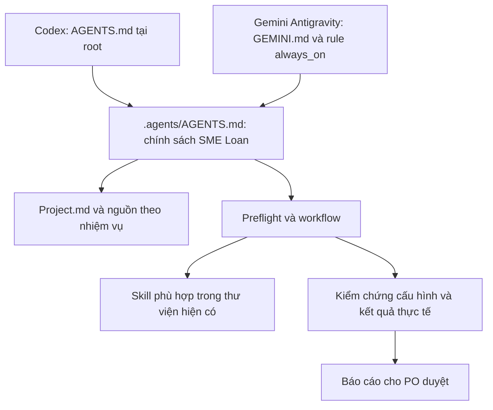

# Khảo sát và kế hoạch chuyển bộ quy tắc AI sang SME Loan

Ngày khảo sát: 18/10/2026. Phạm vi: cấu hình và tài liệu AI trong repository này.
Yêu cầu PO đã cho phép khảo sát → lập kế hoạch → triển khai cục bộ → trình kết quả duyệt.
Đây là khảo sát/kế hoạch giai đoạn đầu. **Cập nhật:** PO đã duyệt phương án với CodeGraph bắt buộc; xem [quyết định và triển khai bổ sung](2026-10-18-codegraph.md). Những mô tả CodeGraph tùy chọn dưới đây là lịch sử đề xuất, đã được thay bằng chính sách v1.1. Việc duyệt không phải quyết định nghiệp vụ ngân hàng.

## 1. Phương pháp và bằng chứng

- Đọc toàn bộ 8 file điều phối ban đầu: `.agents/AGENTS.md`, `.agents/AI-SETUP.md`, `.agents/skills.json`, 3 file trong `.agents/rules/`, 2 file trong `.agents/workflow/`.
- Kiểm kê toàn bộ 56 `SKILL.md`, metadata và nhóm thư mục; đọc sâu các skill có ảnh hưởng đến bootstrap, thiết kế, kế hoạch, kiểm chứng, review và chỉnh skill. Không khẳng định đã kiểm toán mọi script/tài nguyên trong thư viện.
- Đối chiếu `README.md`, 2 `package.json`, Prisma schema, guard/JWT, workflow service, API client, prediction service/schema và script khởi động/kiểm thử.
- Chỉ đọc code/cấu hình; không đăng nhập ứng dụng, gọi API nghiệp vụ, khởi động stack, seed, migrate, huấn luyện hoặc thay dữ liệu.
- Kiểm tra PATH: có Codex `0.162.0-alpha.17.2`, Node/npm; không thấy Gemini CLI hoặc CodeGraph. Có tên lệnh `rtk`, chưa kiểm chứng tính tương thích của wrapper đó.
- Theo PO xác nhận trong hội thoại: Gemini sử dụng qua **Antigravity**, không phải Gemini CLI.
- Git ban đầu: `?? .agents/`; chưa có thay đổi tracked. Lỗi ownership khi đọc Git được xử lý bằng `git -c safe.directory=<repo> ...` theo từng lệnh, không sửa cấu hình Git toàn cục.

## 2. Kết quả khảo sát

| ID | Phát hiện có bằng chứng | Ảnh hưởng | Xử lý dự kiến |
|---|---|---|---|
| F01 | `.agents/AGENTS.md` và `rules/ai-rules.md` ghi ManagementFinance; module `src/Backend`, `src/Admin-web`, `src/Client-app` | AI có thể tìm/sửa sai module | Thay bằng `backend/`, `frontend/`, `ml-service/`, `docs/` |
| F02 | Không có `AGENTS.md`/`GEMINI.md` ở root khi khảo sát | Codex mở root không mặc nhiên kế thừa file chỉ nằm dưới `.agents/` | Tạo entrypoint tại root |
| F03 | File `rules/ai-rules.md` thiếu frontmatter; `ai-delivery-workflow.md` chỉ có `auto_execution_mode`/`description` | Không đạt định dạng rule hiện được Antigravity công bố | Thêm trigger hợp lệ, mô tả đúng phạm vi |
| F04 | `trigger: always_on` ở file AGENTS được diễn giải là bảo đảm cho mọi AI | Trộn cơ chế riêng từng host | Giải thích riêng Codex và Antigravity; file AGENTS/GEMINI không cần frontmatter |
| F05 | Bắt đọc `ManagementFinance/Project.md`; file Project hiện có ở đường dẫn docs dài chỉ ghi “Hôm nay là 1 ngày tuyệt vời” | Không có bản đồ context dùng được | Tạo `Project.md` tại root làm mục lục có bằng chứng, không sao chép đặc tả |
| F06 | Bắt RTK cho mọi lệnh, bắt CodeGraph nhưng package/root manifest không có dependency này | Workflow có thể kẹt hoặc tự tải gói | Đưa thành tùy chọn; dùng `rg` và đọc call site thay thế |
| F07 | Bắt `npm test` nhưng cả backend/frontend không có script test/lint | Báo cáo kiểm thử sai hoặc lệnh không chạy | Ghi đúng build hiện có; phân biệt build với behavioral test |
| F08 | Route `code-review-expert` không có trong bộ skill | Không thực hiện được route | Route tới `mattpocock/.../engineering/code-review/SKILL.md` có thật |
| F09 | 4 phase bắt mọi task; debugging bắt cả khi không có lỗi | Quá tải việc hỏi thông tin/tài liệu | Preflight chung, quy trình theo loại và mức tác động |
| F10 | Chờ duyệt lặp lại cho mọi thay đổi không nhỏ | Xung đột khi PO đã giao trọn việc triển khai rồi duyệt kết quả | Tôn trọng phạm vi đã được giao; vẫn chờ khi chỉ giao plan hoặc có tác động cần quyết định mới |
| F11 | Trỏ bảo mật tới ổ D: của máy khác và memory `/memories/repo/...` không có ở repo | Tham chiếu đứt, khó phục hồi context | Dùng tài liệu tương đối nằm trong repo |
| F12 | Quy tắc cũ buộc mọi query lọc `userId/idaccount`, dành cho tài chính cá nhân | Không đúng quyền nhiều vai trò và phân công hồ sơ SME | JWT + active role được cấp + quyền đối tượng; phạm vi chi nhánh chưa chốt phải ghi rõ |
| F13 | Quy tắc cũ nói bảo đảm 100% tuân thủ pháp luật/PCI-DSS từ Markdown | Không có bằng chứng đánh giá pháp lý/hệ thống | Đặt yêu cầu bảo vệ dữ liệu, không chứng nhận tuân thủ |
| F14 | `start-local.ps1` và `run-local-dev.ps1` chạy `prisma:push`, `prisma:seed` | “Chạy local” có thể đổi schema/dữ liệu | Xem trước side effect, xác định DB và quyền thao tác |
| F15 | `backend/scripts/check-workflow.cjs` tạo/xóa user/company/loan qua API và Prisma; mặc định API cổng 3001 | Không phải test thuần read-only, có nguy cơ API/DB không cùng môi trường | Chỉ chạy khi được phép trên DB test phù hợp; không chạy trong nhiệm vụ setup AI |
| F16 | Các skill imported có `write_to_file`, `ask_question`, `TypeName`, hard gate duyệt/commit và subagent | Không portable nguyên xi sang Codex; dễ vượt phạm vi | Chính sách dự án ưu tiên trong phạm vi chỉ dẫn repo; map tool tương đương và giữ quyền PO |
| F17 | Thư viện có 4 deprecated, 9 in-progress, 2 personal; skills.json không mô tả mức áp dụng | Có thể dùng nhầm skill cũ hoặc gắn với máy tác giả | Kiểm kê, route mặc định chỉ tới skill phù hợp; skill chuyên biệt chỉ khi có yêu cầu |
| F18 | Có hai bộ Git riêng trong `skills/superpowers/.git`, `skills/mattpocock/.git`; toàn `.agents` chưa tracked | Sao chép/chia sẻ không đồng nghĩa thư viện sẽ được Git mang theo đầy đủ | Giữ nguyên thư viện; nêu yêu cầu kiểm tra packaging trước commit |
| F19 | ML schema ghi xác suất **trễ SLA**; tài liệu nghiệp vụ nói train dữ liệu tổng hợp | Dễ bị mô tả sai thành rủi ro vỡ nợ/duyệt tín dụng | Đưa giới hạn ML vào core và Project; không tự thêm quyết định vay |
| F20 | `Phan_quyen_va_luong_nghiep_vu.md` còn mục “Cần họp…” | Hiện trạng code chưa đồng nghĩa yêu cầu đã PO chốt | Phân biệt trạng thái bằng chứng và câu hỏi nghiệp vụ |

Tên dự án cũ được xác nhận từ nội dung file là **ManagementFinance**. PO mô tả nguồn là Zyro; chưa có bằng chứng trong các file điều phối để xác nhận mối quan hệ hai tên này. Việc chuyển đổi không phụ thuộc giải quyết tên nguồn.

## 3. Đánh giá thư viện skill

| Nhóm | Số skill | Hướng áp dụng |
|---|---:|---|
| Superpowers | 15 | Chọn theo task; giữ debug, verification, browser testing, planning; có adapter cho khác biệt tool và quyền thực thi |
| Matt Pocock engineering | 17 | Chọn theo yêu cầu thực tế: code-review, domain-modeling, codebase-design, prototype, research… |
| Matt Pocock productivity | 5 | Làm rõ/handoff khi cần; không buộc phỏng vấn dài cho mọi prompt |
| Matt Pocock misc | 4 | Theo yêu cầu riêng; không tự cài hook/dependency |
| Matt Pocock personal | 2 | Không mặc định áp dụng |
| Matt Pocock deprecated | 4 | Không route mặc định |
| Matt Pocock in-progress | 9 | Không route mặc định |
| **Tổng** | **56** | Giữ nguyên nội dung vendor, không sửa hàng loạt |

Kiểm kê đầy đủ với đường dẫn, tên, mô tả, nhóm và SHA-256 được lưu trong [skills-inventory.json](skills-inventory.json). Đây là kiểm kê tĩnh; không chứng minh host đã discover/activate mọi skill.

## 4. Các phương án và quyết định thiết kế

| Phương án | Lợi ích | Hạn chế |
|---|---|---|
| A. Chỉ thay tên trong `.agents/AGENTS.md` | Nhanh | Bỏ sót entrypoint Codex, rule syntax và các ràng buộc sai |
| **B. Entrypoint riêng, policy chung, vendor giữ nguyên — chọn triển khai** | Dễ review, ít drift, portable, không thay hành vi ứng dụng | Cần mở phiên mới và kiểm tra cơ chế nạp thực tế mỗi host |
| C. Viết lại toàn bộ 56 skill, cài hook và công cụ toàn máy | Có thể tuỳ biến sâu | Phạm vi lớn, khó cập nhật, thay môi trường ngoài repo và không bảo đảm tuyệt đối |

“Bắt buộc” trong repo là quy ước AI phải tuân theo mọi prompt trong workspace; nó không vượt quyền host/system, không bảo đảm mô hình không bao giờ sai và không thay thế sandbox/quyền dữ liệu. Không thêm cài đặt global hoặc hook có tác động bên ngoài ở đợt này.

## 5. Kế hoạch triển khai và nghiệm thu

### T1 — Chốt baseline và kiểm tra cấu hình

- [x] Tạo script `scripts/check-ai-rules.mjs`, không dùng dịch vụ hoặc dependency mạng. Dùng Node có sẵn vì môi trường hiện tại chặn chạy file PowerShell; không thay execution policy.
- [x] Chạy trước triển khai để xác nhận các điều kiện còn thiếu thực sự bị phát hiện.
- [x] Ghi kiểm kê skill và hash nội dung vendor trước khi sửa rule.

Nghiệm thu: kiểm tra trước thay đổi phải thất bại có lý do rõ, không ghi DB, không in secret.

### T2 — Entrypoint và ngữ cảnh

- [x] Tạo `AGENTS.md`, `GEMINI.md`, `Project.md` tại root.
- [x] Giữ bản đồ nguồn theo hiện trạng code, ghi rõ phần nghiệp vụ chưa chốt.
- [x] Không sửa tài liệu nghiệp vụ gốc hoặc file Project placeholder cũ.

Nghiệm thu: root entrypoint yêu cầu đọc core; Project trỏ tới nguồn có thật; không thêm nghiệp vụ mới.

### T3 — Chuyển bộ điều phối `.agents`

- [x] Viết lại `.agents/AGENTS.md`, `.agents/AI-SETUP.md`, `.agents/skills.json`.
- [x] Viết lại 3 rule và 2 workflow có sẵn; thêm `rules/data-security.md`.
- [x] Ghi adapter: project scope/user authority, tool mapping, approval, subagent, Git và context recovery.
- [x] Route theo thông tin/tài liệu/kế hoạch/code/debug/review/UI/vận hành/ML, kiểm tra các skill có thật.

Nghiệm thu: không còn dự án/đường dẫn cũ trong file điều phối đang áp dụng; tất cả rule có frontmatter hợp lệ; không yêu cầu tool không có.

### T4 — Kiểm chứng và bàn giao PO

- [x] Thêm bộ tình huống nghiệm thu và hướng dẫn smoke test phiên mới cho cả hai host.
- [x] Chạy script kiểm tra cấu hình; kiểm tra path/link, rule ID, route skill và integrity vendor.
- [x] Review độc lập các tình huống bằng agent theo hướng dẫn `writing-skills`; ghi đúng đây là mô phỏng/review, không phải kiểm chứng live Antigravity.
- [x] Ghi báo cáo kết quả, mục còn chưa xác minh và quyết định PO cần duyệt.

Nghiệm thu: kiểm tra cấu hình pass; không thay code ứng dụng/DB; không đánh dấu smoke test chưa chạy thành pass.

## 6. Quyền thực hiện, phạm vi và hoàn tác

Cho phép trong đợt này: chỉnh rule/entrypoint/context/tài liệu, thêm script read-only để kiểm tra cấu hình và bộ tình huống nghiệm thu. PO đã yêu cầu triển khai trước khi trình kết quả, nên không tạo thêm gate duyệt lặp giữa bước 2 và 3.

Chưa được yêu cầu: cài/cập nhật tool toàn máy, thay config global, commit/push/merge, deploy, thay business logic, startup/seed/reset DB, huấn luyện model. Không thực hiện các mục này.

Hoàn tác có chọn lọc: xem danh sách file ở báo cáo; bỏ entrypoint mới để ngừng nạp từ root, phục hồi các file rule từ bản baseline nếu cần. Không dùng `git reset --hard`/`git clean` vì `.agents` ban đầu chưa tracked. Snapshot file điều phối gốc được lưu [original-rules.json](original-rules.json), chỉ là bằng chứng/hoàn tác và không phải hướng dẫn đang có hiệu lực.

## 7. Nguồn cơ chế host

Đối chiếu tài liệu chính thức ngày 18/10/2026; cần smoke test trên phiên bản/cấu hình của người dùng:

- [OpenAI: Custom instructions with AGENTS.md](https://learn.chatgpt.com/docs/agent-configuration/agents-md): cơ chế nạp theo root → working directory và giới hạn dung lượng.
- [OpenAI: Build skills](https://learn.chatgpt.com/docs/build-skills): vị trí `.agents/skills`; không xem `skills.json` của repo là cấu hình bắt buộc của Codex.
- [Google Antigravity: Rules](https://www.antigravity.google/docs/rules/): entrypoint/root rule và frontmatter cho rule module.
- [Google Antigravity: Agent skills](https://www.antigravity.google/docs/skills/): cấu trúc `SKILL.md` và thư mục skill.

Không suy diễn cơ chế import/context của Gemini CLI thành cơ chế Antigravity.
