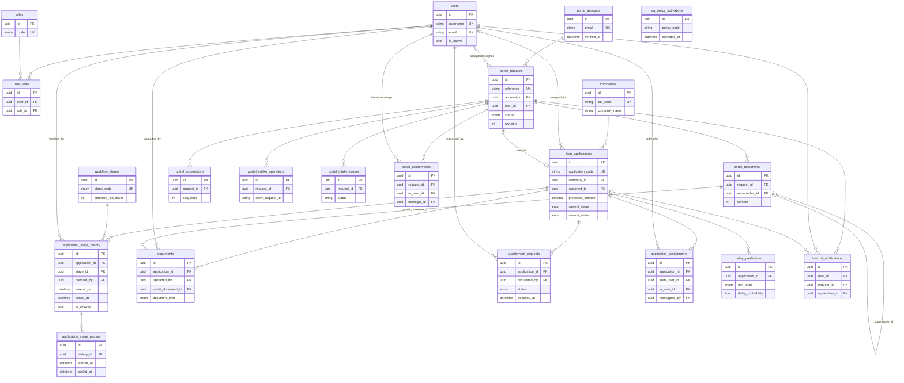
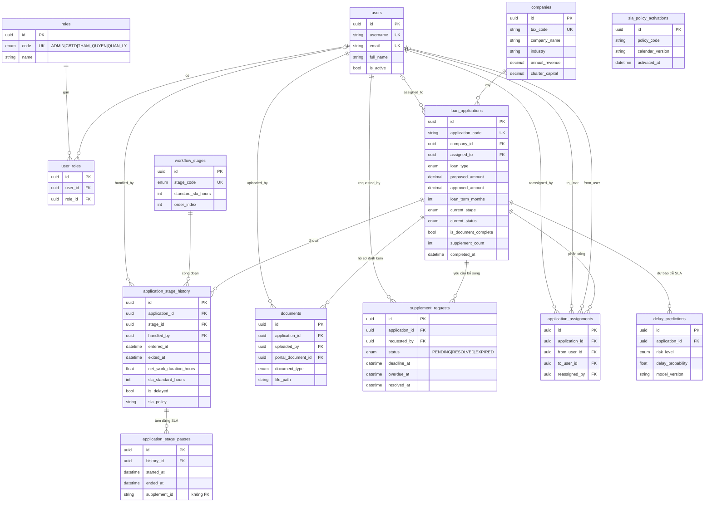
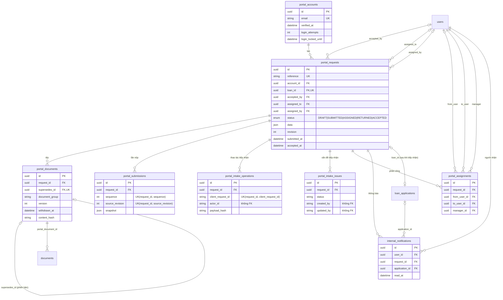

# ERD — SME Loan Workflow

Nguồn: [backend/prisma/schema.prisma](../../backend/prisma/schema.prisma) (23 bảng). Sơ đồ Mermaid; xem bằng preview Markdown trong VS Code (cần extension hỗ trợ Mermaid) hoặc dán vào mermaid.live.

Quy ước: `PK` khóa chính, `FK` khóa ngoại, `UK` duy nhất. Chỉ liệt kê cột chính (khóa, trạng thái, mốc thời gian quan trọng); đầy đủ cột xem schema.

## 0. Sơ đồ gộp một hình (cột chính)

## 1. Lõi nghiệp vụ: người dùng, doanh nghiệp, hồ sơ vay, workflow/SLA, AI

`sla_policy_activations` không có quan hệ khóa ngoại (bảng mốc hiệu lực T0, tra theo `activated_at`).

## 2. Cổng doanh nghiệp (Portal) và cầu nối sang hồ sơ nội bộ

## Ghi chú khi đối chiếu

- `documents.portal_document_id` nối tệp nội bộ với tệp từ cổng; `portal_requests.loan_id` (UK) là cầu 1–1 từ yêu cầu cổng sang hồ sơ vay sau khi tiếp nhận.
- Cột không có khóa ngoại (chỉ lưu id/chuỗi): `application_stage_pauses.supplement_id`, `portal_intake_operations.actor_id`, `portal_intake_issues.created_by/updated_by`, `sla_policy_activations.activated_by`.
- Xóa dây chuyền (`onDelete: Cascade`): từ `loan_applications` xuống `application_stage_history`, `documents`, `supplement_requests`, `application_assignments`, `delay_predictions`; từ `application_stage_history` xuống `application_stage_pauses`; từ `users` xuống `user_roles`. Các bảng Portal dùng `NoAction`.
- Ràng buộc "tối đa một khoảng tạm dừng đang mở mỗi công đoạn" nằm trong SQL (sla-pa1.sql), không thấy trong Prisma schema.
