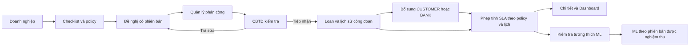

# Portal V2 và SLA PA1 — Implementation Plan

Ngày: 26/10/2026. Trạng thái: gói 1 đã triển khai source và kiểm thử; gói 2–9 chưa triển khai. Chưa áp migration hoặc mở nộp V2. Bằng chứng và giới hạn build chuẩn: [bàn giao gói 1](../../handover/2026-10-26-portal-policy-package-1.md).

> Thực hiện từng gói với checkpoint theo chính sách SME Loan. Không tự sinh subagent, commit/push, cài dependency hoặc gate duyệt lại từ boilerplate skill. Phê duyệt nghiệp vụ đã có trong hội thoại; checkpoint dùng để trình kết quả và xử lý tác động ngoài quyền.

**Goal:** Hiện thực checklist và chỉnh sửa có phiên bản trước tiếp nhận, trách nhiệm xử lý của chi nhánh, SLA giờ làm việc theo bên đang chờ, và kiểm soát tính tương thích ML.

**Architecture:** Giữ NestJS/Prisma/PostgreSQL, React và FastAPI hiện có. Tách đánh giá policy, phiên bản đề nghị/kiểm tra và phép tính thời gian thành các module nghiệp vụ có giao diện rõ. Các phần Portal, SLA và ML có đầu ra nghiệm thu riêng, không mở sử dụng trước khi luồng phụ thuộc đạt.



**Tech Stack:** TypeScript, NestJS, Prisma 6.19, PostgreSQL; React 18/Vite; Node test runner hiện có; Python/FastAPI/scikit-learn hiện có. Không thêm thư viện mặc định.

**Baseline:** [Quyết định và quy tắc đã duyệt](../specs/2026-10-26-portal-v2-sla-pa1-approved.md).

**Trách nhiệm:** Lead BA quản lý bộ kiểm tra, đối chiếu chức năng và chốt đạt/chưa đạt theo baseline; Lead FullStack triển khai và kiểm chứng kỹ thuật; PO quyết định thay đổi nghiệp vụ và nghiệm thu cuối. [Ảnh hưởng tới luồng chính và ma trận phê duyệt](../../handover/2026-10-26-impact-and-next-steps.md). [48 ca nghiệp vụ BA](../../testing/portal-v2-policy/TEST_CASES.md).

## 1. Giới hạn và thứ tự

- Không đổi stage, quyền tín dụng, ngưỡng 10 tỷ, định mức SLA, Company tự động hoặc ý nghĩa ML.
- Không thay thời hạn 5/10 ngày; phải hồi quy reminder/close khi thêm bên đang chờ.
- Chưa thêm luồng mở lại hồ sơ, gia hạn, ký số, OCR, lịch nghỉ tự tải hoặc tài chính nhiều kỳ cho Company.
- Tài liệu này xác định thứ tự triển khai; chưa cho rằng DB đích hoặc browser có sẵn.
- Các tên module/API mới dưới đây là thiết kế dự kiến, chưa phải contract đang chạy.
- Gói 1–4: Portal; gói 5–7: PA1 và bổ sung; gói 8: ML; gói 9: tích hợp, UI, phát hành.
- Gói 5 có thể được phát triển độc lập, nhưng chỉ kích hoạt sau gói 6–9.

## 2. Bản đồ ảnh hưởng ngang và đường truy vết

| Phần | Đường cha → con → biên dữ liệu | Mức ảnh hưởng / hành động |
|---|---|---|
| Checklist | PortalWizard → /form-config,/readiness,/checklist → policy/foundation/readiness → tài liệu A–F | Cao: cùng luật ở client/server, server quyết định. |
| Gửi và sửa | PortalWizard → PortalService.submit → policy → physicalFiles → snapshot → Prisma | Cao: thêm phiên bản, bảo vệ lịch sử tệp và dữ liệu. |
| Tiếp nhận | PortalIntakeQueue → controller.accept → service.accept → snapshot/policy/companyReadiness → Company/Loan/history | Cao: chỉ đúng CBTD và revision đạt; Company mismatch vẫn chặn. |
| Phân công | IntakeAssignment → service.assign → PortalAssignment/notification | Cao: điều chuyển không được đổi trạng thái trả sửa thành đủ tiếp nhận. |
| Tiến độ/vướng mắc | Tracking/Intake → tracking builder/issue store → Portal view | Vừa: trạng thái mới có mapping rõ; không lộ nội bộ. |
| SLA | Loan create/portal accept/workflow.transition/close → stage history → calculator/policy/calendar | Cao: mọi điểm mở/đóng lịch sử phải cùng quy tắc. |
| Bổ sung | respond → response manifest; review → item decision; return/resolve → wait phase và pause | Cao: khóa Loan + supplement, idempotency, giữ trạng thái chặn workflow. |
| Reminder/đóng | hourly scanner/dashboard/close-overdue → wait phase/deadline → notification/history | Cao: không nhắc/đóng do ngân hàng còn kiểm tra; không reset deadline. |
| ML | workflow/resolve/reassign/manual → PredictionService → FastAPI/persistence → Dashboard/LoanDetail | Cao: phân biệt 0/null và policy; chưa đủ tương thích thì báo chưa khả dụng. |
| Dữ liệu cũ | nullable additive fields → legacy branch → báo cáo theo phiên bản | Cao: không backfill giờ làm việc từ dữ liệu thiếu. |

CodeGraph đã kiểm tra ngày lập plan: 135 files; context/deps/fn-impact cho accept, tracking, reminders, supplements và prediction. Graph không chứng minh cạnh HTTP/DI/ORM đầy đủ; đường trên đã nối bằng source. Khi bắt đầu sửa từng gói, kiểm tra freshness và truy tiếp các caller/callee phát hiện thêm; không coi danh sách hiện tại là chứng minh đã kiểm thử runtime.

## Gói 1 — Hợp đồng nghiệp vụ và policy MVP có thể đánh giá

**Files:** sửa `backend/src/modules/portal/{portal.policy,portal.readiness,portal.foundation,portal.validation}.ts`, `frontend/src/portal/model.ts`; tạo `backend/src/modules/portal/portal.approved-policy.ts`, `backend/test/portal-approved-policy.test.cjs`.

**Interface dự kiến:** `evaluateIntakeReadiness(policy, data, documents, { phase, submittedAt })` trả `{ missingFields, missingDocuments, requirements, dataReady }`; requirement có ID ổn định, điều kiện, kỳ, bằng chứng thay thế và thời điểm đến hạn. `getApprovedPolicy(version)` chỉ chọn từ registry server tin cậy; client không gửi policy có quyền kích hoạt.

- [x] Viết test các bảng A–F: OR chỉ giữa bằng chứng đầu ra C; F false khác undefined; E chưa xác định không gửi; 0 thật khác thiếu; bộ bốn thành phần B có thể nằm trong một tệp; sai năm/nguồn bị chặn.
- [x] Tách policy test cách ly và policy demo được duyệt. Không nới `resolveTestPolicy` để đưa TEST_ONLY vào môi trường thông thường.
- [x] Bổ sung thông tin thành phần BCTC và tư cách đại diện vào contract có validation allowlist; metadata coverage được giữ trong cấu trúc snapshot hiện có. Người khai đủ chưa phải người xác minh. Gói sau tích hợp snapshot của policy mới vào gửi/accept.
- [x] Bộ đánh giá nhận thời điểm gửi từ server để chốt năm hoàn thành theo giờ Việt Nam, hỗ trợ đánh giá INTAKE bằng cùng thời điểm. Endpoint hiện chỉ preview DRAFT; không diễn giải lại snapshot đã gửi của policy cũ. Tích hợp gửi/accept mới ở gói 2–3.
- [x] Registry và cấu hình API dùng cùng policy; dataReady không tự đại diện cho canSubmit hay phê duyệt tín dụng.

Thực tế gói 1: thêm `portal.approved-policy.ts`, sửa service để cung cấp `approvedIntakePolicy`/`approvedIntakeAssessment`, giữ `portal.readiness.ts` và `portal.validation.ts` cũ để bảo toàn contract legacy; đồng bộ validation draft mới trong `frontend/src/portal/wizard.ts` ngoài model types. Có script `npm.cmd --prefix backend run test:portal-policy`. Không thêm control UI trong gói này.

**Kiểm chứng gói 1 đã ghi nhận:** `npm.cmd --prefix backend run test:portal-policy` đạt 44/44; hồi quy rộng 97 backend và 36 frontend đạt. Build/Prisma Client chuẩn có giới hạn môi trường; compile/bundle tách riêng đạt. Xem evidence tại bàn giao gói 1; chưa nghiệm thu HTTP/PostgreSQL/UI thật.

## Gói 2 — Schema bổ sung và phiên bản đề nghị

**Files:** sửa `backend/prisma/schema.prisma`, `backend/src/modules/portal/portal.snapshot.ts`; tạo `backend/prisma/portal-v2-review-revisions.sql`, `backend/src/modules/portal/portal.revisions.ts`, `backend/test/portal-revisions.test.cjs`.

**Thiết kế:** thêm `PortalRequestRevision` lưu phiên bản làm việc/bản đã gửi, dữ liệu, policy, manifest và kiểm tra theo mục; `PortalIntakeEvent` cho lịch sử và đề nghị tự xin sửa; `PortalIntakeIssue` cho vướng mắc có đầu mối. Trạng thái Portal thêm nhánh trả sửa, không thêm stage/status Loan. Bản đã gửi và tệp được tham chiếu không bị sửa/xóa vật lý; bản nháp mới tham chiếu tệp giữ lại và phiên bản thay thế. Giữ projection hiện có cho consumer V1/V2, nêu rõ nguồn dữ liệu canonical khi tích hợp.

- [ ] Viết test bất biến snapshot cũ, mỗi request tối đa một working revision, gửi lặp không tạo revision trùng, actor khác chủ sở hữu bị chặn, thay MST chủ thể bị chặn.
- [ ] Viết SQL bổ sung; nullable/default tương thích dữ liệu cũ, FK/index bảo vệ liên kết request/revision/tệp và sequence unique.
- [ ] `returnForCorrection(requestId, expectedRevision, items, user)` khóa request, kiểm tra CBTD được giao, lưu bản đã gửi và mở working revision.
- [ ] `resubmit(requestId, expectedRevision, documentIds, accountId)` đánh giá policy, kiểm tra bytes/hash, công bố bản mới và hủy kết quả review bị ảnh hưởng trong cùng transaction.
- [ ] Giao dịch nhận và trả sửa cạnh tranh chỉ một bên thành công; client phải tải lại nếu revision/assignment đổi.
- [ ] Kiểm tra nhận diện tệp archived: giữ bytes và quyền đọc snapshot cũ; delete/replace chỉ sửa working set, không phá manifest cũ.

**Kiểm chứng:** build backend; `node --test test/portal-revisions.test.cjs test/portal-snapshot.test.cjs test/portal-assignment.test.cjs`. SQL chỉ soát tĩnh trong gói; kiểm chứng migration thật ở schema cách ly trong gói 9.

## Gói 3 — Kiểm tra tiếp nhận, phân công và xử lý vướng mắc

**Files:** sửa `backend/src/modules/portal/{portal.controller,portal.service,portal.module,portal.tracking}.ts`, `backend/test/portal-{assignment,tracking}.test.cjs`; tạo `backend/src/modules/portal/portal.intake-review.ts`, `backend/test/portal-intake-review.test.cjs`.

**Interfaces dự kiến:** review theo `(requestId, revisionId, requirementId, decision, reason, expectedRevision)`; issue theo `(requestId, category, evidenceRefs, proposedAction, ownerId, resolution)` với RBAC và bản an toàn cho doanh nghiệp.

- [ ] Test CBTD khác phân công bị chặn; QUAN_LY điều phối nhưng không accept bằng vai trò quản lý; từng mục cần sửa có lý do; NOT_APPLICABLE chỉ do policy.
- [ ] Checklist review gắn đúng revision/document hash. Sửa điều kiện áp dụng phải đánh giá lại các mục phụ thuộc.
- [ ] Accept chỉ khi mandatory review đạt, không có vướng mắc chặn; giữ Company mismatch; tạo đúng một Loan RECEIVED, chưa tự CHECKED.
- [ ] Assign khi đang trả sửa giữ trạng thái chờ sửa và working revision; không dùng nhánh hiện tại luôn ghi ASSIGNED để vượt kiểm tra.
- [ ] Đề nghị tự xin sửa của doanh nghiệp không tự mở khóa; chưa có người nhận thì vào danh sách quản lý cần phân công, không tự định tuyến ngoài chi nhánh.
- [ ] Vướng mắc có người chịu trách nhiệm, phương án, phản hồi công khai an toàn và ghi chú nội bộ tách biệt; cập nhật policy/Company ngoài quyền không có đường bypass.
- [ ] Tracking có mapping cho trạng thái sửa/chờ kiểm tra/chờ đối soát; kiểm tra không fallback nhầm thành vừa gửi và không lộ nội bộ.

**Kiểm chứng:** build; `node --test test/portal-intake-review.test.cjs test/portal-assignment.test.cjs test/portal-tracking.test.cjs test/companies-access.test.cjs test/loan-access.test.cjs`.

## Gói 4 — Giao diện Portal và Intake đầy đủ vòng sửa

**Files:** sửa `frontend/src/portal/{PortalWizard,PortalApplicationTracking}.tsx`, `frontend/src/components/{PortalIntakeQueue,PortalIntakeDetails,IntakeAssignment}.tsx`, client/model tương ứng; tạo component checklist/review theo trách nhiệm và `frontend/src/portal/intake-review.test.mjs`.

- [ ] Test logic trạng thái: thiếu/chưa phù hợp/đã cung cấp chờ kiểm tra/cần sửa; trường false/0; điều kiện gửi phụ thuộc kết quả máy chủ mới nhất.
- [ ] Doanh nghiệp thấy từng mục, căn cứ áp dụng, kỳ, loại thay thế và liên kết sửa; một tệp có thể khai đủ các thành phần bộ mô phỏng nhưng chưa hiển thị đã xác minh.
- [ ] CBTD có màn kiểm tra từng mục, danh sách sửa tổng hợp, phần khác giữa revision, đối soát Company và vướng mắc.
- [ ] Gửi lại dùng cùng request, không tải lại tài liệu không đổi; xử lý mất phản hồi bằng tải lại trạng thái, không tự tạo request mới.
- [ ] Mọi async response phải kiểm tra target/role/revision hiện tại; nút disabled khi dữ liệu đã đổi chưa đối chiếu lại.
- [ ] Quản lý thấy phân công, trả sửa, vướng mắc, người chịu trách nhiệm và tuổi chờ; doanh nghiệp không thấy ghi chú nội bộ.

**Kiểm chứng:** `npm.cmd --prefix frontend run test:portal`, `test:intake`, `test:tracking`, test mới bằng Node và build. Sau đó kiểm tra browser thực ở gói 9; source/UI text tests không chứng minh giao diện.

## Gói 5 — Bộ tính PA1 và phiên bản lịch

**Files:** tạo `backend/src/modules/workflow/{sla-time,sla-policy}.ts`, `backend/test/sla-time.test.cjs`, `backend/prisma/sla-policy-pauses.sql`; sửa schema và admin SLA/config tương ứng.

**Model dự kiến:** `SlaPolicyVersion` chứa timezone, các khoảng giờ, ngày nghỉ, thời điểm hiệu lực, trạng thái công bố; history tham chiếu policy nullable (null = legacy); `StagePauseInterval` có historyId, supplementId, startedAt, endedAt, event ID. Unique event và một pause mở trên một history. Tổng giờ hiện có là projection, không nguồn duy nhất cho PA1.

**Pure interface:** `calculateSla({ enteredAt, endedAt, calendar, pauses })` trả `{ elapsedHours, businessHours, pausedBusinessHours, netWorkHours }`. Không có I/O hoặc thời gian hệ thống ẩn; hợp nhất khoảng trùng trước khi trừ; không làm tròn từng pause.

Ví dụ test bắt buộc cho interface mới:

```ts
const result = calculateSla({
  enteredAt: new Date('2026-10-23T16:00:00+07:00'),
  endedAt: new Date('2026-10-26T10:00:00+07:00'),
  calendar: { timezone: 'Asia/Ho_Chi_Minh', weekdays: [1,2,3,4,5],
    windows: [['08:00','12:00'],['13:00','17:00']], holidays: [] },
  pauses: [{ startedAt: new Date('2026-10-23T16:30:00+07:00'),
    endedAt: new Date('2026-10-26T09:00:00+07:00') }],
});
assert.equal(result.businessHours, 3);
assert.equal(result.pausedBusinessHours, 1.5);
assert.equal(result.netWorkHours, 1.5);
```

- [ ] Thêm test nghỉ trưa, cuối tuần, ngày nghỉ cấu hình, 0 giờ thật, pause đang mở, pause trùng, ranh giới ngày/năm và sai thứ tự timestamp.
- [ ] Công bố calendar bất biến; bản thay đổi tạo version mới, không sửa bản đang được history tham chiếu. Chỉ ADMIN cấu hình, lịch nghiệp vụ có nguồn xác nhận; chưa đủ lịch thì chưa kích hoạt.
- [ ] Chọn policy tại thời điểm mở công đoạn và lưu trong transaction. NULL history giữ legacy; không backfill pause intervals từ tổng cũ.
- [ ] Chỉ làm tròn trình bày; trạng thái trễ so sánh thời gian chính xác `netWorkHours > slaStandardHours`.

**Kiểm chứng:** build; `node --test test/sla-time.test.cjs`. Migration chỉ áp schema cách ly tại gói 9.

## Gói 6 — Tích hợp vòng CUSTOMER/BANK và pause theo trách nhiệm

**Files:** sửa `backend/src/modules/supplements/{portal-supplement,portal-supplements.service,supplements.service,supplements.controller}.ts`, workflow service/module, `loan-applications.service.ts`, `portal.service.ts`, SupplementPanel; tạo `backend/test/supplement-sla-phase.test.cjs`.

**Thiết kế:** wait phase mới CUSTOMER/BANK/COMPLETED gắn policy cho yêu cầu mới trên công đoạn PA1; legacy giữ hành vi cũ. Trạng thái Loan vẫn SUPPLEMENT_REQUIRED tới resolve. Thêm lệnh gửi trả sửa tổng hợp; item review riêng chưa tự mở pause khi cán bộ còn kiểm tra.

- [ ] Test create → pause; upload lẻ vẫn pause; respond đủ → resume; review chưa kết thúc lượt → vẫn BANK; gửi sửa tổng hợp → pause mới; resolve → không cộng pause hai lần.
- [ ] Respond và thay đổi wait phase/pause ghi chung transaction, khóa Loan rồi supplement; giữ UUID replay/CAS và xác minh bytes.
- [ ] Return/resolve/reassign/close cạnh tranh không làm mất pause, không tạo hai pause mở, không cho người đã bị điều chuyển tiếp tục sửa.
- [ ] Không reset đồng hồ hoặc supplementCount theo response/return; không gọi ML ở sự kiện mới nếu chưa có quy tắc duyệt.
- [ ] Mọi điểm mở/đóng history (create Loan, accept, transition, close-overdue) dùng cùng service chính sách/thời gian. Thu hồi hoặc rollback flag không đổi history PA1 đã tạo thành legacy.
- [ ] UI phân biệt chờ doanh nghiệp và ngân hàng kiểm tra; resume không mở quyền chuyển bước khi chứng từ chưa đạt.

**Kiểm chứng:** build; test mới và bộ `portal-supplements*.test.cjs`, `close-overdue.test.cjs`; chưa chạy script tích hợp DB ở gói này.

## Gói 7 — Nhắc hạn, đóng quá hạn và báo cáo

**Files:** sửa `supplement-reminders.service.ts`, `workflow.service.ts`, `dashboard.service.ts`, `frontend/src/components/{SupplementDeadlineBadge,OverdueSupplementsPanel,LoanDetailModal,DashboardView,AdminView}.tsx`; mở rộng test reminders/overdue/close và tạo `backend/test/sla-policy-reporting.test.cjs`.

- [ ] Test response đúng hạn đang BANK không nhận nhắc thiếu hồ sơ hoặc đóng chỉ vì cán bộ chưa kiểm tra; response nộp muộn giữ evidence thời điểm nộp; return không đổi deadlineAt/mốc 5/10.
- [ ] Scanner phải kiểm tra lại trạng thái/bên đang chờ trong transaction khi claim, không chỉ lọc ở lượt đọc đầu. Close tính lại điều kiện và lịch sử response, không chỉ dựa cờ overdue cũ.
- [ ] Loan đã đóng không được respond/review/return/transition; pause cuối chốt một lần.
- [ ] Dashboard phân biệt policy legacy/PA1, tuổi chờ doanh nghiệp/ngân hàng và thời gian thực; không gộp KPI để so sánh sai thước đo. Chưa đặt thêm ngưỡng cảnh báo mới.
- [ ] Loại các nhãn SLA hardcode liên quan khỏi chi tiết; hiển thị đúng định mức snapshot công đoạn và cách tính.

**Kiểm chứng:** build; `test:reminders`, `test:close-overdue`, `test:tracking` backend/frontend; `test:deadlines` frontend; test reporting mới.

## Gói 8 — Kiểm soát ML theo chính sách

**Files:** sửa `backend/src/modules/prediction/prediction.service.ts`, consumer workflow/supplements/assignments/dashboard và UI dự báo; tạo `backend/src/modules/prediction/prediction-compatibility.ts`, `backend/test/prediction-sla-policy.test.cjs`; cập nhật `docs/Bao_cao_Mo_hinh_Machine_Learning.md` nếu có kết quả mới.

- [ ] Test 0 khác null; không fallback giờ thực cho 0; PA1 chưa có model tương thích không được tạo prediction giả; dự báo cũ không tự được coi là dự báo PA1.
- [ ] Gắn compatibility của policy/feature meaning/model theo registry server; giữ dự báo lịch sử và chưa gán nhãn đã nghiệm thu cho PA1.
- [ ] Loại fallback xác suất/risk giả tại consumer nằm trong luồng này; hiển thị trạng thái chưa có dự báo phù hợp. Phân biệt trạng thái này với ML server lỗi.
- [ ] Failure dự báo vẫn không rollback nghiệp vụ đã hoàn tất; báo lỗi khả dụng đúng contract, không thay bằng mock.
- [ ] Chỉ chạy đánh giá tương thích theo phạm vi dữ liệu được phép; nếu cần train hoặc ghi đè artifact thì trình phạm vi riêng. Đánh giá metric cũ không đủ chứng minh PA1.

**Kiểm chứng:** build; test mới dùng HTTP fixture và dependency test doubles được ghi rõ, không thay runtime ML thật; tích hợp HTTP/DB ở gói 9. Chưa tự chạy train script.

## Gói 9 — Kiểm chứng tích hợp, trình duyệt và bàn giao

**Files:** tạo harness `backend/scripts/check-portal-pa1.cjs` và `frontend/scripts/check-portal-pa1-browser.mjs` theo các harness cách ly hiện có; cập nhật README, handover và tài liệu kiểm chứng đúng kết quả thực tế.

- [ ] Refresh CodeGraph sau source/config thay đổi và chạy freshness check.
- [ ] Build artifact backend trước HTTP test; không dùng dist cũ để đối chiếu source mới.
- [ ] Chuẩn bị harness chỉ tạo schema/tệp test có prefix sở hữu; kiểm tra URL/schema trước ghi hoặc cleanup; không in secret, không reset/seed public.
- [ ] Trình rõ DB/API target, hành động tạo/xóa dữ liệu giả lập và cleanup trước khi chạy; sử dụng quyền đã có nếu bao phủ đúng target, không coi đồng ý nghiệp vụ là quyền xóa dữ liệu dùng chung.
- [ ] Kiểm thử cả SQL chuyển đổi trên schema có dữ liệu legacy và schema mới; schema push đơn thuần không chứng minh SQL migration đúng. So sánh các cột cũ và lịch sử trước/sau, giữ tệp được snapshot tham chiếu.
- [ ] HTTP regression: V1 cũ; V2 thiếu/đủ; xin sửa/trả sửa/gửi lại; phân công/điều chuyển; Company mismatch; không truy cập chéo; gửi/accept/review lặp và cạnh tranh; PA1 qua ngày nghỉ; respond/return/close; ML unavailable và ML lỗi.
- [ ] Browser thực: doanh nghiệp thiếu gì/sửa gì, CBTD review, quản lý giao việc/xử lý vướng mắc, đồng hồ theo bên chờ, người dùng ngoài quyền không thao tác được. Nếu tool browser không có, ghi rõ chưa nghiệm thu UI, không thay bằng build.
- [ ] Trình evidence theo gói: lệnh/kết quả, môi trường test, ảnh/luồng, giới hạn và cleanup. Không mặc định mọi test đều pass.
- [ ] Chỉ bật policy demo/PA1 sau checkpoint nghiệm thu tương ứng và xác định môi trường. Tách quyền nộp mới khỏi đọc/xử lý hồ sơ đã nộp. Không dùng TEST_ONLY trên server vận hành chung.

## 3. Cách bàn giao từng gói

Mỗi gói có: yêu cầu được bao phủ; đường tác động; diff; test hành vi và hồi quy; ảnh UI nếu có; schema/script chưa áp hoặc đã áp tại target nào; giới hạn còn lại. Chỉ đánh dấu hoàn tất sau kết quả thực tế. Các lệnh được liệt kê trong plan là lệnh dự kiến, không phải bằng chứng đã chạy.

Gói bắt đầu triển khai: **Gói 1 — policy và checklist**. Sau đó gói 2–4 tạo lát cắt Portal có thể nghiệm thu; không mở submit đơn lẻ trước khi review/sửa/accept hoạt động xuyên suốt. Gói 5–7 tạo lát cắt PA1; gói 8 bảo vệ ý nghĩa ML trước khi tích hợp cuối.
