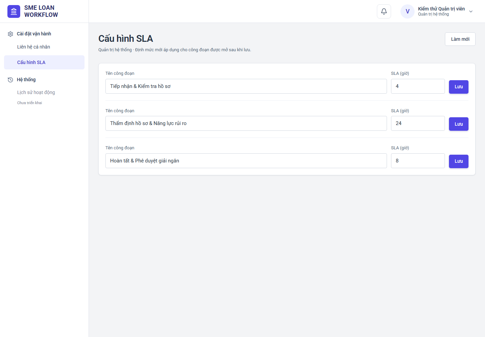
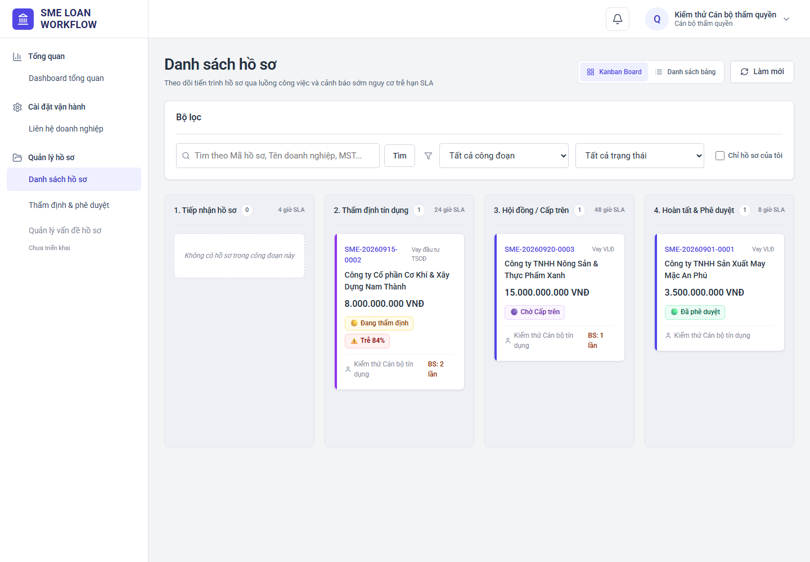
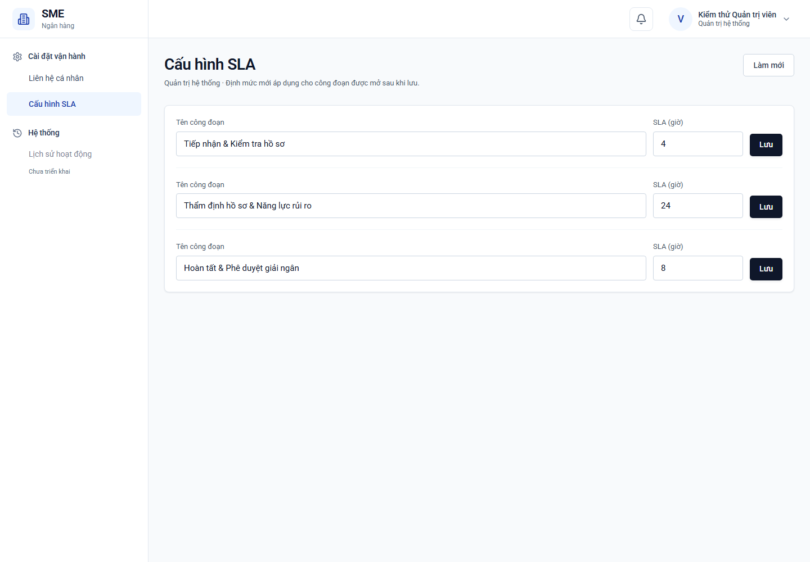
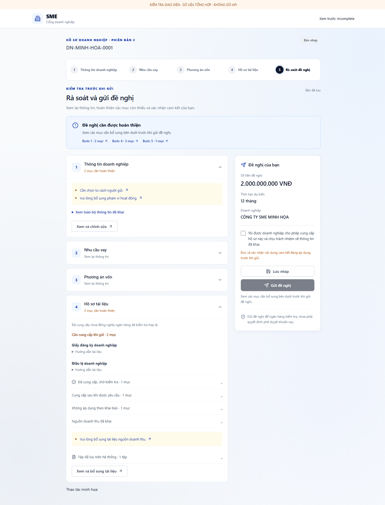

# Review giao diện SME Loan Workflow theo 5 actor

Ngày lập: **05/11/2026**. Phạm vi: giao diện hiện có của **Doanh nghiệp, Cán bộ tín dụng, Thẩm quyền, Quản lý chi nhánh và Admin**.

Tài liệu phục vụ PO review danh mục view, nội dung, thao tác và ranh giới quyền trước khi giao sửa giao diện. Đây là bản bàn giao theo yêu cầu riêng, không thay thế sổ review 7 nhóm trong [SME_MASTER](../docs/SME_MASTER.md).

**Cập nhật sau kiểm tra ngày 05/11/2026:** đã gỡ Cấp trên khỏi view Cấu hình SLA của Admin, kiểm tra trên Chrome local và đối chiếu 5 actor/7 nhóm với Master. Kết quả chi tiết và giới hạn ở **mục 11**. Giao diện hiện tại **chưa khớp hoàn toàn** luồng mới: còn công đoạn Cấp trên trên Kanban/bộ lọc, nút điều phối không đúng actor và chênh lệch trách nhiệm bổ sung giữa Master với code.

**Mức bằng chứng:** đã đi qua 13 view làm việc của 4 actor nội bộ và 5 chế độ xác thực doanh nghiệp trên hệ thống local, không gửi giao dịch nghiệp vụ. Hai view Portal sau đăng nhập chưa kiểm tra live vì tài khoản thử cũ trả 401. Chưa kiểm chứng lại E2E API–DB hoặc mọi trạng thái hồ sơ mới. Các mục “Cần review” trong danh mục bên dưới vẫn là checklist, không đồng nghĩa đã kiểm tra tất cả tiêu chí.

**Cập nhật nhận diện cùng ngày:** màu và logo Ngân hàng đã đồng bộ với Portal theo yêu cầu tiếp theo của PO; xem **mục 12**. Các ảnh ở mục 11 là bằng chứng trước lượt đổi màu/logo, vẫn dùng để đối chiếu các phát hiện chức năng.

## 1. Quy ước đếm và tổng hợp

- **View chính:** màn hình xác thực hoặc khu vực làm việc chính được chọn qua menu/nhánh hiển thị của ứng dụng. View không nhất thiết có URL riêng.
- **View con:** tab, bước wizard, panel hoặc popup nằm trong view chính. Vẫn phải review nhưng không cộng vào số view chính.
- View dùng chung được liệt kê cho từng actor để kiểm tra đúng quyền. Không cộng các dòng theo actor để suy ra số màn hình thiết kế duy nhất.
- Đếm theo **vai trò đang hoạt động**; tài khoản có nhiều vai trò không đồng nghĩa được dùng đồng thời mọi thao tác.
- Menu đang vô hiệu hóa và ghi “Chưa triển khai” không được tính là view đã có.

| Actor | View làm việc sau đăng nhập | View xác thực | Tổng view chính | View mặc định sau đăng nhập |
|---|---:|---:|---:|---|
| Doanh nghiệp | 2 | 5 | **7** | Danh sách đề nghị vay |
| Cán bộ tín dụng — CBTD | 2 | 1 | **3** | Danh sách hồ sơ |
| Thẩm quyền — THAM_QUYEN | 4 | 1 | **5** | Dashboard tổng quan |
| Quản lý chi nhánh — QUAN_LY | 5 | 1 | **6** | Dashboard tổng quan |
| Quản trị hệ thống — ADMIN | 2 | 1 | **3** | Liên hệ cá nhân |

Bốn actor nội bộ dùng chung một màn hình đăng nhập và khung làm việc. Doanh nghiệp dùng Portal riêng tại `/portal`; tài khoản và nội dung công khai tách khỏi không gian cán bộ tại `/`.

Nguồn đếm: [navigation.ts](../frontend/src/navigation.ts), [App.tsx](../frontend/src/App.tsx), [PortalAuth.tsx](../frontend/src/portal/PortalAuth.tsx), [PortalApp.tsx](../frontend/src/portal/PortalApp.tsx).

## 2. Actor Doanh nghiệp — 7 view chính

### DN-01 — Đăng nhập doanh nghiệp

- **Cách vào:** mở `/portal` khi chưa có phiên hợp lệ; chế độ `login`.
- **Nội dung/thao tác theo source:** email, mật khẩu, đăng nhập; liên kết tạo tài khoản và quên mật khẩu.
- **Cần review:** nhận biết rõ cổng doanh nghiệp; nhãn và lỗi nhập liệu; trạng thái đang gửi; phiên hết hạn; đường đi sang đăng ký/khôi phục mật khẩu.
- **Ranh giới:** đăng nhập thành công đưa về danh sách đề nghị của tài khoản; chưa xác minh quyền sở hữu dữ liệu bằng phiên chạy thực tế.

### DN-02 — Tạo tài khoản

- **Cách vào:** chuyển sang chế độ `register` trong màn hình xác thực Portal.
- **Nội dung/thao tác theo source:** email, người liên hệ, số điện thoại, mật khẩu; gửi đăng ký và chuyển sang xác minh email.
- **Cần review:** trường bắt buộc, hướng dẫn mật khẩu, lỗi đăng ký, thông điệp gửi email và cách quay lại đăng nhập.
- **Ranh giới:** đăng ký tài khoản chưa đồng nghĩa đăng nhập thành công hoặc đã gửi đề nghị vay.

### DN-03 — Xác minh email

- **Cách vào:** sau đăng ký hoặc chuyển sang chế độ `verify`.
- **Nội dung/thao tác theo source:** email, mã xác minh; xác minh và gửi lại mã; đếm chờ gửi lại.
- **Cần review:** nhận diện email đang xác minh; mã sai/hết hạn; trạng thái gửi lại; hướng dẫn kiểm tra thư rác; thông báo xác minh thành công.
- **Ranh giới:** thành công quay về đăng nhập; không phải màn hình xét duyệt hồ sơ vay.

### DN-04 — Quên mật khẩu

- **Cách vào:** chọn “Quên mật khẩu?” tại đăng nhập Portal.
- **Nội dung/thao tác theo source:** email; yêu cầu liên kết đặt lại mật khẩu; thông báo kết quả và thời gian chờ gửi lại.
- **Cần review:** câu hướng dẫn, lỗi định dạng email, thông báo gửi yêu cầu và cách trở lại đăng nhập.
- **Ranh giới:** gửi yêu cầu chưa thay đổi mật khẩu.

### DN-05 — Đặt lại mật khẩu

- **Cách vào:** liên kết Portal có tham số đặt lại mật khẩu; chế độ `reset`.
- **Nội dung/thao tác theo source:** mật khẩu mới, xác nhận mật khẩu; gửi đặt lại. Giao diện thông báo liên kết hiệu lực 10 phút và dùng một lần.
- **Cần review:** hai mật khẩu không khớp; liên kết không hợp lệ/hết hạn/đã dùng; thông báo hoàn tất và quay về đăng nhập. Hiệu lực liên kết cần xác minh riêng bằng backend.

### DN-06 — Danh sách đề nghị vay

- **Cách vào:** đăng nhập Portal; chưa mở biểu mẫu/chi tiết.
- **Nội dung/thao tác theo source:** danh sách đề nghị, mã, doanh nghiệp, số tiền, trạng thái; tạo đề nghị; tiếp tục khai bản nháp; chỉnh sửa và gửi lại đề nghị được trả sửa; xem chi tiết. Đề nghị đã tiếp nhận có thông tin yêu cầu bổ sung đang mở.
- **Cần review:** trạng thái không có đề nghị; tải/lỗi dữ liệu; khả năng phân biệt nháp, đang xử lý, trả sửa và đã tiếp nhận; cách tìm đúng đề nghị để tiếp tục.
- **Ranh giới:** danh sách/tổng quan Portal là một view; không tính mỗi trạng thái đề nghị thành một view mới.

### DN-07 — Biểu mẫu / Chi tiết đề nghị vay

- **Cách vào:** tạo đề nghị hoặc mở một đề nghị từ DN-06.
- **Nội dung/thao tác theo source:** tạo, xem hoặc sửa đề nghị theo trạng thái; lưu nháp; gửi/gửi lại; theo dõi tiến độ công khai; xử lý yêu cầu chỉnh sửa; bổ sung tài liệu sau tiếp nhận.
- **Cần review:** doanh nghiệp hiểu mình đang khai nháp hay xem bản đã gửi; trường chỉ đọc rõ ràng; nút gửi phản ánh đúng điều kiện; thông báo lưu thành công/lỗi/xung đột; quay lại danh sách không gây hiểu nhầm đã lưu.
- **Ranh giới nghiệp vụ theo Master:** không tự sửa bản đang được ngân hàng xem xét; đề nghị xin chỉnh sửa không tự mở khóa; dữ liệu đủ gửi không đồng nghĩa ngân hàng đã kiểm tra đạt; không hiển thị ghi chú nội bộ, danh tính cán bộ, điều phối hoặc ML nội bộ.

Các phần con của DN-07 cần review:

| Mã | Bước / panel | Nội dung và điểm cần kiểm tra |
|---|---|---|
| DN-07.1 | Thông tin doanh nghiệp | Pháp lý, liên hệ, ngành nghề, doanh thu/kỳ năm, vốn điều lệ; đơn vị tiền và hướng dẫn căn cứ tài chính rõ ràng. |
| DN-07.2 | Nhu cầu vay | Mục đích, số tiền, thời hạn, thời điểm cần vốn và thông tin liên quan; thông báo giới hạn đề nghị mới tối đa 10 tỷ. |
| DN-07.3 | Phương án vốn | Hoạt động cần tài trợ, chi phí, vốn tự có/nguồn khác, thời gian dùng vốn, nguồn trả nợ; số tổng dễ đối chiếu. |
| DN-07.4 | Hồ sơ tài liệu | Nhóm tài liệu, loại, kỳ và phiên bản; tải lên, tiến độ/lỗi tải, tài liệu còn thiếu; không nhầm “đã cung cấp” với “đã kiểm tra đạt”. |
| DN-07.5 | Rà soát đề nghị | Tóm tắt dữ liệu, tài liệu và mục cần xem lại; liên kết quay về bước sửa; lưu nháp, gửi/gửi lại. |
| DN-07.6 | Tiến độ xử lý | Mốc xử lý, trạng thái công khai, ngày gửi/tiếp nhận và lý do từ chối công khai nếu có; lỗi tải tiến độ hiển thị riêng. |
| DN-07.7 | Gửi, kiểm tra và chỉnh sửa | Kết quả kiểm tra và nội dung cần sửa; xin ngân hàng cho chỉnh sửa; trạng thái chờ trả lời và nộp lại. |
| DN-07.8 | Bổ sung sau tiếp nhận | Yêu cầu bổ sung, từng mục/tài liệu và trạng thái; phân biệt với sửa đề nghị trước tiếp nhận. |

Năm dòng đầu là năm bước của wizard V2, không phải năm view chính. Source còn nhánh biểu mẫu V1 tương thích; khi review thực tế phải ghi rõ phiên bản và cấu hình đang bật, không mặc định mọi đề nghị đều V2.

Nguồn: [PortalAuth](../frontend/src/portal/PortalAuth.tsx), [PortalApp](../frontend/src/portal/PortalApp.tsx), [PortalWizard](../frontend/src/portal/PortalWizard.tsx), [DocumentManager](../frontend/src/portal/DocumentManager.tsx), [PortalApplicationTracking](../frontend/src/portal/PortalApplicationTracking.tsx), [IntakeCyclePanel](../frontend/src/portal/IntakeCyclePanel.tsx), [SupplementPanel](../frontend/src/components/SupplementPanel.tsx).

## 3. Actor Cán bộ tín dụng — 3 view chính

| Mã | View | Nội dung / thao tác theo source | Cần review |
|---|---|---|---|
| TD-01 | Đăng nhập nội bộ | Tên đăng nhập, mật khẩu; thông báo lỗi và phục hồi phiên khi có lỗi phiên. | Hiểu đúng kênh nội bộ; lỗi đăng nhập; đang xử lý; vào đúng Danh sách hồ sơ sau đăng nhập. |
| TD-02 | Danh sách hồ sơ | Kanban/Bảng, tìm kiếm, lọc công đoạn/trạng thái, lọc hồ sơ của mình; mở chi tiết; nút tạo hồ sơ. Có tab Hồ sơ đang quản lý / Chờ tiếp nhận. | Phân biệt hồ sơ vay với đề nghị chưa tiếp nhận; bộ lọc và chuyển chế độ giữ ngữ cảnh; trạng thái rỗng/lỗi; hồ sơ được giao và quyền thao tác rõ ràng. |
| TD-03 | Liên hệ doanh nghiệp | Tìm theo tên/MST; bảng MST, doanh nghiệp, ngành nghề, đại diện, điện thoại; làm mới. | Tên cột, khả năng đọc/tìm kiếm, dữ liệu rỗng/lỗi; không suy ra có quyền sửa doanh nghiệp chỉ từ tên menu. |

Các phần con của TD-02:

| Mã | Phần giao diện | Nội dung / quyền cần review |
|---|---|---|
| TD-02.1 | Chờ tiếp nhận — danh sách | Mã đề nghị, doanh nghiệp, loại/mục đích vay, đơn vị mong muốn, số tiền, ngày gửi, trạng thái và cán bộ phụ trách. |
| TD-02.2 | Chờ tiếp nhận — chi tiết | Bản đã nộp, tài liệu, lịch sử phân công; checklist đạt/cần sửa, trả đề nghị, xử lý xin sửa; đối chiếu Company và gửi yêu cầu đối soát; tiếp nhận khi đủ điều kiện. Quyền thao tác thực tế còn phụ thuộc người được giao và phản hồi API. |
| TD-02.3 | Tạo hồ sơ vay | Popup tiếp nhận hồ sơ trực tiếp từ nút tạo; review riêng cách chọn/khai doanh nghiệp, dữ liệu hồ sơ, trường bắt buộc và xác nhận tạo. Không gộp với tiếp nhận đề nghị Portal. |
| TD-02.4 | Chi tiết hồ sơ vay | Thông tin chung, hạn mức chính thức, xác nhận hồ sơ đầy đủ, tài liệu, bổ sung và tiến trình SLA; chỉ sửa đúng hồ sơ/công đoạn được phép. |
| TD-02.5 | Tờ trình tín dụng | Tám nhóm nội dung phân tích, lưu nháp trước khi trình; yêu cầu làm rõ; xem các bản đã trình. Chỉ người phụ trách đủ điều kiện được sửa. |
| TD-02.6 | Đề nghị điều phối / COI | Chọn lý do, ghi diễn giải, gửi và theo dõi biên nhận; rút khi được phép. Hiển thị rõ chặn ghi khi COI đang chờ. |

**Ranh giới theo Master:** CBTD không quyết định phê duyệt/từ chối tín dụng, không tự điều chuyển và không đóng hồ sơ bổ sung quá hạn. Không dùng việc có nút trên frontend làm bằng chứng backend đã cho phép.

Nguồn: [LoanList](../frontend/src/components/LoanList.tsx), [PortalIntakeQueue](../frontend/src/components/PortalIntakeQueue.tsx), [CreateLoanModal](../frontend/src/components/CreateLoanModal.tsx), [LoanDetailModal](../frontend/src/components/LoanDetailModal.tsx), [AppraisalPanel](../frontend/src/components/AppraisalPanel.tsx), [CompaniesView](../frontend/src/components/CompaniesView.tsx).

## 4. Actor Thẩm quyền — 5 view chính

| Mã | View | Nội dung / thao tác theo source | Cần review |
|---|---|---|---|
| TQ-01 | Đăng nhập nội bộ | Dùng chung màn hình nội bộ; mặc định vào Dashboard. | Phiên, vai trò đang dùng và điều hướng sau đăng nhập. |
| TQ-02 | Dashboard tổng quan | Chỉ số hồ sơ/SLA, phân tích điểm nghẽn, bảng cảnh báo nguy cơ trễ SLA; mở hồ sơ. | Phân biệt thống kê, SLA và dự báo; lỗi tải, dữ liệu rỗng, cách đọc số và đi đến hồ sơ. |
| TQ-03 | Danh sách hồ sơ | Danh sách phạm vi `all`, Kanban/Bảng và các bộ lọc; mở chi tiết. Không hiển thị tab Chờ tiếp nhận theo điều kiện frontend. | Khác biệt với danh sách Thẩm định & phê duyệt; không xuất hiện thao tác tạo/tiếp nhận dành cho CBTD. |
| TQ-04 | Thẩm định & phê duyệt | Dùng lại thành phần danh sách nhưng lọc công đoạn THAM_DINH/CAP_TREN; mở hồ sơ để xem tờ trình và ra quyết định khi đủ điều kiện. | Ranh giới hàng đợi; thấy rõ hồ sơ đang chờ quyết định hay chờ CBTD làm rõ; lý do nút bị khóa. |
| TQ-05 | Liên hệ doanh nghiệp | Bảng thông tin doanh nghiệp và tìm kiếm, tương tự TD-03. | Thông tin phục vụ tra cứu; trạng thái tải/lỗi/rỗng; không suy ra quyền cập nhật Company. |

Các phần con quan trọng của TQ-03/TQ-04:

| Mã | Phần giao diện | Nội dung / quyền cần review |
|---|---|---|
| TQ-C1 | Chi tiết hồ sơ và tờ trình | Xem dữ liệu, chứng từ, các bản đã trình và lịch sử; phần phân tích của CBTD ở chế độ chỉ đọc. |
| TQ-C2 | Yêu cầu làm rõ | Nhập nội dung, gửi khi tờ trình/độc lập đủ điều kiện; hiển thị lý do chặn. Làm rõ nội bộ không đồng nghĩa tạm dừng SLA. |
| TQ-C3 | Phê duyệt | Form số tiền phê duyệt/lãi suất và thao tác xác nhận; phản hồi lỗi và điều kiện chưa đủ. |
| TQ-C4 | Từ chối | Danh mục lý do, ghi chú và xác nhận; phân biệt ghi chú nội bộ với lý do công khai cho doanh nghiệp. |
| TQ-C5 | Dự báo SLA | Xem/chạy lại dự báo khi điều kiện cho phép; lỗi dự báo phải được thể hiện rõ; không diễn giải thành quyết định tín dụng. |

**Ranh giới theo Master:** Thẩm quyền độc lập với người phụ trách, tiếp nhận và tham gia lập/trình tờ trình. Khi không đủ độc lập, vẫn được đọc theo quyền nhưng thao tác quyết định/làm rõ phải bị chặn kèm lý do. Actor này không điều phối nhân sự và không quản trị tài khoản.

Nguồn: [navigation](../frontend/src/navigation.ts), [DashboardView](../frontend/src/components/DashboardView.tsx), [LoanList](../frontend/src/components/LoanList.tsx), [LoanDetailModal](../frontend/src/components/LoanDetailModal.tsx), [AppraisalPanel](../frontend/src/components/AppraisalPanel.tsx).

## 5. Actor Quản lý chi nhánh — 6 view chính

| Mã | View | Nội dung / thao tác theo source | Cần review |
|---|---|---|---|
| QL-01 | Đăng nhập nội bộ | Dùng chung màn hình nội bộ; mặc định vào Dashboard. | Vai trò đang dùng, phiên và điều hướng. |
| QL-02 | Dashboard tổng quan | Các chỉ số, điểm nghẽn và cảnh báo SLA; dữ liệu bổ sung quá hạn được tải riêng cho QLCN; liên kết điều phối và mở hồ sơ. | Ưu tiên thông tin cần xử lý; phân biệt quá hạn bổ sung với nguy cơ trễ SLA; đi đúng hồ sơ. |
| QL-03 | Danh sách hồ sơ | Danh sách hồ sơ vay; tab Chờ tiếp nhận để xem đề nghị Portal, phân công/điều chuyển trước tiếp nhận, xem checklist và xử lý đối soát Company. | Phân biệt giao việc với kiểm tra tiếp nhận; lịch sử phân công rõ; QLCN không làm thay thao tác tiếp nhận của CBTD. |
| QL-04 | Thẩm định & phê duyệt | Xem danh sách theo phạm vi thẩm định và mở hồ sơ để theo dõi. | Cùng tên menu với Thẩm quyền nhưng QLCN không được dùng để quyết định tín dụng. |
| QL-05 | Điều chuyển & phân công | Hàng đợi đề nghị điều phối; lọc trạng thái; tải công việc CBTD; danh sách hồ sơ và popup điều chuyển. | Nhận biết hồ sơ Portal/hồ sơ vay; ưu tiên COI; cán bộ nhận việc và số tải; lý do, xác nhận và kết quả điều chuyển. |
| QL-06 | Liên hệ doanh nghiệp | Tra cứu danh sách doanh nghiệp, tương tự TD-03. | Phân biệt tra cứu ở đây với quy trình duyệt đối soát Company trong chi tiết tiếp nhận. |

Các phần con cần review:

| Mã | Phần giao diện | Nội dung / quyền cần review |
|---|---|---|
| QL-C1 | Phân công đề nghị Portal | Chọn CBTD, xem số hồ sơ vay/đề nghị đang phụ trách, ghi chú; khi đổi người cần lý do; lịch sử trước và sau tiếp nhận rõ ràng. |
| QL-C2 | Đối soát Company | Trong chi tiết đề nghị: dữ liệu trước → đề xuất, căn cứ, chấp thuận/từ chối; không nhầm với phê duyệt tín dụng. |
| QL-C3 | Chi tiết điều phối / COI | Người gửi, lý do, trạng thái, người nhận mới và căn cứ quyết định; trường hợp đề nghị đã hết hiệu lực/xung đột phân công cần tải lại. |
| QL-C4 | Điều chuyển hồ sơ vay | Popup chọn cán bộ và ghi lý do, xác nhận; phản hồi phân công đã thay đổi; không nhầm với phân công đề nghị trước tiếp nhận. |
| QL-C5 | Chi tiết hồ sơ — đóng quá hạn | Form đóng bổ sung quá hạn và lý do; chỉ cho QLCN đủ điều kiện độc lập và hồ sơ đủ điều kiện. |
| QL-C6 | Hồ sơ/tờ trình/SLA | Xem tiến độ và tài liệu; không chỉnh phần phân tích của CBTD hoặc quyết định tín dụng thay Thẩm quyền. |

**Ranh giới theo Master:** QLCN điều phối và xử lý vận hành; không cấp quyết định tín dụng. Đóng bổ sung quá hạn phải độc lập với người đang phụ trách và người tiếp nhận ban đầu. Điều kiện nghiệp vụ/API cần kiểm tra riêng khi thực hiện QA có dữ liệu được phép.

Nguồn: [AssignmentsView](../frontend/src/components/AssignmentsView.tsx), [AssignmentChangeRequestsView](../frontend/src/components/AssignmentChangeRequestsView.tsx), [AssignmentChangeRequestPanel](../frontend/src/components/AssignmentChangeRequestPanel.tsx), [IntakeAssignment](../frontend/src/components/IntakeAssignment.tsx), [IntakeCyclePanel](../frontend/src/portal/IntakeCyclePanel.tsx), [CloseOverdueForm](../frontend/src/components/CloseOverdueForm.tsx).

## 6. Actor Admin — 3 view chính

| Mã | View | Nội dung / thao tác theo source | Cần review |
|---|---|---|---|
| AD-01 | Đăng nhập nội bộ | Dùng chung màn hình nội bộ; mặc định vào Liên hệ cá nhân. | Điều hướng đúng quyền quản trị; không tự vào Dashboard hoặc danh sách hồ sơ vay. |
| AD-02 | Liên hệ cá nhân | Thực tế là danh sách tài khoản nội bộ: tên đăng nhập, họ tên, vai trò, trạng thái; Tạo mới liên hệ; Sửa / Cấp quyền; làm mới. | Tên menu và nút có truyền đạt đúng chức năng quản lý tài khoản không; nhận biết nhiều vai trò; trạng thái hoạt động/đã khóa. |
| AD-03 | Cấu hình SLA | Sau sửa ngày 05/11: frontend loại CAP_TREN khỏi danh sách API trả về; live chỉ còn Tiếp nhận, Thẩm định, Hoàn tất. Vẫn có lưu tên/SLA từng dòng hiện hành. | Đã kiểm tra DOM, desktop 1440px và mobile 375px không có dòng Cấp trên; chưa bấm lưu cấu hình hoặc đổi dữ liệu. |

Các phần con của AD-02:

| Mã | Popup | Nội dung / quyền cần review |
|---|---|---|
| AD-02.1 | Tạo tài khoản | Tên đăng nhập, mật khẩu ban đầu, email, họ tên, chi nhánh, điện thoại và chọn ít nhất một vai trò. |
| AD-02.2 | Cập nhật tài khoản / Cấp quyền | Họ tên, chi nhánh, điện thoại, vai trò và trạng thái hoạt động; dữ liệu đã lưu, lỗi lưu và quyền vừa thay đổi phải rõ ràng. |

### Kết quả sửa AD-03 — loại công đoạn Cấp trên (05/11/2026)

**Bản review ban đầu đã bỏ sót nội dung công đoạn Cấp trên trong view Cấu hình SLA.** Đây là nội dung bên trong AD-03, không phải actor thứ sáu hoặc một view Admin mới; số view chính của Admin vẫn là 3 nếu tính đăng nhập.

- **ĐÃ SỬA:** [AdminView](../frontend/src/components/AdminView.tsx) lọc theo `stageCode !== 'CAP_TREN'` ngay khi nhận danh sách từ `/admin/workflow-stages`. Không còn dòng công đoạn cũ hoặc nút lưu dòng đó trong view Admin.
- **ĐÃ KIỂM CHỨNG LIVE:** API danh mục vẫn trả CAP_TREN; view sau sửa chỉ hiển thị ba dòng hiện hành. Có ảnh desktop/mobile và JSON kiểm tra ở mục 11. Không bấm lưu cấu hình, không thay đổi SLA trong DB.
- **Ranh giới API/dữ liệu:** [AdminController](../backend/src/admin.controller.ts) vẫn giữ danh mục và endpoint cũ; [seed.js](../backend/prisma/seed.js) vẫn có CAP_TREN. Phạm vi sửa là loại mục khỏi UI Admin, không xóa enum, bản ghi, lịch sử hoặc thay đổi hợp đồng API.
- **Phân biệt với vai trò:** [ROLE_NAMES](../frontend/src/context/AuthContext.tsx) chỉ có ADMIN, CBTD, THAM_QUYEN, QUAN_LY. Không có vai trò “Cấp trên” trong popup tạo/cấp quyền tài khoản.
- **Theo Master:** công đoạn Cấp trên giữ để tương thích hồ sơ cũ; hồ sơ mới tối đa 10 tỷ không đi luồng này. Giữ dữ liệu tương thích không tự xác định công đoạn đó nên hiện và được chỉnh sửa như công đoạn vận hành hiện hành.
- **Đã được PO giao thực hiện:** loại mục khỏi view cấu hình SLA. Không còn để phương án này ở trạng thái chờ duyệt. Các nơi còn hiển thị Cấp trên ở actor nghiệp vụ được ghi riêng UI-R08.

**Ranh giới theo Master:** không tự khóa hoặc tự tước Admin của chính mình; việc khóa/tước CBTD còn ràng buộc công việc đang phụ trách. Các ràng buộc này là tiêu chí cần xác minh API, không kết luận đã đạt chỉ từ popup. Admin không tiếp nhận, lập tờ trình hoặc quyết định tín dụng. Cấu hình SLA không được hiểu là hồi tố lịch sử.

Nguồn: [AdminView](../frontend/src/components/AdminView.tsx), [navigation](../frontend/src/navigation.ts), [Master — 5 actor](../docs/SME_MASTER.md#trach-nhiem-5-actor).

## 7. Giao diện dùng chung và các phần không cộng vào view chính

| Phần | Actor | Nội dung cần review |
|---|---|---|
| Đăng nhập nội bộ | CBTD, Thẩm quyền, QLCN, Admin | Một thiết kế dùng chung; kiểm tra trang đích theo vai trò và tình huống lỗi phiên. |
| Sidebar và header | Bốn actor nội bộ | Menu theo vai trò, mục đang chọn, tên người dùng, vai trò đang dùng; mục chưa triển khai không được gây hiểu nhầm có thể sử dụng. |
| Popup tài khoản / chuyển vai trò | Bốn actor nội bộ | Chỉ chọn vai trò đã cấp; xác nhận chuyển sẽ đóng tác vụ và bỏ nội dung chưa lưu; sau chuyển vào view hợp lệ. |
| Đổi mật khẩu | Bốn actor nội bộ | Mật khẩu hiện tại, mật khẩu mới, xác nhận; lỗi/đang lưu/thành công; cách đóng popup. |
| Chuông thông báo | Bốn actor nội bộ, nội dung tùy quyền | Danh sách, trạng thái đã đọc, mở đúng đề nghị/hồ sơ/biên nhận; lỗi tải và quyền sau khi phân công thay đổi. |
| Chi tiết hồ sơ vay | CBTD, Thẩm quyền, QLCN | Popup dùng chung nhưng hành động theo vai trò, người phụ trách, trạng thái và maker-checker. |
| Ba tab trong chi tiết hồ sơ | CBTD, Thẩm quyền, QLCN | Tiến trình công đoạn SLA; Danh mục chứng từ; Yêu cầu bổ sung. Kiểm tra số lượng, dữ liệu rỗng và nội dung sau chuyển tab. |
| Tờ trình tín dụng | CBTD, Thẩm quyền, QLCN | Panel trong chi tiết; trạng thái, bản nháp/bản đã trình, các phiên bản và quyền chỉ đọc/sửa/làm rõ. |
| Biên nhận điều phối | CBTD, QLCN theo quyền | Popup/panel mở từ thông báo hoặc hồ sơ; theo dõi trạng thái và quyền mở lại hồ sơ nguồn. |
| Xác nhận hành động | Theo thao tác | Kiểm tra đối tượng, tác động, nút xác nhận/hủy và kết quả; không tính mỗi hộp xác nhận thành view chính. |

Các mục **chưa triển khai trong sidebar**:

| Mục | Actor nhìn thấy theo cấu hình menu | Hiện trạng theo source |
|---|---|---|
| Quản lý vấn đề hồ sơ | CBTD, Thẩm quyền, QLCN | `unavailable: true`; nút bị vô hiệu hóa, ghi “Chưa triển khai”; chưa có nhánh view trong Workspace. |
| Lịch sử hoạt động | Admin, QLCN | `unavailable: true`; tương tự; khác với lịch sử công đoạn hoặc lịch sử phân công bên trong hồ sơ. |

Popup tài khoản còn các mục Hồ sơ, Cài đặt, Ngôn ngữ, Trợ giúp, Quyền riêng tư đang vô hiệu hóa; không tính thành view đã triển khai. “Cài đặt” trong popup này không phải view Cấu hình SLA của Admin.

Nguồn: [Navbar](../frontend/src/components/Navbar.tsx), [LoginPage](../frontend/src/components/LoginPage.tsx), [ChangePasswordModal](../frontend/src/components/ChangePasswordModal.tsx), [NotificationBell](../frontend/src/components/NotificationBell.tsx), [LoanDetailModal](../frontend/src/components/LoanDetailModal.tsx), [AssignmentChangeRequestModal](../frontend/src/components/AssignmentChangeRequestModal.tsx).

## 8. Nhận định ban đầu để PO review

Các nhận định ghi rõ bằng chứng source hoặc live; trạng thái đã sửa/chưa sửa được tách riêng. Chỉ UI-R07 đã được giao sửa trong lượt này. Các phát hiện khác là kết quả kiểm tra để PO xem xét.

| Mã | Quan sát có căn cứ source | Tác động / điểm cần kiểm tra | Đề xuất để PO cân nhắc |
|---|---|---|---|
| UI-R01 | Admin quản lý tài khoản và quyền tại menu “Liên hệ cá nhân”, nút “Tạo mới liên hệ”. | Tên có thể khiến người dùng hiểu là danh bạ thay vì quản trị tài khoản. | Cân nhắc tên “Tài khoản nội bộ” / “Tạo tài khoản”; chưa đổi nhãn ở lượt này. |
| UI-R02 | Thẩm quyền và QLCN cùng thấy menu “Thẩm định & phê duyệt”; QLCN vào để theo dõi. | Người dùng có thể suy ra QLCN được phê duyệt tín dụng. | Review nhãn hoặc lời giải thích theo vai trò; giữ nguyên quyền nghiệp vụ đã chốt. |
| UI-R03 | “Danh sách hồ sơ” và “Thẩm định & phê duyệt” dùng chung LoanList, khác phạm vi lọc. | Cần làm rõ mục đích hai view để người dùng không nghĩ chúng trùng nhau. | Kiểm tra tiêu đề, mô tả phạm vi và bộ lọc mặc định trên phiên thật. |
| UI-R04 | Nhiều tác vụ nằm trong popup chi tiết hồ sơ: tờ trình, điều phối, hạn mức, quyết định, ba tab dữ liệu. | Có khả năng khó tìm thao tác hoặc phải cuộn nhiều; chưa kiểm tra kích thước hiển thị thực tế. | Review trên desktop trước, ghi vị trí hành động và dữ liệu cần đọc khi ra quyết định. |
| UI-R05 | Menu/popup tài khoản có nhiều mục vô hiệu hóa và chưa triển khai. | Cần đánh giá khả năng hiểu trạng thái sẵn có của sản phẩm. | PO cân nhắc giữ có nhãn giải thích hoặc ẩn; chưa xem đây là yêu cầu phải triển khai các mục còn thiếu. |
| UI-R06 | ĐÃ TÁI HIỆN LIVE: Thẩm quyền có nút “Điều phối cán bộ” trên Dashboard, bấm vào quay về Dashboard vì không được mở Assignments. | Nút không phù hợp actor và tạo đường đi không hữu ích; không phát hiện vượt quyền backend trong lượt này. | P2 — chỉ hiện nút cho QLCN; chưa sửa. |
| UI-R07 | ĐÃ SỬA: AD-03 lọc CAP_TREN dù API còn trả công đoạn cũ. Chrome desktop/mobile xác nhận chỉ còn 3 dòng hiện hành. | Dữ liệu cũ giữ nguyên; số view chính của Admin không đổi. | Đã hoàn thành phần sửa UI; chưa thay API hoặc danh mục DB. |
| UI-R08 | ĐÃ THẤY LIVE: CBTD, Thẩm quyền, QLCN vẫn thấy cột “Hội đồng / Cấp trên”, bộ lọc CAP_TREN và WAITING_HEAD_OFFICE trong view mặc định. | Giao diện mặc định mô tả bốn công đoạn dù luồng mới chỉ Tiếp nhận → Thẩm định → Hoàn tất quyết định. Dữ liệu hồ sơ cũ đang trộn cùng danh sách; không được xóa để làm đẹp số liệu. | P1 — đề xuất tách nhánh hồ sơ lịch sử khỏi sơ đồ mặc định, giữ truy cập dữ liệu cũ. Chưa triển khai ngoài mục Admin. |
| UI-R09 | ĐÃ THẤY LIVE: dòng SLA hiện hành còn tên “Hoàn tất & Phê duyệt giải ngân”; cột Kanban là “Hoàn tất & Phê duyệt”. | Luồng Master kết thúc tại quyết định tín dụng; nhãn có thể khiến người dùng hiểu đã có xử lý giải ngân thực tế. | P2 — rà tên gọi trước khi đồng bộ; chưa sửa danh mục hoặc đổi tên trong DB. |
| UI-R10 | CHÊNH LỆCH MASTER/CODE: nhóm 4 mô tả CBTD yêu cầu/giải quyết bổ sung; LoanDetailModal và assertLoanWrite cho Thẩm quyền ghi chứng từ/bổ sung tại Thẩm định, CBTD chỉ tại Tiếp nhận. | Đã thấy nút Thẩm quyền trên hồ sơ cũ. Cách chia quyền trong source không chỉ nằm ở nhánh legacy; chưa thử ghi trên hồ sơ mới, không tự kết luận đã tái hiện E2E với hồ sơ mới. | P1 — PO chốt cách đồng bộ trách nhiệm; nếu theo Master cần sửa xuyên frontend/guard/service và hồi quy chứng từ–SLA–tờ trình–quyết định. Chưa tự đổi phân quyền. |

Nguồn UI-R01: AdminView; UI-R02/03/05: navigation, Navbar và LoanList; UI-R04: LoanDetailModal; UI-R06: App, DashboardView và navigation; UI-R07: AdminView; UI-R08: LoanList/Kanban; UI-R09: tên danh mục API và nhãn Kanban. UI-R10: [LoanDetailModal](../frontend/src/components/LoanDetailModal.tsx), [SupplementPanel](../frontend/src/components/SupplementPanel.tsx), [SupplementsController](../backend/src/modules/supplements/supplements.controller.ts), [SupplementsService](../backend/src/modules/supplements/supplements.service.ts), [assertLoanWrite](../backend/src/modules/workflow/loan-policy.ts), đối chiếu [Master nhóm 4](../docs/SME_MASTER.md#nhom-4).

## 9. Checklist cho lượt review trực tiếp

Áp dụng cho từng mã view chính và phần con liên quan. Chưa đánh dấu đạt toàn checklist vì lượt kiểm tra chỉ đọc có giới hạn tại mục 11.

- [ ] Đúng tài khoản, vai trò đang hoạt động, phiên bản biểu mẫu/cấu hình và trang đích.
- [ ] Tiêu đề, mô tả, nhãn trường và tên nút diễn đạt đúng mục đích nghiệp vụ.
- [ ] Nội dung ưu tiên, hành động chính và đường quay lại dễ nhận biết.
- [ ] Trạng thái tải, không có dữ liệu, lỗi, thành công và chỉ đọc phân biệt rõ.
- [ ] Hành động ẩn/khóa theo quyền; có lý do khi cần; không chỉ kiểm tra sự tồn tại của nút.
- [ ] Số tiền, thời gian, đơn vị, trạng thái hồ sơ và SLA hiển thị nhất quán.
- [ ] Trường bắt buộc, hướng dẫn, lỗi từng trường và bảo toàn dữ liệu chưa lưu được kiểm tra.
- [ ] Popup, bảng dài, nội dung tờ trình dài và tên tệp dài không che thao tác quan trọng.
- [ ] Kiểm tra cuộn, focus, bàn phím và kích thước màn hình được PO chọn; ghi rõ thiết bị/viewport thực tế.
- [ ] Không nhầm dự báo trễ SLA với đánh giá tín dụng; không lộ nội dung nội bộ trên Portal.

Mẫu ghi kết quả ngay trong file này:

| Mã view / phần con | Actor | Điều kiện / trạng thái | Bước kiểm tra | Mong đợi | Thực tế / bằng chứng | Kết luận / việc tiếp theo |
|---|---|---|---|---|---|---|
| AD-03 | Admin | Danh mục API có CAP_TREN | Vào Cấu hình SLA ở desktop và mobile | Không có mục Cấp trên, còn các công đoạn hiện hành | live-ui.json; ảnh 02 và 03 | Đạt phần hiển thị sau sửa |
| TQ-02 / UI-R06 | Thẩm quyền | Đăng nhập vai trò THAM_QUYEN | Bấm Điều phối cán bộ trên Dashboard | Không cung cấp thao tác ngoài trách nhiệm actor | Có nút; bấm quay về Dashboard | Lệch UI, chưa sửa |
| TD-02 / TQ-03–04 / QL-03–04 | CBTD, Thẩm quyền, QLCN | Danh sách mặc định có hồ sơ cũ | Quan sát Kanban và option bộ lọc | Phân biệt luồng hiện hành với lịch sử | Cấp trên nằm trong sơ đồ/bộ lọc thông thường | UI-R08, chưa sửa |

Thứ tự review đề xuất: Doanh nghiệp → CBTD → Thẩm quyền → QLCN → Admin; các thành phần dùng chung chỉ mô tả một lần nhưng kiểm tra khác biệt quyền tại từng actor. Tác vụ ghi dữ liệu chỉ thực hiện khi môi trường, hồ sơ thử và tác động đã được cho phép.

## 10. Bằng chứng và giới hạn của bản bàn giao

- Đã đọc danh mục menu, nhánh render Workspace/Portal, điều kiện vai trò và các thành phần con liên quan; đối chiếu trách nhiệm 5 actor trong Master.
- `npm.cmd run graph:check` đạt: CodeGraph **3.17.0**, **182 file**, **3.715 node**, **7.428 edge**. Đã truy vấn context của Workspace và dependencies của LoanDetailModal; dùng lại các truy vấn App/Portal/navigation từ lượt khảo sát ngay trước đó khi graph vẫn khớp.
- Đã mở rộng khảo sát UI live theo bảng mục 11, truy vết thêm biên API cấu hình và quyền bổ sung. Không rà lại toàn backend hoặc kiểm thử ghi dữ liệu; kiểm tra frontend không thay thế kiểm thử phân quyền API.
- Không chạy startup, seed, migration hoặc kiểm thử có ghi dữ liệu nghiệp vụ. Đã sửa đúng bộ lọc danh sách cấu hình Admin và thêm kiểm tra hồi quy; không đổi quy trình, phân quyền, giá trị SLA, dữ liệu lịch sử hay ML.
- Chỉ duy trì file Markdown review này trong `output`; cập nhật sổ chính trong Master theo quy định dự án. UI-R07 đã sửa; các phát hiện khác chưa triển khai.

## 11. Kết quả rà soát trực tiếp và đối chiếu 7 nhóm — 05/11/2026

### 11.1. Phạm vi kiểm tra live

- Hệ thống local: frontend `localhost:5173`, backend `localhost:3000`; health báo backend/database/prediction ready tại thời điểm kiểm tra. Health không phải bằng chứng E2E nghiệp vụ.
- Dùng bốn tài khoản cán bộ **kiểm thử có sẵn**, đúng các vai trò ADMIN, CBTD, THAM_QUYEN, QUAN_LY. Không tạo tài khoản, không đổi quyền. Token không được ghi vào báo cáo; profile Chrome kiểm tra đã được dọn sau khi dùng.
- Đi qua đủ **13 view làm việc của bốn actor nội bộ** theo menu hiện hành (2 + 2 + 4 + 5); xem các tab Chờ tiếp nhận; xem chi tiết hồ sơ cũ có sẵn. Không có hồ sơ chính sách mới đang mở trong các danh sách thử để xác minh vòng đời mới trên UI.
- Portal đã mở đủ **5 chế độ xác thực**: đăng nhập, đăng ký, xác minh email, quên mật khẩu, đặt lại mật khẩu. Chỉ kiểm tra form/điều hướng; không gửi đăng ký, email, OTP hoặc đổi mật khẩu. Màn đặt lại dùng chuỗi giả không hợp lệ để kiểm tra form, không kiểm tra tính hợp lệ token.
- Tài khoản Portal tổng hợp từ kịch bản cũ trả **401** khi thử đăng nhập một lần; không tạo/reset tài khoản để vượt giới hạn này. Chưa có bằng chứng live mới cho danh sách/biểu mẫu sau đăng nhập.
- Browser đã chặn request ghi nghiệp vụ; không bấm gửi/lưu/nộp/duyệt/từ chối/điều chuyển. Chuông thông báo chỉ hiển thị; không đánh dấu đã đọc.

### 11.2. Kết quả theo actor

| Actor | Đã xác minh mới | Điểm chưa khớp / giới hạn | Đánh giá phạm vi hiện tại |
|---|---|---|---|
| Doanh nghiệp | 5 form xác thực hiện đúng chế độ; login mobile 375px không tràn ngang. Source có wizard 5 bước, gửi lại, checklist, tiến độ và bổ sung. | Chưa đăng nhập thành công bằng tài khoản thử cũ; không thử nộp/gửi lại/upload. | Chỉ xác nhận UI xác thực và source; chưa kết luận toàn luồng Portal. |
| CBTD | Menu đúng 2 view làm việc, có Chờ tiếp nhận; mở được hồ sơ cũ theo quyền. | Cấp trên vẫn nằm trong sơ đồ/bộ lọc mặc định. Chưa có hồ sơ mới để kiểm tra checklist → RECEIVED → CHECKED → trình tờ trình. | Khung quyền đúng; còn UI-R08 và chênh lệch nhóm 4 cần chốt. |
| Thẩm quyền | Menu đúng 4 view; không có tab Chờ tiếp nhận hoặc menu phân công. | Nút Điều phối cán bộ vẫn có; Kanban/bộ lọc Cấp trên; nút bổ sung xuất hiện trên hồ sơ cũ ở Thẩm định. | Chưa đồng nhất hoàn toàn với trách nhiệm actor trong Master. |
| QLCN | Menu đúng 5 view; có hàng đợi tiếp nhận, view điều chuyển/phân công và liên kết điều phối hợp lệ. | Cấp trên vẫn nằm trong sơ đồ/bộ lọc; chưa thử phân công, đối soát Company, COI hoặc đóng quá hạn. | Khu làm việc có đúng chức năng điều phối; chưa xác nhận toàn bộ nghiệp vụ live. |
| Admin | Đủ 2 view làm việc; popup cấp quyền chỉ có 4 vai trò nội bộ; Cấu hình SLA đã bỏ Cấp trên; desktop/mobile đã xem. | Nhãn quản lý tài khoản và tên Hoàn tất còn cần review; chưa thử lưu tài khoản/SLA. | Đã đạt phần gỡ mục Cấp trên và điều hướng trong phạm vi kiểm tra. |

### 11.3. Đối chiếu các nhóm chức năng

| Nhóm | Chuỗi giao diện cần khớp Master | Kết quả đối chiếu mới | Giới hạn / việc còn lại |
|---|---|---|---|
| 1 — Tài khoản và đề nghị Portal | Xác thực → nháp V2 → khai 5 bước/tải A–D/cam kết → gửi | 5 chế độ xác thực có UI live; source wizard và 33 kiểm tra logic/client Portal đạt. | Hai view sau đăng nhập chưa kiểm tra live. Master bước đăng ký còn mô tả MST/tên công ty; form thực tế thu email/người liên hệ/điện thoại/mật khẩu, MST/tên công ty ở wizard. Cần thống nhất diễn giải tài liệu, chưa tự đổi form. |
| 2 — Hàng đợi, phân công, điều phối | QLCN giao → CBTD xử lý → xin điều phối/COI → QLCN quyết định | Menu, hàng đợi và view điều phối hiện diện đúng actor; source có biên nhận và kiểm soát phiên bản. | UI-R06 và UI-R08 còn tồn tại; chưa thử thao tác ghi hoặc tình huống COI thực tế mới. |
| 3 — Kiểm tra và tiếp nhận | Checklist → trả sửa/nộp lại → đối soát Company → tiếp nhận RECEIVED | Source nối PortalIntakeQueue → IntakeCyclePanel/IntakeAssignment → API; các kiểm tra render tiếp nhận thuộc gói 43 đạt. | Hàng đợi live được mở nhưng chưa có ca đề nghị mới phù hợp để diễn tập; không suy ra API–DB đã được nghiệm thu lại. |
| 4 — Chứng từ và bổ sung | CBTD phát hành/kiểm tra bổ sung → DN gửi → xác nhận CHECKED; QLCN đóng quá hạn độc lập | Source có danh mục hợp nhất, supplement heads, lời nhắc CHECKED và nút đóng theo quyền; kiểm tra bổ sung 9/9 đạt. | UI-R10: trách nhiệm bổ sung tại Thẩm định lệch mô tả actor trong Master; cần quyết định trước khi sửa xuyên tầng. |
| 5 — Tờ trình và làm rõ | CBTD lưu nháp → trình bản bất biến → Thẩm quyền yêu cầu làm rõ → CBTD trình bản mới | AppraisalPanel có hai bước lưu/trình, readOnly theo actor và chặn maker-checker; 3 kiểm tra component trong gói 43 đạt. | Chưa có hồ sơ mới/tờ trình phù hợp để xác minh lại thao tác live; không thay bằng chứng cũ bằng kết luận UI mới. |
| 6 — Quyết định và kết thúc | Thẩm quyền độc lập quyết định → HOAN_TAT → Portal nhận kết quả công khai | Source có điều kiện reportVersionId, maker-checker, form hạn mức/lãi suất và lý do TC01–TC05. Hồ sơ mới đã ẩn bước/nút Trình cấp trên theo businessPolicyVersion. | Chưa thử quyết định hoặc kết quả Portal; Kanban/bộ lọc vẫn mô tả nhánh cũ; UI-R09 cần chuẩn tên Hoàn tất. |
| 7 — Quản trị và phân quyền | Admin tài khoản/SLA; vai trò hoạt động hợp lệ; không can thiệp quyết định tín dụng | UI-R07 đã sửa và xác minh live; menu 4 vai trò nội bộ khớp ma trận; test render mới 2/2 đạt. | Chưa thử lưu/cấp-thu hồi quyền, đa vai trò hoặc SLA mới trong DB. API danh mục cũ vẫn giữ nguyên theo phạm vi sửa. |

Các mục “ĐẠT (Local)” trong Master là bằng chứng đợt nghiệm thu trước, không phải kết quả chạy lại đầy đủ 7 nhóm trong lần rà UI này. Các phát hiện hiện tại cần được xử lý riêng, không suy luận hệ thống đã mất mọi kết quả nghiệm thu trước đó.

### 11.4. Bằng chứng và kiểm chứng

- [Kết quả Chrome/DOM](../evidence/reviews/ui-actors-20261105/live-ui.json): **11 kiểm tra có phạm vi đạt**, **22 ảnh**, không ghi nhận ngoại lệ JavaScript. Số kiểm tra này không phải số use case được nghiệm thu.
- Gói kiểm tra frontend liên quan: **43/43 đạt**, gồm 2 test Admin mới; `test:portal`: **33/33**; `test:supplements`: **9/9**. Tổng **85 kiểm tra**, sử dụng fixture/component/logic trong kiểm thử, không phải diễn tập giao dịch API–DB live.
- TypeScript chạy `node node_modules/typescript/bin/tsc -p tsconfig.app.json` đạt; bundle chạy `node node_modules/vite/bin/vite.js build --configLoader runner --outDir ../evidence/reviews/ui-actors-20261105/build` đạt (từ `frontend`). `npm run build` mặc định gặp EPERM ở tsbuildinfo/cache; không báo lệnh mặc định đã đạt.
- Đã làm mới CodeGraph sau sửa source; `graph:check` đạt. Kiểm tra test Admin đã thất bại đúng lỗi hiển thị công đoạn cũ trước sửa, sau sửa đạt.





Các ảnh khác: [Admin mobile](../evidence/reviews/ui-actors-20261105/03-admin-sla-mobile.png), [Dashboard Thẩm quyền](../evidence/reviews/ui-actors-20261105/05-approver-dashboard.png), [Bổ sung trên hồ sơ cũ ở vai trò Thẩm quyền](../evidence/reviews/ui-actors-20261105/08b-tham_quyen-supplements.png), [Login Portal mobile](../evidence/reviews/ui-actors-20261105/15-enterprise-login-mobile.png).

### 11.5. Thứ tự xử lý đề xuất

1. **UI-R07 đã xong:** loại mục Cấp trên khỏi cấu hình Admin.
2. **UI-R08:** chuẩn hóa Kanban/bộ lọc cho luồng mới và phân biệt rõ hồ sơ lịch sử; không xóa lịch sử hoặc ẩn hồ sơ cũ đến mức không tra cứu được.
3. **UI-R06:** bỏ nút điều phối khỏi Dashboard Thẩm quyền.
4. **UI-R10:** PO chốt trách nhiệm xử lý bổ sung tại Thẩm định dựa trên Master; lập phạm vi sửa xuyên frontend/API nếu giao triển khai, hồi quy SLA và căn cứ tờ trình.
5. Rà nhãn UI-R01/UI-R02/UI-R09; thực hiện lượt QA có dữ liệu mới được cho phép để đóng các phần chưa xác minh ở nhóm 1–6.

## 12. Đồng bộ màu và logo Ngân hàng với Portal — 05/11/2026

**Yêu cầu đã thực hiện:** dùng nhận diện cổng Doanh nghiệp làm chuẩn cho Ngân hàng của bốn actor CBTD, Thẩm quyền, QLCN và Admin.

| Thành phần | Sau chỉnh sửa |
|---|---|
| Nút chính | Navy `#0F172A`; hover `#1E293B`, giống CTA của Portal. |
| Điểm nhấn | Xanh `#1E40AF`; nền chọn/logo/avatar `#EFF6FF`; viền nhấn `#BFDBFE`. |
| Nền và nội dung | Nền `#F8FAFC`, thẻ/sidebar trắng, chữ chính `#0F172A`, chữ phụ theo bảng màu slate của Portal. |
| Logo | Dùng chung component BrandLogo: Building2 22px trong ô xanh nhạt 40×40px, chữ SME. Theo điều chỉnh tiếp theo của PO, sidebar và login nội bộ không có phụ đề “Ngân hàng”; Portal giữ phụ đề “Cổng doanh nghiệp”. |
| Bảng và Kanban | Thay nền/hover tím nhạt bằng màu trung tính và xanh cùng hệ Portal. |
| Trạng thái nghiệp vụ | Giữ riêng màu lỗi/cảnh báo/thành công; không đổi trạng thái, quyền, SLA, API, DB hoặc ML. |

**ĐÃ KIỂM CHỨNG:** 165/165 kiểm tra Chrome live; đủ 13 view nội bộ tại 1440px và 375px (26 tổ hợp view/kích thước), login nội bộ và Portal. Đối chiếu computed style và SVG xác nhận logo/màu khớp; kiểm tra cả hover nút, focus input, menu đang chọn và avatar. Không ghi nhận tràn ngang trang trong phạm vi đã kiểm tra hoặc ngoại lệ JavaScript. Đã quan sát ảnh sau sửa.

**Hồi quy:** 26/26 kiểm tra navigation, role governance, phục hồi phiên, đổi mật khẩu và Admin đạt; TypeScript và Vite bundle đạt. Bộ nhận diện này không thay thế kiểm chứng giao dịch nghiệp vụ hoặc xử lý các phát hiện UI-R06/UI-R08/UI-R10 ở trên.

**Source:** [BrandLogo](../frontend/src/components/BrandLogo.tsx), [CSS logo](../frontend/src/components/brand.css), [theme](../frontend/src/theme.css), [Navbar](../frontend/src/components/Navbar.tsx), [LoginPage](../frontend/src/components/LoginPage.tsx), [PortalApp](../frontend/src/portal/PortalApp.tsx), [Portal CSS](../frontend/src/portal.css).

**Bằng chứng:** [branding.json](../evidence/reviews/branding-20261105/branding.json), [login mobile](../evidence/reviews/branding-20261105/03-staff-login-375.png), [CBTD desktop](../evidence/reviews/branding-20261105/04-cbtd-loans-1440.png), [Portal đối chiếu](../evidence/reviews/branding-20261105/01-portal-desktop.png).



**Bản logo mới nhất:** đã bỏ dòng “Ngân hàng” dưới chữ SME ở cả 4 vai trò nội bộ và trang đăng nhập. Kiểm tra Chrome desktop/mobile đạt 75/75 trong phạm vi này, TypeScript/bundle đạt. Xem [sidebar chỉ còn SME](../evidence/reviews/branding-20261105/logo-only/04-admin-users-1440.png), [login mobile](../evidence/reviews/branding-20261105/logo-only/03-staff-login-375.png), [kết quả kiểm tra](../evidence/reviews/branding-20261105/logo-only/branding.json). Ảnh phía trên là bản trước khi bỏ phụ đề.

## 13. Review quá trình gửi đề nghị và 7 view Portal — PO + Senior Frontend

Ngày 05/11/2026. **Trạng thái: ĐỀ XUẤT, CHƯA DUYỆT TRIỂN KHAI.** PO yêu cầu phân tích trước, không fix giao diện ngay. Phần này chỉ cập nhật tài liệu review; không sửa source hoặc dữ liệu trong lượt review này.

### 13.1. Kết luận và bằng chứng

**Khuyến nghị:** kiểm tra sớm tại đúng bước, chặn Tiếp tục khi thiếu yêu cầu bắt buộc thuộc bước đó; vẫn cho lưu nháp và quay lại. Bước 5 trở thành trang tổng hợp ngắn, chỉ rõ thiếu ở đâu và cho sửa đúng chỗ. Không khóa toàn bộ quá trình chuẩn bị hồ sơ bằng các yêu cầu chưa thể hoàn thiện tại bước hiện tại.

Bằng chứng dùng trong review:

- Hai ảnh PO gửi: bước 5 có dấu ✓ ở các bước trước nhưng checklist còn thiếu; nhiều dòng đỏ chứa businessScope, annualRevenueBasis, representative, submissionDeclaration; phần rà soát/cam kết tách rời và khó đọc.
- Source hiện hành: PortalApp, PortalWizard, wizard.ts, intake-cycle.ts, DocumentManager, PortalAuth, PortalApplicationTracking; biên server portal.service, portal.intake-cycle, portal.approved-policy và portal.policy.
- Ảnh 5 form xác thực đã chụp trong phiên và quan sát lại khi review. View danh sách đánh giá theo source; chưa có kiểm chứng live mới sau đăng nhập bằng tài khoản Portal phù hợp. Hai ảnh PO là bằng chứng bước 5, không đại diện cho toàn bộ trạng thái của 7 view.
- CodeGraph hiện hành đạt; đã truy vấn context/deps/fn-impact của PortalWizard, nối tới server assessment bằng đọc contract/source. Không chạy lại giao dịch tạo/nộp đề nghị.

**Trả lời câu hỏi về 5 bước:** nút Gửi hiện chỉ nằm ở bước 5. Tuy nhiên code không yêu cầu người dùng lần lượt truy cập đủ 5 bước; điều kiện thực sự là dữ liệu/tài liệu đáp ứng policy và các điều kiện phiên bản, quyền sửa, cấu hình cho phép gửi, không có xung đột hoặc tệp chưa tải xong. Nằm ở bước 5 hoặc có bốn dấu ✓ không đồng nghĩa đã đủ điều kiện gửi.

### 13.2. Lượt review PO — vấn đề và tác động

| Mã | Hiện trạng / căn cứ | Tác động | Đề xuất và tiêu chí chấp nhận |
|---|---|---|---|
| DN-UX01 — P1 | Stepper dùng vị trí `step > index + 1` để vẽ dấu ✓, không kiểm dữ liệu. Nhảy tới bước 5 cũng có thể làm bước 1–4 hiện ✓. | Báo hoàn thiện sai, người dùng không biết cần quay lại đâu. | Trạng thái Chưa khai / Đang khai / Cần bổ sung / Đã khai đủ theo rule; dấu ✓ chỉ khi đủ yêu cầu áp dụng, không đồng nghĩa ngân hàng đã duyệt. |
| DN-UX02 — P1 | navigate → persist chỉ dùng validation cấu trúc của bản nháp; nhiều thiếu sót bắt buộc được thấy tập trung ở bước cuối. | Phát hiện thiếu muộn, mất công tìm và sửa lại. | Next kiểm yêu cầu của bước; summary lỗi tại bước và lỗi cạnh trường; lưu nháp vẫn chấp nhận phần còn thiếu theo contract hiện có. |
| DN-UX03 — P1 | approvedAssessment chứa cả issues và formErrors; evaluatePolicy tạo chuỗi kỹ thuật; UI in trực tiếp và còn lớp checklist/gợi ý khác. | Lỗi lặp, tên kỹ thuật khó hiểu, số lượng thiếu có thể bị hiểu nhầm. | Một danh sách lỗi chuẩn hóa theo trường/mục/bước; khử trùng lặp; mọi lỗi có câu tiếng Việt và đường sửa; không chỉ giấu lỗi nhưng làm readiness bị chặn không rõ lý do. |
| DN-UX04 — P1 | Bước 5 hiển thị checklist chi tiết, hướng dẫn dài, cam kết, dữ liệu tóm tắt, danh sách tài liệu, gợi ý và thông báo cấu hình. | Nội dung chính bị chìm; cam kết và nút gửi khó tìm. | Một summary, bốn khối bước 1–4, một vùng cam kết/gửi; mở phần thiếu, thu gọn phần đã đủ; vẫn xem được mọi câu trả lời. |
| DN-UX05 — P1 | canSendCycle yêu cầu dirty=false, readiness đúng revision. Tick cam kết làm dirty=true; dù submit có persist bên trong, guard đầu có thể chặn trước khi lưu. | Người dùng có thể thấy đã khai đủ nhưng nút gửi vẫn khóa, phải đoán cần Lưu nháp. | Luồng Kiểm tra và gửi tự lưu phần hợp lệ, lấy assessment mới, dừng nếu có lỗi, chỉ gửi sau xác nhận; giữ revision/snapshot và chống gửi lặp. Hoặc giữ hai thao tác nhưng phải nêu rõ việc cần làm tiếp. |
| DN-UX06 — P2 | Câu “trước khi ngân hàng mở chức năng gửi V2” trong tiêu đề phụ bước 5 được render ngay cả khi cấu hình đã cho gửi. | Nội dung và khả năng gửi có thể mâu thuẫn; nhiều thuật ngữ triển khai lẫn vào luồng DN. | Nội dung theo trạng thái thực: đang chuẩn bị / được gửi / tạm chưa nhận đề nghị / đã gửi / cần chỉnh sửa; bỏ V2, MVP, policy kỹ thuật khỏi thông điệp người dùng thông thường. |
| DN-UX07 — P1 | Tài liệu có mục SUBMIT/LATER/không áp dụng và điều kiện E/F, nhưng DocumentManager trình bày nhiều loại cùng dòng Chưa cung cấp. | DN có thể tưởng phải tải mọi nhóm và mọi tài liệu để qua bước. | Ưu tiên mục phải cung cấp khi gửi; tách cung cấp sau/không áp dụng; tính theo yêu cầu, kỳ và thành phần, không chỉ số tệp. Không đổi checklist nghiệp vụ. |

### 13.3. So sánh cách điều hướng và phương án khuyến nghị

| Phương án | Lợi ích | Đánh đổi |
|---|---|---|
| Tự do di chuyển, kiểm đầy đủ tại bước 5 | Linh hoạt khi chuẩn bị dần, ít gián đoạn lúc khai. | Phát hiện thiếu muộn; cần hệ thống lỗi và chỉ dẫn rất tốt; hiện trạng chưa đáp ứng. |
| Khóa tuần tự toàn bộ, đủ tất cả yêu cầu mới mở bước sau | Dễ hiểu thứ tự; hạn chế bỏ sót nếu yêu cầu hoàn toàn độc lập. | Có thể mắc kẹt do chứng từ hoặc điều kiện nằm ở bước sau; không phù hợp hồ sơ cần bổ sung qua nhiều phiên. |
| **Kiểm theo bước + lưu nháp linh hoạt + rà tổng thể cuối** | Phát hiện sớm, vẫn chuẩn bị dần; xử lý đúng phụ thuộc liên bước. | Cần ma trận rule và trạng thái bước thống nhất với policy server. **Khuyến nghị.** |

Quy tắc cụ thể của phương án khuyến nghị:

1. **Tiếp tục:** kiểm các trường bắt buộc đang áp dụng và lỗi định dạng của bước hiện tại. Có lỗi thì ở lại, hiện summary và focus lỗi; không chỉ vô hiệu hóa nút khi người dùng chưa biết lý do.
2. **Lưu nháp:** cho phép thiếu dữ liệu bắt buộc phục vụ gửi theo contract bản nháp; dữ liệu sai cấu trúc cần báo rõ. Không bắt DN hoàn tất hồ sơ để giữ lại công việc.
3. **Quay lại / sửa bước trước:** không bắt hoàn thiện bước đang xem mới được quay lại. Khi có nội dung chưa lưu hoặc sai định dạng, giữ nội dung và cho lựa chọn phù hợp, không tự bỏ dữ liệu.
4. **Xem yêu cầu tài liệu / tổng quan:** cho đọc yêu cầu áp dụng khi chuẩn bị; không đánh dấu bước đã đủ chỉ vì đã mở xem. Chưa biết thông tin điều kiện thì giải thích cần khai gì để xác định danh mục.
5. **Sửa thông tin điều kiện:** khi đổi phạm vi hoạt động, đại diện, dư nợ, bảo đảm, nguồn doanh thu hoặc tệp nguồn, đánh giá lại các bước liên quan; bước từng xanh có thể trở lại Cần bổ sung. Không tự xóa tệp hoặc dữ liệu cũ.
6. **Gửi:** chỉ khi toàn hồ sơ đủ policy đang áp dụng, cam kết đúng phiên bản được xác nhận, tệp đã tải xong, bản lưu/assessment cùng revision, quyền sửa và cấu hình còn cho phép. Server tiếp tục kiểm tra độc lập.

Ma trận kiểm tra dự kiến, chưa phải thay đổi yêu cầu bắt buộc:

| Bước | Kiểm tại bước | Không chặn nhầm |
|---|---|---|
| 1 — Thông tin doanh nghiệp | Trường thuộc bước 1 trong policy, định dạng MST/liên hệ, thông tin điều kiện đại diện/phạm vi, kỳ/doanh thu đã khai. | Không yêu cầu đã chọn tệp BCTC nguồn khi tệp chỉ được tải ở bước 4; chưa có dữ liệu năm phù hợp thì giải thích giữ nháp, không annualize/fake0. |
| 2 — Nhu cầu vay | Trường thuộc bước 2 trong policy, tiền/thời hạn, trần 10 tỷ, khai dư nợ/bảo đảm và thông tin phát sinh theo điều kiện. | Không tự coi lựa chọn không đề xuất bảo đảm là đã được ngân hàng chấp thuận; không yêu cầu tài liệu LATER. |
| 3 — Phương án vốn | Trường bắt buộc nếu policy có quy định; kiểm số/ngày và giải thích cân đối vốn. | Cân đối vốn hiện là cảnh báo trong validateV2; không tự nâng thành lỗi chặn, không đặt thêm mức tiền/ngưỡng kinh doanh. |
| 4 — Hồ sơ tài liệu | Mục bắt buộc lúc gửi theo phạm vi/điều kiện, năm/thành phần BCTC, tệp nguồn hiện hành, tình trạng upload và xác nhận năm hoàn thành. | Một tệp có thể bao phủ nhiều yêu cầu; nhóm E/F tùy điều kiện; tài liệu cung cấp sau không tính thiếu chặn gửi hiện tại. |
| 5 — Rà soát | Rà toàn bộ và các phụ thuộc, cam kết, bản lưu/assessment hiện hành; có lỗi server phải dẫn lại đúng bước. | Đủ cung cấp không đồng nghĩa CBTD kiểm tra đạt, tiếp nhận Loan hoặc quyết định tín dụng. |

### 13.4. Lượt review Senior Frontend — thiết kế lại bước 5

**Mục tiêu trang:** DN nhìn vào biết được có thể gửi chưa, còn thiếu gì, sửa ở đâu và sau gửi chuyện gì xảy ra. Giữ navy/xanh, logo và ngôn ngữ tiếng Việt đã thống nhất; không cần thay nhận diện toàn cổng.

**Bố cục desktop:** khung nội dung tối đa khoảng 1120px, lưới nội dung chính linh hoạt + cột tóm tắt khoảng 300–320px. Số đo là đề xuất thiết kế, cần kiểm tra theo viewport thực tế. Không thu hẹp trường thông tin đến mức khó đọc.

Wireframe minh họa, số lượng thiếu chỉ là ví dụ:

```text
RÀ SOÁT VÀ GỬI ĐỀ NGHỊ                     Bản nháp · Đã lưu
Mã đề nghị: DN-...

[Còn 3 mục cần hoàn thiện tại 2 bước]       [TÓM TẮT ĐỀ NGHỊ]
                                          Số tiền · Thời hạn
[1. Doanh nghiệp   Cần bổ sung 1 mục]       [TÌNH TRẠNG SẴN SÀNG]
  Chọn tư cách người gửi       [Hoàn thiện] Các bước 1–4
[2. Nhu cầu vay    Đã khai đủ]     [Xem/Sửa]
[3. Phương án vốn  Đã khai đủ]     [Xem/Sửa] [Cam kết theo policy]
[4. Tài liệu       Còn thiếu 2 mục]         [Lưu nháp]
  BCTC · Căn cứ đại diện       [Bổ sung]    [Hoàn thiện mục thiếu]
                                          hoặc [Gửi đề nghị]
```

Chi tiết cách trình bày:

- **Đầu trang:** tiêu đề Rà soát và gửi đề nghị, mã hồ sơ phụ trợ, trạng thái lưu chính xác. Không đưa mã dài thành nội dung thị giác lớn nhất. Chỉ hiển thị thời điểm lưu nếu có phản hồi server phù hợp, không tạo thời gian lưu giả.
- **Một thông báo tổng hợp:** thiếu bao nhiêu yêu cầu duy nhất tại những bước nào; mỗi dòng dẫn tới trường/mục cụ thể. Không tính một thiếu sót thành nhiều lỗi do trùng missingFields, issues và formErrors.
- **Bốn khối theo bước 1–4:** tiêu đề, trạng thái bằng chữ/icon, số mục cần hoàn thiện, nút Xem/Sửa hoặc Bổ sung. Tự mở phần cần xử lý, thu gọn phần đã đủ; dữ liệu đầy đủ luôn có thể mở xem, không bỏ các câu trả lời liên quan.
- **Tài liệu theo yêu cầu:** mỗi nhóm hiện tiến độ yêu cầu bắt buộc, thiếu kỳ/thành phần nào và tài liệu liên quan. Phần hướng dẫn dài, tài liệu LATER, lịch sử phiên bản đặt dưới Xem chi tiết. Nhãn đã tải không đổi thành đã hợp lệ.
- **Một vùng cam kết/gửi:** giữ nguyên nội dung và phiên bản cam kết đã duyệt; không tự chọn sẵn. Nếu thiếu thông tin, hành động chính dẫn tới mục đầu tiên cần hoàn thiện; nếu đủ, chuyển thành Gửi đề nghị. Không để nút xám im lặng.
- **Thông báo nghiệp vụ ngắn:** “Đề nghị sẽ được gửi để ngân hàng kiểm tra. Việc gửi chưa phải phê duyệt khoản vay.” Thông tin triển khai, snapshot/revision hoặc SLA nội bộ không đưa vào luồng DN nếu không giúp họ quyết định.
- **Sau gửi:** hiển thị xác nhận rõ, mã/trạng thái và đường Theo dõi đề nghị; đây là trạng thái trong view hiện có, không bắt buộc tạo view thứ tám. Hồ sơ đã gửi chỉ đọc; được trả sửa thì tập trung những mục cần sửa/gửi lại.

**Mobile:** một cột, summary cần làm ở trên, các khối xếp dọc; stepper rút gọn “Bước 5/5 — Rà soát” kèm xem danh sách bước. Thanh hành động dưới màn hình không che nội dung, vùng cam kết hoặc bàn phím; có khoảng đệm và kiểm tra focus/scroll. Không ép cả 5 nhãn nhỏ thành hàng khó đọc.

**Trạng thái cần có:** đang kiểm tra / chưa đủ / đã đủ để gửi / đang lưu hoặc tải tệp / xung đột phiên bản / dịch vụ kiểm tra lỗi / tạm chưa nhận đề nghị / đã gửi / được trả sửa. Lỗi hệ thống và tạm khóa cấu hình không được báo thành doanh nghiệp thiếu hồ sơ.

### 13.5. Rà đủ 7 view Portal

Đánh giá thẩm mỹ ở đây là nhận định chuyên môn từ ảnh/source, chưa phải kết quả nghiên cứu người dùng. Nền tảng màu/logo và phân nhóm view có thể giữ; ưu tiên sửa khả năng hoàn thành tác vụ thay vì đổi toàn bộ giao diện.

| View | Nhận định hiện tại | Đề xuất cụ thể | Ưu tiên |
|---|---|---|---|
| DN-01 — Đăng nhập | Ảnh có CTA rõ và palette nhất quán; trên mobile phần giới thiệu dài có thể đẩy form xuống. | Rút phần giới thiệu khi quay lại/mobile; ưu tiên form; cân nhắc hiện/ẩn mật khẩu; giữ lỗi rõ và đường quên mật khẩu. | P2 |
| DN-02 — Đăng ký | Form gọn nhưng câu “Dùng email đã xác minh” không đúng thời điểm đang tạo tài khoản chưa xác minh. Hướng dẫn giới hạn byte không thân thiện. | Nói rõ nhập email nhận mã; yêu cầu mật khẩu bằng ngôn ngữ dễ hiểu, kiểm tra gần trường, giữ dữ liệu khi có lỗi. Không tự thêm yêu cầu hồ sơ pháp lý lúc đăng ký. | P2 |
| DN-03 — Xác minh email | Form hiện email và mã; chưa tập trung rõ tài khoản nào đang được xác minh. | Hiện email đích đã nhập, đường đổi email, mã dễ dán/auto-complete, gửi lại có đếm chờ và trạng thái gửi; không tách ô OTP nếu làm hỏng thao tác dán/đọc màn hình. | P2 |
| DN-04 — Quên mật khẩu | Một trường, CTA rõ; dùng chung phần giới thiệu lớn với đăng nhập. | Giữ ngắn gọn; sau gửi có trạng thái kiểm tra email/gửi lại; không tiết lộ tài khoản có tồn tại. Hướng dẫn hồi phục phù hợp, không đổ lỗi người dùng. | P2 |
| DN-05 — Đặt lại mật khẩu | Hai trường và hướng dẫn có sẵn; màn token giả vẫn mở form để nhập, chưa chứng minh xử lý token hết hạn live. | Phân biệt liên kết hợp lệ/hết hạn/đã dùng, đường xin liên kết mới và thành công rõ ràng; cân nhắc hiện/ẩn mật khẩu. Không tuyên bố đã test hết hạn ở lượt này. | P2 |
| DN-06 — Danh sách đề nghị | Source có thống kê, trạng thái, CTA theo nháp/trả sửa/chi tiết; chưa chỉ rõ việc còn phải làm tại mỗi đề nghị. | Thêm chỉ dẫn việc tiếp theo theo trạng thái: Tiếp tục khai/Bổ sung theo yêu cầu/Theo dõi; nếu có số mục thiếu thì lấy dữ liệu chính xác, không bịa phần trăm. Cân nhắc lọc trạng thái khi nhiều đề nghị, mobile dạng thẻ. | P1–P2 |
| DN-07 — Biểu mẫu/chi tiết | 5 bước phân chia hợp lý nhưng completion, lỗi và bước rà soát gây khó hiểu. Tài liệu và hậu tiếp nhận cùng nhiều panel. | Áp dụng kiểm theo bước, readiness theo policy, bước 5 tổng hợp; bước 4 phân biệt bắt buộc/có điều kiện/cung cấp sau. Tách hiển thị theo nháp/đã gửi/trả sửa/đã tiếp nhận, không đưa thao tác sửa nháp vào trạng thái chỉ đọc. | P1 |

### 13.6. Thiết kế dữ liệu giao diện và phạm vi ảnh hưởng

- Một mô hình lỗi thống nhất gồm mã, đường dẫn trường/mục tài liệu, bước, mức độ và câu tiếng Việt; tận dụng issues/requirements hiện có. formErrors dạng chuỗi cần được chuẩn hóa ở nguồn/adapter có contract rõ, không phụ thuộc việc cắt chuỗi tiếng Việt tùy tiện. Lỗi chưa ánh xạ được phải có thông báo/chỉ dẫn phù hợp, không được giấu để tạo trạng thái xanh.
- Ma trận trường → bước và phụ thuộc chính sách phải dùng thống nhất cho lỗi cạnh trường, summary, stepper và nút gửi. Không dựa vào labels rời rạc hoặc đánh giá hoàn thiện bằng số lần click.
- Tách dữ liệu đã lưu, dữ liệu đang nhập, tình trạng file và kết quả đánh giá revision mới nhất. Các khối chỉ đọc và trạng thái trả sửa dùng cùng contract, không dùng bản đánh giá cũ để bật Gửi.
- Khi gửi: kiểm tra → lưu phần hợp lệ → nhận revision → kiểm server → xác nhận → submit có revision/manifest phù hợp. Nếu dữ liệu đổi, upload lỗi hoặc assessment chưa tải được thì dừng; không dùng mock/đánh giá xanh giả.
- Nhóm 1 chịu ảnh hưởng trực tiếp; nhóm 2–3 phải nhận đúng snapshot/checklist; nhóm 4 giữ ranh giới bổ sung sau tiếp nhận. Nhóm 5–7, Company, SLA, ML và ngưỡng tiền không đổi trong đề xuất giao diện này.

Nguồn truy vết: [PortalWizard](../frontend/src/portal/PortalWizard.tsx), [wizard.ts](../frontend/src/portal/wizard.ts), [canSendCycle](../frontend/src/portal/intake-cycle.ts), [DocumentManager](../frontend/src/portal/DocumentManager.tsx), [PortalAuth](../frontend/src/portal/PortalAuth.tsx), [PortalApp](../frontend/src/portal/PortalApp.tsx), [PortalService](../backend/src/modules/portal/portal.service.ts), [approved policy](../backend/src/modules/portal/portal.approved-policy.ts), [policy evaluation](../backend/src/modules/portal/portal.policy.ts).

Tham khảo thiết kế: [W3C — biểu mẫu nhiều bước](https://www.w3.org/WAI/tutorials/forms/multi-page/) cho định hướng tiến độ; [GOV.UK — validation](https://design-system.service.gov.uk/patterns/validation/) cho thời điểm kiểm tra; [error summary](https://design-system.service.gov.uk/components/error-summary/) cho tổng hợp lỗi dẫn đến trường; [check answers](https://design-system.service.gov.uk/patterns/check-answers/) cho rà soát/sửa trước khi gửi. Đây là cơ sở UX, không thay chính sách nghiệp vụ SME.

### 13.7. Tiêu chí nghiệm thu khi PO giao triển khai

1. Chuyển/nhảy bước không tự tạo dấu ✓; hoàn thiện được tính theo rule áp dụng và cập nhật khi điều kiện thay đổi.
2. Thiếu yêu cầu của bước thì Next báo đúng trường; lưu nháp vẫn giữ được phần thiếu; không tạo vòng lặp bước 1 đòi tệp chỉ tải ở bước 4.
3. Không xuất hiện tên trường/code kỹ thuật, lỗi trùng hoặc lỗi chỉ dẫn sai bước; mỗi blocker có đường xử lý. Sai phiên bản cam kết có lời nhắc đọc/xác nhận lại, không yêu cầu DN sửa mã version.
4. Phân biệt trường thiếu, mục tài liệu thiếu và lỗi kỹ thuật; không chặn mục tùy chọn/không áp dụng/LATER. Một tệp đủ nhiều thành phần được tính đúng, không bắt tải trùng.
5. Không bật Gửi theo assessment cũ; lưu thất bại/409/file lỗi/đa tab không làm mất nội dung hoặc tạo bản gửi lặp. Bản nháp chưa lưu không được hiển thị là đã lưu server.
6. Bước 5 luôn có summary rõ, đầy đủ dữ liệu có thể xem/sửa, cam kết và hành động chính; nút chưa dùng được có lý do và đường tiếp theo.
7. Desktop/mobile, bàn phím/focus và đọc màn hình truy cập được summary, trường lỗi, accordion và CTA; vùng hành động không che nội dung.
8. Gửi lại đề nghị RETURNED xử lý đúng các mục phải sửa và phụ thuộc; hồ sơ đã gửi/tiếp nhận vẫn đúng quyền chỉ đọc/bổ sung.
9. Hồi quy bản nộp → phân công → kiểm tra/trả sửa → tiếp nhận; bảo toàn snapshot, Company, SLA/ML. Chỉ chạy giao dịch trên môi trường/dữ liệu thử được cho phép.

**Gói đề xuất để PO quyết định:** (A) thống nhất cách kiểm từng bước và trạng thái hoàn thiện; (B) thiết kế lại bước 4–5 và thông báo/nút gửi; (C) chỉnh nội dung và trải nghiệm 5 view xác thực + danh sách theo ưu tiên, giữ nhận diện. Không áp dụng các gói này trước khi được giao triển khai. Không tự bổ sung điều kiện bắt buộc, đổi policy hoặc bỏ các kiểm tra bảo vệ phía server.

<a id="14-ket-qua-goi-giao-dien-portal"></a>
## 14. Kết quả gói giao diện Portal — 05/11/2026

**Trạng thái: đã triển khai source và kiểm chứng phần giao diện dưới đây, chờ PO review.** PO giao “thực hiện gói giao diện”; phần chặn từng bước, tính hoàn thiện và thay đổi cách lưu/gửi tại mục 13 vẫn chưa triển khai.

| View/phần | Đã thực hiện |
|---|---|
| DN-01–05 — Đăng nhập, đăng ký, xác minh, quên/đặt lại mật khẩu | Câu hướng dẫn riêng đúng mục đích; đăng ký nói rõ nhận mã xác minh, xác minh hướng dẫn mã 6 số và thao tác dán. Thu gọn khoảng cách/tiêu đề phần giới thiệu trên mobile. Giữ nguyên xử lý xác thực. |
| DN-06 — Danh sách đề nghị | Thêm hướng dẫn việc tiếp theo theo nháp, trả sửa, chờ xử lý và đã tiếp nhận; không bổ sung số thiếu hoặc phần trăm giả. |
| DN-07 — Thanh bước | Hiển thị số bước và bước đang xem, bỏ dấu ✓ chỉ dựa vào vị trí. Chưa tính hoàn thiện hoặc chặn Tiếp tục theo từng bước. |
| DN-07 — Bước 4 | Checklist chia mục cần cung cấp, đã cung cấp chờ kiểm tra, cung cấp sau và không áp dụng; hướng dẫn mở khi cần. Thêm điểm focus cho tài liệu/nguồn doanh thu. |
| DN-07 — Bước 5 | Một tiêu đề, trạng thái tổng hợp và đường về bước cần sửa; 4 nhóm nội dung mở/thu gọn, chi tiết đã khai không bày toàn bộ ngay từ đầu. Khung gửi riêng có số tiền/thời hạn/doanh nghiệp, một cam kết, Lưu nháp/Gửi và giải thích khi chưa dùng được nút. Desktop hai cột, mobile một cột. |
| DN-07 — Thông báo | Ánh xạ tên trường sang tiếng Việt; gộp lỗi trùng từ assessment/formErrors/readiness; giữ lỗi chưa biết ở dạng thông báo cần kiểm tra. Không lấy việc không có lỗi đã biết để tự bật nút Gửi. |

**Phạm vi code:** [PortalReview](../frontend/src/portal/PortalReview.tsx), [adapter hiển thị](../frontend/src/portal/review.ts), [CSS](../frontend/src/portal/review.css), tích hợp trong [PortalWizard](../frontend/src/portal/PortalWizard.tsx); PortalAuth/PortalApp chỉ tinh chỉnh nội dung, DocumentManager chỉ thêm điểm focus. Gói này không sửa backend/API/DB, policy, Company, snapshot, SLA/ML. `canSendApproved`, `received`, `persist`, `mutate`, `navigate`, `useRemote`, `submitTestRequest` giữ nguyên source theo đối chiếu AST trước/sau; biểu thức khóa nút gửi được chuyển nguyên vào component mới.

**Đã kiểm chứng:**

- 65 test trong phạm vi đạt: 11 review, 33 Portal, 9 supplement, 8 intake, 4 tracking.
- TypeScript và Vite bundle kiểm chứng đạt; CodeGraph mới và hợp lệ. Build dùng `--configLoader runner` và thư mục bằng chứng riêng; không tuyên bố lệnh build mặc định đã đạt.
- 69/69 kiểm tra trình duyệt, 18 ảnh, không lỗi runtime. Đã quan sát ảnh desktop 1440/mobile 375, mở/thu nội dung, đường sửa theo bước, trạng thái thiếu/đủ/chưa lưu/stale/lỗi/chỉ đọc/chưa mở/tệp chờ/legacy. Bước 5 chạy component thật với **dữ liệu tổng hợp và callback cục bộ, không gửi API**, được ghi nhãn trên ảnh. 5 màn xác thực được mở trên app localhost bằng thao tác chỉ đọc, không gửi form.
- [Kết quả browser](../evidence/reviews/portal-ui-20261105/browser-results.json) · [Đối chiếu 7 hàm/guard](../evidence/reviews/portal-ui-20261105/workflow-results.json).

**Ảnh để PO review — dữ liệu minh họa:**



[Xem bản mobile](../evidence/reviews/portal-ui-20261105/review-incomplete-375.png) · [Trạng thái sẵn sàng](../evidence/reviews/portal-ui-20261105/review-ready.png) · [Có thay đổi chưa lưu](../evidence/reviews/portal-ui-20261105/review-dirty.png) · [Màn đăng ký mobile trên app local](../evidence/reviews/portal-ui-20261105/auth-register-375.png).

**Giới hạn:** chưa chạy lại gửi hồ sơ → phân công → trả sửa → tiếp nhận trên API/DB; chưa xác minh lại danh sách đã đăng nhập, token hết hạn/đã dùng hay gửi email thật. Không có dữ liệu nghiệp vụ bị tạo/sửa trong đợt này, chưa phát hành hoặc PO nghiệm thu. Khi muốn áp dụng chặn từng bước và tự lưu/kiểm tra khi Gửi, cần triển khai gói hành vi riêng theo tiêu chí mục 13; điều kiện hiện tại vẫn được giữ nguyên.
