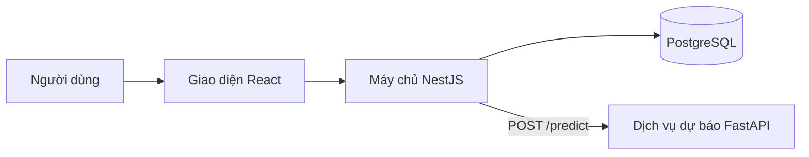
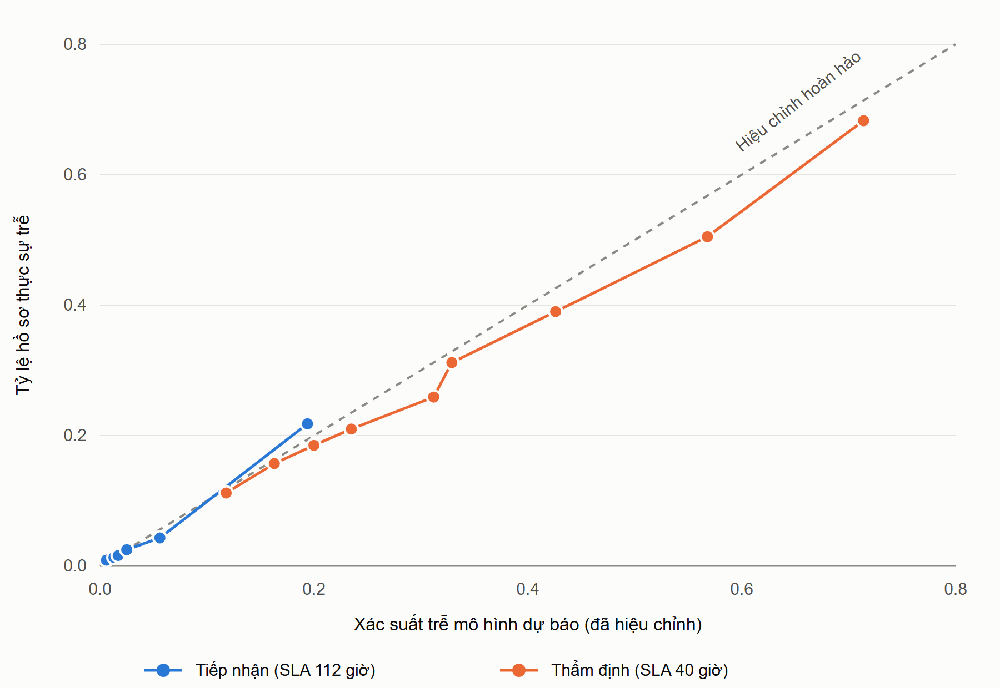
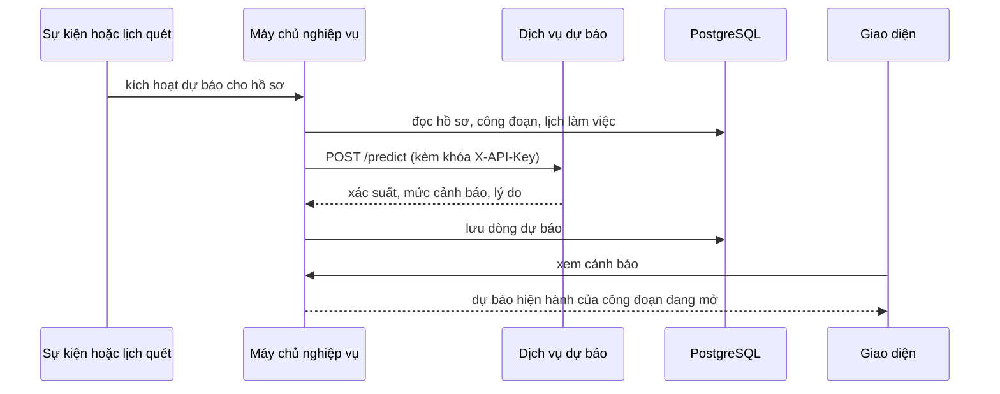

# CHƯƠNG 5. HIỆN THỰC HỆ THỐNG VÀ GIẢI PHÁP DỰ BÁO HỒ SƠ CHẬM HẠN

> Ghi chú (xóa trước khi nộp): **[SẼ BỔ SUNG SAU]** = phần đánh giá chưa chạy; **[CHỤP ẢNH]** / **[VẼ HÌNH]** = hình cần làm; số [1] là tài liệu tham khảo của chương, cần đánh lại số cho khớp danh mục chung của KLTN. Số liệu lấy từ `metrics_v4.json` và `ml-service/README.md`.

## 5.1. Công nghệ sử dụng

Hệ thống gồm ba thành phần chạy độc lập, giao tiếp qua HTTP và được đóng gói bằng Docker Compose (Bảng 5.1, Hình 5.1).

**Bảng 5.1. Công nghệ sử dụng**

| Thành phần | Công nghệ | Vai trò |
|---|---|---|
| Giao diện | React 18, TypeScript, Vite | Cổng nhân viên và cổng doanh nghiệp |
| Máy chủ nghiệp vụ | NestJS, Prisma | Quy trình vay, phân quyền, tính SLA, gọi dự báo |
| Cơ sở dữ liệu | PostgreSQL 16 | Hồ sơ, công đoạn, tờ trình, kết quả dự báo |
| Dịch vụ dự báo | Python, FastAPI, scikit-learn | Nạp mô hình và trả xác suất trễ SLA |

Phần dự báo được tách thành dịch vụ riêng vì thư viện học máy trưởng thành nhất nằm ở Python, trong khi máy chủ nghiệp vụ viết bằng TypeScript. Cách tách này còn giúp hệ thống chịu lỗi: khi dịch vụ dự báo tắt, nghiệp vụ vay vẫn chạy bình thường. Phiên bản scikit-learn được ghim cố định vì tệp mô hình phụ thuộc phiên bản thư viện lúc huấn luyện.

**[VẼ HÌNH] Hình 5.1. Kiến trúc các thành phần**

## 5.2. Giải pháp dự báo hồ sơ chậm hạn

### 5.2.1. Bài toán và dữ liệu

**Bài toán.** Mỗi hồ sơ vay đi qua các công đoạn, mỗi công đoạn có hạn xử lý chuẩn (SLA) tính bằng giờ làm việc của ngân hàng (hiện hành: Tiếp nhận 112 giờ, Thẩm định 40 giờ). Quản lý không thể theo dõi từng hồ sơ, nên hệ thống dự báo hồ sơ nào có nguy cơ vượt SLA để can thiệp *trước khi* trễ thật. Hình thức hóa: cho đặc trưng hồ sơ $x$, số giờ đã dùng $e$ và hạn $S$ ($e < S$), cần ước lượng $p = \Pr(T > S \mid x, e, S)$ với $T$ là tổng giờ công đoạn sẽ tiêu tốn. Đây là bài toán phân loại nhị phân. Hồ sơ đã có $e \ge S$ được xác định là *quá hạn* bằng quy tắc tất định, không qua mô hình. Mô hình chỉ cảnh báo nguy cơ trễ, **không** chấm điểm tín dụng và không thay quyết định của con người.

**Dữ liệu.** Hệ thống chưa vận hành thực tế nên chưa có lịch sử xử lý hồ sơ. Vì vậy dữ liệu được **sinh bằng bộ mô phỏng** gồm 20.000 hồ sơ (hạt giống cố định, chạy lại cho kết quả giống hệt). Các tham số mô phỏng có ba nguồn: hình dạng phân phối thời gian chờ rút từ bộ nhật ký xử lý hồ sơ vay thật BPI Challenge 2012 [1]; quy định của chính hệ thống (trần hạn mức 10 tỷ đồng, các giá trị ngành); và các giả định của nhóm chưa được cán bộ tín dụng thực xác nhận. Mô phỏng cố ý giấu ba biến (tốc độ cán bộ, tốc độ Thẩm quyền, độ phức tạp thực của hồ sơ) khỏi mô hình để kết quả không cao giả tạo.

Vì mô hình được gọi ở nhiều thời điểm của cùng một hồ sơ, mỗi hồ sơ sinh nhiều dòng "ảnh chụp": lúc vào công đoạn, khi có sự kiện (bổ sung, làm rõ) và đầu mỗi ngày làm việc. Kết quả là 106.705 dòng cho Tiếp nhận và 83.629 dòng cho Thẩm định.

Nhãn của mỗi dòng là "tổng giờ cuối cùng của công đoạn có lớn hơn SLA hay không". Nhãn được gán theo một mức SLA lấy ngẫu nhiên từ một lưới (Tiếp nhận 24–128 giờ, Thẩm định 16–80 giờ), nên SLA là một đầu vào của mô hình. Nhờ đó khi quản trị viên đổi định mức SLA trong lưới, hệ thống không phải huấn luyện lại. Dữ liệu được chia 70/15/15 theo **hồ sơ** (không theo dòng) thành tập huấn luyện, kiểm định và kiểm tra, để các ảnh chụp của cùng một hồ sơ không rơi vào hai tập khác nhau. Bộ dữ liệu đạt 31/31 phép kiểm tra chất lượng tự động (không trùng mã, không rò rỉ giữa các tập, miền giá trị hợp lệ…); phép kiểm tra này chỉ bảo đảm dữ liệu nhất quán, không bảo đảm giống ngân hàng thực.

Đặc trưng đầu vào gồm thông tin hồ sơ và doanh nghiệp (số tiền, thời hạn vay, ngành, số năm hoạt động, doanh thu, dư nợ hiện có, tài sản bảo đảm), ba đại lượng thời gian (đã dùng, SLA, còn lại), và đặc trưng vận hành riêng từng công đoạn (Bảng 5.2).

**Bảng 5.2. Đặc trưng vận hành riêng từng công đoạn**

| Công đoạn | Đặc trưng |
|---|---|
| Tiếp nhận | Số vòng bổ sung đã có, số tài liệu chờ kiểm tra, số hồ sơ cán bộ đang giữ |
| Thẩm định | Số vòng bổ sung ở Tiếp nhận, giờ đã tốn ở Tiếp nhận, độ dài hàng chờ, số Thẩm quyền hoạt động, số lần làm rõ, có yêu cầu làm rõ đang mở |

### 5.2.2. Xây dựng mô hình

Giải pháp dùng **hai mô hình**, mỗi công đoạn một mô hình, vì tập đặc trưng khác nhau. Mỗi công đoạn thử hai thuật toán là Logistic Regression và Gradient Boosting, rồi chọn thuật toán có log-loss thấp hơn trên tập kiểm định (Bảng 5.3). Chênh lệch giữa hai thuật toán nhỏ, phản ánh dữ liệu mô phỏng ít cấu trúc phi tuyến phức tạp.

**Bảng 5.3. Chọn thuật toán theo log-loss trên tập kiểm định**

| Công đoạn | Logistic Regression | Gradient Boosting | Được chọn |
|---|---|---|---|
| Tiếp nhận | 0,3738 | 0,3638 | Gradient Boosting |
| Thẩm định | 0,4557 | 0,4585 | Logistic Regression |

Đầu ra của mô hình được **hiệu chỉnh bằng hồi quy đẳng điệu (isotonic)** để con số phản ánh gần đúng xác suất thực (0,6 ứng với khoảng 60% hồ sơ thực sự trễ), vì người dùng đọc nó như một xác suất. Xác suất sau đó được chuyển thành mức cảnh báo bằng hai ngưỡng: **Chú ý** từ 0,35 và **Khẩn** từ 0,60. Riêng Thẩm định không dùng mức Chú ý vì ở mức này độ chính xác chỉ khoảng 41% và báo nhầm gần 30% hồ sơ đúng hạn. Mỗi cảnh báo kèm tối đa ba lý do, tính bằng cách thay từng yếu tố bằng giá trị điển hình rồi xem xác suất giảm bao nhiêu; đây là giải thích "mô hình dựa vào gì", không chứng minh quan hệ nhân quả.

**Kết quả.** Để biết thông tin hồ sơ có thật sự đóng góp, mô hình được so với một *đường cơ sở* chỉ biết ba đại lượng thời gian. Kết quả đo trên tập kiểm tra (15% hồ sơ chưa dùng khi huấn luyện), ở cấu hình đang chạy, nêu ở Bảng 5.4.

**Bảng 5.4. Kết quả trên tập kiểm tra (dữ liệu mô phỏng)**

| Chỉ số | Tiếp nhận (112 giờ) | Thẩm định (40 giờ) |
|---|---|---|
| AUC mô hình / đường cơ sở | 0,824 / 0,797 | 0,720 / 0,687 |
| Brier mô hình / đoán theo tỷ lệ chung | 0,0280 / 0,0353 | 0,1765 / 0,2048 |
| Mức Khẩn: độ chính xác / bắt được ca trễ | 78,4% / 76,3% | 57,7% / 86,5% |
| Mức Khẩn: báo nhầm hồ sơ đúng hạn | 0,3% | 13,7% |
| AUC ngay lúc vào công đoạn | 0,557 | 0,634 |

Có ba nhận xét. Thứ nhất, mô hình hơn đường cơ sở khoảng 0,03 AUC, nghĩa là phần lớn sức dự báo đến từ đồng hồ SLA, thông tin hồ sơ đóng góp khiêm tốn. Thứ hai, ngay lúc hồ sơ vừa vào công đoạn mô hình gần như không phân biệt được; giá trị tăng dần khi hồ sơ tiến triển. Thứ ba, ở Tiếp nhận chỉ có 38 hồ sơ trễ trong tập kiểm tra nên các tỷ lệ của công đoạn này có nhiễu lớn.

*Hình 5.2. Đường hiệu chỉnh xác suất trên tập kiểm tra: xác suất mô hình dự báo (trục ngang) so với tỷ lệ hồ sơ thực sự trễ (trục dọc). Càng sát đường chéo càng đáng tin.* Cả hai công đoạn bám sát đường chéo; Thẩm định hơi nằm dưới đường chéo ở xác suất cao (mô hình dự báo nhỉnh hơn thực tế khoảng 3–6 điểm phần trăm).

**[SẼ BỔ SUNG SAU]** So sánh với các thuật toán khác và luật ngưỡng, lặp nhiều hạt giống, khoảng tin cậy cho AUC, thí nghiệm bóc tách thành phần, đo độ trễ dự báo.

### 5.2.3. Tích hợp và cảnh báo

**Luồng tích hợp.** Khi có sự kiện (hồ sơ chuyển công đoạn, trình tờ trình, yêu cầu làm rõ, bổ sung chứng từ, điều chuyển cán bộ) hoặc đến lượt quét định kỳ lúc 08:00 và 13:00 mỗi ngày làm việc, máy chủ nghiệp vụ tính các đặc trưng từ dữ liệu vận hành rồi gọi dịch vụ dự báo (Hình 5.3). Giờ đã dùng được tính theo lịch làm việc và trừ thời gian chờ doanh nghiệp; SLA lấy từ định mức đang áp dụng của công đoạn. Kết quả được lưu thành một dòng mới trong bảng `delay_predictions` (hồ sơ, thời điểm, mức rủi ro, xác suất, lý do, phiên bản mô hình).

**[VẼ HÌNH] Hình 5.3. Luồng dự báo**

**Các quy tắc an toàn.** Dịch vụ dự báo xử lý ba trường hợp đặc biệt: hồ sơ đã quá hạn thì trả ngay mức Quá hạn (không dùng mô hình); SLA ngoài lưới đã học thì từ chối, hệ thống coi là "chưa dự báo" chứ không ngoại suy; yêu cầu thiếu hoặc sai khóa bị từ chối. Khi dịch vụ dự báo lỗi hoặc tắt, nghiệp vụ vay vẫn chạy bình thường và lỗi chỉ được ghi nhật ký. Thao tác lặp lại không sinh dự báo trùng.

**Hiển thị.** Để tránh cảnh báo sai, giao diện chỉ hiện dự báo *hiện hành*: do mô hình phiên bản hiện tại tạo, thuộc đúng công đoạn đang mở và tạo sau lúc hồ sơ vào công đoạn đó. Trạng thái Quá hạn do máy chủ tính theo thời gian thực và xếp lên đầu danh sách. Quản lý và Thẩm quyền xem bảng cảnh báo toàn chi nhánh; cán bộ tín dụng xem cảnh báo của hồ sơ mình phụ trách; doanh nghiệp không thấy dữ liệu dự báo. Cảnh báo chỉ nhắc người điều phối, không tự đổi trạng thái hồ sơ.

**[CHỤP ẢNH] Hình 5.4. Bảng cảnh báo sớm của Quản lý và cảnh báo trong chi tiết hồ sơ.**

**Kiểm thử.** Phần tích hợp được kiểm thử tự động (quy tắc hiển thị, các thời điểm kích hoạt, cách đếm Thẩm quyền, lập lịch quét; toàn bộ 427 kiểm thử của máy chủ đạt ở lần chạy cuối) và kiểm chứng trên hệ thống đang chạy: dịch vụ dự báo bật và tắt, khóa đúng và sai, dự báo được sinh khi tạo hồ sơ, yêu cầu làm rõ và nộp lại tờ trình. **[SẼ BỔ SUNG SAU]** bảng kịch bản kiểm thử tích hợp.

**Hạn chế.** (1) Toàn bộ số liệu đo trên dữ liệu mô phỏng, chất lượng với hồ sơ thực chưa biết, và các tham số giả định chưa được cán bộ thực xác nhận. (2) Năng lực dự báo khiêm tốn so với đường cơ sở. (3) Báo nhầm ở Thẩm định còn cao. (4) Huấn luyện chỉ với 2 hoặc 3 Thẩm quyền nên số lượng khác là ngoại suy. (5) Số tài liệu chờ kiểm tra ở Tiếp nhận chỉ là xấp xỉ vì hệ thống chưa lưu số lượng. (6) Dự báo phụ thuộc lịch làm việc đã nạp. Hướng phát triển là thu thập dữ liệu vận hành thực của chi nhánh để huấn luyện lại, hiệu chỉnh ngưỡng và đánh giá tác động của cảnh báo lên tỷ lệ hồ sơ trễ thực tế.

## Tài liệu tham khảo

[1] B. F. van Dongen, "BPI Challenge 2012," 4TU.ResearchData, dataset, 2012. doi: 10.4121/uuid:3926db30-f712-4394-aebc-75976070e91f. [Online]. Available: https://data.4tu.nl/articles/_/12689204/1
